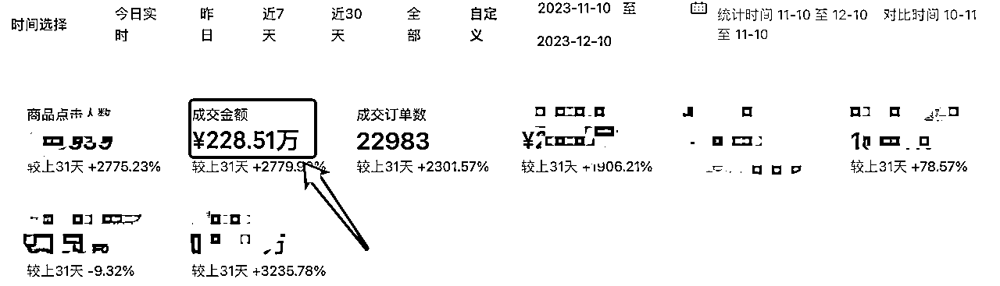
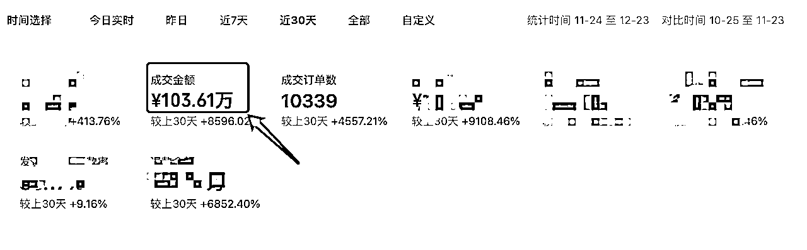
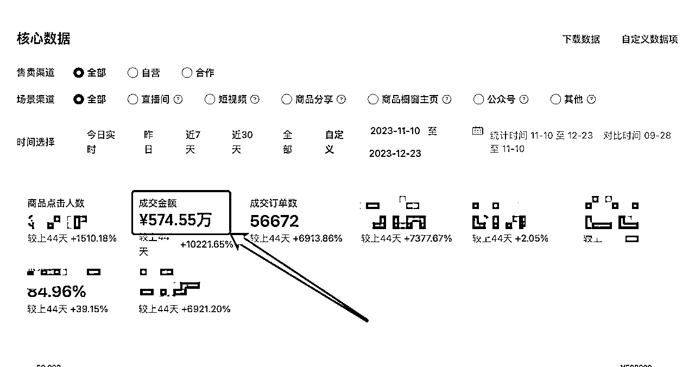
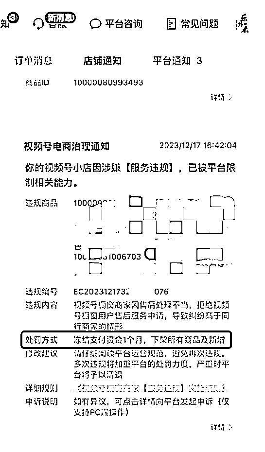
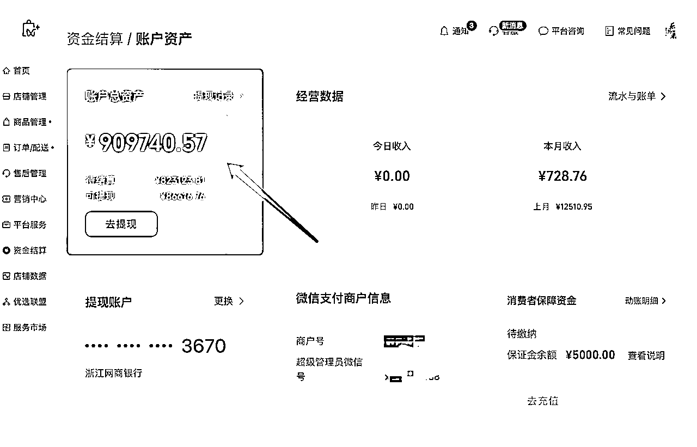

# 货款被冻100万之后，我终于想明白了这些事

大家好，我是晋四喜，赚钱圈的老朋友了。我现在主要做微信视频号小店，类目集中在生鲜和中医图书，同时也在跑无卡支付相关项目。今天写这篇文章，是想聊聊最近视频号小店这轮大调整给我带来的触动。与其说是“惨痛教训”，不如说是一次让我重新审视生意逻辑的转折点。

## 1、先说说近期的视频号战绩

这段时间如果你在做视频号直播，并且用微信豆投流拉量，应该能感受到整个盘子的GMV有多夸张。下面这几组数据，是最近合作项目的真实情况。

需要说明的是，这个成绩并不是我自己的团队在直播间里播出来的，而是我和一位认识了两年的赚钱圈友合作完成的。他家做直播，我家做店铺后端。我们是今年11月10日开始配合，前后跑了40天，实际正常开播时长加起来还不到一个月。我这边负责店铺所有后端操作，再加上投流资金的加持；他那边负责前端直播。两边优势一互补，原本月销大概百万出头的盘子，直接被拉高了好几个量级。

## 2、该来的黑天鹅还是来了

生意哪有一直顺风顺水的道理，我们很快撞上了第一只黑天鹅。

12月17日，我的一个视频号小店收到违规处罚，接近100万的货款被冻结了30天。能试的申诉渠道都试了，能用上的办法也都用了，最终还是只能等时间到期。

这笔钱虽然没让现金流伤筋动骨，但足够让我后背发凉——视频号不能再靠粗放打法混了，精细化运营已经不是选择题，而是必答题。

## 3、所有做视频号小店的商家，请认真看完这一段

为了不让同样的事再发生，我和团队把视频号官方的规则一条条拆开研究了一遍。下面这几个点，是做后端最容易踩的坑，以及对应的顶格处罚：

1. 发布超出店铺资质范围的商品：店铺会被降级、重新命名，最严重的情况下，橱窗暂停使用30天。
2. 服务违规：包括客服不达标、发货不达标、售后不达标、商责不达标、纠纷介入不达标、商品品质不达标等。平台最高可以禁止提现30天，同时扣除违规所得、违约金、保证金，严重者直接清退。日常规避方式就是做好好评维护，并电话沟通客户修改售后类型。
3. 虚假交易：补单、补好评都容易触发，严重时封掉主账号橱窗。
4. 质量抽查：商责率、品退率一旦掉到行业末尾5%-10%，最严重会永久封禁橱窗。
5. 信用分相关：一定要尽量避免罚款类处罚，这是当前平台的重点考核项。

把这些顶格处罚写出来，是想和大家说一个结论：售后和品控就是平台当前划出的红线。我们做任何业务，都要先预判最坏的结果，再决定怎么行动、怎么设风险预警。

下面这几个官方规则链接，建议所有做视频号的人收藏起来，并且定期回看。很多规则会在原版基础上悄悄调整，不看很容易吃亏。

| 序号 | 规则名称 | 链接 | 备注 |
|---|---|---|---|
| 1 | 视频号带货公告与规则 | https://channels.weixin.qq.com/commerce/#/noticeList | 总合集 |
| 2 | 视频号橱窗-【商家信用分】 | https://support.weixin.qq.com/cgi-bin/mmsupportacctnodeweb-bin/pages/eSJSFJmG9Cqhr2SB | 信用分（扣罚相关） |
| 3 | 视频号橱窗-【达人信用分】指引 | https://support.weixin.qq.com/cgi-bin/mmsupportacctnodeweb-bin/pages/lpKlEroy4iyRPQyd | 信用分（扣罚相关） |

帖子发出后，很多圈友都在问怎么合理避坑。我的建议很实在：

1. 售后问题能电话沟通就别只发文字。出现品退的时候，尽量和用户协商修改退款理由。记住，先处理情绪，再处理事情，态度一定要好。
2. 纠纷类问题不要和用户死磕对错。如果损失可以接受，就让对方撤诉，走线下退款解决，能有效降低纠纷率。
3. 每天都要盯DSR评分。品质、售后、纠纷这几项指标一旦异常，特别是体量已经很大的时候，很容易被官方重点关注，后果会很严重。
4. 定期安排补单和补好评，用来对冲差评率。
5. 物流信息要定期跟踪，特别是异常订单。可以把订单导出到猪猪快递云：https://yun.zhuzhufanli.com/?preuid=252328 ；也可以用服务市场里的芝麻小客服，就是价格小贵，1280元一个店/年。

把上面这些基础动作做好，想被冻结真的很难。

其实2023年我们公司一直处在增长期，但我整年都如履薄冰。我脑子里反复在想两个问题：

第一，增长过程中，有没有我还没意识到的风险？如果有无法解决的潜在风险，我能不能承受后果？
第二，怎么让公司业绩变成一条可持续向上的曲线，而不是昙花一现？

## 4、黑天鹅逼我做了一次团队升级

如果是以前，这件事可能翻过去就翻过去了。但12月20日半夜四点，我猛然惊醒。想到团队最近为了应对平台调整，配合度非常高，而我做电商也有两年多了，完全可以借这次平台洗牌的机会，给团队来一次真正的升级。

公司原本有基础的建制和人员配置，但业绩一直没有太大起色，优化效率也很低。说白了，就是一个披着公司外壳的工作室。现在是打胜仗的时候，员工心气最高，正是鱼跃龙门的好时机。

我陆续做了这些调整：

### 公司架构与企业文化基因

a. 人员虽然不多，但在成本合理的前提下增岗增员，把门店运营、直播商务、售后客服、供应链管理等岗位的职责拆细，做到专事有专人负责。

b. 继续保持扁平化管理，但沟通效率必须提上来。沟通成本是一个公司最大的成本。我用企业微信作为管理工具，教员工用文字高效表达，并且要考虑对方是否容易理解。这个习惯是我在赚钱学会的：链接别人时尊重对方的时间，一句话能讲清的绝不说两句，但该说的关键信息一条也不能漏。毕竟5分钟都说不清的事，给半小时大概率也说不清。

c. 越是打胜仗，越要防骄傲。我反复和团队说，我们现在处在鱼跃龙门的阶段，大家要一起发力冲过去，同时要不断提升个人能力。不然等公司真的跃上去了，个人能力跟不上，既会被淘汰，也享受不到战果。好在现在团队伙伴都特别愿意尝试新东西。

### 人力资源与培训体系

a. 招人这个动作绝不能停，哪怕现在不缺人，也要一直招。人不是培养出来的，是筛选出来的——这是涛哥教我的，我自己也深有体会。我直接给HR下了要求：每个月必须完成多少到面和试岗人次。

b. 新员工有固定入职培训，老员工有业务能力升级培训。让HR和员工逐一沟通，梳理出一套相对固定的培训课件，然后我再优化调整。这个意识，是我刚出社会在手机连锁店当店长时就建立起来的。培训和考试的价值，贯穿了我整整13年的创业经历。

### 团队协同与OKR

我有开周会和月会的习惯，但以前安排完工作后，经常跟进不及时，导致效率偏低。后来用企业微信的OKR协同工具，所有任务的进度都能被追踪，明显顺畅了很多。

### 财务体系

a. 财务是最重要的一件事。钱没管好，其他做得再多都白搭。公司的一切运作，最终都要落到财务目标上。以前我做手机零售店的时候，账面算出来是赚钱的，但钱就是不知道去哪了。最近两年我才真正明白，账要清楚，钱也要清楚。公司所有财务都要对得上：钱出去了，东西就要回来。应收应付、待结算和已结算货款、投放资金、云仓费用、发货损耗，这些都必须算明白、对得上。

b. 税筹规划一定要做。合理规避不必要的税务开支，但该交的税一分也不能少。这不只是为了规避稽查风险，还要考虑公司以后继续壮大的资金需求。缴税标准越规范，以后去银行贷款就越容易，融资成本也能降下来。

为什么能想到这些？很大程度上要感谢早期做手机连锁店的管理经验，以及过去三年读过的企业管理书籍。到了那个阶段，知识好像一下子全涌出来了。

## 5、2023年的思考与总结

2023年，我打破了一些认知上的束缚，找到了属于自己的那把“钥匙”。把这些思考分享出来，希望能对大家有启发。

### 积极链接，找对人学习

想做成一件大事，最直接的办法就是找到在这件事上已经拿到结果的人。你遇到过的大部分问题，他都大概率遇到过，他给你的建议会比门外汉中肯很多。我做电商三年多，认识了很多优秀的朋友，每个阶段遇到问题都能很快找到答案，基本都靠他们帮忙。

### 认清优劣势，再做决策

过去几年，我做短视频带货、后端店铺、直播带货、引流变现，都不同程度拿到过结果。但我真正能全身心投入、并且愿意持续迭代的，只有后端店铺和引流变现。短视频和直播虽然踩中过风口，也赚到过钱，但并不长久。我看直播不会超过半小时，但研究后端店铺和引流优化会特别兴奋。

今年把短视频和直播团队砍掉之后，团队专心做店铺后端和支付引流业务，反而一路顺风顺水。

我也重新盘了一下自己在电商业务上的优势：

a. 团队擅长视频号后端店铺运营，有两年视频号电商运营经验，熟悉平台玩法和调性，能够灵活应对平台周期下的各种问题，目前有15家视频号小店。

b. 资金体量足够。自有资金在1000万左右，外部可调配资金也在1000万左右，可以支撑直播团队的货款和投放需求。

c. 后端团队配置完整，店铺运营、BD、短视频、客服都是经验丰富的老将，能稳稳支撑前端发展。

d. 在生鲜食品和图书类目的供应链、云仓等第三方对接上经验丰富，能有效优化商品成本，让大家的利润更大化。

定位清晰之后，阶段性结果很快就来了。这里也顺便找一个有放大业务需求的直播团队，探讨一下赚钱大计。V：xsd9092。

### 互联网有记忆，珍惜羽毛

这句话虽然是老生常谈，但我今年受益特别深。过去十年在线下积累的声誉，让股东无条件信任我；过去三年在线上积累的口碑，让朋友连抵押都没要，直接转了200万给我做资金拆借。

### 所有的努力都不会白费

不管是过去十来年经营手机连锁店的经验，还是这几年看过的书、写过的文章，又或者是贷款中介公司的背景，还是各种项目的试错，其实都在不断成就现在的我。所以，勇敢去经历吧，你总会在未来某个瞬间发现，曾经的努力全都算数。

### 树立正确的金钱观

这一点我要放在最后说，因为它卡住了很多有能力但赚不到钱的人，也卡住过曾经的我。

很多个人能力强的人，在没赚到钱之前，都喜欢把道德底线绷得很高，俗称“孔乙己的长衫”。因为只有这样，才能给自己没赚到大钱找一个体面的归因，才不会否认自己。但真相往往是对财富的认知不够。想赚钱就别分黑白，想赚大钱就别有道德负担。

赚到第一个100万之前，只要不犯法，理论上你可以不择手段，但我还是不建议用羽毛去换。钱的来源无非是：掠夺、交换、剥削、垄断、受赠。如果你身在底层，赚钱只能从掠夺开始。什么叫掠夺？就是合法地把别人的钱拿过来，变成自己的钱。掠夺能力越强，你越有钱；掠夺能力越弱，你越没钱。这是今年年初让我猛然醒悟的一句话，也贯穿了我一整年。

当然，如果那时候你觉得自己能力还不够，就一定要扎根苟住，别乱投资，不打无把握的仗，慢慢补课，这样才不至于重新跌下去。

用金钱观来压轴，是因为我认为它束缚了太多人。幸运的是，我现在已经想通了，也终于找到了自己的答案。

2023年已经接近尾声，希望大家今年都收获满满。我们2024年见，一起龙哥盟！