# AI辅助做私域，月入30万+，我把整套经验复盘讲清楚

大家好，我是龙哥，00后，创业第三年，目前所有探索都围绕AI展开。上个月，我在赚钱分享了AI线上兼职项目的复盘，意外被龙哥大大加了精华。也就是从那时候起，我开始琢磨：能不能每个月都把自己做的项目沉淀成一篇复盘，定期输出？

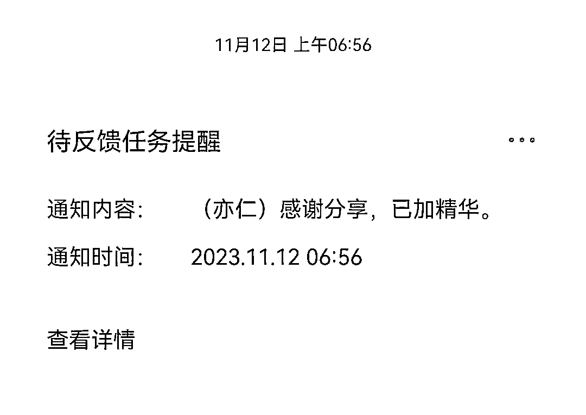

有这个想法之后，我马上就开始动笔。这篇文章主要讲我12月私域项目的完整拆解，当月收入已经突破30万，目前实际是34万；同时也会聊聊我对AI辅助、AI应用的一些最新理解和真实操作。如果内容对你有一点启发，点赞支持就是对我最好的鼓励。

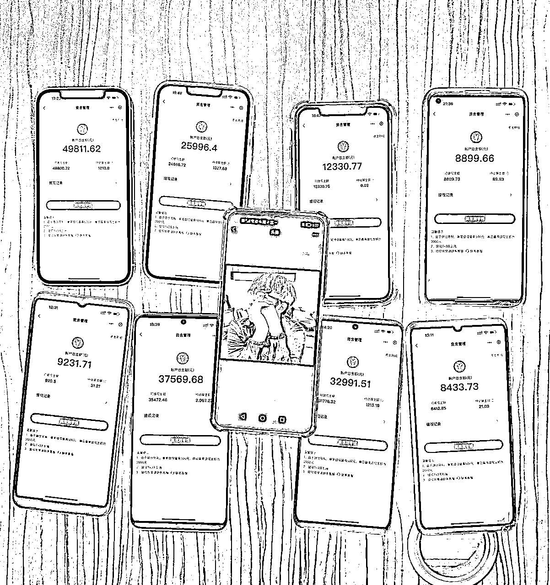

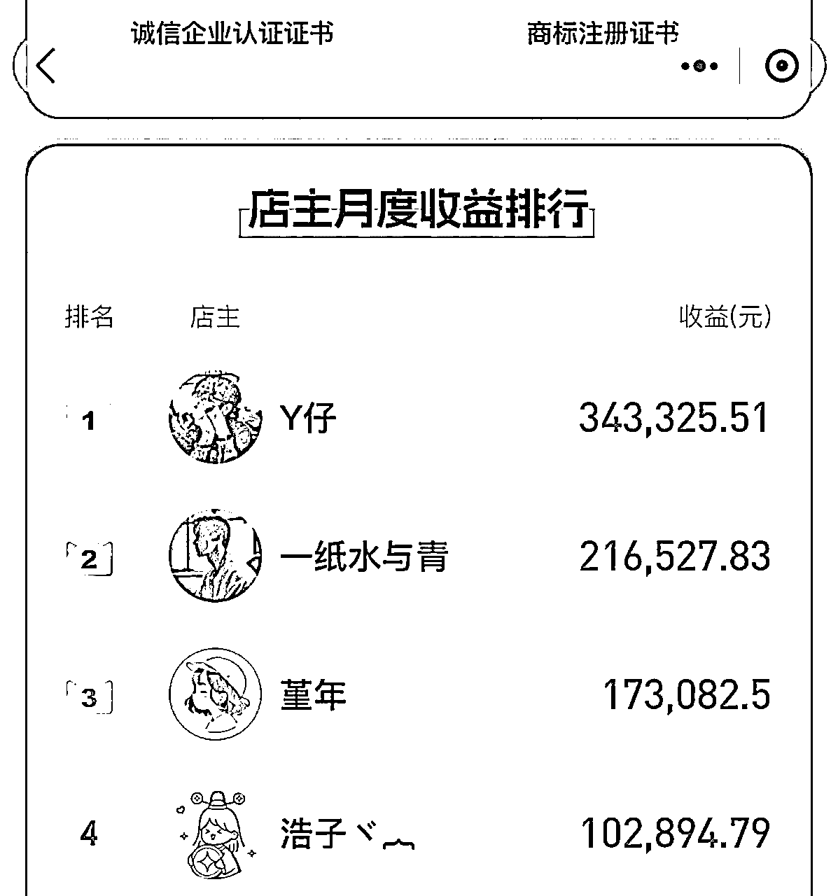

这个项目其实是今年2月启动的。当时做它的目的很纯粹：把手头积累的私域流量做一次变现。说实话，我当时完全没想到，10个月后，AI辅助能让这个项目的利润直接翻倍，甚至成为我的主营业务。

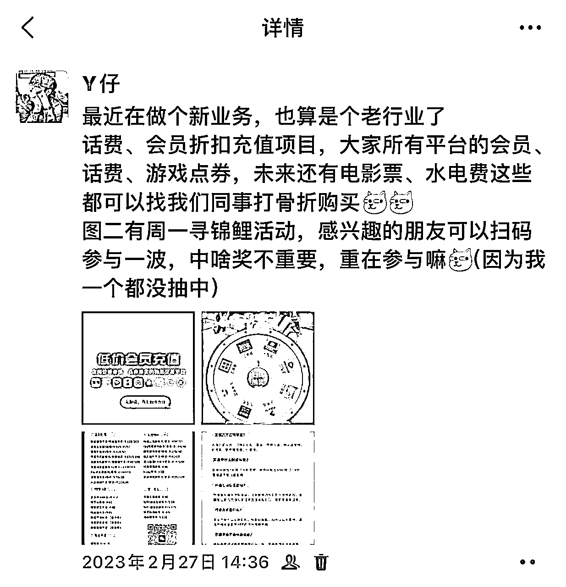

项目名字叫“卡老板”，做这个项目的是我一位朋友（赚钱编号1900+的大佬），公司实力很强。也正是因为信任他的背景，我很早就入了局，而且一直做到现在。

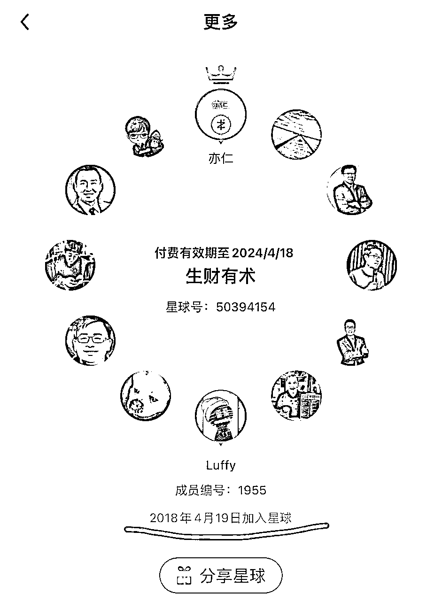

卡老板的逻辑并不复杂：用户能在平台买到各类折扣商品，也可以申请成为合伙人，推广产品赚佣金；如果还能拉来新合伙人，同样有奖励。最早平台主要就是话费充值和会员充值，在我眼里，它更多是个引流+变现的小工具。直到11月，官方做了一次大改版，把话费、电费、燃气、电影票、外卖、打车、快递、加油、餐饮折扣、购物返利等一堆生活刚需服务全部打通，整合进同一个产品。

具体细节如下：

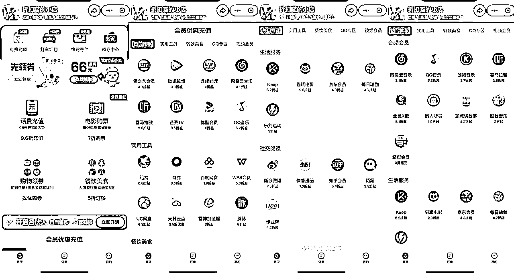

同时，原本298元的加盟费被设计成一层分销：每邀请一个合伙人，直接拿200元奖励。

这两个变化叠加在一起，让我彻底改变了对它的定位：从“辅助引流的小项目”，升级成“适用面广+利润够高+能裂变”的私域变现项目。而这类项目，恰好是我一直在等的机会。

## 一、私域折扣充值的机会点在哪？

我从17岁（2019年）就开始做微商，卖过电子烟和球鞋，后来因为行业被禁和各种打击，就没再做下去。创业之后，我一直在折腾各种私域，长期短期都碰过。

说实话，CPS充值这类项目很早就有，但我一直没动手，原因绕不开一个点：想赚到钱就只能走量，然后卷价格、拼低价、拼福利，拼得越狠利润越薄，最后靠巨大的量堆出收益；一旦量上不去，就会非常难受。这种拼资源和获客手段、必须一刻不停干活的项目，我骨子里是抗拒的。

我一直做知乎好物出身的，更偏爱有长尾效益、睡醒就能看到后台进账的模式。卡老板刚好就是这种感觉，这也是它跟其他CPS充值项目最大的区别——我现在每天睁开眼，后台都有源源不断的新订单，体验跟当年做知乎好物很像。

具体机会点有四：

### 1. 三率高，用户容易锁定
和传统CPS充值项目比，卡老板的转化率、使用率、复购率都更高。用户一旦被锁定，后面只需要持续引导他省钱，不需要反复教育。

### 2. 产品覆盖面广，用户习惯更容易养成
很多CPS项目只有单一产品，用户没有留存理由；卡老板覆盖的是话费、电费、燃气、电影票、会员、外卖、打车、快递、加油、餐饮折扣、购物返利等高频刚需，受众几乎人人需要。

### 3. 合伙人供货价接近成本，红利期明显
传统CPS的利润基本都在产品差价上，比如话费：成本0.93折，供货0.95折，一单只赚0.02折。卡老板给合伙人的推广商品走的是成本价路线：话费0.91折，燃气0.9折，电费0.94折，电影票7折，对多数人来说很有吸引力。官方愿意放出利润，本质是为了吸引更多人推广，这种项目前期一般都存在红利。

### 4. 收入来源不止一种
传统CPS只有卖产品这一条路；卡老板给合伙人的路径有两条：推广产品赚差价，以及推广合伙人赚奖励。我的打法很简单：先用折扣话费、电费、电影票、外卖这些产品做引流，把用户留在私域里；再用“推广合伙人”这个产品去创造高额利润。一句话概括：产品负责引流，合伙人负责赚钱。

## 二、我为什么会选这个项目？

选择它，是多个维度综合判断的结果。

第一，性价比最高。对内，合伙人供货价足够低，既能维持不错利润，又能让用户记住我；对外，我还能拿这些产品当钩子，去公域引流打粉。

第二，受众够广。生活服务类产品没有人群限制，只要想省钱就会关注。更重要的是，发这类内容不需要多强的IP属性，把产品优势讲清楚就够了。

第三，推广门槛足够低。店主开通后，最基础的推广就是发朋友圈，图片和文案AI就能批量生成，店主照着发完全没问题。

这几点，刚好又踩中了我之前精华帖里写的AI项目公式：

产品卖点足够吸引人 + 可复制的AI提效方法 + 下沉市场洞察 = AI项目

## 三、收益逻辑拆解

卡老板项目的主要收入有两块：

一块是产品佣金。每单能赚0.5元到12元不等，外卖返利低的可能一单只有0.5元，话费返利高的能到11元。

另一块是拉新奖励。每邀请一个合伙人，就赚200元，天然适合手里有私域池子、或者在找项目的人。

拿我自己的数据来说：产品佣金部分累计约19万，对应8万个订单；拉新奖励部分约15万，对应750多位店主。两者比例大概55%对45%。我现在正在想更多办法，争取把拉新收益的占比继续往上拉。

## 四、AI辅助具体怎么落地？

当时我最核心的思考是：AI辅助一定要用在最省时间、效果最直观的地方。落在卡老板这个项目上，最合适的切入点就是私域运营；而私域运营里AI最能发力的，就是内容产出——朋友圈文案、图片、社群营销文案、推文、话术。

定了方向之后，我和团队立了一个规矩：所有内容都用AI辅助制作。我们不做别的，只做一件事：用AI把内容生产速度提上来，把时间省下来。

具体执行包括以下几块：

### 1. 朋友圈基础装修
店主正式开干前，先把朋友圈底子打好很重要。背景、头像、每条朋友圈的定位，执行的人必须清清楚楚，不然做出的内容很难产生好感。我们用GPT生成了官宣素材，再配合人工优化，最后形成了完整内容。

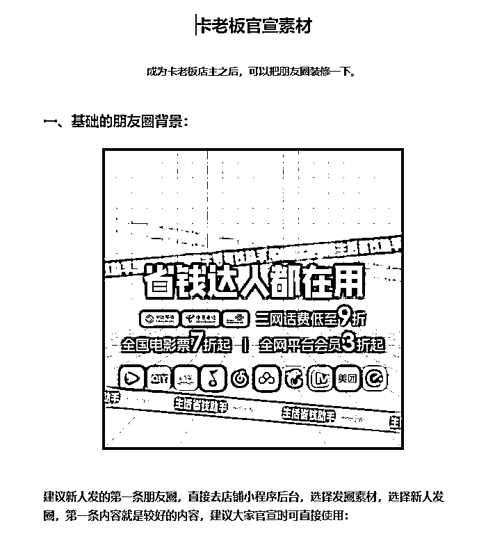

【腾讯文档】卡老板官宣素材
https://docs.qq.com/doc/DZFBzdnNFaFljdnBp

### 2. 成交话术梳理
成交话术要分两类：一类卖产品，一类转化合伙人。我们让GPT生成了两套底稿，再不断迭代打磨，最终沉淀出分别针对产品成交和合伙人转化的两套话术。

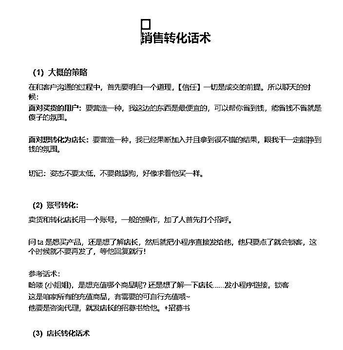

【腾讯文档】销售转化话术链接：
https://docs.qq.com/doc/DSnhZRG5Pc3hlQVhi

### 3. 每个账号每天至少3条朋友圈
有节奏地发朋友圈，是私域的基本功。我们也给合伙人准备了AI生成的内容。

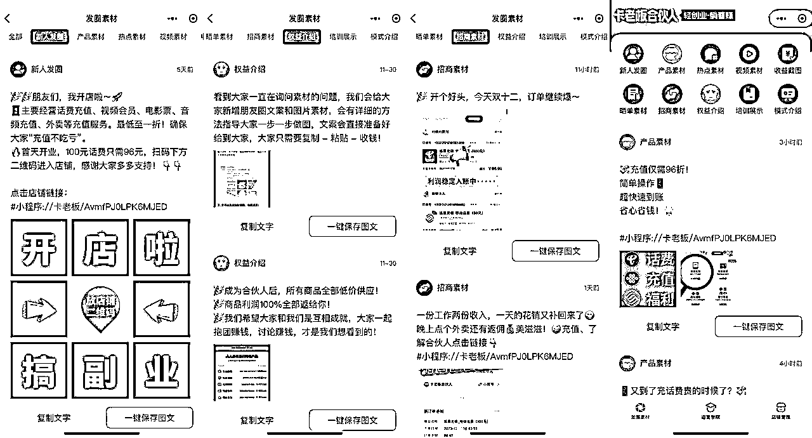

官方围绕朋友圈素材做了一个小程序，合伙人可以直接从后台拿素材；另外还配了一个“卡老板朋友圈文案生成器”，内容产出效率直接提升了80%。点下方链接就能体验：

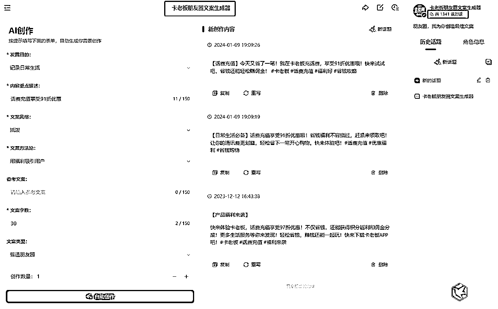

### 4. 体系化的朋友圈打法
我们让AI围绕卡老板产品生成了一套产品朋友圈策略，又围绕合伙人生成了一套合伙人朋友圈策略。

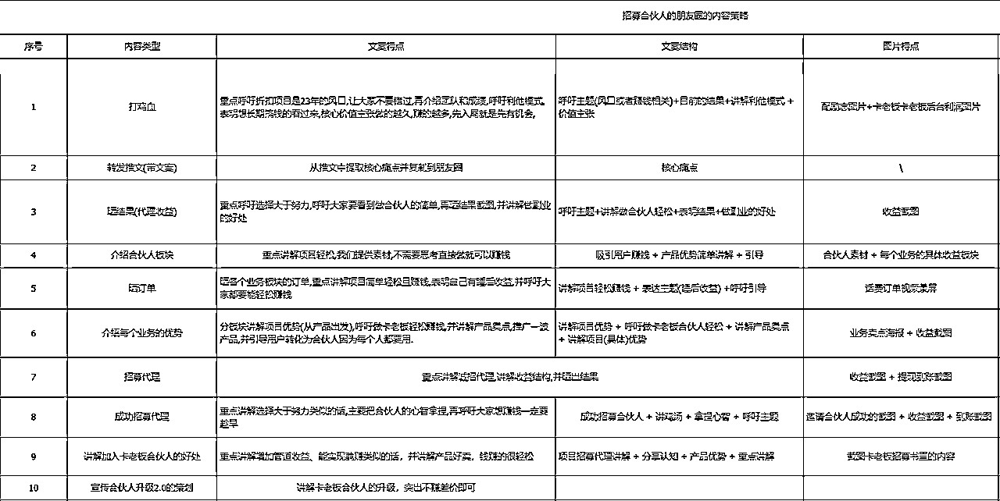

合伙人招募文档入口在这：

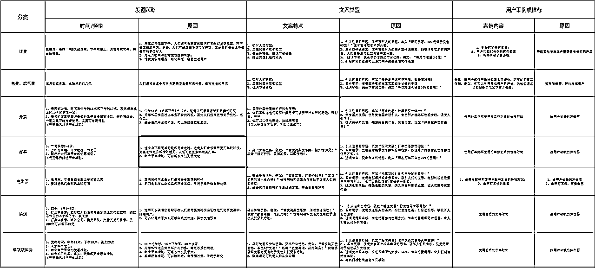

产品推广朋友圈文案策略也整理好了：

有了这套素材+策略，新加的用户翻几条朋友圈就能了解平台和产品；原有客户也能快速被触达，知道我们在做什么。

### 5. 群发话术
我们根据流量画像，让AI生成了一系列群发策略和话术初稿，再逐条打磨，最终沉淀出9套群发话术，用来精准触达粉丝。

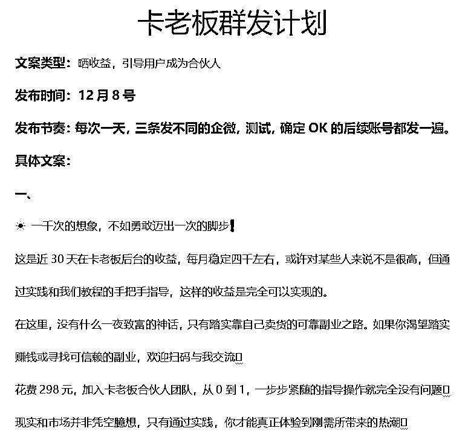

群发话术文档放在这里，感兴趣可以看：

### 6. 社群运营打法
把有意向但还在观望的用户拉进群，用AI提前准备好的社群转化话术，在群里完成成交。

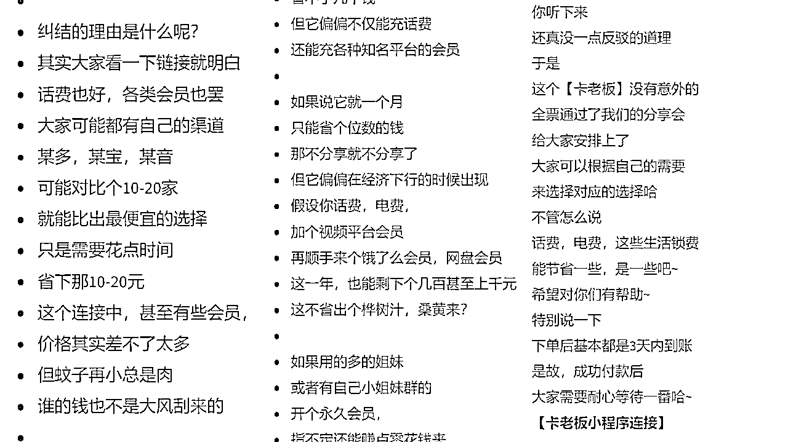

### 7. 三篇合伙人招募推文
用AI产出优质推文，自己先发，看到有效果后，马上同步给合伙人。

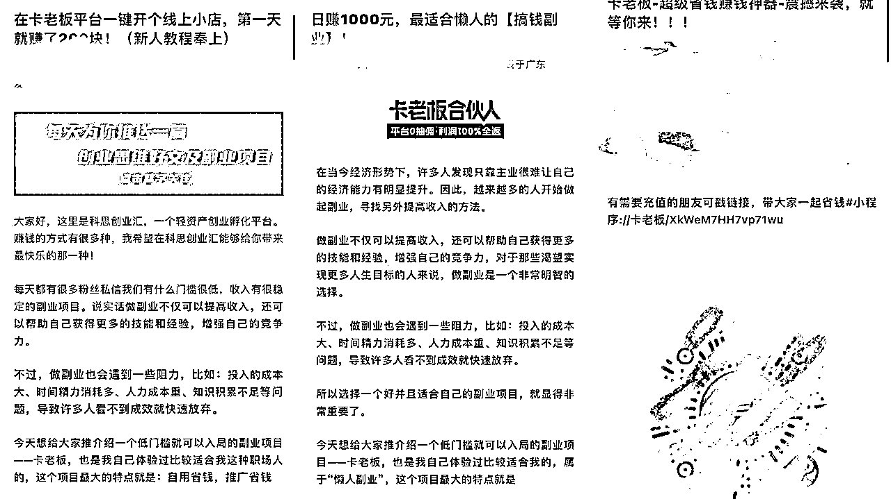

整套动作其实是一环扣一环的连环打法：先用“每天3条朋友圈+体系化打法”激活老用户，再用群发话术每天触达一次未激活用户。整个过程不是硬广轰炸，而是通过小程序链接、二维码等方式温柔地推进。做完这两个动作后，合伙人数量和订单量都很快起来了。项目里绝大多数内容都是AI辅助写的。如果没有AI，让我自己去准备这些内容，最少也要一个月；但AI辅助后，只花了一天时间。

后来我们发现还有一部分用户仍在观望，于是围绕他们做了一套社群运营打法，把人拉进群持续成交。最后再围绕合伙人做推文培训，把三篇招募推文完全交给合伙人去洗稿、教学、改写，用最低成本撬动各种类型的推文。

## 五、总结

看到这里，我最想说的是：

AI在应用里的定位永远是辅助，项目本身的特点才是根本。AI能帮你节约时间，但解决不了“翻倍”的问题。

感谢你看到这里。

现在我也还在用AI探索更多私域运营和公域打法的可能性。类似卡老板的项目其实不少，赚钱里很多前辈都是淘客出身，推广这类产品肯定比我更有经验。希望能得到各位大佬的指点，也欢迎同频的朋友或对这个赛道感兴趣的人来找我交流，一起加油，一起进步，一起龙哥盟。