# 半年做小红书带货新西兰旅游，成交超260万，我把实操全盘托出

> 来源：[https://tnqr6xnium.feishu.cn/docx/Mk7ddPBWJoBtYgxzuePctAnIn5z](https://tnqr6xnium.feishu.cn/docx/Mk7ddPBWJoBtYgxzuePctAnIn5z)

从7月初入局到现在，半年时间我主攻新西兰旅游，个人自成交金额已突破260W+。跟团客单价稳定在2W上下，定制游则普遍在10W左右。8月起我开始带一批圈内伙伴一起做，短时间内已有不少人跑出成绩，并且决定长期深耕。生财官方也相继邀请我担任11月、12月航海训练营小红书旅游赛道的教练，和1000多位圈友一起拆解这个赛道。

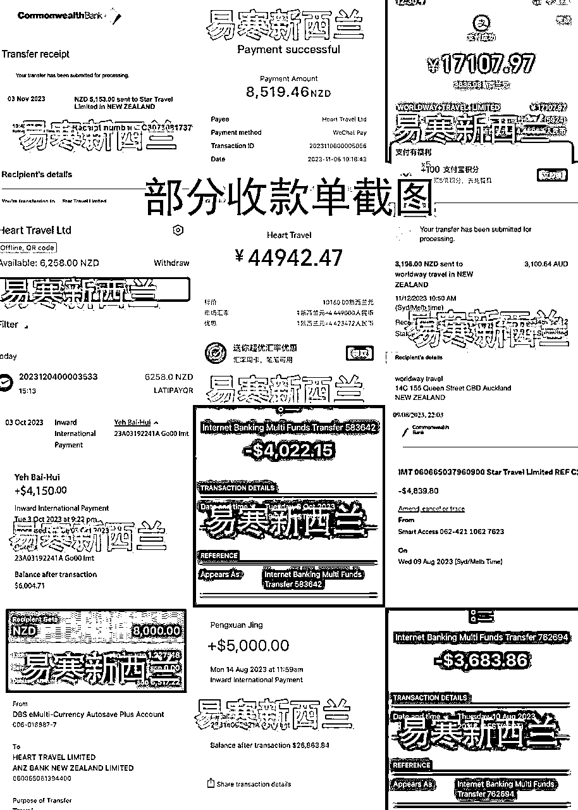

下面把这半年从笔记发布到最终成交的完整链路一次性摊开，最后也会补上给新手的入场判断，希望对你有参考。

## 一、境外目的地怎么挑

提到高客单境外游，第一反应往往是欧洲。但以新手视角，欧洲并不友好，问题主要在4点：

#### 1、签证门槛高、周期长
申根签材料繁琐，资产证明要求严，办下来通常要1-3个月。疫情后拒签率明显抬升。

#### 2、录指纹要跑城市，名额难抢
12岁以上申请人必须本人到签证中心录指纹拍照。全国只有北京、沈阳、济南、武汉、上海、杭州、南京、广州、深圳、重庆、成都设有中心，非本地游客要专门跑一趟，且预约困难，现场排队体验差。

#### 3、成本被动上涨
国际航线恢复慢，机票居高不下。通胀加俄乌战争推高欧洲吃住游费用，综合成本上浮明显。

#### 4、竞争过于激烈
同程、众信等头部企业在小红书深耕多年。跟多家旅行社交流得知，2023年欧洲游在整体业绩里占比已很小。

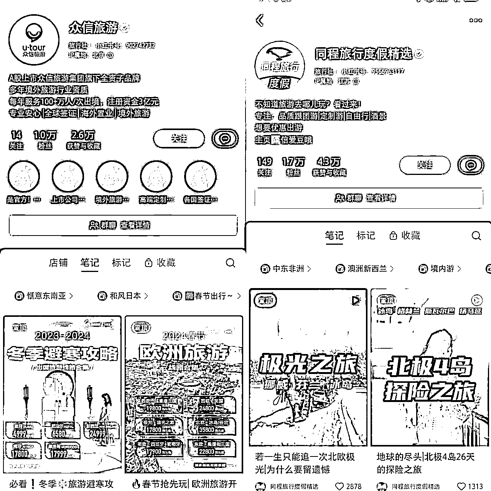

不过政策在变，国家近期对法国、德国、意大利、荷兰、西班牙等实行免签，2024年签证和录指纹的难度有望缓解。

比如：
重磅！法国对中方免签回应：持硕士学位可获5年签证！
https://www.163.com/dy/article/IKK9TBGU05169EA1.html

欧洲依然拥有深厚文化底蕴、优质自然资源和高品质生活，长期来看仍是值得布局的标杆目的地。

### 我的选品思路

#### 1、先看热度
小红书官方每月15号会发布文旅月报。11月榜单前30的海外目的地如下：

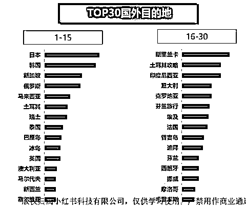

排名会随淡旺季波动，需要结合当月数据动态调整。

#### 2、再看蓝海程度
从专业视角看蓝海比较复杂，但新手只需看一个核心指标：笔记数量。

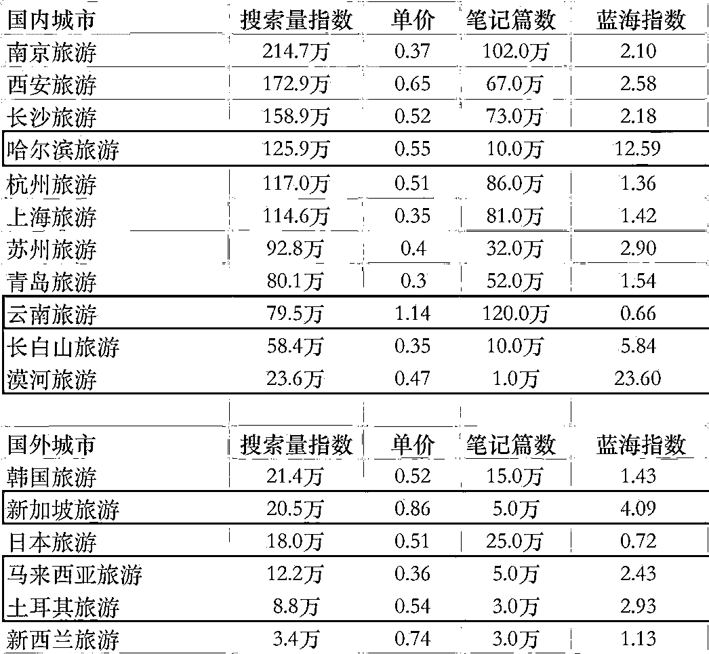

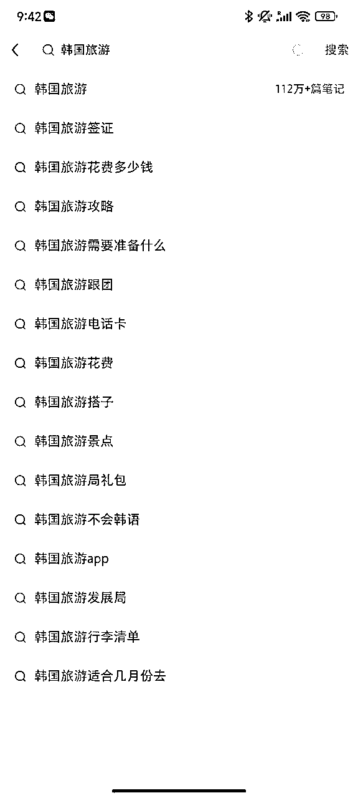

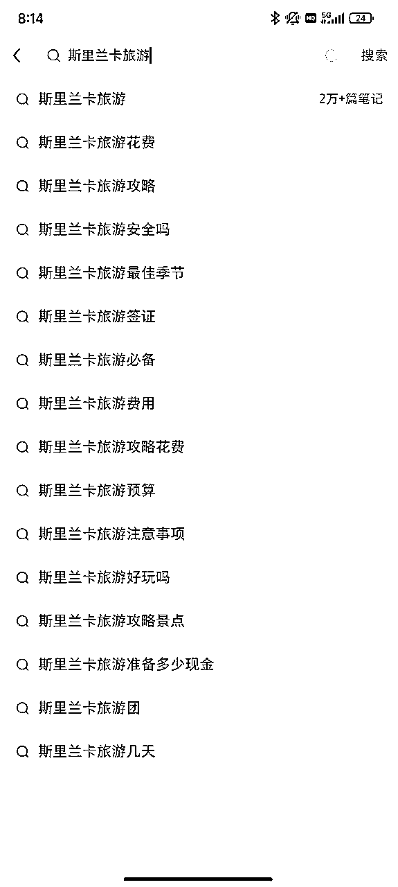

在小红书搜索框输入国家名即可看到笔记数。同样是热门地，韩国旅游笔记有112万篇，斯里兰卡仅2万篇。显而易见，韩国竞争白热化，斯里兰卡更容易被客户看到，获客效率更高。

## 二、旅行社怎么选，我为什么偏向当地社

境外游客单高，客户对行程要求也高。国内社和海外社对比，我更倾向目的地本地社。以斯里兰卡为例，就是直接找当地华人社合作。

#### 1、优先海外社的3个理由

第一，价格更透明。
国内社要转包给海外社执行，中间加10-20%利润。国内多家社给我的新西兰跟团报价都偏高，自己不可控。

第二，产品更丰富不易同质化。
国内社带国际机票，受成团日期限制，产品少且高度同质化，通常来自同一个批发商。海外社可每日发团，自研玩法灵活。

第三，服务更专业，可定制。
国内社客服多没去过目的地，回复慢且不准。海外社客服对当地熟到生活细节，能给出准确解答和个性化建议。

譬如新西兰跟团常见提问：
凯库拉观鲸和奥克兰观鲸差别在哪？
库克山和约瑟夫冰川直升机体验有何不同？
蒂卡普哪个观星团更适合？

海外社客服亲身经历过的描述，和国内社网上查来的答案，客户感知完全不同。

如下图：
这组台湾客户需求很多，我们都能满足，还被夸耐心，跟团间隙还安排留学生带玩。

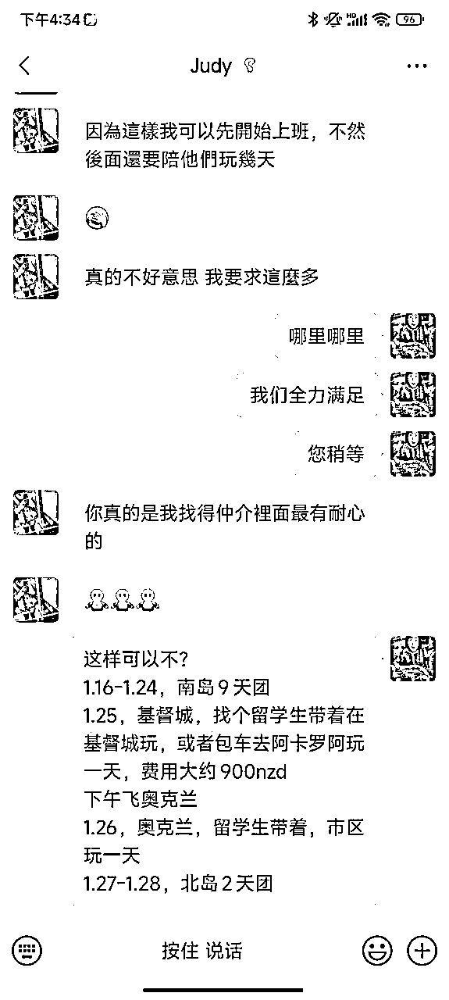

定制游方面，当地社能找到让人难忘的餐厅，也能安排农场深度住宿体验农场主生活。

如下图：
这家餐厅客户赞到想回头二刷：

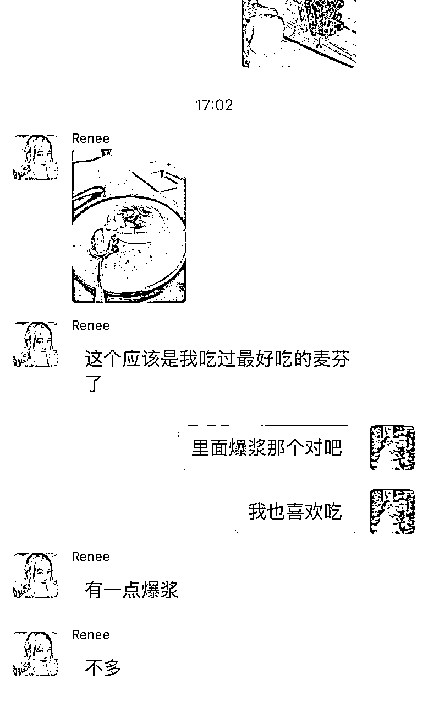

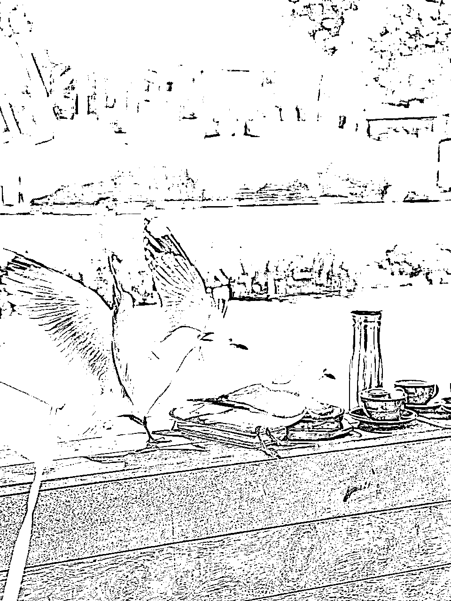

#### 2、如何找海外社
有新西兰资源在手，若没有，这2个方法是我和不少圈友验证过的。

方法一：
用Bing国际版搜：日本旅行社

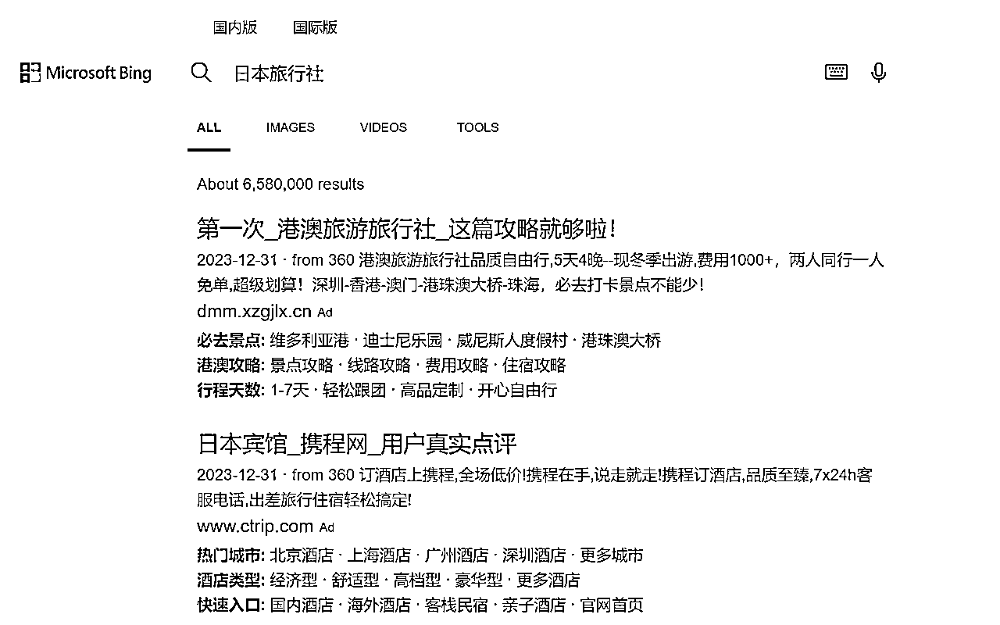
前几条是广告，后面都是当地社，直接联系即可。

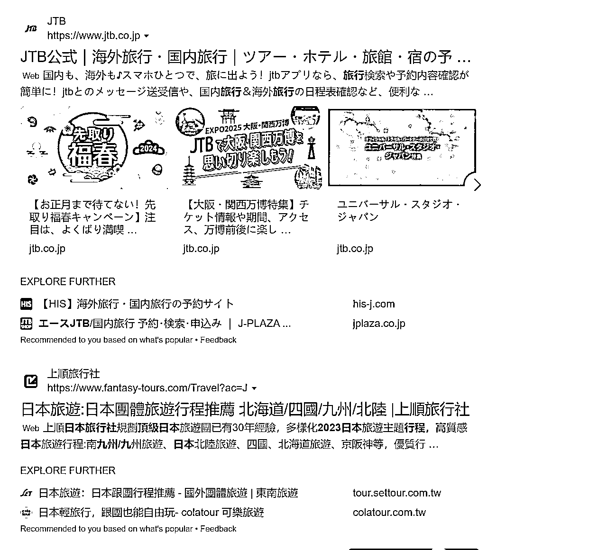

方法二：
打开大众点评，把地点设为东京，搜旅行社，详情页有电话，直接打过去沟通。

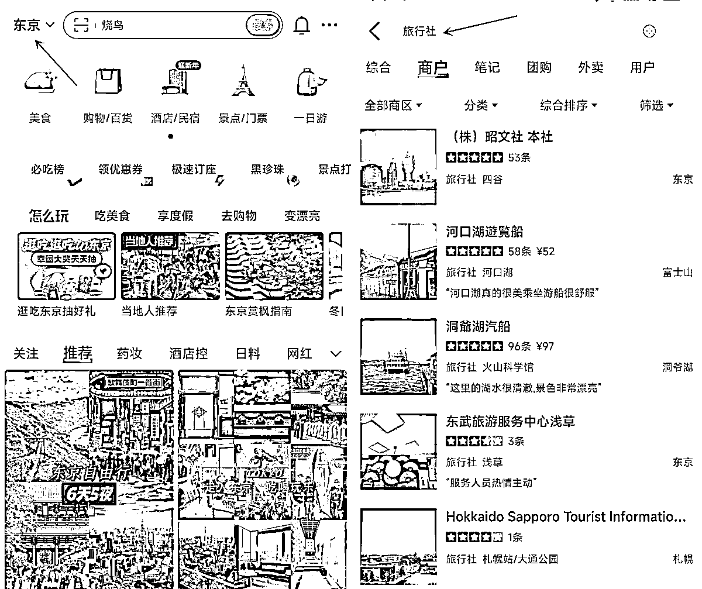

## 三、爆款笔记是怎么写的

我之前写过一篇文章系统讲过旅游类爆款笔记的打法，核心逻辑相通。赛道切换3次，每次都能快速出爆款。

系统学习我主要靠这本书：

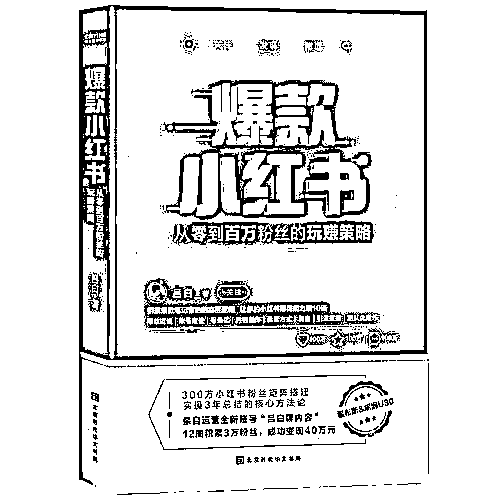

看过很多书和课都落地不了，直到这本。真传一句话，假传万卷书。这本书基本就是小红书的实操心法。我买了3本，分放在办公室、卧室、书房，反复研读。

## 四、投流实战

笔记打通后，核心问题是高效加微信。10月前个人号还能免费加，按单号算一个月能加200+。11月底平台收紧，每天加1-2个微信就会被监测，私信超10条也易触发。

【交易导流商业秩序治理规则公告 - 薯管家 | 小红书】 http://xhslink.com/xJVEKx

个人号从简介到笔记都在限流。长期玩必须转企业号+聚光投流。

#### 1、企业号和聚光如何开通
认证旅游企业号除了营业执照，还需旅行社经营许可证。现行规则下，一张执照最多认证2个企业号。聚光投流只对境内旅行社开放，境外社无法开通。我是找国内社借资质认证。

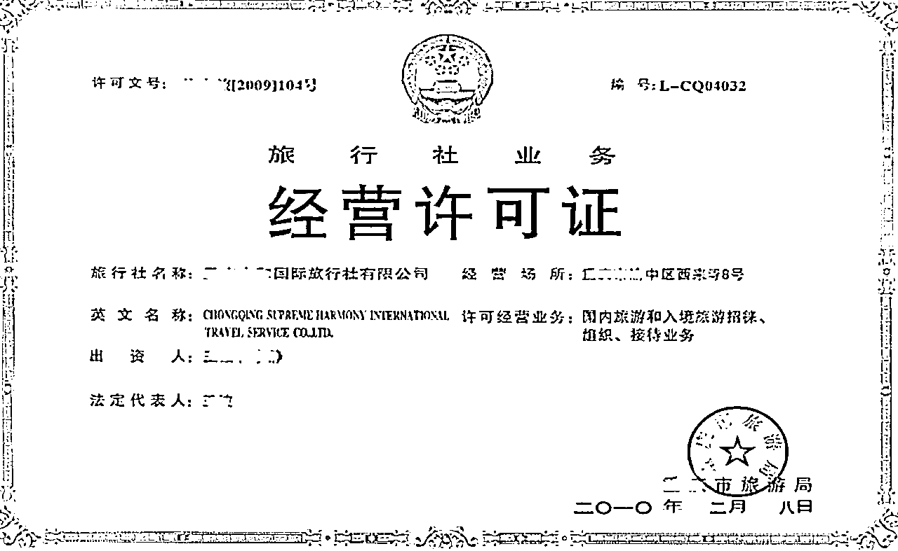

有伙伴想自己注册旅行社认证，难度极高：

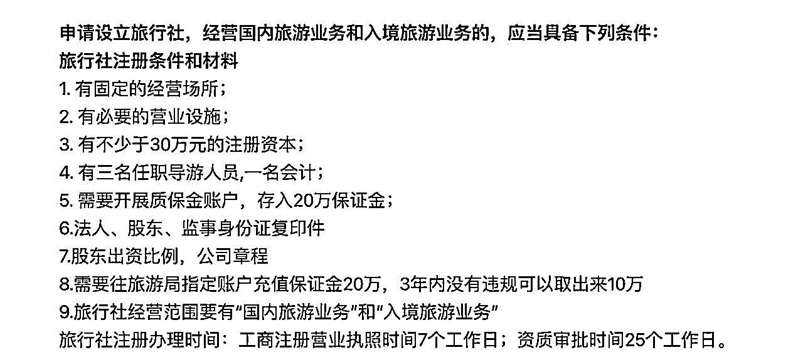

目前每月累计投流≥1000元可进白名单，不受加微信限制。

#### 2、投流实操要点
1)、交给专业投放手
投流是技术活，需要试错成本。圈友自己投云南花3000+只加十几个人0成交。我前期自学成本高，后面找投放手操作，新西兰客户获客成本降到10-15元/人。每天投200元，私信聊不断。

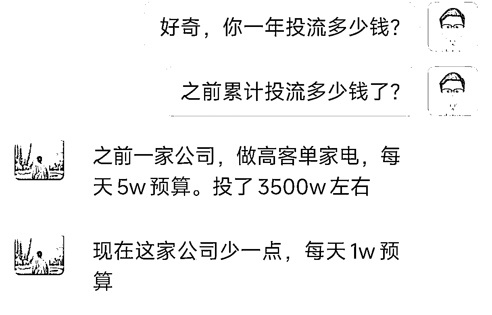

2)、笔记质量是前提
投流是锦上添花，不是救命稻草。笔记自然流量不佳就投，纯属浪费钱。投流前必须先验证笔记有自然起量和基础转化。引流来的精准度同样重要，笔记撰写时就要做客户筛选，具体方法看前文推荐书籍和谢无敌星球。

3)、路线投流成本参考
开通聚光后官方会主动联系指导：

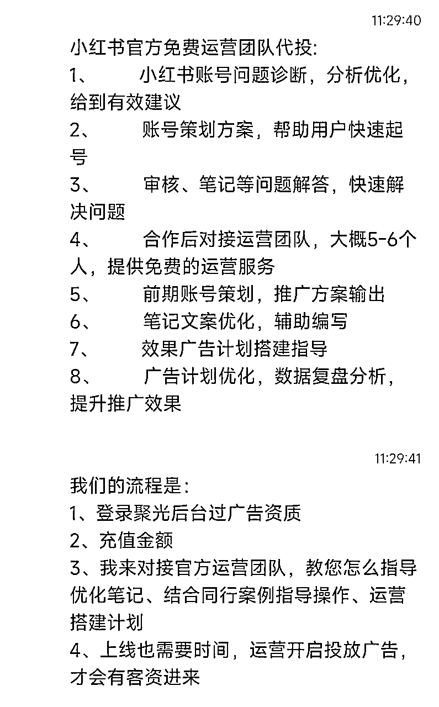
他们无实战经验，只为完成销售任务。100-300元就能测出你的实际获客成本。11月官方给出的成本价如下：

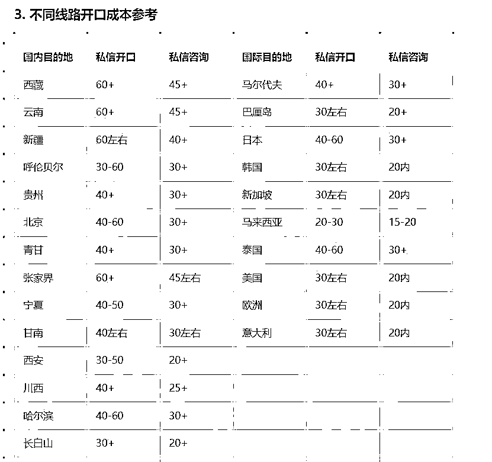
若偏差过大，说明投放策略有问题。

## 五、跟团游成交要点

跟团产品固定，熟练后可独立成交。

先让旅行社做产品培训，把每个景点、餐厅、住宿讲透，并列出竞品差异和亮点。境外游必问的机票签证也要同步掌握。

跟团游客户问题90%重复，客服一个月就能熟练。我卖本地社新西兰跟团成交率很高，而国内社同款产品目前0成交。

跟团成交靠产品力，行程、吃住体验决定成败，话术技巧空间有限。

## 六、高客单定制游成交流程

我做的新西兰定制游不含机酒，客单价7W起，最高22W，均价10W左右。高客单成交对能力要求极高。

#### 第一步，价格筛选
客户进群后，先锚定价格：2人起步每天1600纽币约7200人民币。客人秒回“可以”，基本就是目标客户。犹豫或嫌贵直接过滤。

跟团游吃住行玩一价全包约300纽币/人/天，定制游参考800纽币/人/天，最终报价更高且不含餐门票。

我每天微信量大，必须2-3句话内完成筛选。

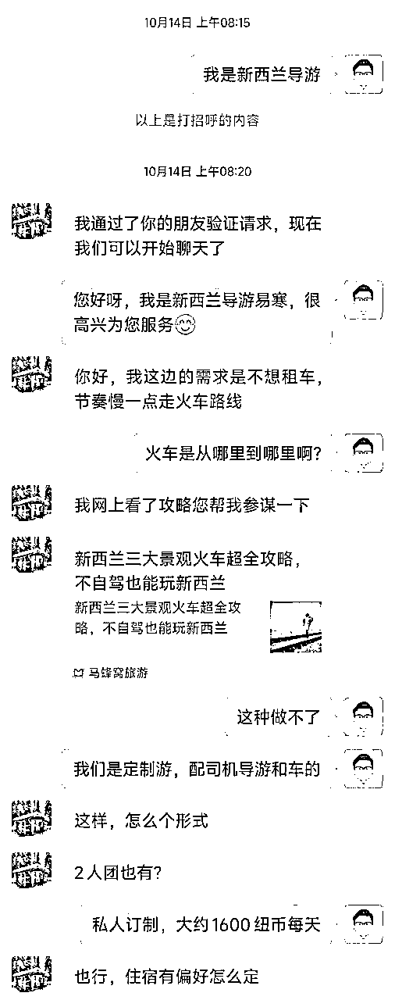

#### 第二步，展示高价值
接受报价后，先用客户案例笔记+同款行程单呈现价值。

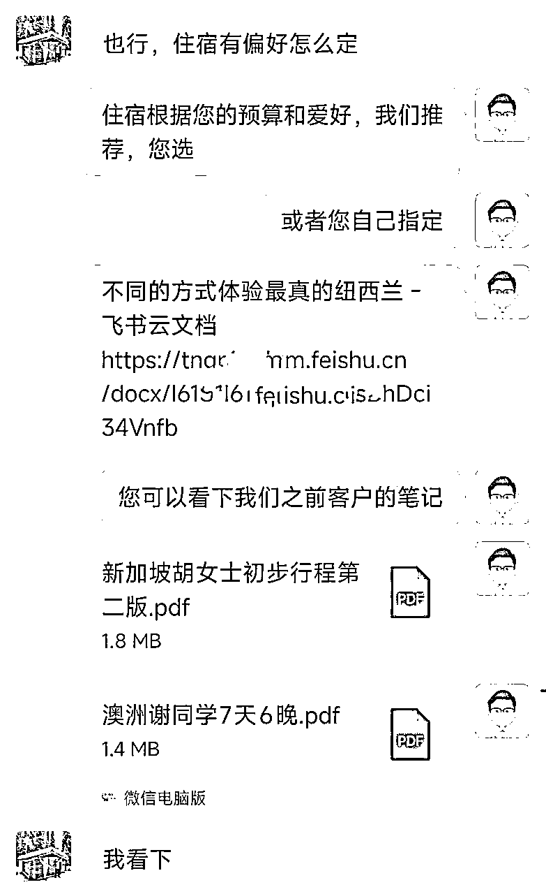
这篇案例笔记在成交中作用巨大，多位客户反馈看完后购买欲明显提升。

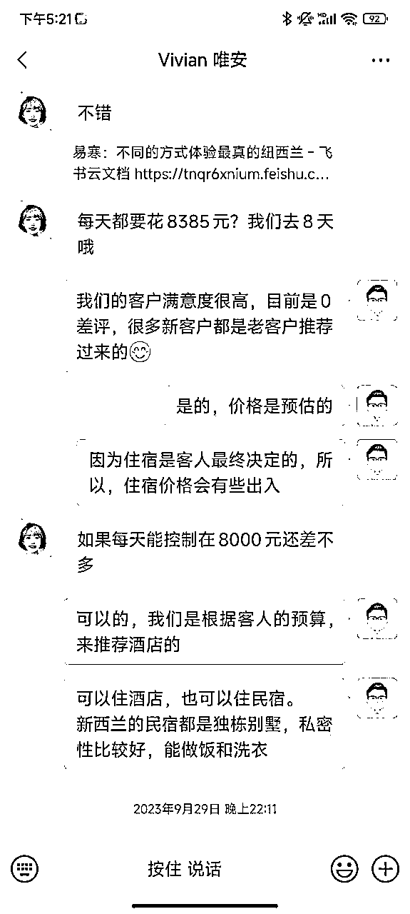
我们的行程单制作用心，客户反馈都很喜欢。

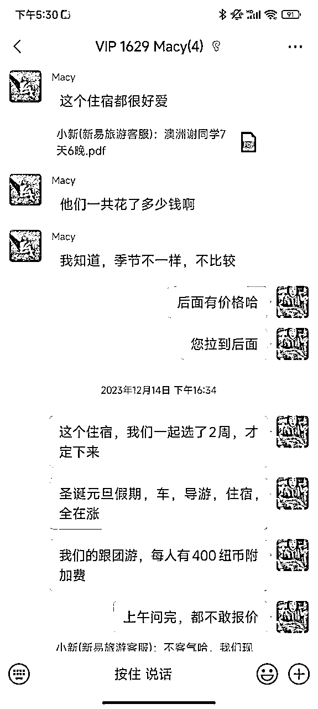

#### 第三步，收取定制费
展示价值后立刻收定金锁定意向。行业普遍免费出方案，我们坚持收费制，无定金不启动服务。

带圈友实操时，国内社难以理解。有云南社说他们一直免费做方案，还幻想过收费不现实。跟许义老师交流后，对方才认可收费逻辑。后来云南、西安两家合作社学会收费模式，转化效果立竿见影。

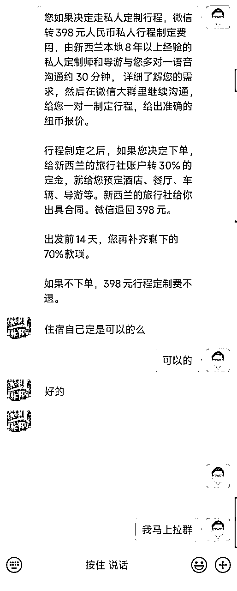

#### 第四步，专业团队做行程
高客单定制必须由目的地客服+一线导游联合出方案。国内定制师纸上谈兵，效果差。我们总结出需求挖掘-定制师匹配-导游确认的闭环，效率和满意度都高，客户认可度高后付款自然顺畅。

#### 第五步，售后跟进
成交只是开始，付款后要配合旅行社跟进服务，直至行程结束。

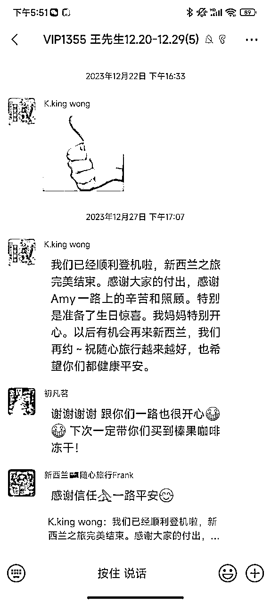

## 七、新手入局建议

结论先行：小红书近期限流变严，门槛抬高，但依然是红利期。

【交易导流商业秩序治理规则公告 - 薯管家 | 小红书】 http://xhslink.com/xJVEKx

过去个人号月加200个微信，现在限制严格。长期做必须转企业号+聚光投流。除了引流，后续成交、淡旺季波动都要考虑。

新手起步可用个人号验证，怕封号也无妨。交易引流检测路径为警告→7天禁言→14天禁言→30天禁言→封号。多备几个号即可跑通，后期放大再转企业号。

更详细的判断：

小红书投流+旅游赛道仍有红利，但能不能吃到、能否长期做，看你能否跨过以下门槛：

判断好项目的两点：有一定门槛+处于红利期，天花板高+可长期经营。

门槛1：产品深度理解
销售一线问题千奇百怪，必须对产品了如指掌，最好踩线实地考察。新手需花大量时间研究目的地，做到百科级，客户才信任下单。

门槛2：微信成交能力
传统旅业利润薄，只给微信佣金约5%。想拿高佣必须自己成交。做过微商的会更快上手，新手需从零学习成交。

门槛3：目的地社深度支持
旅游红海，同质化严重，必须靠旅行社提炼差异化亮点。境外高客单定制尤其依赖后端资源。

门槛4：旅行社经营许可证
平台趋严，个人号受限。长期需旅行社营业执照+经营许可证认证企业号，现行规则一张证最多2个号。

门槛5：投流能力
限流后投流是刚需，首充5000元开通聚光，每月投流1000元可加白名单。投流需试错成本，新手难自学。获客成本约20-60元/人，按月加200人就是几千成本，转化率不足就亏。

门槛6：淡旺季
境外游集中在五一、十一、暑假、春节约4个月，其余8个月淡季。我有预期可做其他赛道过渡，新人全职是否能接受长期无单期，务必先思考。

都说旅游行业熬出头了，但真正做下来，才懂什么叫“冰火两重天”。淡季的时候，几乎没有团可以接；好不容易盼到旺季，订单来了，却因为资源跟不上只能眼睁睁推掉。大家的假期都集中在寒暑假、五一和十一，那段时间酒店、导游、用车价格涨得离谱，资源早就被抢空了。新西兰明年2月春节期间的团，12月初就已经收得差不多，我早早就开始拒绝新客人。问了一圈做日本线和欧洲线的同行，春节订单同样爆满，送上门来的单子也接不了。说白了，从现在到五一，至少还要熬过三个月的“不开单期”。

再说说平台这边。整整憋了四年，出游需求一下子释放出来，这波报复式出行确实猛，旅游内容和小红书都在风口上。和我一起试水的那十几个博主，出单成绩都很亮眼。只不过小红书最近严格限制引流，新人再想进场已经有点门槛了。但我反而觉得，这对打算长期做的人是个好消息——不投入的玩家慢慢玩不转了，流量越来越向做投放的人倾斜。我们这边做投流，现在跑得相当舒服。

如果你背后有很强的资源支持，或者本身就是旅行社、旅游行业的从业者，这个方向真的值得试试。小红书上的用户画像很清晰，消费力也强，认真深耕一个旅游号，后劲还是很足的。