# 从电信诈骗负债70w到正向盈利50万，一个赚钱小白的浴火重生之路

被诈骗背债70万，一年后盈利50万：普通人翻身的真相，很扎心

一年前，那个在赚钱星球发匿名提问的圈友，是我。帖子里我没有写完全部真相，因为当时的我已经被电信诈骗拖入深渊，副业积蓄清零，还背上了七十多万信用贷。一年后的今天，债务填平了，副业也稳定了，累计正向盈利已达到50万。很多人问我怎么做到的，我想认真讲一次。

在出事之前，我的人生几乎可以用“顺”来形容。从小是别人眼里的“好孩子”，一路读书进985，毕业后进央企，一干十年没换过工作。在深圳买下房子后，我以为日子会一直波澜不惊。朋友@brady 把我拉进了赚钱，但那时候我并不知道，这个社群日后会成为我的救命稻草。直到那场骗局，把我从舒适区直接扔进谷底。

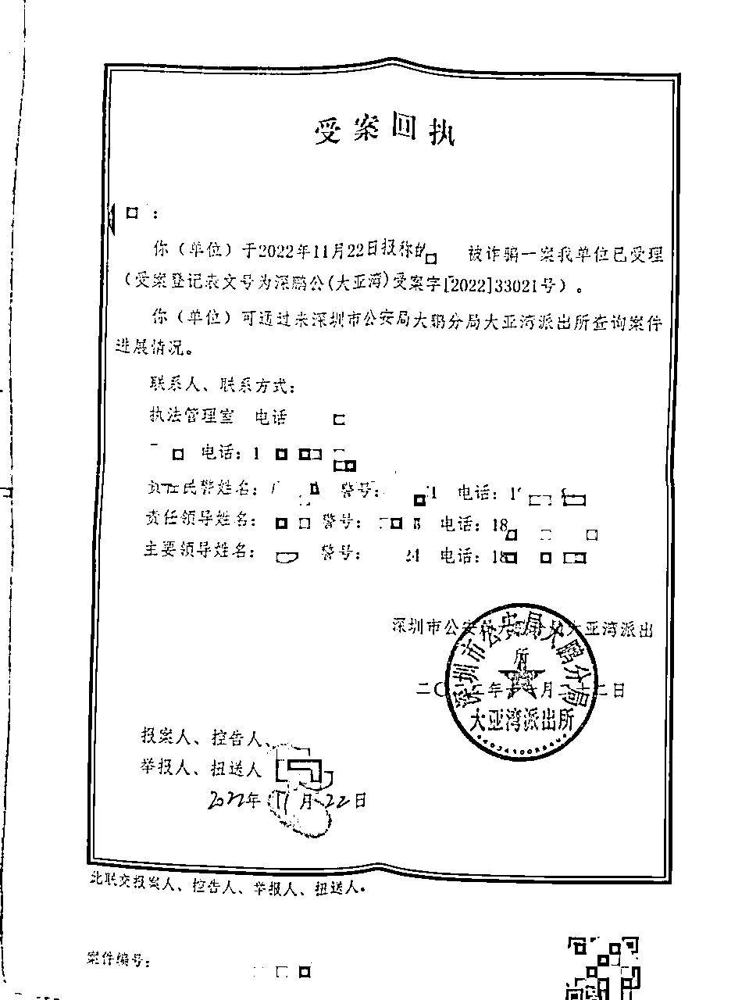

被骗之后，我整个人是懵的。为了不让家里人发现，我照常上班、照常还房贷，工资一到账就被划走，卡里从不超过三位数，吃饭靠饭卡。每个月光是信用贷利息就要三千多元，本金却一分都还不了。我不敢找人借钱，只能拆东墙补西墙，债务越滚越大。
那些书里写的“坚强”“乐观”，在自己经历时才显得那么苍白。我白天强撑，晚上一个人EMO，刷短视频刷到天亮，逃避所有社交，甚至开始排斥以前轻松应付的一切事情。

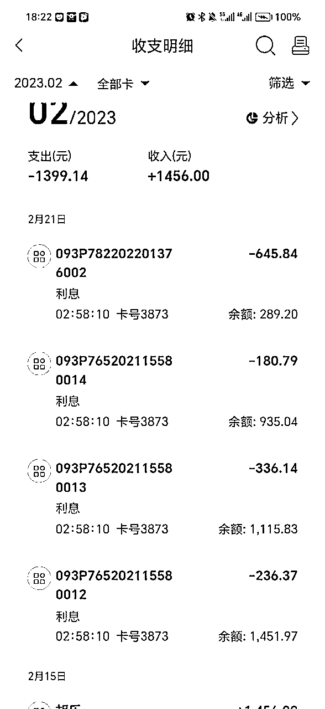

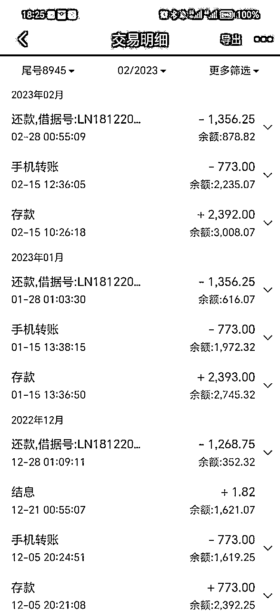

最难受的是想到父母。他们为了帮我和老婆，一直省吃俭用，而我却突然背上大笔债，让他们在本该享福的年纪还在担心。那种感觉，像万箭穿心。
但我也清楚，窟窿是自己捅的，必须自己补。与其继续内耗，不如把赚钱当成唯一的救命稻草，重新开始。

听了龙哥的建议，那个年我没有回家，把方向重新理了一遍。情绪上来时，就翻别人的故事。木易那篇《绑着炸弹做淘宝，负债百万的逆袭之路》，我看了不下二十遍。他说负债阶段经不起折腾，害怕任何风险把自己再次击垮，所以必须求稳。这句话我每次读都有共鸣。我反复告诉自己：他负债百万都能扛过来，我条件比他好，没理由不行。

负债的人最容易犯的错，就是急于求成。我也一样。
看到小红书是红利，我马上报名资料引流小航海，每天刷对标、做笔记，结果注意力总被内容带走，一晚上下来没实操几分钟。项目最终没跑出结果，却意外让我意识到自己不会管理时间，于是又去学时间管理。
现在回头看，这套时间管理方法，是我后面同时做多个副业的底层支撑。

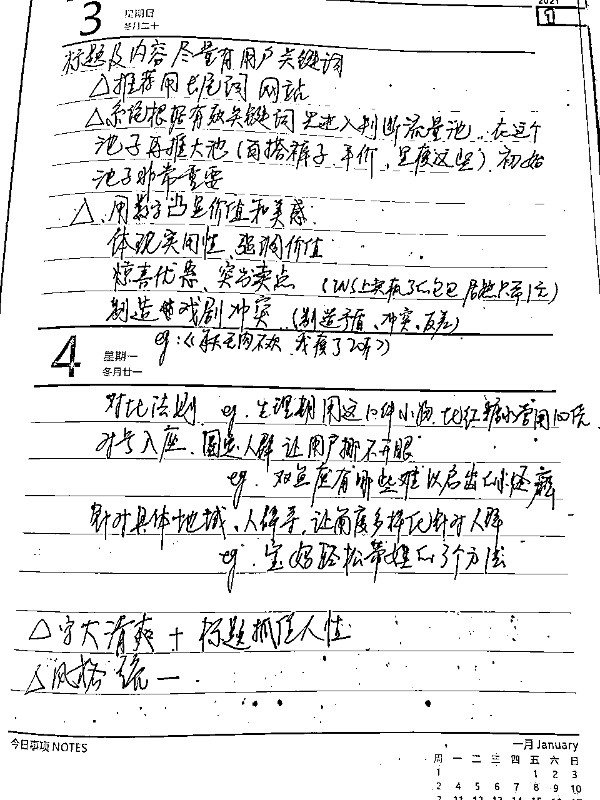

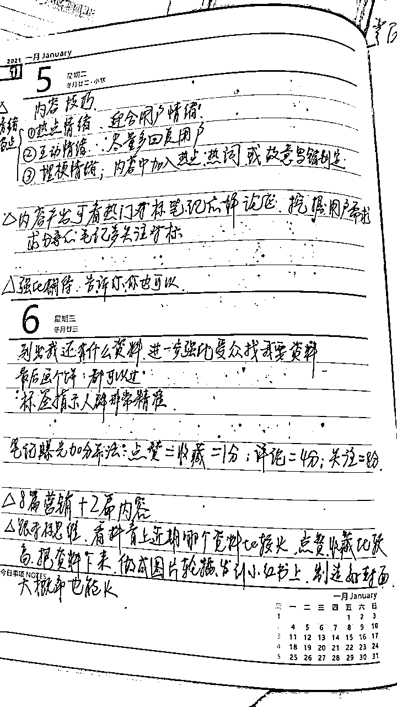

年初又看到美团短视频的机会，觉得平台早期一定有红利，就借着老经验冲了进去。操作确实简单：搬素材、上传、批量发。可平台政策不稳、激励不明，项目很快不了了之。这件事像一盆冷水，把我浇醒了：尽人事，听天命，别把一夜翻身当执念。
后来还报名了ChatGPT航海志愿者，没挖到什么金矿，倒是用ChatGPT一晚上写完报奖材料，进了公司内部奖项名单。

三连试探，说不上精彩，但很真实。哪有什么天降神兵？普通人能做的，就是一次次试错，一次次把自己从焦虑里拉出来，然后等机会出现。
我做事三分钟热度，什么热就追什么，和大多数普通人一样。撞了几次墙后反而清醒了：我有本职工作，精力有限，没法像全职创业者那样把每个环节都补上。像小红书那种闭环很重的项目，一个环节没做好就难变现，试错成本太高。我更倾向变现路径短的，比如短视频带货。

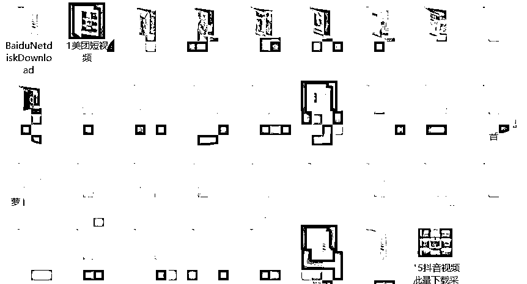

机会来的时候，是我之前的合伙人徐子浅来找我。徐哥、待续老大、孟meng一起跑通了多多视频带货的线下结算玩法，问我要不要回来做交付。

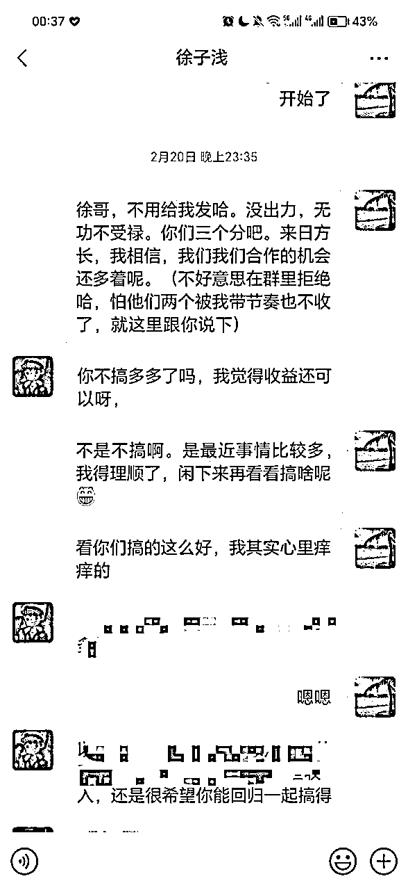

我们没有立刻铺开。2022年那会儿，我们做过一个两百多人的训练营，帮很多学员赚到了钱，也攒下了拼多多头部商家资源。这次先只从老学员里挑了90名执行力强的做内测，3月1号启动。
所谓线下结算，说白了就是对接优质供应链商家，推广潜力链接，佣金由商家直接结算。好处很直接：不用每个月花几天去发爆款视频保带货资格，也能避免平台吞单。
因为商家资源扎实，又有那90个人拼命跟上，第一个月局面就打开了。团队也沉淀出一套完整的交付体系。

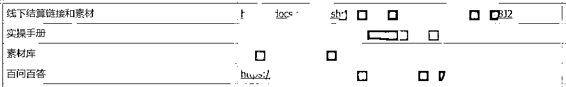

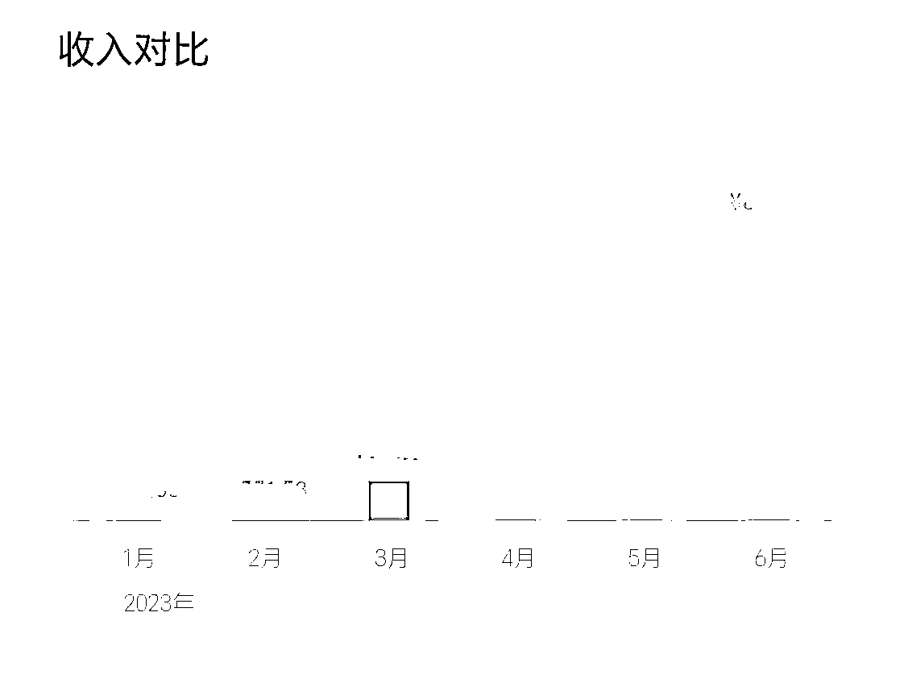

模式跑通后，我们开始想放大。讨论下来，决定用抖音直播招副业粉，增加达人数量；达人多了，爆单概率变大，对供应链议价权更强；议价权高了，又能吸引更多达人，形成正向循环。
但我们四个人都没做过直播，与其现学浪费时间，不如在自己学员里找人。后来联系上武汉萍子，她负责直播招商，一切都是线上协作。
赚钱圈友之间的信任感，真的很难得。

萍子加入后，两个月招了600多位学员。这些学员大多是宝妈，没有底薪，但执行力强得惊人，让干什么就干什么，遇到问题先自己实操再提问，不抱怨也不躺平。
我们一开始没指望她们立刻赚到钱，只希望第一笔小单早点出现，让她们看到第1块钱。没想到她们比预期更快跑出了结果。还有个两个孩子的宝妈，一条视频累计变现了15万。当然，这是极端个例，可也足够说明：选对人，比疯狂招人重要。

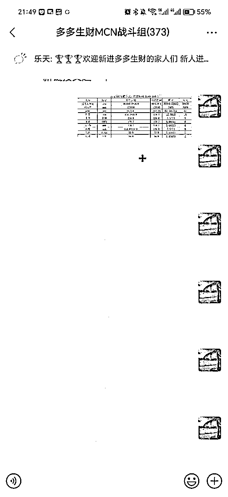

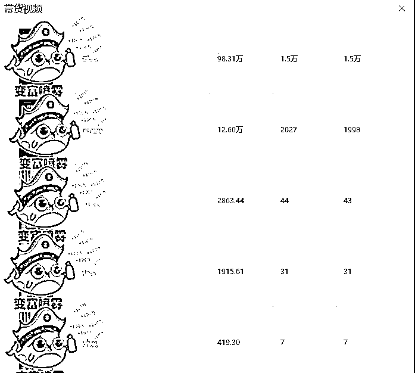

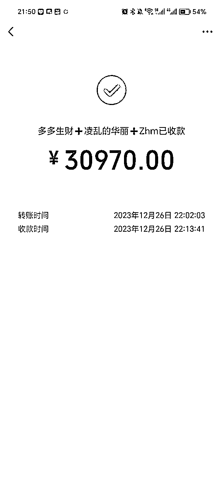

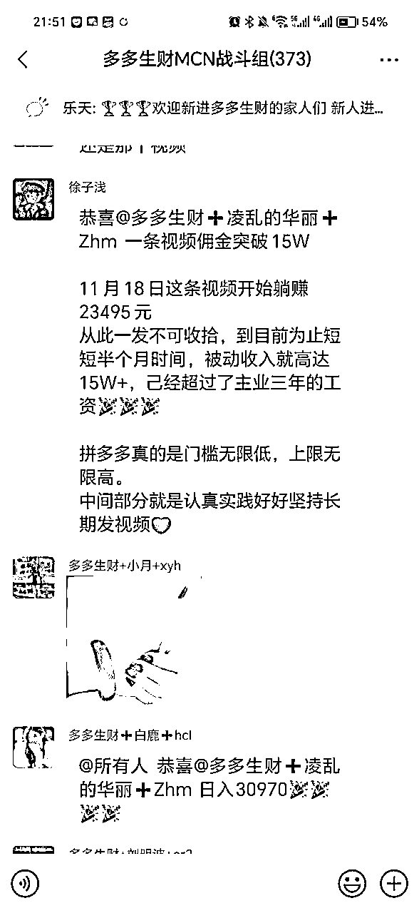

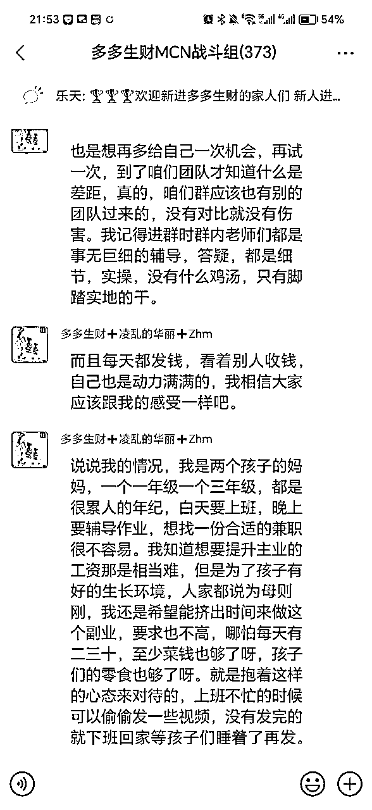

人一多，交付就重了。对接商家、整理链接、核对数据、学员答疑、直播教学、课程沉淀……我们团队没有周末，也没有精确分工，谁有空谁上，大家都在主动扛事。
我当时尽量把日常的基础工作都揽下来：一天要和几十家供应链打交道，整理链接、核对数据、结算佣金。本职工作也不能丢，只能压榨自己：早上六点多起床，健身半小时，然后上班+副业连轴转，通常要熬到凌晨一两点，周末和节假日基本无休。
说来也怪，那阵子我整个人是兴奋的，问题来了就解决，解决完又来新的，像心流一样。我几乎忘了自己还背着七十万债。

转折发生在7月。很多宝妈要照顾放暑假的孩子，发视频的频率降了，收益开始往下滑。更不巧的是，父亲突然住院，母亲又因为脑梗行动不便，我只好请假回家。
那段时间每天往返家与医院，做饭、陪床，睡眠不到五小时。晚上就在医院大堂用手机热点开电脑，处理学员答疑和商家结算，经常忙到凌晨两三点。
我反而觉得那是自己效率最高的时候。为了不让团队停下来，我组织了好几场学员分享，把这些经验沉淀成文档，新学员进来后能更快上手。经过几轮共学，训练营收益重新回升。

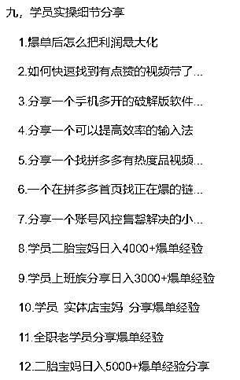

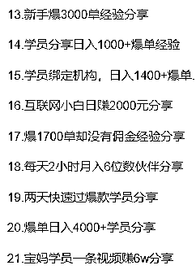

解决了达人端的问题，商家端又出幺蛾子。有爆款链接被商家私下改销售额数据，幸好我们对品类转化率熟，很快识破了。
重新调整后，我们建立了风控机制：不管多大的商家，多熟的关系，都要按日订单量交押金，并纳入黑名单管理。这套规则推出后，合作反而更顺了。

9月15号，负债正式清零。
没有庆祝，没告诉任何人。我怕一庆祝，好运就被惊跑了。那种随时担心征信爆掉的日子，终于过去了。
同月，我妈六十大寿，我给她买了一条金项链。以前我对钱没概念，但那一年我彻底明白了：钱是底气，是保护家人和自己的底气。后来去电影院看《孤注一掷》，看到那些取钱的镜头，我手心都是汗，太有代入感了。

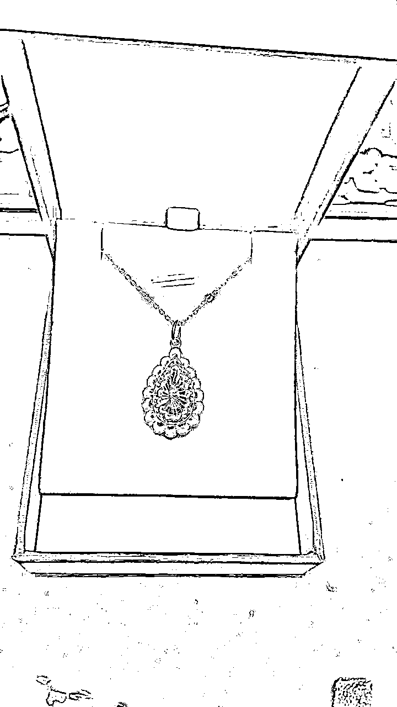

负债清零不是终点。十月体检，我查出了轻度脂肪肝——身体开始报警了。
那段时间我什么都亲力亲为，生怕这根救命稻草飞走。但不行，我不能一直困在事务性工作里，否则收益一旦下滑，又会掉回原来的状态。
于是我从龙哥给其他圈友的回答里学了一招：找人分担。招了助理，把机械性工作一点点交出去，自己抽身出来探索新方向。

我们反复测试后，把视频号口播实拍模式跑通了：核心是实拍口播，多账号分发，隔天线下结算。有之前的供应链和交付经验加持，这套模式复制得很快。
到现在，视频号这条线已经服务了200多名学员，开单人数160+，开单率接近八成。多多视频和视频号两条线，都在稳定交付。

回头看这一年，没有逆袭爽文，没有天降好运。有的只是一个普通人被生活锤到谷底后，咬着牙一点点爬出来。
我特别想谢谢龙哥，谢谢赚钱里的老师、朋友、合作伙伴，还有无数个像木易一样的精神榜样。是这些人的存在，让我相信“利他”不是口号，而是真的能托住一个人。
如果你也正处在低谷，请相信：所有摔过的跟头，都会成为你翻身的台阶。只要还想爬起来，就一定能爬出来。

回望过去十二个月，最大的感受就是感恩。特别要感谢几位带头的老大在年初就点名找我，一起把线下结算训练营搭起来。日常运营里即便出错，也从未被指责过一句，正因为这份包容我才能放开手脚，和几位老大紧密配合把社群交付做好。后来转到视频号训练营，平台规则怎么变，我们的节奏始终一致，依然携手向前。在几位老大的共同推动下，一年里我们完成了超一千名学员的交付，并与两百多家pdd头部商家建立了长期合作。玩法不断迭代，面对规则波动，收入依然保持相对稳定。视频号这条线也在持续推进，已稳定交付两百位学员，收益呈现稳步上升态势。

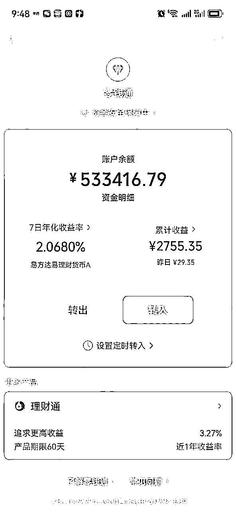

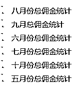

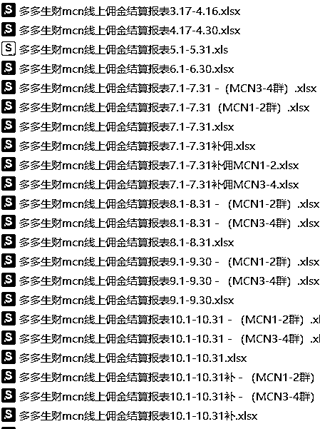

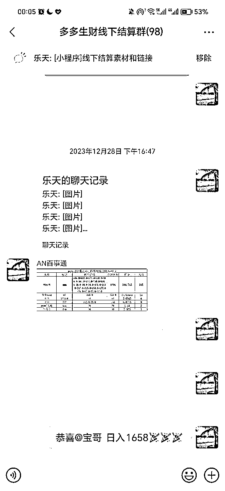

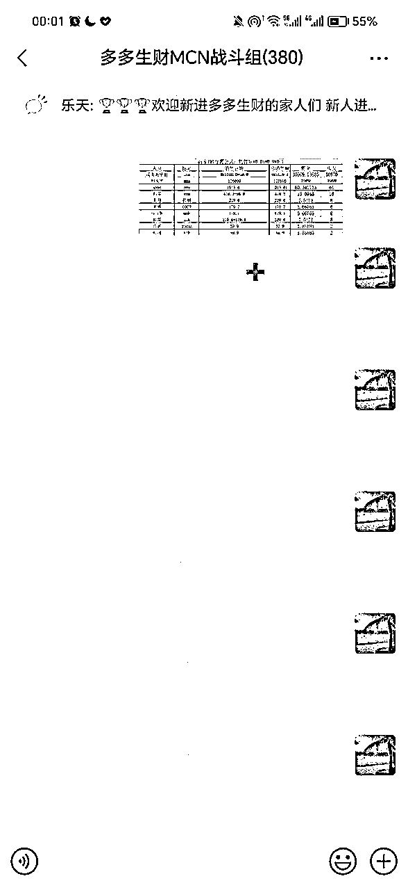

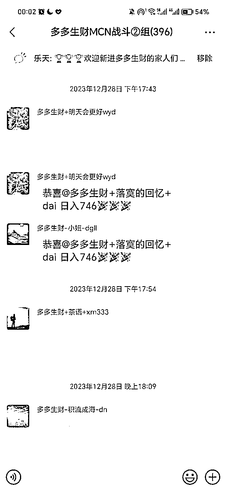

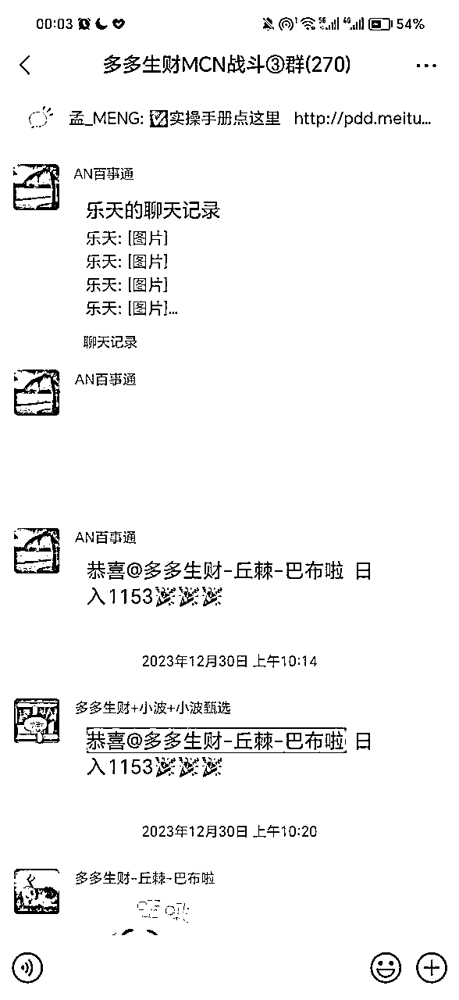

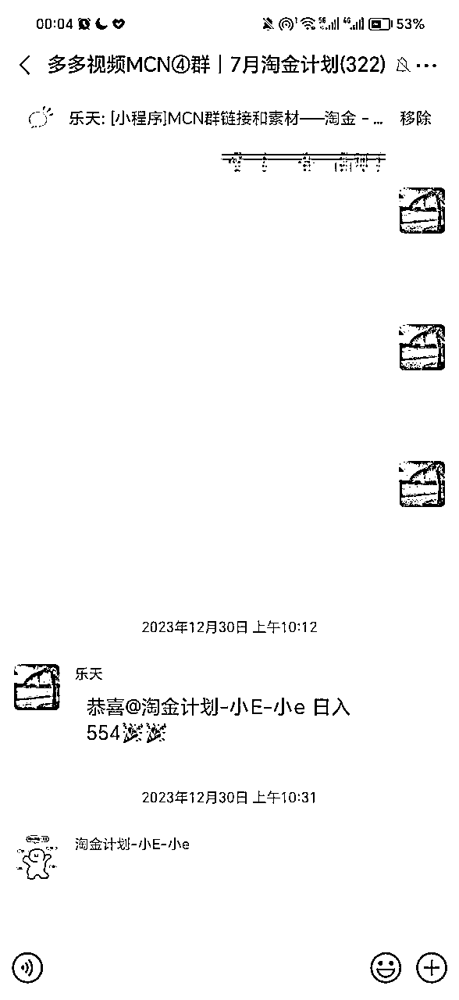

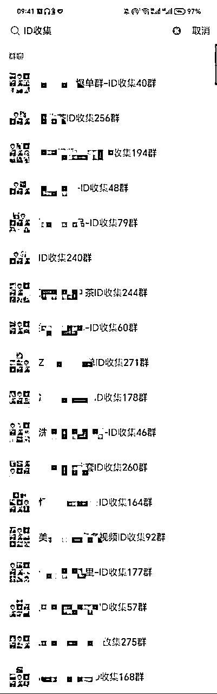

## 五、致敬木易，调整心态

聊到低谷期的心态自救，我实在有太多体会。书里那些励志案例读起来理所当然，却也拉开距离，反而提醒我自己只是个普通人。我和绝大多数掉进低谷的人一样，会自责、焦虑、内疚、绝望、封闭、无助，甚至自暴自弃。想告诉你的是，这些反应恰恰是低谷期的正常真实写照。若你完全没有这些情绪，反而是不正常的。我们常从书本汲取力量，但书中的偶像经历终究与我们不同。偶像能鼓舞，但现实里的样本更能让人振作。说的是赚钱圈里的木易。

那篇《绑着炸弹做淘宝，负债百万的逆袭之路》是我反复重读的帖子，从中汲取了大量能量。文中的核心观点我摘录如下。

1、“先遏制低谷的下滑势头，也就是负债时先冷静。不要幻想一次回本，而是先想怎么跑赢负债利息。跑赢利息后，才能看到向上希望。”

年初，前教培机构的老板联系我，问我是否愿意回来做兼职教学。那点课时费显然不足以在短时间内填上70万的窟窿，但那是我当时唯一能看到的确定性副业现金流，且足够覆盖负债利息。这个判断很关键，回头看正是它稳住了我的心理底线，给了我一个保底，让我在试错其他副业时不容易被情绪带跑，能更平常心地面对波动。

接下兼职前我也做了取舍。教培备课耗时，我和老板沟通后砍掉了所有其他科目和年级，只聚焦初二数学。这样备课只要一个晚上就能支撑周末的教学，既保证了课堂质量，又不占用太多时间去探索副业。后来还收到多位家长的好评，老板甚至提出带我入股。

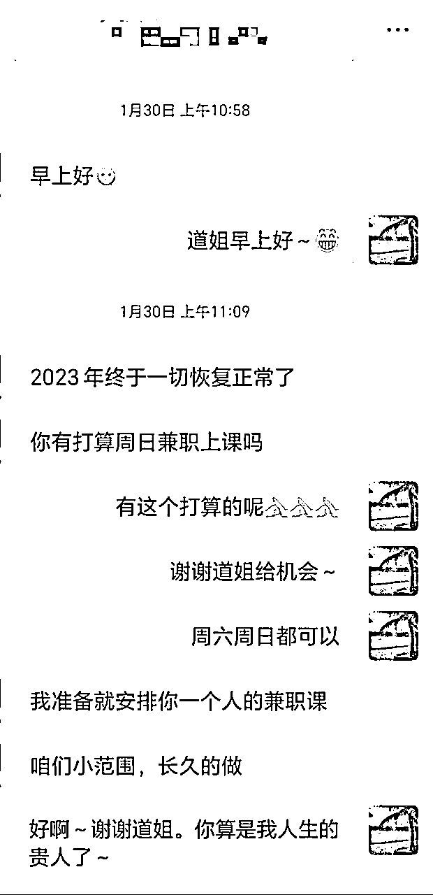

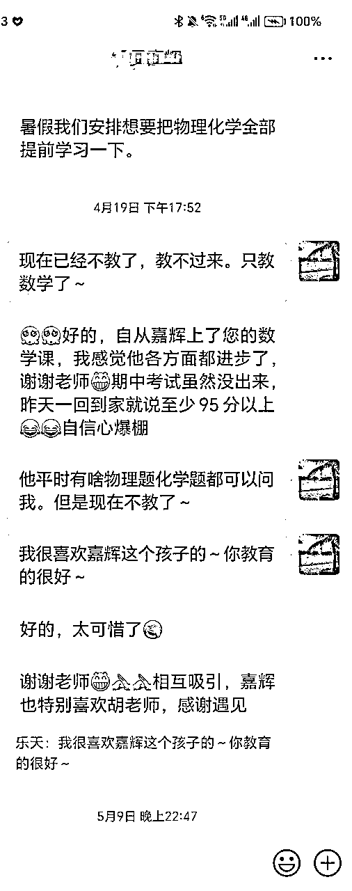

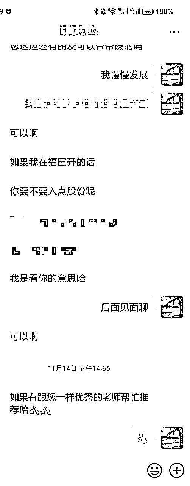

2、“别自责，即便犯下大错，事已至此自责也无用。人生漫长，谁没走错几步？能从错误中吸取教训就是成长。调整心态，我们改变不了过去，至少还能掌握未来。”

遭遇诈骗的那个月，我状态很差，自责感很重，尤其受不了家人的笑脸，那些笑容都在提醒是我搞砸了一切。后来我花了一个月了解缅北诈骗的套路，才明白公司里每年都有很多人中招，面对成体系专业的诈骗团伙，普通人很难防范。这件事让我很快释怀，不再沉溺于自责。真心建议大家装上国家反诈app，拦截效果很明显。再次提醒：网上冒充京东客服的不要信！网上冒充京东客服的不要信！网上冒充京东客服的不要信！

3、“别在低谷人群中抱团倾诉，别怨天尤人。与同样在低谷的人相处，只能互相安慰缓解焦虑，对解决问题毫无帮助。此时更需要走出去，跟上进的人同行，尽快回归生活正轨。”

被骗后我谁也没告诉。一是不想让关心我的人担心，二是不想被贴上负债人的偏见标签。低谷期不要等别人施舍，发展自己才是解药。

4、“注意身体，别太拼也不能不拼。贵有恒，无需三更眠五更起；害莫大，只怕一日曝十日寒。”

这一年再忙，我也坚持抽时间健身，甚至宁愿少睡也要去。身体上的畅快远好过心理的焦虑绝望。通过运动强行刺激多巴胺，让我度过了无数个煎熬的夜晚。

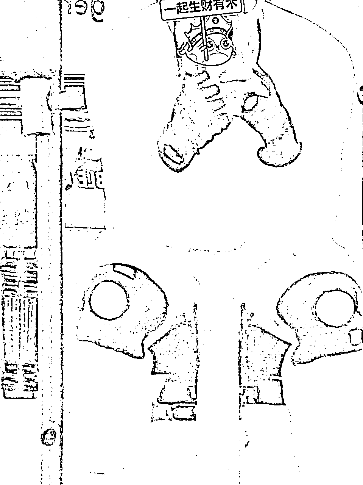

## 六、个人的思考

这一年的经历让我感悟很多，见过更大的世界后更不敢轻言成功。这一年我更了解自己，下面几条体会，希望能帮到同样在低谷的你，也把赚钱给我的能量传递下去。

「人生是多线程的」

想把所有事都做到完美并不现实，低谷期更是如此。低谷要做减法，放下负担，勇敢前行，践行精益主义，生活会稍显轻松。

当时已经是谷底，能量所剩无几，就别再做消耗能量的事。很多以前能忍受的事，那时却完全不愿承受：不愿跟同事应酬社交，不愿无效联络感情，不愿面对父母催生，不愿再迎合妥协。以前轻松应对的琐事，此刻都令人疲惫。既然不情愿，就全部停掉。甩掉包袱，只聚焦于自身提升。每天健身、工作、搞副业，每一件都在增加能量。砍掉所有让你难受内耗的事，只做能提升能量的事，慢慢积蓄力量等待状态回升。

「焦虑的反义词是具体」

身处低谷时，与其天天想怎么快速翻身、想宏大目标，不如脚踏实地让自己每天进步一点。宏大目标对眼前问题无助，只会放大焦虑。当注意力放在提升能量、积蓄力量上时，焦虑自然缓解。负债不可怕，可怕的是心理负债。一旦心理高度焦虑，日常基本动作都会变形，副业也做不下去，陷入恶性循环。

没有战略思维也不妨碍普通人赚到第一笔百万。别一直盯着大目标陷入焦虑，多思考每天每月的小目标更实在。回头看，无数小目标拼起来，大目标就在脚下。

当你把时间压榨到极致，每时每刻都在解决具体问题时，就没空迷茫、没空焦虑。甚至不需要长远眼光和投入产出比，只想着怎么先把钱赚到。有机会就先赚了再说。现在复盘，真的印证了龙哥老大说的，做项目最重要是先下场，先赚到第一块钱。

「别高估意志力」

仅靠意志力压制负面情绪很难。人是环境造就的，主动改变环境，靠近能量高的人，接受影响。作为普通人，我们发不了光，但可以反射光。在赚钱这样的环境里，长期沉浸、刨根问底、沉浸于问题解决，时间会给出答案。

「靠近优质的信息源」

个人获取信息的广度和深度有限，自己挖信息效率很低。赚钱就是优质信息源。在这里认识了徐子浅、待续老大、孟meng和李诚老师，后来才有李诚老师无私分享的美团短视频项目，以及徐哥邀请我参与的多多视频带货线下结算项目。靠近优质信息源，能更快获取价值，赚钱概率更高。

「资源有限，选闭环短的项目」

以电商为例，要赚钱必须完成站内站外引流、客服、成交、生产、物流、售后的完整闭环，缺一不可。资源有限时要让每个环节高效，成本极高。而短视频带货不同，只需选品和剪辑，其余环节由成熟供应链完成。把有限资源聚焦在剪辑和选品上即可变现。等前端流量打通，再向上下游扩展会更顺畅。东方甄选、小杨哥基本也是这样起盘，最终才扩张到自营产品。

## 七、生命里的那些贵人

这一年能快速翻身摆脱负债，运气占了九成。前三十年太顺，遇到的都是师长、朋友、家人。用信用贷帮朋友过桥，没有合同全靠信任，信任从未被辜负，我从未体会社会的险恶。

作为普通人，我很幸运遇到了太多贵人。一个举手之劳、一次信任，就能改变轨迹。感恩。

感谢李诚老师。在我困顿的时候告诉我美团短视频项目。虽然因平台规则项目停止，但他的无私分享让我体会到圈友的利他精神，促我积极改变。

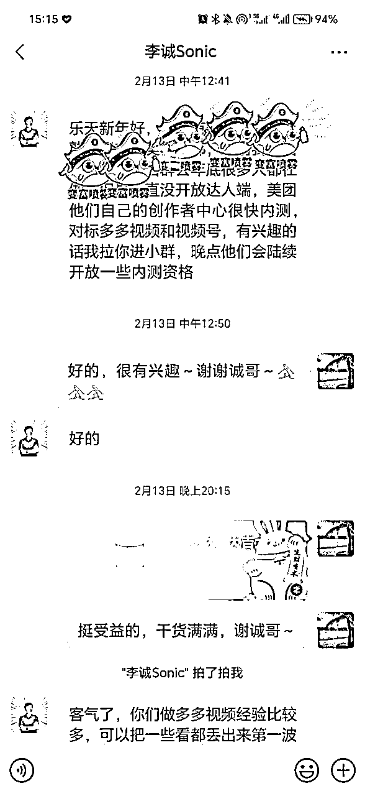

感谢教培机构老板的信任。在我最缺钱时给我兼职教学的机会，解了燃眉之急，让我能更稳地探索其他副业。

感谢龙哥。创造了这个平台让我认识志同道合的朋友。那篇建议帖给了我很大力量，让我及时调整，甩掉包袱重新出发。

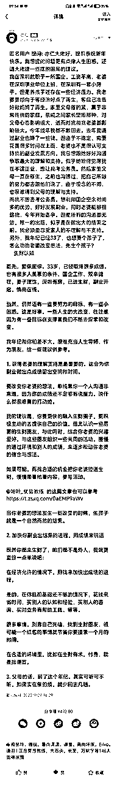

特别感谢赚钱前辈梁靠谱、鱼丸对本文的完善帮助。

最后特别感谢事业上的几位合伙人：徐子浅、待续、孟meng、武汉萍子。没有他们的信任，我可能还在挣扎尝试别的副业。希望未来能继续合作，一起多多赚钱。

## 八、引用

1、遭遇低谷时，我发的匿名贴以及当时龙哥老大的鼓励建议：

https://t.zsxq.com/15sHyDnaM

2、遭遇低谷时，常读的木易大佬的逆袭帖子：

《绑着炸弹做淘宝，负债百万的逆袭之路》

3、我刚开始在赚钱里探索的一些经历：

《从0到副业收入16w+，一个新手小白的副业探索之路》

4、我们在做的多多视频项目拆解【精华帖】：

《从1条风向标到实操闭环变现100w，赋能千人团队月GMV破千万的多多视频创业实操分享》

5、我们在做的视频号口播项目拆解【精华帖】：

《视频号口播实拍带货，单条视频变现14w+，像素级拆解！》