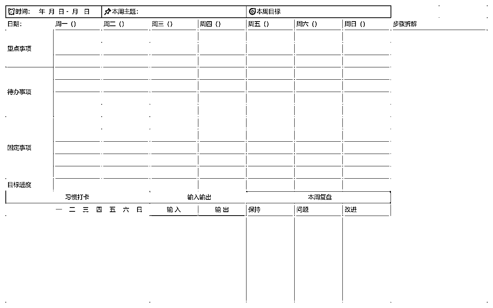
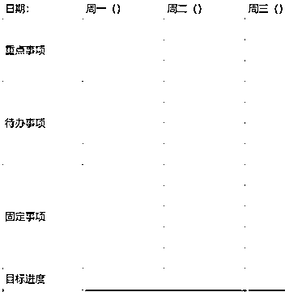
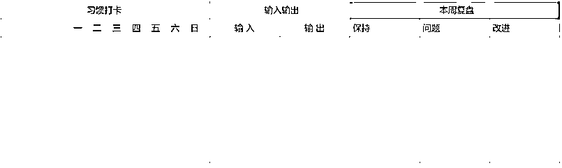

# 用复盘把工作效率拉满的正确姿势

## 一、为什么必须复盘

大家好，我是魔王，曾在头部理财公司负责社群运营，现在全职自由创作，专注做个人IP孵化与内容变现。

我拆解过大量上市公司的财报后，形成了一个核心认知：要像经营公司一样经营自己。

很长一段时间里，我没有复盘的习惯，生活就是随波逐流，混乱又散漫，想到什么做什么，年终一看，什么也没落地，更别谈成果了。

虽然早几年就入了自媒体圈，但市面上内容项目实在太多，像进了大观园一样眼花缭乱，什么都想碰，什么都想带回去试试。

结果就是精力被稀释，时间被消耗，专业能力几乎原地踏步。

最近做年度梳理时才恍然大悟，年初列了那么多计划，每个月都想启动某个事项，却始终没开干。深度反思后发现，根源就是复盘太敷衍。

没有当下清晰的主线，没有阶段明确的任务，全年就是一盘散沙。

那复盘到底能带来什么？

复盘能让我们用客观视角审视结果，把产出量化来看。

复盘能帮我们理清自己在做什么、该做什么、现在处于什么阶段。

复盘能把经验沉淀为方法，避免在同一个坑里反复踩。

复盘能拆解关键影响因素，找到因果，才能精准调整下一步动作。

复盘是在总结经验、提升能力、形成方法论的唯一路径。

有目标会让人走得更稳，有复盘能力会让人少走弯路。

目标决定方向，复盘确保我们不偏航，在奔赴目标的路上持续迭代加速。

复盘让我们远离内耗与迷茫，不再在同一个问题上摔倒两次，它能及时发现偏差，帮我们绕开冗余。

一次复盘，就是一次沉淀。

一次复盘，就是一次自我纠偏。

一次复盘，就是离目标更近一步。

## 二、复盘带给我哪些改变

通过持续记录与复盘，我从曾经的迷茫无措、方向感缺失，变成了自律、有想法、有路径、持续向上的状态。

复盘让我的生活变得可追溯，生命有了清晰的轨迹。

我清楚知道自己该做什么、能做什么、当下处于什么水平。

我现在最享受的状态是：我知道自己在干什么，缺什么，接下来该学什么来补齐短板。

很多人卡住无解，很大程度上是因为状态混沌，对自己缺乏认知。

多问自己：我做了什么？做得好在哪？做得差在哪？该如何及时修正回到正轨？不断迭代自我，就必须养成复盘反思的习惯。

## 三、科学复盘的实操方法

### 3.1 以终为始，先把目标定死

行动之前，先搞清楚终点在哪。

没有目标的努力很容易迷失方向。

就像出门前必须知道目的地，才能规划路线。

但目标要具体、可执行，不能空泛。

比如不要说我要减肥，要说100天内减掉20斤，这样才有结果导向。

当然也有人会说，我不知道想要什么，终点在哪。

这时可以先做生活记录，梳理价值观与人生愿景，涵盖职业、家庭、成长等维度。

把它们写下来，逐步细化拆解。也可通过复盘过去来倒推未来。

可以问自己这几个问题：

1、这一年我做过的最正确的决定是什么？
2、这一年我获得的最有价值的收获是什么？
3、这一年我遇到的最大挑战是什么？
4、这一年我最自豪的事是什么？
5、这一年对我影响最大的人是谁？
6、这一年我最大的遗憾是什么？
7、这一年我发现自己最大的闪光点是什么？
8、这一年我最感恩的事或人是什么？

回答时要往深处挖，多问几个为什么，才能触达真正在意的东西，摸清当下状态。

### 3.2 【周主题计划】做到极致聚焦

#### 3.2.1 周主题计划是什么

这个思路受我很喜欢的博主启发，她做过30天挑战，比如用30天学会跳一支舞。

她每天更新进展，评论区很多人跟她一起打卡。30天后她真的完成了，还发了两支MV。

很多人留言说，原来专注做一件事是这么爽，也让自己更坚定知道该干嘛。

当时我也有触动，我总觉得30天太短做不了太多，却又想同时启动多个项目。

结果就是左右拉扯，哪个都做不好，意志力被耗光。

对目标和能力不清晰时，月初总觉得时间清零，可以大干一场。

于是我尝试把一个月压缩成一件事，但对拖延的人来说，一个月太长，容易拖延。

一周的时间则刚刚好，能形成一个小闭环，获得即时成就感。

所以我总结出【主题周计划法】

核心就是给一周定一个主题，除了工作和刚需，其余大部分时间都用来推进这件事。

用一周时间集中打透一个点，而不是把精力切碎。

大多数人想做的事太多，什么都不舍得放，每件事都想出成果又想快。

同时推进只会全军覆没。

但如果只锚定一件事，效果会完全不同。

把清单列出来，选一个当下最契合目标的作为本周主题，比如我的本周主题就是【搞定视频号直播】

这周的目标就只围绕它，每天工作结束后就投入学习视频号直播的操作与玩法。

坚持一周，课程和基础打法就能过一遍，顺利开播。

好处很明显：精力聚焦，周期短，不靠意志力硬撑。

从摆烂拖延到全力以赴，热情被保持住。

一个月四个主题周，像打游戏通关，每天都有期待。

如果你也是选择困难、任务过载，可以试试先梳理清单，选出最重要、最易变现、最迫切的一件事作为本周主题。

周计划比月计划更可控，比日计划更灵活。

#### 3.2.1 操作步骤

1、锁定主题，比如本周核心任务是【视频号直播】，先定中心。
2、拆解主题，拆成可执行的行为步骤，列清楚需要完成哪几步。
3、把步骤排期到每天，根据可利用时间分配任务。

可以根据下面表格对照年度目标、月目标拆解周任务。

（可以找魔王领取模板）（nihaodamowang001）

这个表格是按我的计划与复盘逻辑设计的。

*   第一步，明确当下。写清本周主题和本周目标。
比如：本周主题：【视频号直播】
本周目标：【周五前完成准备并开第一场播】

*   第二步，按周主题拆解步骤。即达成目标需要哪些动作。
比如：【视频号直播】
步骤：
1.  注册并完善视频号账号
2.  学习开播流程与规则
3.  准备直播主题内容
4.  准备直播提纲
5.  正式开播

*   第三步，把拆解后的步骤分散到每周每一天。
这样本周做什么、怎么做就一目了然了。

*   每日计划我分了三块来梳理
1.  重点事项：当天必须完成的任务，围绕周主题展开，清单化执行。
2.  待办事项：重点事项完成后可做的额外工作。
3.  固定事项：日常复用动作，比如IP朋友圈发布、引流、每日阅读1小时等。

*   第四步，总结复盘与习惯打卡

1.  习惯打卡：早起、早睡、任务完成等，用打钩打叉记录。
2.  输入输出：输入如读了《xxx》、看了《xxx》；输出如发了👸号x篇、📕x篇笔记。
3.  本周复盘：
保持：本周做得好的地方，比如复盘习惯形成，继续保持。
问题：本周遇到的问题，比如早起刷手机、睡太晚。
改进：针对问题给出可行对策，比如睡前把手机放远，早起后先起床再碰手机。
每周改掉一个小毛病，就是一次成长。

## 四、最后的话

每周一张表格，一张卡片，线上或纸笔都行。

一年52周，你就能清晰看到自己做了什么、取得了什么成就，努力的轨迹和上升的路径。

这只是复盘方式的一种，没有固定套路的话可以先试试这个。

坚持复盘一个月、三个月，你会更懂自己在做什么、能做什么，对未来有清晰判断。

还能省下大量无效消耗，把时间用到刀刃上。

感谢观看，需要模板的伙伴可以联系魔王获取（nihaodamowang001）