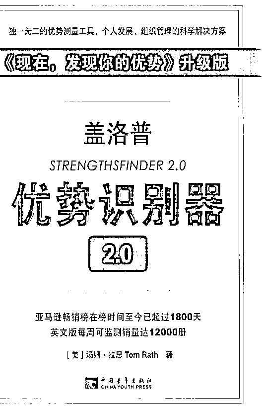

# 请把你的《盖洛普优势识别器》扔进垃圾桶，收下这份手册

如果你也有一本《盖洛普优势识别器2.0》，大概率和我一样，翻了几页就想把它塞回书架。书是好书，但实在太像“专业黑话大全”了，读起来真的费劲。好在咱们赶上了AI时代——我直接请AI把整本书“翻译”成华人大白话，于是就有了这份手册。先声明：一切免费，纯利他分享，不靠它赚钱。想要原书的PDF或Word版，去👸号“从零实现人生富足”回复“盖洛普识别”就能拿到（文件太大，记得耐心）。使用方法也简单：先测出你的前十优势才干，然后直接找对应的编号看就行。想更深入读懂报告，可以搭配我的另一篇《AI时代我们如何打造学习力》。

下面就是34个优势才干的“人话版”。每个才干我都给了一个好记的“外号”，再附上行动指南，建议先收藏、慢慢品。

1. 成就（永动机）：天生工作狂，看不到实打实的结果就不踏实。哪怕这股劲儿没逻辑，也推着你一直往前跑，学会和心里那点“不满足”共存，它反而会成为动力。行动指南：选能让你忙碌且能量化成果的工作，做成事记得给自己庆祝，再定新的目标。

2. 行动（实干家）：不爱空谈，决定的事马上开干，别人还在犹豫，你已经跑出两步。实践、试错、摔倒再爬起，是你最喜欢的成长方式。行动指南：找能自主决策的岗位，让新想法尽快落地。

3. 适应（变色龙）：计划永远赶不上变化？别人头疼，你却松了一口气。突发状况越多，你越清醒，压力越大，你越稳。行动指南：去做需要快速响应的活儿，你的“稳”就是最大价值。

4. 分析（逻辑控）：凡事都要拆开看，用数据和逻辑说话，找不到规律就浑身难受。你追问到底，只想挖出事情背后的真相。行动指南：承担需要研判、能把信息变成决策的工作，别让分析停在纸面。

5. 统筹（资源调度师）：手里一把乱牌，你也能重新洗成最优牌型。你擅长在复杂环境里调配人和事，总能找到最大化利用资源的路。行动指南：参与团队管理、大型活动组织，把你的协调才华全亮出来。

6. 信仰（守誓者）：你心里有一根价值标杆，做任何事都先问符不符合信念。外界再吵，你的步调不乱。行动指南：去价值观一致的地方工作，坦然表达你的坚持。

7. 统率（天生头目）：你天生有带队伍的欲望，喜欢站出来表态、定方向，而且不怕冲突。关键时候，你甚至敢推着别人冒险。行动指南：练习直面冲突的表达，用人格魅力自然带动团队。

8. 沟通（故事大王）：你一开口就有画面，能把冷冰冰的概念讲到让人上头。你希望每句话都被人记住，所以故事、例子、比喻随手就来。行动指南：去教学、销售、市场等面对人群的岗位，打造属于你的故事库。

9. 竞争（较劲王）：没有对手的世界很无聊。你靠比较和挑战来确认自己的位置，赢了心情起飞，输了反而被点燃。行动指南：挑有排名、有竞争的环境，赢了大大方方庆祝，输了就总结经验继续较劲。

10. 关联（链接器）：你相信万物皆有联系，人与人、事与事之间总藏着隐秘的连线。这种视角让你有超出常人的同理心，也让你成为文化之间的桥梁。行动指南：适合做协商、调解类工作，帮团队找到更大的使命感。

11. 公平（天平星）：最见不得不公平，管你是谁，规则面前人人平等。你愿意站出来维护公正，看不惯任何特权。行动指南：去做需要主持公道、制定规则的岗位，比如搭建透明的激励制度。

12. 回顾（考古学家）：做新事之前，你先翻老账。历史、前因后果、成功经验、翻车教训，都是你的藏宝图。行动指南：启动项目前先复盘旧案例，用真实故事去教育新人。

13. 审慎（安全锁）：做什么都先掂量风险，宁可慢一点，不愿错一步。你不是胆小，只是太明白世事难测。行动指南：法律、咨询这类需要给建议的工作很合适，记得把你的决策逻辑讲给别人听。

14. 伯乐（园丁）：别人身上的潜力，你一眼就能看见，还愿意耐心浇水施肥。你天生喜欢看着别人从普通变闪光。行动指南：去做人才发展、带教类的工作，同时也要为自己找一位好导师。

15. 纪律（秩序控）：没有条理会让你抓狂，规律和流程是你的安全感来源。你追求效率，讨厌混乱。行动指南：建立清单和固定节奏，每天复盘检查，效率自然就高了。

16. 体谅（情感雷达）：不用对方开口，你就能感知他的情绪，甚至连没说出口的话都懂。这种天赋让你成为绝佳的倾听者。行动指南：多陪伴朋友、同事，关键时刻做大家的“心理避风港”。

17. 专注（单点聚焦）：目标不明确，你会迷茫；目标一旦定下来，你就是激光，屏蔽一切杂音。行动指南：给自己设定清晰、可实现的目标，也帮身边的人把目标钉在墙上。

18. 前瞻（瞭望者）：别人看眼前，你看远方。你脑子里总有一幅未来图景，好像亲眼见过一样。行动指南：参与规划愿景、制定长期战略的职位，把你的预见变成团队的共同方向。

19. 和谐（和事佬）：你受不了内耗和争吵，只想让大家快快乐乐往一处使劲。你天生是共识的“粘合剂”。行动指南：搭建沟通桥梁，帮不同立场的人找到共同利益。

20. 理念（点子工厂）：你对抽象概念特别上头，喜欢从旧事物里搅出新东西。思考本质、重组概念，都是你的乐趣。行动指南：去做需要创新的岗位，大胆抛出你的奇思妙想，哪怕最初听起来很怪。

21. 包容（大熔炉）：你能接纳各种性格、背景、观点，不给任何人贴排斥标签。你在的地方就有人气。行动指南：多帮新人融入，刻意寻找大家的共同点。

22. 个别（识别器）：你只看点，不看面。别人在你眼里都是一个一个具体的人，而不是群体的代表。行动指南：做需要因材施教、深度理解个体需求的职业，你会如鱼得水。

23. 搜集（信息松鼠）：看到新知识、新资源就忍不住囤积，像松鼠存松果一样快乐。指不定哪天就能用上。行动指南：选信息密度高的职业，同时建一个自己的知识库，别让收藏吃灰。

24. 思维（冥想者）：你脑子里永远在“后台运行”，走路、发呆都在想事情。不把问题想透，你过不去。行动指南：把想法写下来，找高手进行真正的智力碰撞，别只停留在内心戏。

25. 学习（知识海绵）：比起“学会了”，你更享受“正在学”的状态。从零到一的过程让你上瘾。行动指南：学完一定要输出，分享出去既巩固自己，也能帮别人适应新事物。

26. 完美（精工师）：你天生盯着优势看，不喜欢补短板，只想把长板磨得更亮。你不仅对自己苛刻，还愿意把别人也打磨到出色。行动指南：专注发展自己的最强天赋，找一个能帮助他人成功的职位。

27. 积极（小太阳）：再阴的天，你也能看到光。你自带乐观滤镜，还能把这份明亮传染给身边的人。行动指南：在团队里当那个点灯的人，用积极心态为工作注入燃料。

28. 责任（守诺人）：承诺两个字，对你就是契约。答应下来的事，再难也要完成，否则浑身不舒服。行动指南：求职时主动亮出你的可靠，然后真的去接更多责任。

29. 排难（救火队员）：问题越复杂，你越兴奋。别人躲着困难走，你迎着困难上，天生是解决问题的命。行动指南：选择需要不断破难题的岗位，在实战中把技能磨得越来越利。

30. 自信（定心石）：你心里有一套自己的判断体系，不太需要外界吹捧。你信你行，这种笃定自带气场。行动指南：去没人定过规矩的地带开荒，你的自信会感染一帮人。

31. 追求（舞台中心）：你希望自己活得有分量，做出的成绩能被人看见、被人记住。你不接受平庸的过场。行动指南：挑一个能让你主导、有机会出彩的岗位，大方说出你的梦想。

32. 战略（棋手）：你做事像下棋，别人看一步，你能看三五步。眼前的布局都是为后面的胜利做准备。行动指南：留出安静时间复盘和推理，参与新计划的早期设计，你会是关键角色。

33. 取悦（万人迷）：认识陌生人不但不累，还像充电。你喜欢在短时间内赢得对方的认可，人脉对你来说就是能量源。行动指南：去做需要高频社交的工作，把你的联系人网络变成资本。

34. 交往（深交者）：你不追求朋友圈点赞，只在乎少数人的生死之交。泛泛而谈让你疲惫，深度关系才滋养你。行动指南：找一个人情味浓、同事如家人的地方，用心对待每个真正靠近你的人。

好了，这就是34个优势才干的大白话打开方式。别抱着原著啃到怀疑人生了，先测出你的前十，对照这份手册，好好想想怎么把自己的天赋用起来。如果你觉得有用，顺手转发给需要的朋友，让更多人的优势被看见。最后，欢迎到👸号“从零实现人生富足”找我，一起活出丰盈自在的人生。

盖洛普的34个优势主题，就像34扇观察人性的窗。我们每个人都在其中几扇窗后闪闪发光。下面这22个主题，藏着我们如何思考、如何感受、如何与别人协作的密码。读懂它们，不仅更懂自己，也更懂身边人。

【审慎】
审慎不是优柔寡断，而是把风险前置的智慧。他们做决定慢，恰恰是为了把漏洞堵在起跑线前。在外部环境动荡时，保守一点反而成了最优解。他们不会轻易亮出底牌，也不喜欢被催促着仓促表态。如果你是这样的“风险雷达”，试着向别人解释你的“慢”其实是一种负责；在变革期，别不好意思选择求稳；同时多和统率、自信或行动派的人组队，他们会帮你更快落地。和别人合作时，把审慎的人放在容易冲动的团队里，让他负责在行动前扫雷；要尊重他的隐私，更别把他塞进需要争分夺秒拍板的岗位。

【伯乐】
伯乐的眼睛总能看见别人身上的矿藏。他们天生对“人的可能性”敏感，喜欢通过制造挑战来推动他人成长。想发挥这份天赋，你可以列一份“我帮助过的人”的清单，主动选择以培养人为核心的角色，也去找一位能欣赏你内在独特之处的导师，并和“个别”天赋出色的人搭班子。在团队中，多让伯乐型的人站出来表扬那些表现优异的同事，这会强化他们的育人意识，也让他们在推动别人进步的同时，自己也走得更远。

【纪律】
纪律型的人靠着秩序和常规获得安全感。计划表、时间表就是他们的定心丸，意外和失误会让他们浑身难受，他们追求精确，也追求效率。日常中，他们常常不厌其烦地反复检查；假如犯错让自己沮丧，也不用掩饰，这很正常。要主动给自己找疏导情绪的出口，别让烦恼滚成雪球，同时检查哪些环节在偷偷浪费时间和金钱。和纪律型的人共事，记得提前把截止日期交代清楚，不要临时改方案，给他们一个整顿混乱的机会，他们能还你一片井井有条。

【体谅】
体谅型的人自带情感雷达，能够准确感受到别人的感受和立场。他们特别擅长换位思考，能看到一个人正在经历什么难处。身边有人遇到困难时，你可以帮忙提醒周围人“他最近不太容易”；当某人做了一些对自己或他人不利的事，也请该出手时及时制止。做别人的知己或导师很合适，甚至可以设计一个固定的收工小仪式，提醒自己今天的工作已经完成。在组织里，体谅型的人很适合帮你解读某些人心里真正的想法，帮你了解团队对某个行动方案的真实感受，只要你想知道员工或顾客的疑虑，问他们准没错。记得给他们搭配积极乐观的同事。

【专注】
专注型的人需要一个清晰的目标作为定海神针，一旦方向明确，大脑就会自动忽略无关杂音，带着团队直奔终点。给你自己设目标时，要严格守住期限和衡量标准；在团队里，可以主动帮别人把目标拆解清楚；别忘了把目标延伸到八小时之外，让生活也有方向。和专注型的人合作，让他参加有严格期限的项目，定期碰头沟通，每次变化都要解释原因，最好再安排一些时间管理培训，让他的专注力如虎添翼。

【前瞻】
前瞻型的人活在未来的光里。他们是天生的梦想家，看到的是明天会发生什么，也善于点燃别人对将来的期待。如果你有这样的天赋，不妨选择一个允许你把想法往前看的角色，刻意留时间思考未来，并把你的想法大声说出来；多和有“前瞻”特质的同频人交流，也可以和“行动”天赋强的人并肩，把愿景一步步做成现实。和前瞻型的人共事，多请他分享他的蓝图，经常和他畅聊各种可能性，给他看相关的材料，并给他足够的自由去思考未来和做规划。

【和谐】
和谐型的人视和平为氧气。他们努力避开冲突，不断寻找共同点，认为团队气氛融洽比什么都重要。你可以搭建一张容纳不同观点的人脉网；当两个人争论时，不妨叫上其他人一起说说看法；尽量别去承担那些天天对抗的岗位，同时练习无对抗式的冲突解决法。和和谐型的人共事，请尽量把他从战火中拉出来，不要拿有争议的话题反复试探他；当他和别人吵到僵持时，他反而是那个能让大家缓和下来的关键人物。

【理念】
理念型的人对“概念”和“联系”上瘾。他们喜欢刨根问底，习惯换角度思考，总能从别人注意不到的缝里找到新点子。营销、广告、新闻、设计或新产品开发这些需要想象力的领域，简直是他们的主场。日常可以故意给自己引入一些小变化，保持思维活跃；交流之前先在心里把想法打磨完整；再找一个朋友或同事帮你验证点子，或者帮你指出隐藏的缺陷。和理念型的人共事，多分享那些能精准表达某个概念、观点或模式的词语，让他的设计天赋尽情发挥，同时不断向他灌输新观念，他会还你一个更大的脑洞。

【包容】
包容型的人相信每个人都是独一无二的存在。他们不只接纳差异，更主动创造让差异存活的空间。可以试着做那个替被忽视的人发声的角色；新人刚进组织时，带他们认人、熟悉环境；要旗帜鲜明地反精英主义，帮每个人找到自己的贡献点；哪怕必须传递坏消息，也要给不和谐的声音留一个座位。共事时，让他动员团队成员参加集体活动，也可以请他帮公司想一想还有哪些潜在客户、市场或机会，是我们目前还没发现的。

【个别】
个别型的人对“人与人之间的不同”有着近乎本能的洞察。他们留意每个人的风格、动机、思维方式和沟通习惯，也因此特别擅长因材施教。咨询、监督、教学、销售这类职业能放大这种天赋；平时可以练习描述自己的优势和个人风格，并帮别人设计未来；记得真正的多元不在口号里，而在微小的差异中；弄清团队成员各自的长处，然后助推他们发挥天赋。当你觉得搞不懂某个人时，去问“个别”天赋的人；让他在绩效薪酬方案设计或职务选拔委员会里发光，会非常靠谱。

【搜集】
搜集型的人对信息有着松鼠般的热爱。词汇、事实、书籍、物件……都让他们两眼放光。这种好奇心的燃料，适合投在每天都能接触新信息的行业里，比如教学、研究或新闻。给自己建一个能储存、好查找的信息系统；和“专注”或“纪律”型的人合作，可以帮助你保持焦点；还要把知道的分享出去，知识只有流转才有价值。和搜集型的人共事，保证他每天都在情报前线，多分配带研究性质的任务，并且帮他把信息库修得更顺滑。

【思维】
思维型的人靠思考呼吸。他们喜欢独自待在房间里，和问题耳鬓厮磨，逻辑、哲学、心理学都是他们的营养剂。适合开启或继续哲学、文学或心理学的钻研，用日志和日记记下脑子里的风暴；主动去结识那些你认定的“思想家”，并和他们展开硬核的智力对攻。和思维型的人共事，要不断向他的思想发起挑战，多给他整块的时间埋头思考，然后和他一起把他的优势掰开揉碎地讨论。

【学习】
学习型的人最享受的不是学会，而是“正在学”的过程。他们迷恋从笨拙到熟练的曲线，所以能在变化中一直保持弹性。试着把你学到的东西做提炼，建立一套跟踪学习进度的工具；你也可以成为那个帮别人适应新规则、新技能、新环境的人；工作上尽量靠近需要一定技术核心能力的岗位。和爱学习的人共事，为他主动创造学习条件，帮他把学习过程记录下来，并鼓励他往某个领域的专家位置钻。

【完美】
完美型的人对“卓越”有洁癖。他们追求极致，死磕细节，产出总在平均水平之上。最好的用力方式，是把最大的力气花在你最显著的天赋上；把才华也带到工作之外，别浪费自己的光；研究成功人士的路径，接近那些已经把自己优势活出来的人；再找一个能通过帮助别人获得成就感的岗位。和完美型的人共事，让他去专注优化正常业绩，多了解他的优势所在，并帮他开辟一条属于自己的事业之路。

【积极】
积极型的人是行走的暖风机。他们相信生活是好玩的，工作是值得庆祝的，就算跌倒，也要笑着爬起来。在能放大自己优势的环境里发挥呗；主动给朋友或同事安排表彰活动；万一有人觉得你的热情是装的，耐心解释你的积极不是率性而为；也请多多鼓励身边的人带给你更多快乐。和积极型的人共事，让他负责给职场注入动力，整个团队都会被带得更阳光、更有干劲。

【责任】
责任型的人把“承诺”看得比天还大。一旦答应某件事，哪怕再小，也会玩命做完。他们的品牌就建立在说到做到的口碑上。找工作时可以把责任感当卖点；任务超出经验范围时，主动多扛一点；和同款负责任的人搭伙，容易产出惊艳的成果；不过也要学会拒绝，别让自己被过重的责任压垮。和责任感强的人相处，要尊重他内在的准则，不要催促他，定期问问他愿意接下哪些新的责任。

【排难】
排难型的人天生爱解决问题。遇到麻烦，别人皱眉，他们兴奋。他们喜欢拆解、诊断、修好，享受“从卡住到畅通”的爽感。最适合找那种以解决难题为核心的工作；也要记得给自己放假，别苛责自己；偶尔换位思考，能救活一个停滞的项目或团队；持续提升技能，尽早把问题拦在发生之前。当他被一个棘手问题缠住时，默默支持他就好，然后听听他打算怎么改进。

【自信】
自信型的人内核稳定，他们相信自己的判断，做决定时果断，不随波逐流。适合去规则还没建立的起步阶段开疆拓土；让你的自信自然流露，形成感染力；不过要小心措辞，别让表达变成了说教。与“战略”“审慎”或“前瞻”天赋的人结盟，会组成一套无敌的决策班子。和自信型的人共事，给他足够的自主决策空间，并且明确告诉他，他的判断和行动是有效的，他会因此走得更准。

【追求】
追求型的人想要站在高处被看见。他们渴望真正的认可，渴望自己的意见被重视，他们相信卓越本身就是一种成就。你可以主动选择一个能自己决定任务和节奏的位置；和家人或亲密朋友分享你的大梦；把目标定得宏一点，然后盯着进步走；去寻找那些能让自己闪闪发光的舞台。和追求型的人共事，先明白他很需要独立，多即时地表扬他的贡献，并创造机会让他亮相。

【战略】
战略型的人像棋手，总在脑中推演各种剧情。他们能从纷乱的日常中找出最顺的那条路，也很难被惊慌干扰。花时间自省，想清自己的目标模式；把每一种可能的回应和策略都列个剧本；加入能点燃你战略思考的团队；或者参与一个新计划、新公司的早期阶段。和战略型的人共事，请他参与制订计划，给他足够的时间去思考，然后让他做那个开路的先锋。

【取悦】
取悦型的人是天生的社交开关，他们喜欢认识陌生人，并且能在三分钟内赢得好感。职场和社交场都是他们的游乐场。选一份能天天和人打交道的工作；在大脑里建一张不断扩张的人脉地图；报名参加几个本地社团或委员会；认真记住别人的姓名，慢慢整理成熟人名册。和取悦型的人共事，帮他制造每天认识新人的机会，他会替你打开一扇又一扇市场大门。

【交往】
交往型的人不喜欢泛泛之交，他们在意的是深度链接。他们愿意花时间了解一个人的情感、目标、恐惧和梦想，也愿意把自己摊开给对方看。对他们来说，真诚的关系才值得冒险。找一个重视友谊的工作环境；有意识地和接触的人建立信任；和家人朋友保持温度，并努力和同事建立工作之外的关系。与交往型的人共事，请定期投入时间和精力去浇灌你们的关系，直接告诉他你很在乎他，同时也要关注他身上其他的天赋主题。

优势不是用来标榜的标签，而是一套理解人的语言。找到自己发光的方式，也看懂别人发光的路径，我们就能把每个人的能量放到最合适的位置。