# 📕电商选品，这5招我亲测有效，小白也能直接上手！

各位做📕的朋友们好，我是龙哥。之前写过一篇抖音选品的干货，结果被不少兄弟吐槽“说了等于没说”，当时还挺尴尬的。所以今天干脆换个思路，把我们现在实际在跑的📕选品方法整理成一篇合集，希望能给正在做📕的你一点启发。

先纠正一个误区：很多人习惯把抖音那套刷视频选品的方法直接搬到📕，但实际用下来效率真的很低。📕虽然也有推荐机制，但远不如抖音的算法那么成熟，靠刷是刷不出好品的。

真正高效的做法，其实是借鉴淘宝的选品思维：在📕里搜索核心关键词。这里有个原则要记住——优先选和女性需求强相关的品，其次是小孩相关的，最好避开男性需求主导的品类。

## 招数一：从淘宝分类页挖词

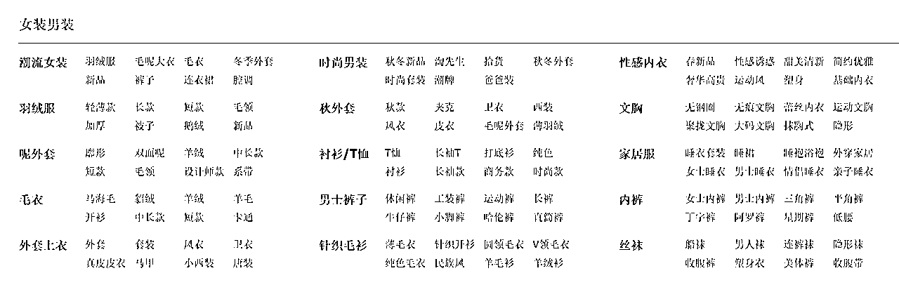

论类目丰富度，淘宝分类页在国内主流搜索电商平台里称第二，没人敢称第一（虽然跟亚马逊比还差一截，但亚马逊那分类词的细致程度，我愿称之为天花板）。

具体操作很朴实：在淘宝分类页里，把适合女性用户的产品词一个个挑出来，丢到📕的搜索框里去验证热度。这过程确实枯燥，初期就是得耐着性子，一个词一个词地去各平台查数据，没什么捷径可走。

## 招数二：盯紧淘宝神店榜

这个板块是手机淘宝里的一个功能，实测下来对📕选品特别给力，亲测有效。

### 第1步：打开手机淘宝，点“全部频道”

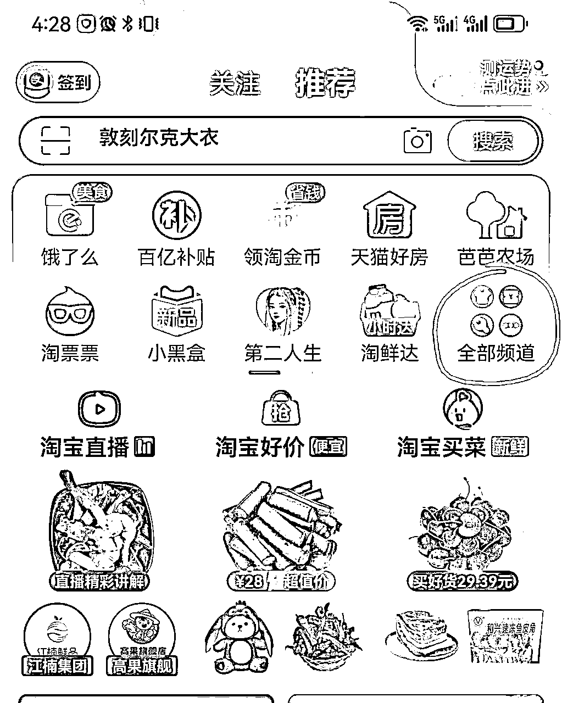

### 第2步：点那个放大镜“搜索”（因为我常用，它就出现在“最近使用”里了）

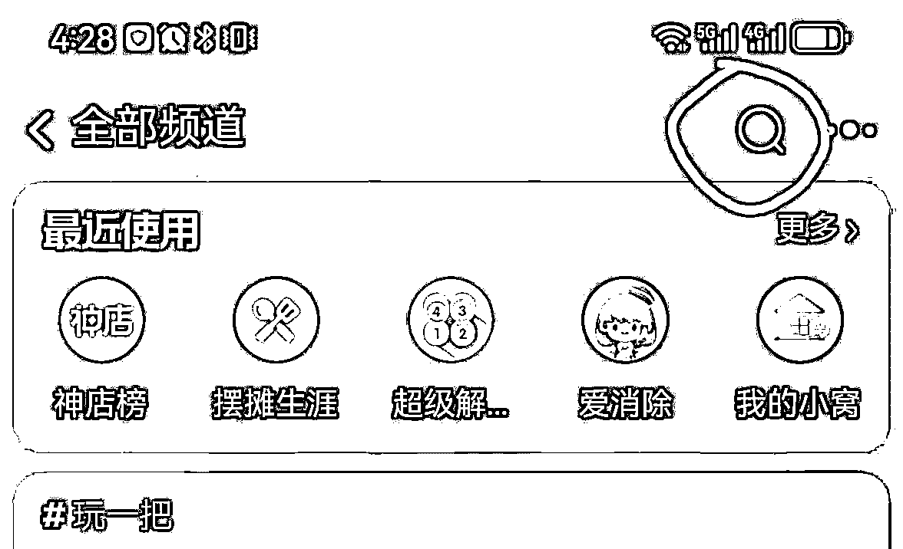

### 第3步：点进“神店榜”

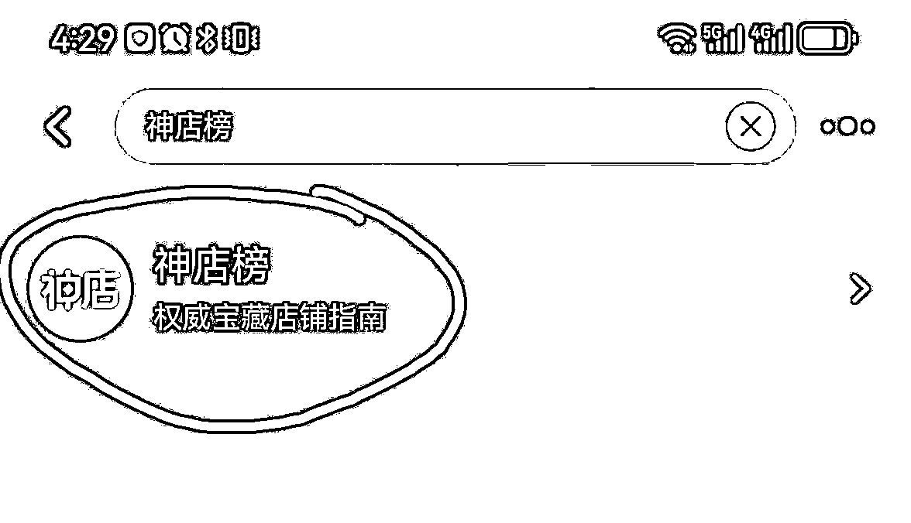

### 第4步：进去后能看到各种类目，选你感兴趣的，比如“潮玩宠物”，再点“浪漫婚礼首饰热卖榜”

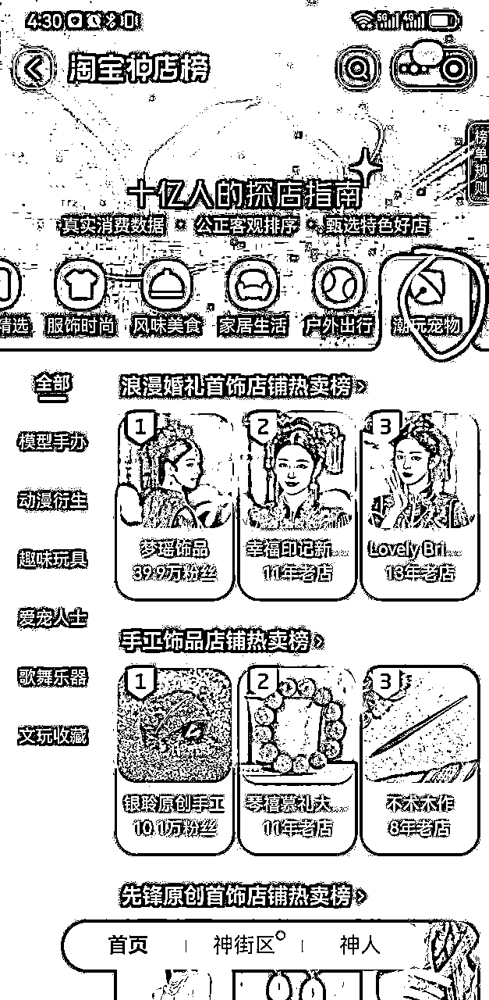

### 第5步：这个页面里基本都是卖婚礼首饰的店，顶部有几个分类，“黑马榜”和“回头客榜”尤其值得多看看

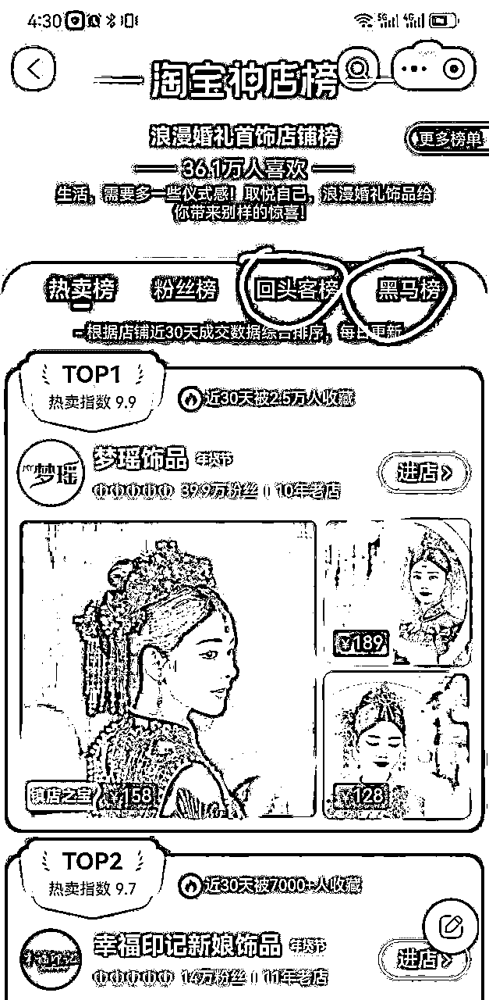

### 第6步：点进具体店铺，按销量排个序，看看有没有让你心动的品。如果有，就去📕搜这个产品的关键词，观察一下它的数据表现

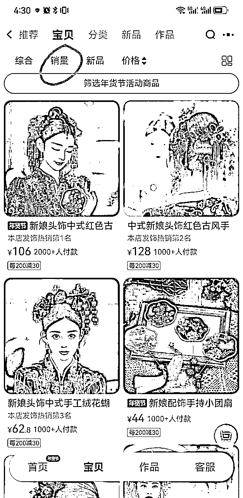

这套方法我拿去试过抖音选品，说实话不太好使。但它用在淘宝、拼多多、闲鱼这些平台上，都是顺手的。

至于抖音嘛，最灵的依然是靠刷短视频来找账号。哪怕被吐槽“说了等于没说”，我还是要说：这确实是目前做抖音选品最好用的路子，没有之一。

## 招数三：淘宝实时热销榜单

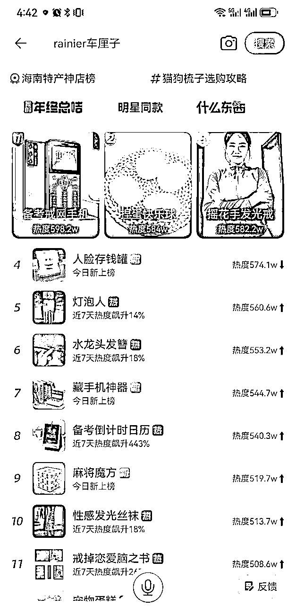

在手机淘宝点一下搜索框，底部就会弹出最近热销的产品榜单，而且每小时都在更新。这里面有不少品，搬到📕同样有的打。

关键是，上榜的都是当前淘宝搜索热度飙升的产品，时效性非常强，蹭热点选品就看这里。

## 招数四：天猫榜单，信息差机会

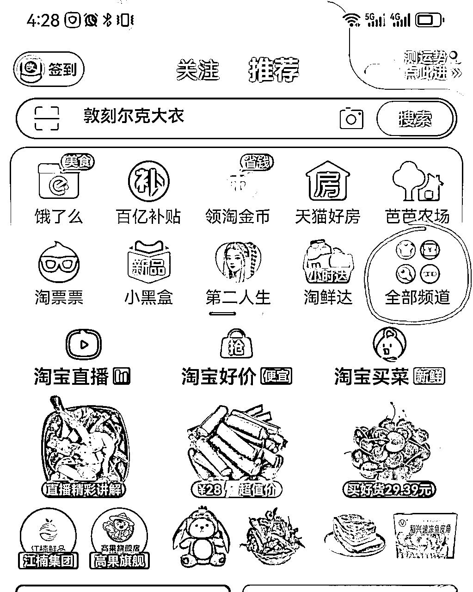

### 第1步：手机淘宝，点“全部频道”

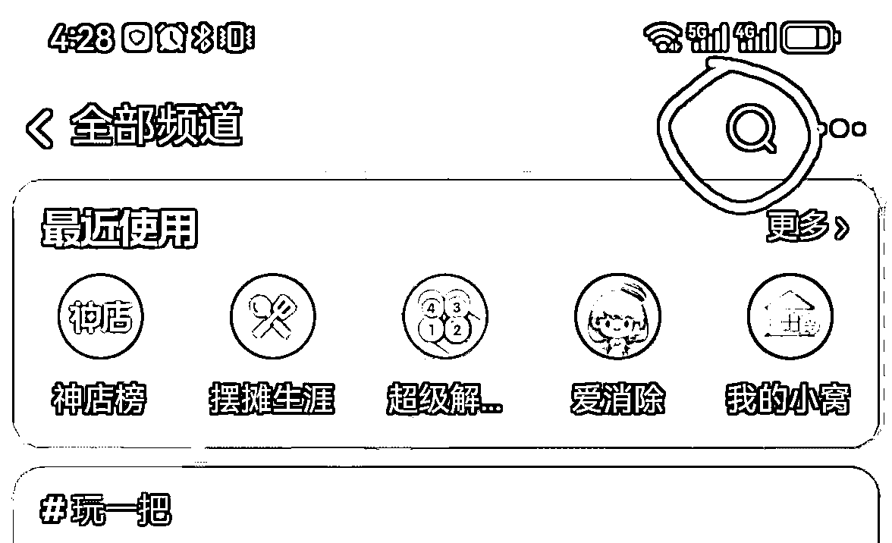

### 第2步：点那个放大镜

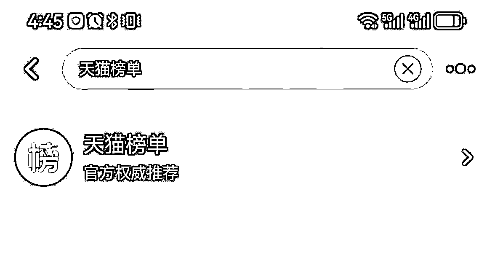

### 第3步：输入“天猫榜单”，再点“天猫榜单”

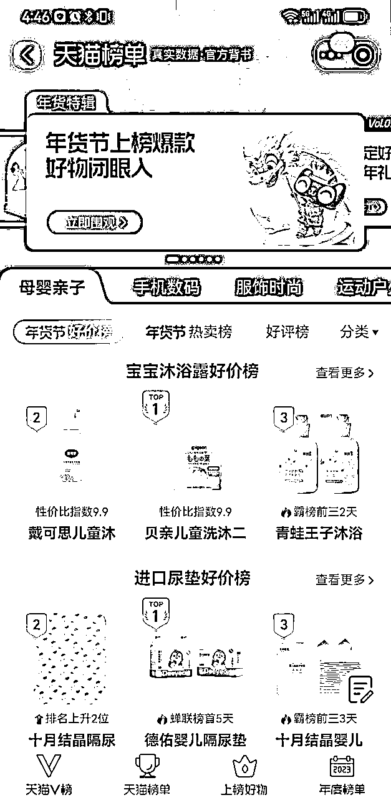

### 第4步：顶部有多分类，选你需要的，比如“母婴”，页面就会列出很多母婴用品，挑第一个“宝宝沐浴露好价榜”就对了

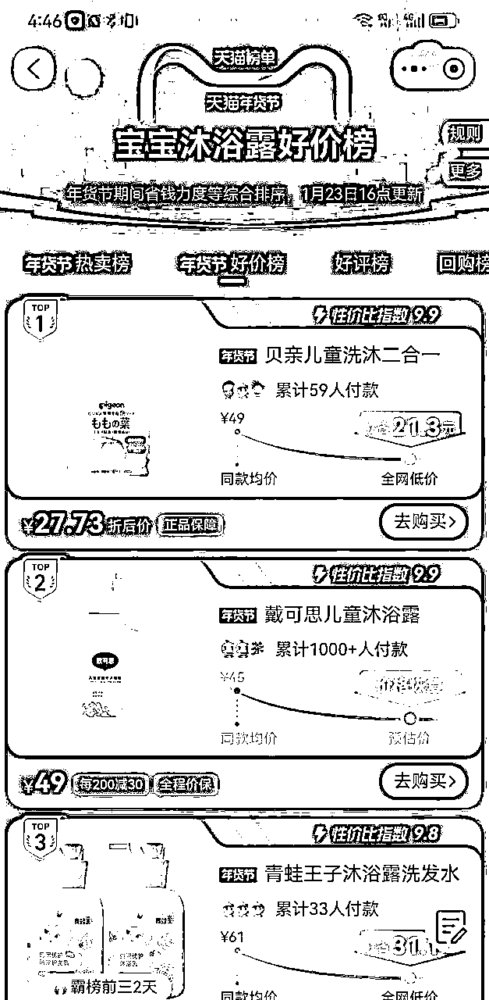

### 第5步：进去就能看到目前天猫卖得最火的产品。重点来了：这些品和📕之间存在不少信息差——天猫竞争再激烈，📕上可能还是一篇蓝海。

## 招数五：5118.com挖词选品

做搜索相关的活儿，绕不开5118。它也同样适用于选品，不过前提是得先有一个“关键词根”（也就是核心关键词）。没有词根，拿什么去搜？

词根从哪来？最简单的方式就是从第一个方法——淘宝分类页里拎出来。如果你已经积累了自己的关键词库，那就直接从库里调取，更快。

### 操作路径：流量词库 &gt; 关键词挖掘

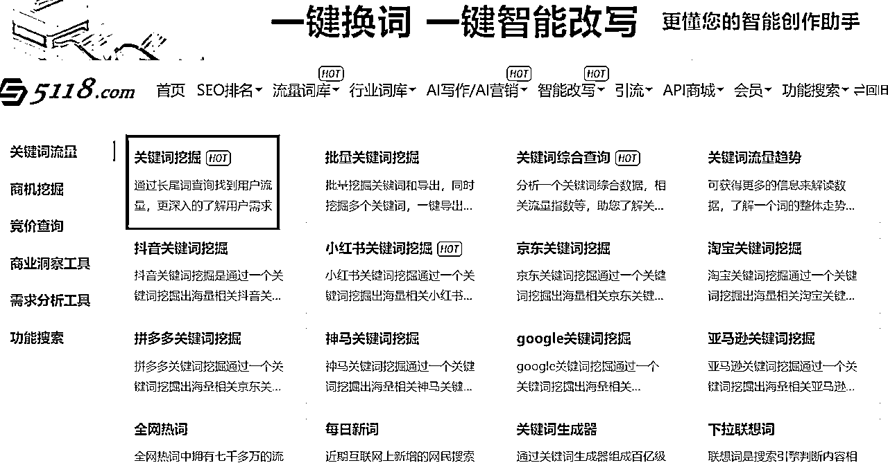

### 比如在输入框里敲“车厘子”，

点搜索后按“移动日检索量排序”，就能看到所有和车厘子相关的高搜索量词。这些词不光能选品，平时写📕标题、埋关键词也能直接拿去用。

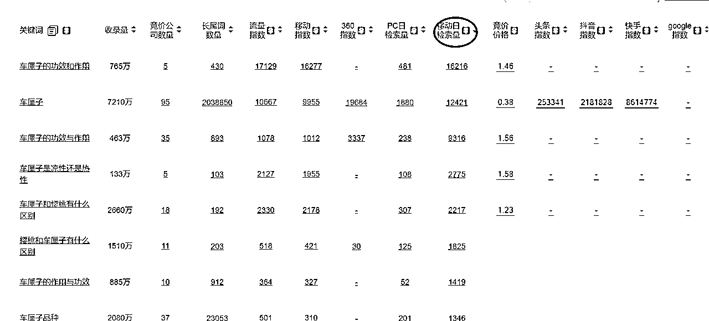

好了，以上就是目前我们团队实操中跑得比较顺的五种选品思路。核心就是：别用刷抖音的思路做📕选品，用淘宝的搜索逻辑去跟关键词死磕。希望能帮你少走点弯路。