# 与“小天”圈友详细沟通细节，双方消除误会

最近在赚钱圈子里，我经历了一次不小的波动，也收获了一次特别珍贵的成长。回想起来，还是想把这些心里话整理出来，和各位圈友坦诚地聊聊。

我是berttao，一路从无人问津的小透明走到今天，靠的就是这个平台给予的机会。说实话，能被部分圈友看见、认可，甚至帖子被加精，那种找到价值感的心情，真的很难用语言形容。这种“利他即利己”的循环，是我在赚钱获得最宝贵的东西。

事情的起点其实很顺利。某位圈友的工作室从11月29日到1月11日，陆续在我这里制作了近十个声音克隆模型，反馈都相当不错。另外还有几位圈友也做过，这里就不一一点名了。

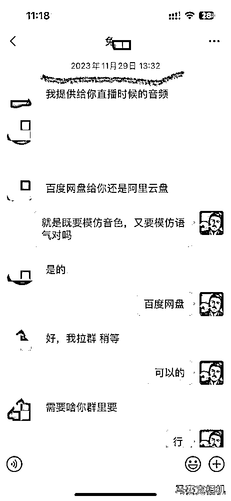

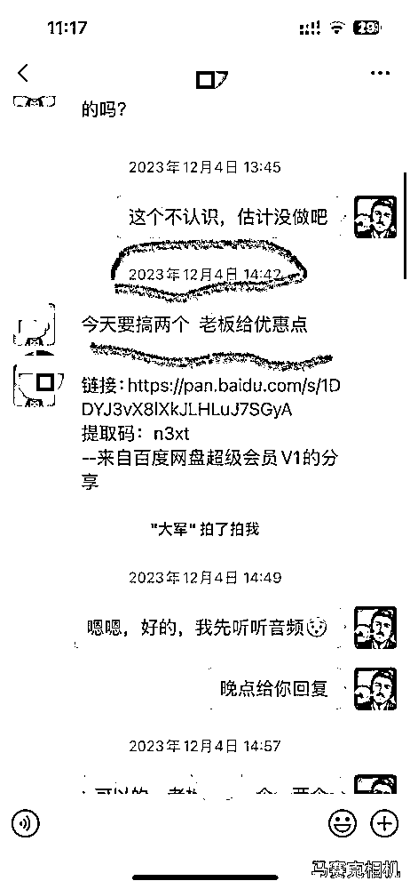

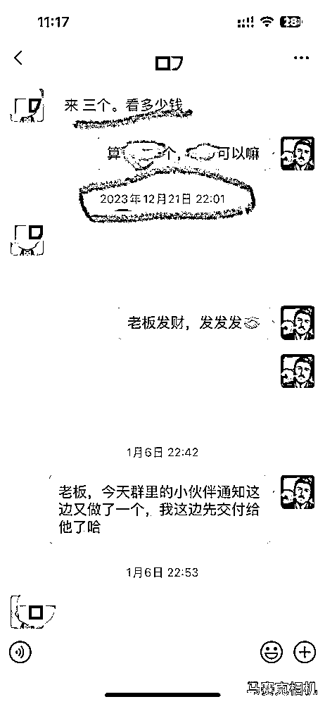

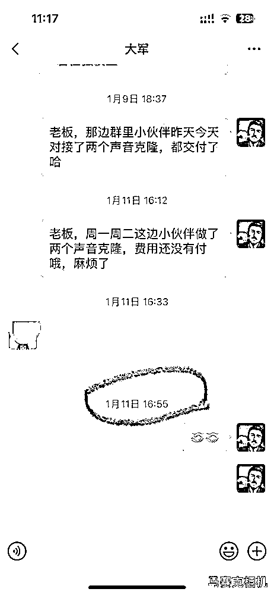

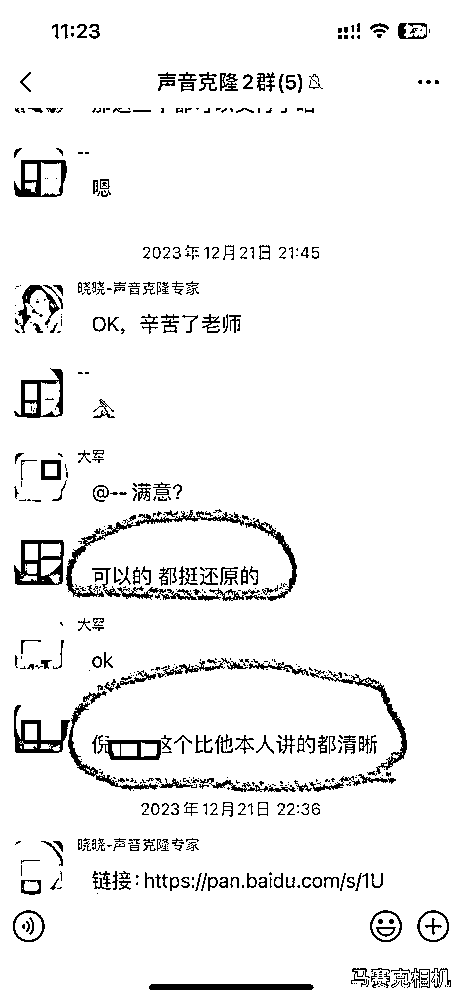

也是在那个阶段，不少优秀的朋友主动加了我。哪怕平时只是简单聊几句，翻翻他们朋友圈里分享的日常，都让我觉得眼界打开了不少。换作从前，想接触这么厉害的人，可能连好友申请都发不过去，哈哈。

后来，因为自己确实通过声音克隆赚到钱了，又在几位圈友的鼓励下，决定“赶鸭子上架”做一期声音克隆教学。当时主要做的是视频教程，核心内容无非两方面：一是技术层面的模型训练方法，二是如何在闲鱼和淘宝上精准找到客户、完成接单闭环。

但随之而来的，是我个人精力上的捉襟见肘，加上培训经验确实不足，在和其中一位学员——圈友小天沟通时，出现了一些误解。当时因为正忙，没太把苗头放在心上。直到助理鱼丸联系我，我才知道小天在圈里发了维权帖。

得知之后，我首先把全部课程资料交给鱼丸审核，同时主动联系上小天本人。经过深入坦诚的交流，双方终于把话说开了。我真诚地向小天道了歉，也认真描述了项目本身的逻辑和特点。核心的分歧，主要集中在几个方面：

1. 关于“零基础”这个宣传词，我承认是有些夸大了。声音克隆本身还是有一定技术门槛的，开源软件也天然存在一些不成熟或者使用上的小问题。我是这个项目的原创者，确实对自己的课程过于自信，想着普通人只要照着操作就能轻松做出来，却忽略了对学员技术底子的考量，耐心也没给足。就拿昨天一位客户举例，他看中我做声音的效果，直接付费学习，后来又一口气下了6单让我帮他训练。

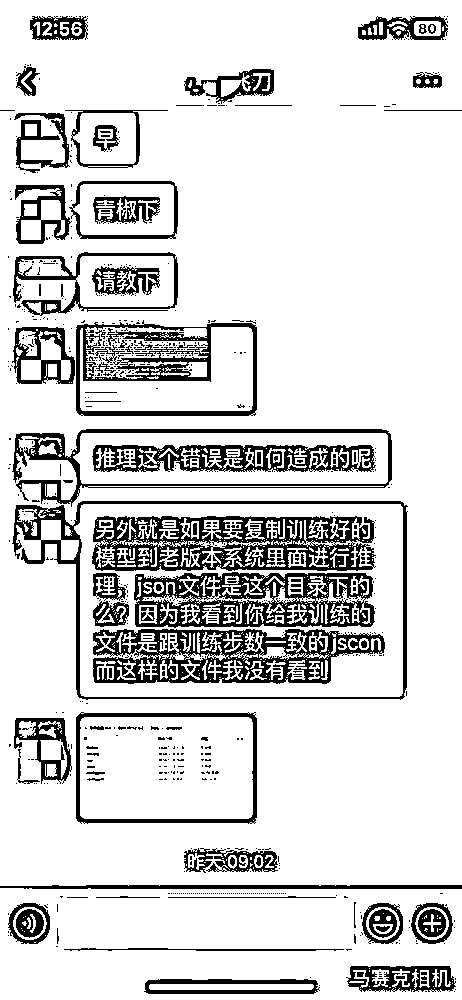

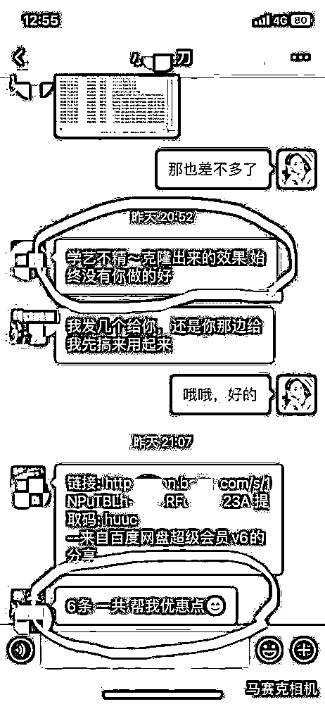

2. 项目使用的所有工具软件，都来自GitHub开源项目，这确实是事实。但我不觉得这能成为否定整个项目的理由。本质上这更是一种资源整合能力。项目本来就是运用各种工具来解决问题的，重点在于把工具串成一个完整的解决方案。尤其是一对一咨询这块，关键不在于工具是谁开发的，而在于：客户的问题是什么？我们有没有方案解决？哪个软件、哪个版本最合适？客户要翻唱用哪种模型？要文字转语音带情绪带语气该训练哪种音色？中文用哪个版本、日语用哪个版本、韩语用哪个版本？这些靠的是实打实的经验积累，是帮学员避坑和给建议的核心能力。

3. 关于引流方式，这是我和小天分歧最大的地方。目前我的主力流量池是10个闲鱼号，闲鱼运营确实是我的强项。我专门用闲管家统一管理这10个号，每天早上借助影刀自动化工具完成自动上品，一天上新4个商品，分散发布到4个不同城市。

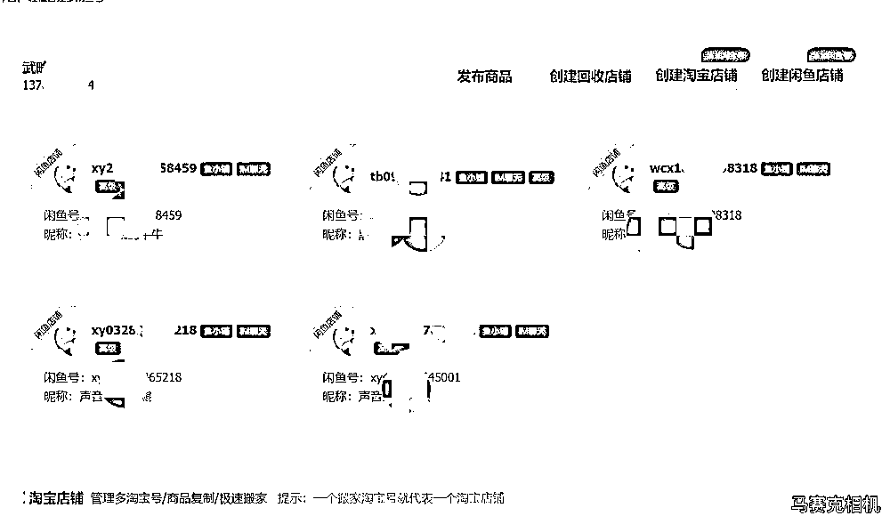

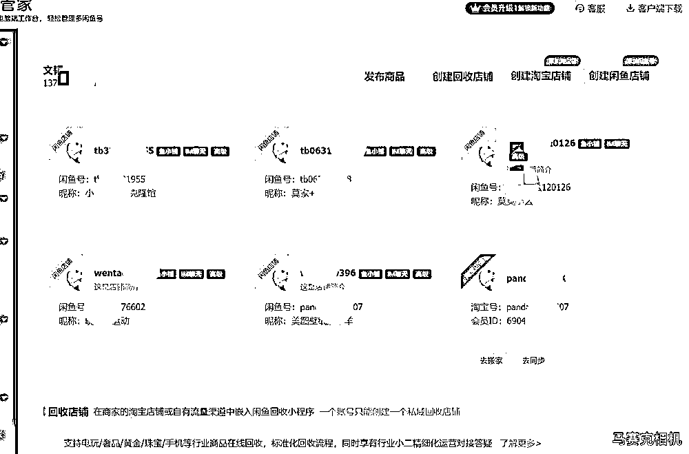

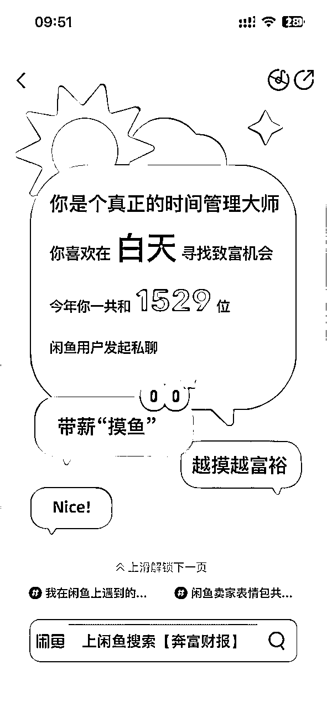

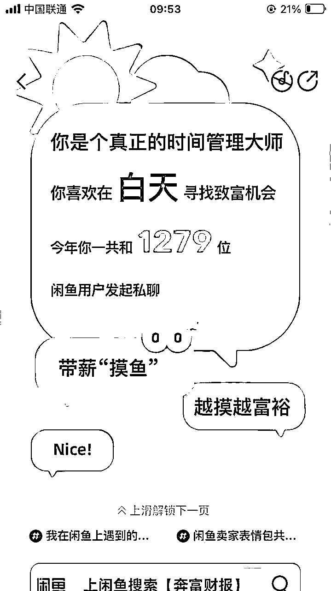

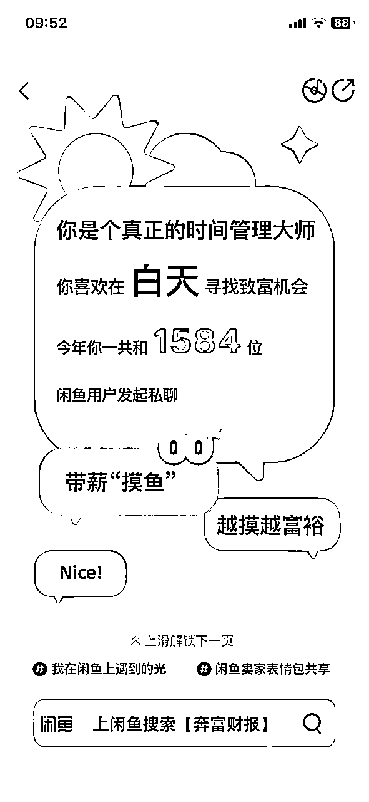

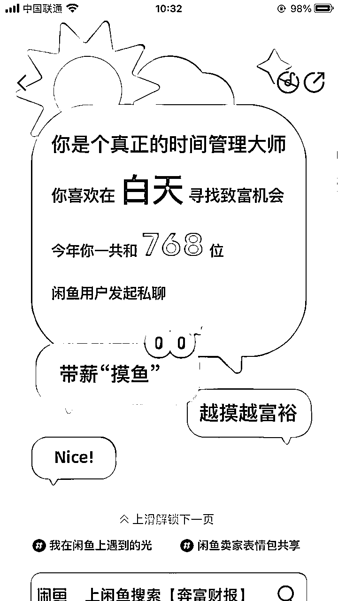

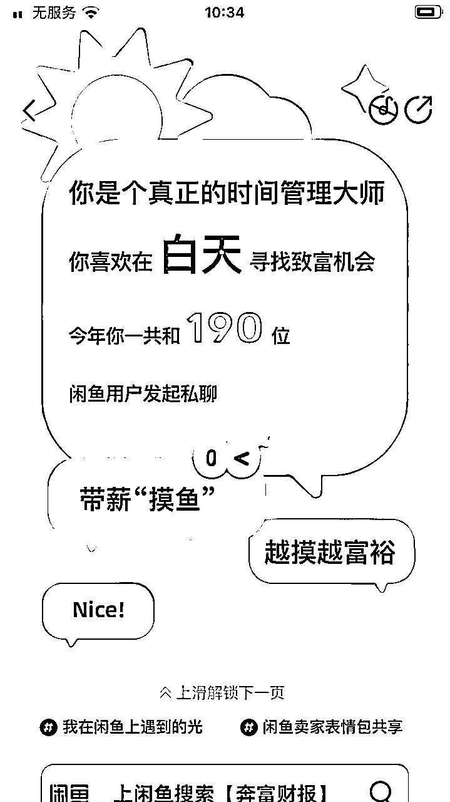

4. 淘宝那边其实我还算个新手，经验不算丰富。小天也知道我的性格，我向来不夸大事实、不吹嘘数据。但即使这样，也有3个商品做到了品类前三，而且完完全全是靠自然流量，一分投流费都没花。

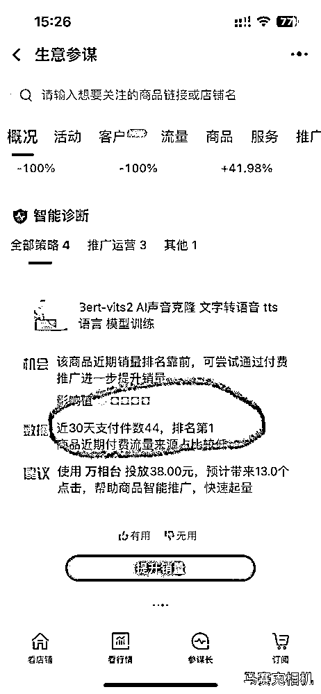

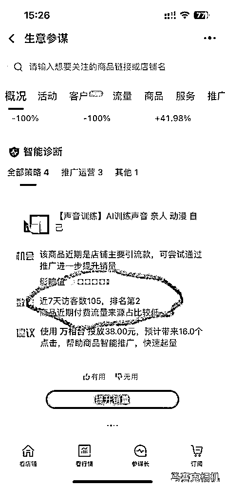

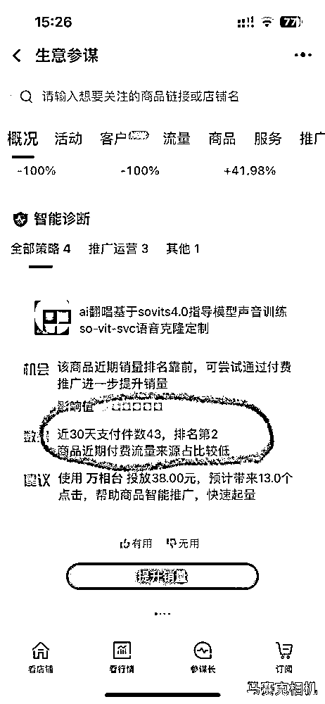

5. 另外我还运营着几个抖音号和几个视频号，每天大概能引流十个左右，确实成绩平平。小天在小红书做到了10W+的收益，她觉得我引流这块太弱，这点我也完全承认，自己确实还有很大提升空间。

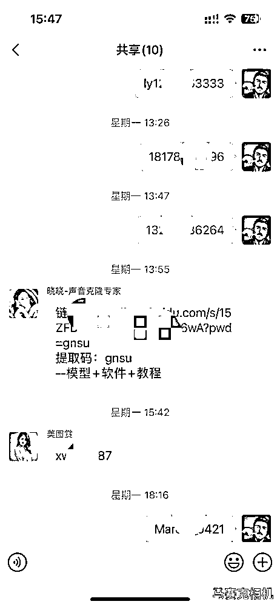

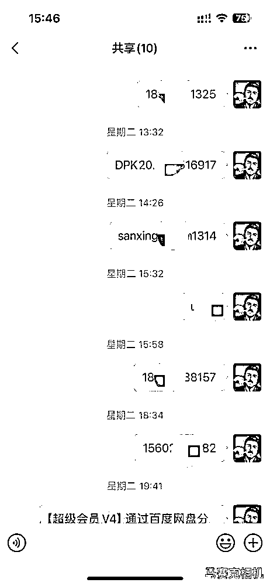

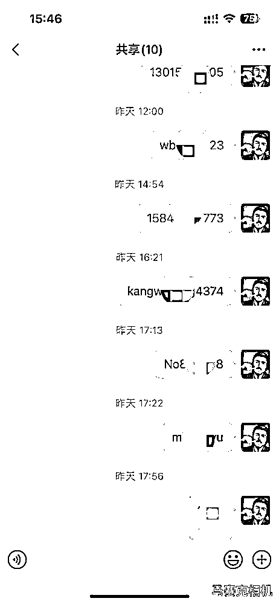

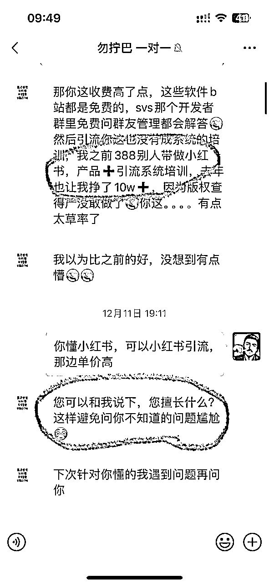

但我想说的是：真的假不了，假的真不了。以上所有截图，全部来自我个人的真实后台数据。客观来讲，这个项目每天只要认真做两到三单，一个月下来过万收入是完全可以实现的。再加上过去大半年积累的私域用户，我已经沉淀了上千精准客户，至少300多位客户都做过声音克隆，几乎零差评，复购和转介绍的数据也相当可观。当然，如果有人指望靠它月入十万，我的回答是：很遗憾，这个项目做不到。

最后聊聊我个人的复盘吧。

第一，既然收了学员的学费，就必须投入百分之百的精力和热情去答疑解惑。耐心这件事，怎么强调都不为过。这件事是我做知识付费以来最重要的一个拐点，也是给我上的最生动的一课。

第二，课程本身要持续打磨。学员有异议、有想法，这太正常了。姿态放平，站在和学员平等的位置去理解他们的困难，而不是居高临下地俯瞰。后来我已经迭代了几版课程，尽量把操作步骤做得更简化、更直观、更好上手。

第三，交付体系也需要升级。虽然我背后有工作室，但学员交付这块一直是我一个人扛着。接下来我打算专门请教圈里的大佬，多学习成熟的知识付费是怎么做交付的。

最后说说结果吧——我和小天后续沟通得很顺畅，误会彻底解开，结局也还算圆满。和气赚钱嘛。也借着这个机会，祝所有圈友龙年顺顺利利，财源广进！