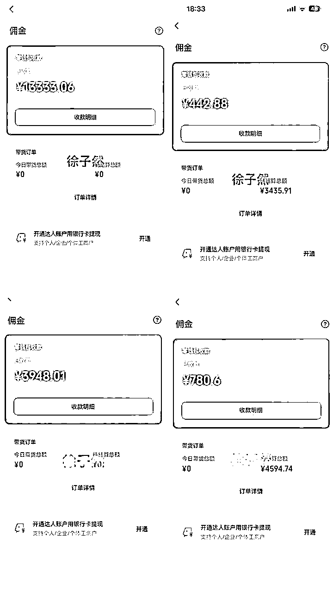
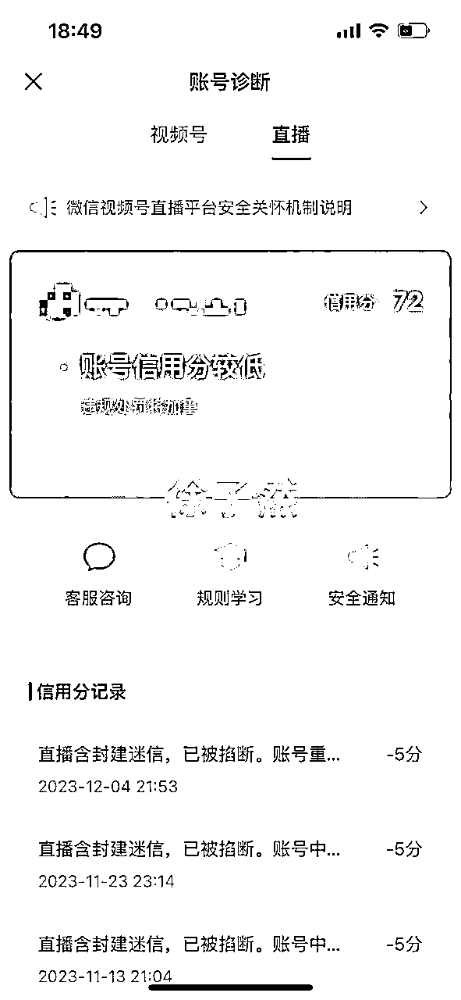
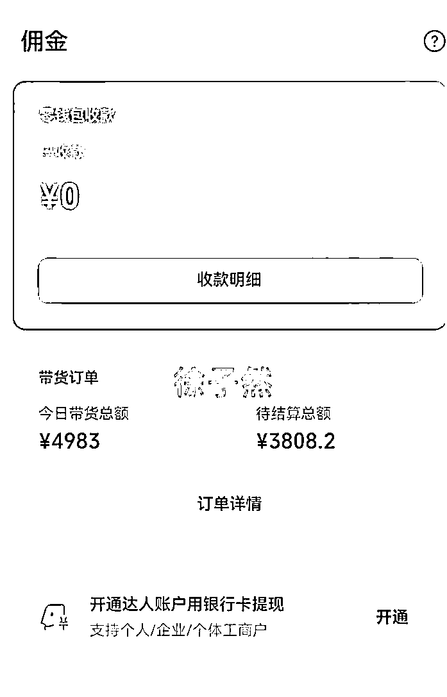
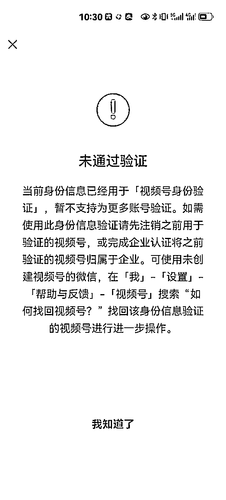

# 从小白到月入4万+，我用3个月在视频号里踩过的坑，我帮你填平了
作者：龙哥

先说声谢谢，@梁靠谱 @李千万 @芷蓝 ，这三个月能少走弯路，多亏了三位老师的点拨。

我是龙哥。2022年底我辞掉了工作，2023年3月和我老婆一起正式杀进互联网，4月加入了龙哥盟。这是我在赚钱的第一篇复盘，里面全是我这三个月真实的踩坑经历、转变思路和具体的解决办法，希望能帮到正在犹豫的你。

我真正开始操盘视频号是在9月中下旬。当时报了赚钱的视频号航海营，之前一直折腾📕，对选品和运营都是一头雾水，想做却不知道从哪下手。可能是想把押金挣回来，也可能是被逼到了墙角，我决定先干起来。

看了航海手册的选品课，我用了最笨也最直接的方法：去直播广场看大家在卖什么。发现秦东魁老师的国学书籍和摆件在广场里铺天盖地，橱窗上全是已售1000单、2000单的标签。巧的是我老婆之前就买过他的书，于是我就抱着试试看的心态，交了100块押金把店铺开了，第一条混剪就开始剪了。

混剪我之前只在📕用过基础操作，看同行视频要换背景、换音、加贴纸，我完全不会。于是跑去B站找教程，把每一步操作都手写下来整理成笔记，还按要求打卡交作业，居然被加精了。

就这样每天稳定剪3条发视频号。第三天早上刷手机，后台显示当天出了17单。我又惊又怕，惊的是真的能出单，怕的是我只看得到订单看不到佣金，总觉得是幻觉。截图发到航海群里，群友帮我找到了订单详情，当天佣金236元，握着手机愣了好久。

信心上来我就又开了两个号同步发。很快迎来了第一个坑：只要一条视频播放冲到5000左右，系统立刻提示非原创限流，要求补10条原创才能恢复播放。

我当时解决原创的有两招，一是直接用视频号自带的模板拍10条怼脸自拍，二是拍10条风景随拍。后来我研究同行才发现门道：他们视频第一秒都是秦老师的原片，中间全换成自己拍的风景。于是我跟着学，大量外出拍摄风景素材混剪进去，播放量立刻起飞，几个视频都跑到了十几万。

航海教练说过，视频播放到5000就该开播承接流量。我的第一个视频刚起量我就跃跃欲试，但总觉得没准备好，还是靠自然流出单。直到看到同行都在语音直播，循环播放秦老师的录音一天下来能卖几十上百单，我也心动了，照着做了。

结果播了10分钟就被限流了。复盘发现录音里有很多敏感词没处理。于是我去抖音找秦老师10分钟左右的长视频，剪掉可能违规的内容，拼成50多分钟的长音频再直播，还是不行。后来我们换成真人出镜，我老婆直接念书，我在评论区引导。

第一场真人直播播了1个多小时，场观120，没有成交，但算是跨出了舒适区。第二天继续播，30分钟后出了2单。那场直播的核心是老婆讲解时不急不躁，把书里有用的部分讲得很细，用帮助别人的心态去讲，客户信任感一下就上来了。虽然只有2单，却给了我们极大的底气。

好景不长，连续几天直播后，平台通知橱窗和直播功能被封7天。那天正好中秋，我一条视频爆了15万播放，手里月饼都不香了。复盘后发现主要是讲解时不小心带了违规词，国学赛道本身就容易触发封建迷信的提示，一点就封。

我换了个新号继续，刻意规避敏感词，账号能存活的时间长了一些，但场观卡在300左右，单日GMV只有几百。观察同行发现，场观1000+的主播直播时长都比我长，于是我们开始拉时长：每天早上9点开播到下午3点，晚上7点再播到11点多。

拉时长3天后场观破500，被封的那個号也自动解封了。之后我们两人轮班，白天一人一个号，晚上再各开一个连播。连着5天后，单天GMV直接冲破4000，那天晚上我们俩真的激动到睡不着。

那段时间我们每天就是拍风景、剪视频、开直播。就在一切看似顺起来的时候，平台又提示作品非原创违规。我明明已经去重、改音、用自己的素材，依然被判定。我没有干等，选择直接申诉。申诉话术我放下面，供你参考：

尊敬的视频号官方：你好，我是刚加入视频号的新创作者，也是🛰️生态的长期用户。昨天发布的一条视频被判定违规，我对规则理解不足深表歉意。从昨天开始我发布的视频播放量均为0，我猜测是被限流了。后续我会认真学习并严格遵守平台规则，用心创作。恳请官方解除限制，感谢视频号官方。

我觉得想在这个平台长期做，就得讲规矩。有人骂官方，有人空等，我选择正经申诉。第二天就解封了。

解封后我开始优化直播流程。直播间粉丝大多是年纪稍大、爱国学的群体，于是我尝试在开播前10分钟，带着大家一起读国学。没想到止留效果特别好，这也成了和同行的差异化。

后来每天开播，粉丝都会提前问今天读不读书，甚至有人提前把书摆好等我们上播。阅读过程中新进来的观众会问这是什么书怎么买，我就用小号在评论区引导下单，很好地承接了第一波流量。

为了做留存，我把数据要成了习惯，每5分钟就要一次点赞、互动、成交。我们的话术大概是这样：

点赞话术会引导大家长按右下角大拇指，顺便点赞积福报，还会点名表扬正在点赞的观众。
互动话术会让看过和没看过的分别回复1、2，然后让看过的人分享读完了没，安抚情绪。
成交话术会强调书要送给身边需要的人，建议买两本一本自用一本送人，强调积累福报。

目的只有一个：让用户停留。靠着不断要数据，我们在没有任何付费的情况下，把场观从100拉到2500多，在线人数从零到破百。平均一场地GMV在2000多，最高一场地过5000。从10月初做到11月中旬，两个号累计出单2500多单，变现2万+。

但我还是想换品了。原因有三：一是这个老师的品利润很薄；二是再怎么规避，直播还是会被反复限7天；三是很多爆款品都没开通带货权限，无法最大化收益。所以11月中旬我就开始找下家。

11月底我认识了李千万老师，报了私教。才明白自己摸索多浪费时间。12月初跟李百万老师学实拍滋补品赛道，这是我第一次真正意义上的实拍，一天拍了200多条素材，然后套爆款脚本剪辑，每天发4条。

第二天早上6点，一个视频直接爆了，我立刻去承接流量。结果开播不到2分钟就被掐断，直播和橱窗被封3天。违规原因是标题不规范。我忍不住申诉：

尊敬的视频号审核人员您好，审核可能存在误判，直播间标题并非违规宣传，我本意是日常聊天，不存在违规目的，恳请重新审核恢复直播和橱窗。

中午12点左右收到解封通知，橱窗已经出了11单。我赶紧上播，开播几分钟涌入300多人。虽然紧张，但我一直重复逼单话术。当天热卖标识从X2涨到X53，粗略算利润1000左右，下播一看佣金3800多。第一次感受到高佣金的爽感。

做滋补品不到一周赚了8000多，一个月直接破2万。当然高佣金伴随高风险，就算实拍也经常限流封号，做视频号3个月，限流封号已经是日常操作，只得不断规避和调整。

账号被加热不了怎么办？我总结了三步：先拍10条怼脸原创视频，每隔40分钟发一条；发完去申诉入口申诉【申诉入口】(检测链接)https://channels.weixin.qq.com/pandora/pages/appeal/index#account-detail；申诉话术：尊敬的视频号官方，我已按要求发布10条原创视频，请恢复我的权益。一般3到6小时就能恢复。

视频号身份验证不过怎么办：
第❶ 苹果手机未通过验证
❶ 需要手机连电脑
❷ 下载【爱思助手】
❸ 在爱思助手里找到🛰️历史版本，下载8.037左右的版本即可。卸载重装前记得备份聊天记录。
第❷ 安卓手机未通过验证
❶ 浏览器下载【应用宝】
❷ 应用宝下载【豌豆荚】
❸ 豌豆荚里搜🛰️找历史版本，下载8.037左右版本即可。卸载重装前备份聊天记录。

这些就是我从零到月入4万+的完整踩坑和解法。每一个项目都能赚钱，人生没有白走的路。别总停留在想象，要去行动，路虽远，行则将至。希望这篇复盘能帮你少交点学费，快速启动。