# 图文矩阵号也能做到日更百张？高效批量生产的方法
作者：龙哥

你是不是这样的情况？

你已经有选题、有方向，甚至手里同时在做几个账号，可就是卡在“没时间做那么多内容”上，一直做不出来量。

你是不是也这样？

想入局📕、抖音，却因为不爱出镜、不敢露脸而犹豫📷......

想发笔记，却对拍视频一窍不通📹，也不知道哪种题材才容易吸粉......

幻想着靠📕变现，等粉丝积累起来就能接广告，结果发出去的笔记只有几十个👀......

想做📕带货，却对选品👜、电商运营完全无感，还要自己拍视频引流🛒，素材根本找不齐......

明明有思路，却抽不出整块时间⏱️来稳定更新，账号断更、掉粉......

这些坑，我以前全踩过。下面这套思路，是我踩坑后总结出来的解决办法......

我是毫末，一名沉迷研究📕图文套路的程序员。

图文笔记你肯定不陌生。📕最早靠图文起家，后来抖音、👸号也都支持图文，👸号的图文甚至被叫“小绿书”。

相较于视频，图文加载快、信息密度高，用户几秒就能看完，阅读体验清晰直观。尤其在📕，图文笔记依然非常显眼，吸量能力一点不差。

你以为现在全是视频的天下？就像几个月前👸号流量主爆火一样，图文也正在悄悄反攻。

随便举几个例子。心理学这个赛道，一个笔记轻松几千上万赞，用的全是模板化图文，现在有13万粉丝，数据条条都是爆款 🔥

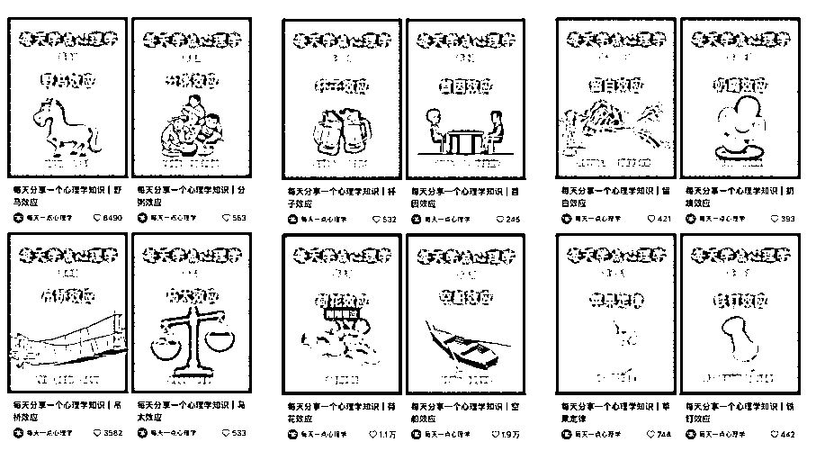

再看这个养生号，单篇2.5万赞，全部是图文，只更了14条，一个月不到涨粉近3000，已经开始接单变现：

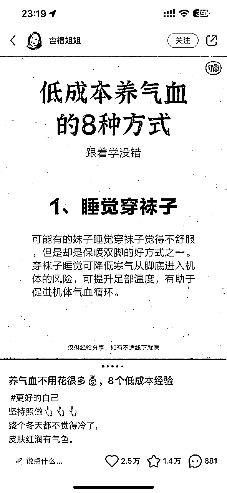

更夸张的是这个正念账号，每天笔记都几千赞，粉丝4.3万，广告合作已经做得很频繁。

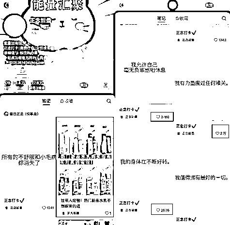

这个正念号正好撞上了经济下行期的情绪需求。经济好时谈赚钱，经济差时谈疗愈，正念就是在做心理抚慰。这类内容，换你做也能跑起来！

除了📕，抖音和👸号的图文流量也依然很猛。下图是养生、育儿、心理学在抖音图文上的表现：

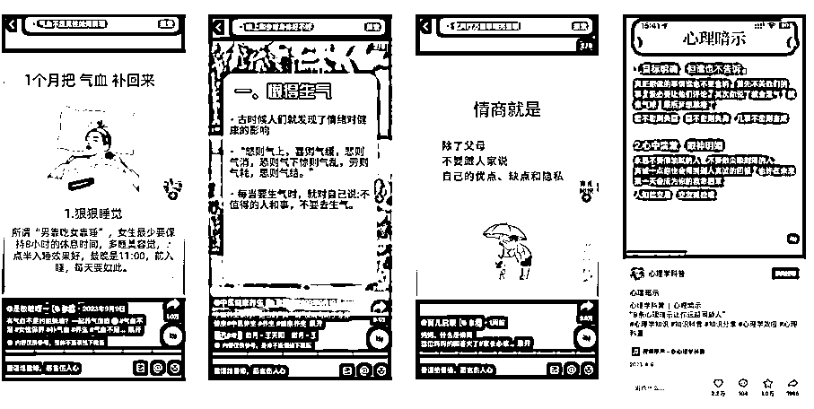

看到这里你可能会问：这些图是不是要一张张P？当然可以手动P，但那样太耗时间了。

看完这篇的人，完全不需要自己手工做图。

# 实操教程

直接上干货。

这次批量做图的组合拳是 ChatGPT + Canva。ChatGPT负责批量写内容，Canva负责批量出图，两者配合效率极高。注意，Canva的批量编辑功能需要 Pro 会员。

假设我们要做男性成长的图文矩阵。

第一步，用 ChatGPT 生成内容。

我用的提示词如下，关键点是必须让它输出表格格式！

ChatGPT 按要求生成了对应格式的内容：

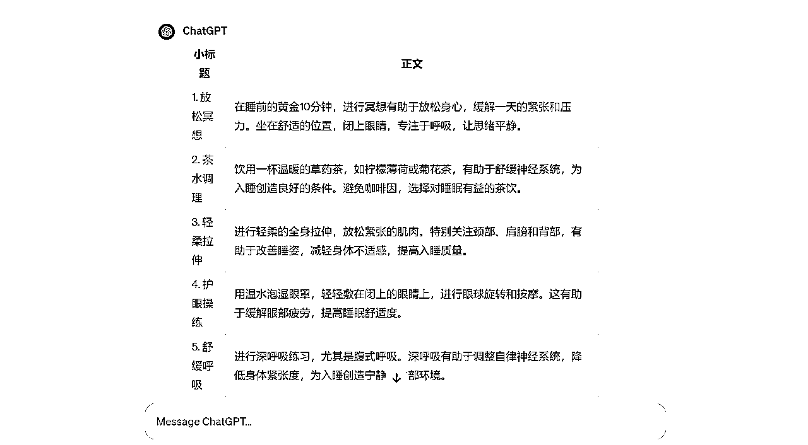

复制时一定要直接选中复制，不要点内容下方的【复制】按钮，否则表格格式会丢：

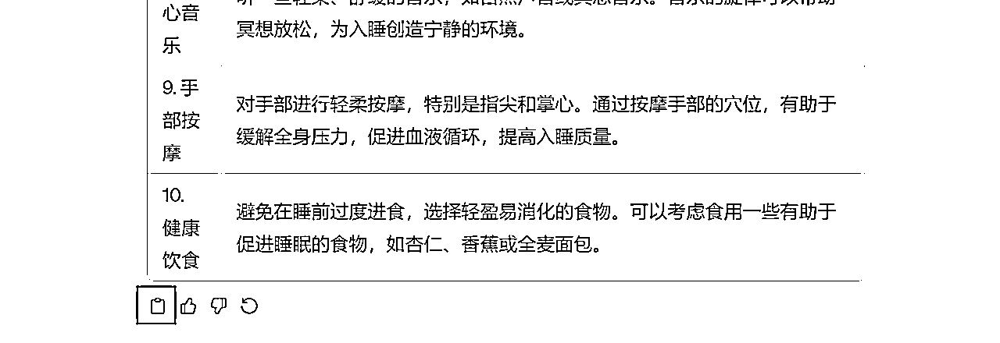

第二步，把内容整理成表格

复制后的内容长这样：

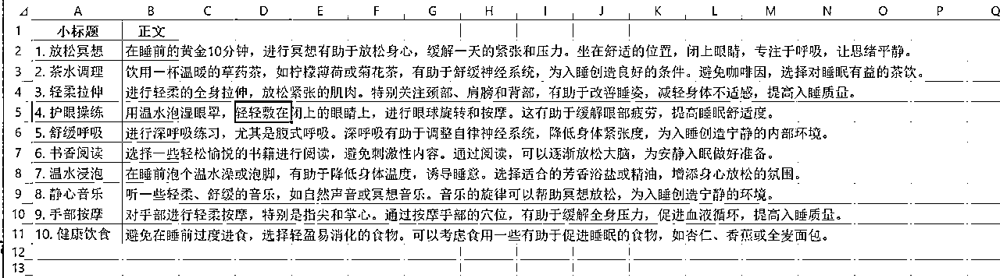

把内容粘贴到表格中后，另存为 csv 格式。Canva 只能识别这种纯文本格式的 CSV，保存时如果弹出兼容性提示，直接全部点“是”。

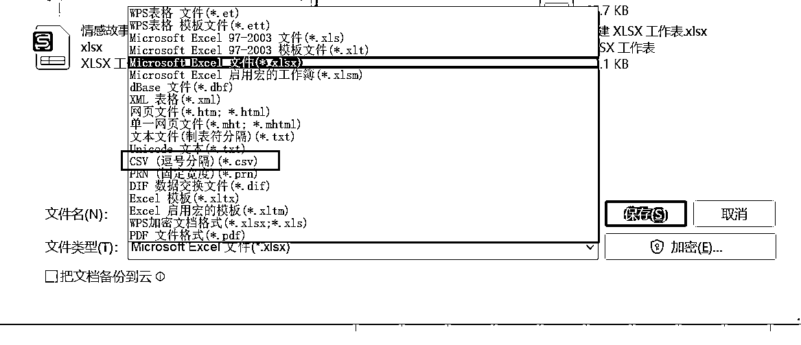

第三步，在 Canva 里建模板并导入数据

先建好一个设计稿。

点右上角【创建设计】，自定义尺寸，单位选厘米，宽30高40，刚好是📕常用的3:4比例，点击创建。

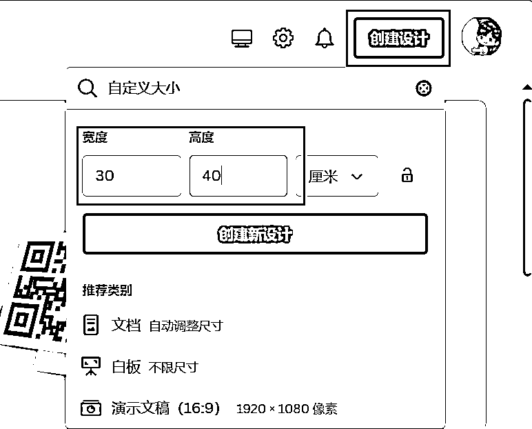

选一张好看的背景，排好标题区和正文区的位置。

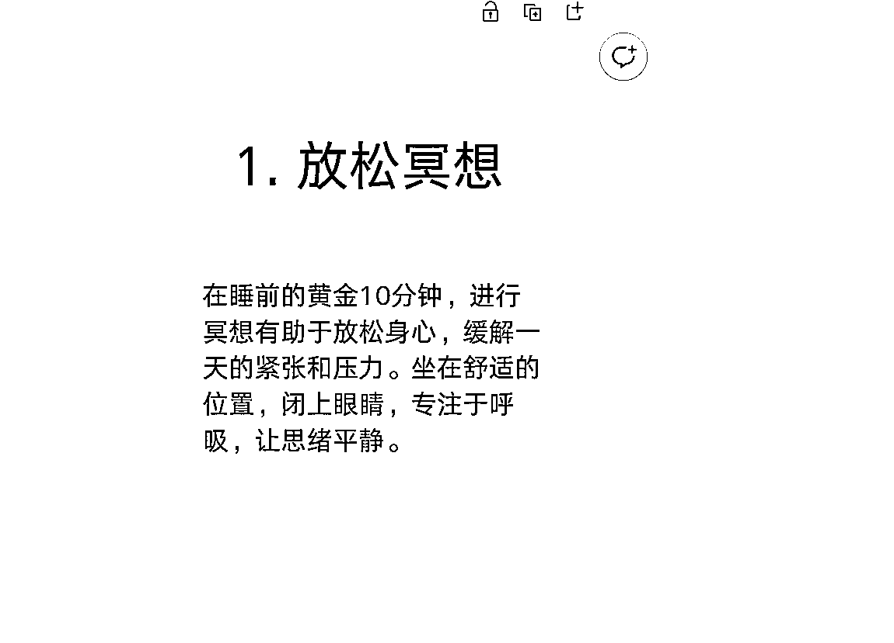

开始批量生成

点击左下角【应用】，再点【批量创建】。该功能同样需要开通会员，约30元/月。

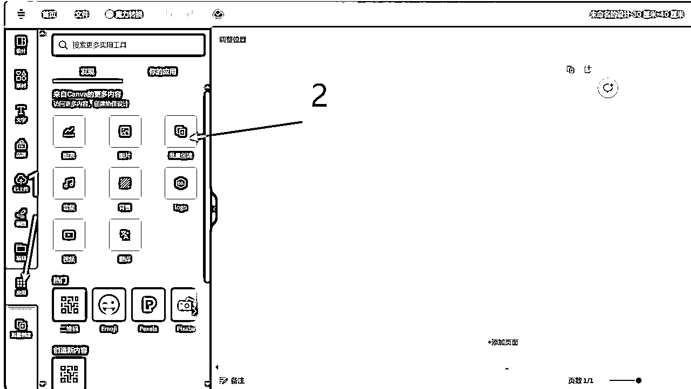

点击【上传 CSV】，选择刚才的表格，系统会提示你关联字段。

右键模板里的“小标题”，选择关联数据，把模板里的各个位置分别对应到表格里的列。如果出现乱码，回头看乱码处理部分。

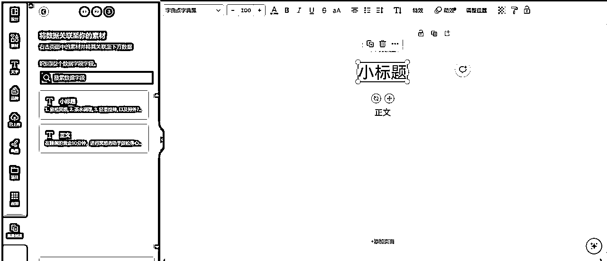

关联完成后点继续，就会自动生成多张不同的设计稿：

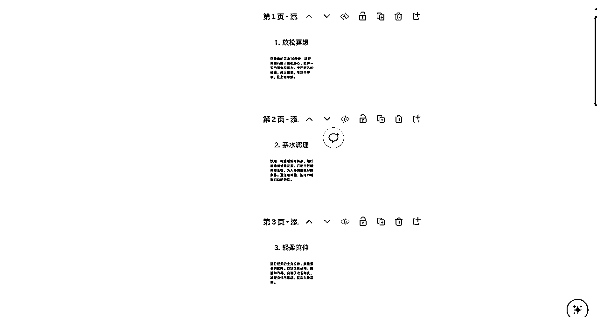

最后点【导出】-【下载】，按需选择格式即可完成！

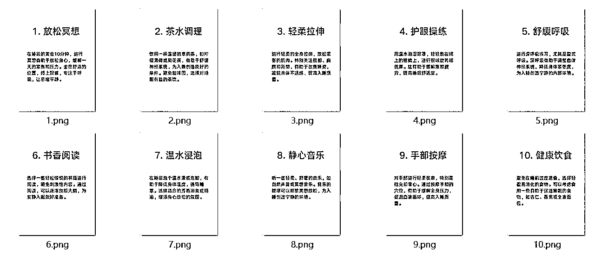

效率是不是拉满了？

注意：如果导入时遇到乱码，需要单独处理一下文件。

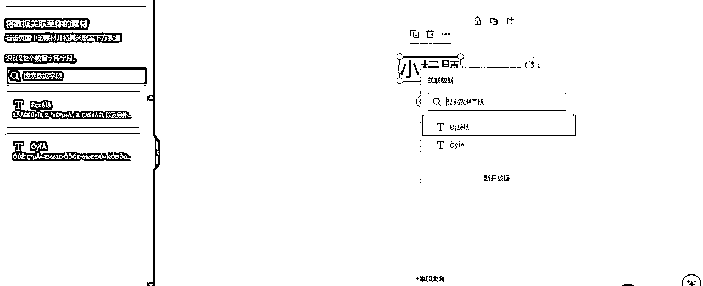

乱码通常是因为保存时编码不是 UTF-8。

解决办法：用记事本打开这个 csv 文件，再次另存为，并手动选择 UTF-8 编码保存即可。

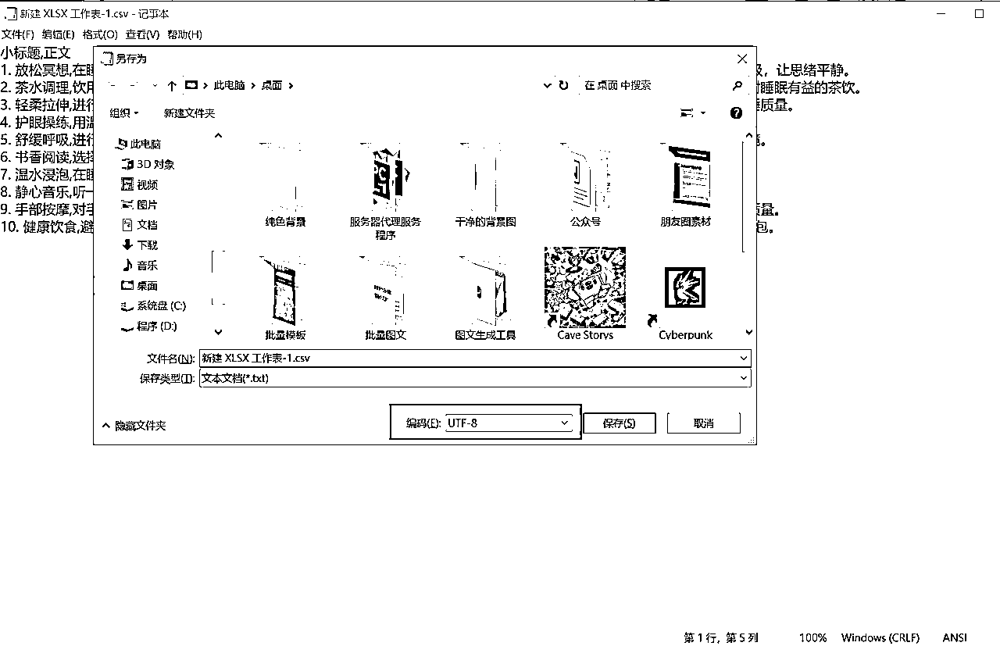

之后只要把新内容粘贴到这个已修正编码的 csv 文件里，就不会再乱码了。点这里回到上一步操作位置：

用这种纯图文方案，一次性做几十张甚至几百张，效率提升非常明显，唯一的成本就是 Canva 的月费，30元/月。

如果觉得还不错，欢迎点个赞。

# 工具推广

下面是我自己做的批量图文工具。

最近上线了一个更专注图文批量生成的软件，永久使用价格比 Canva 年费还便宜。

购买后还能免费获得一些配套工具，比如批量抠图、批量拼图等。

Windows 本地运行，一键搞定，无需导出 csv，只要选好 excel 文件和模板，两步就能批量出图。

软件演示如下：

除单文字替换外，还能批量替换图文组合。

软件出图案例：

#### 类型①：同一模板，仅文字不同

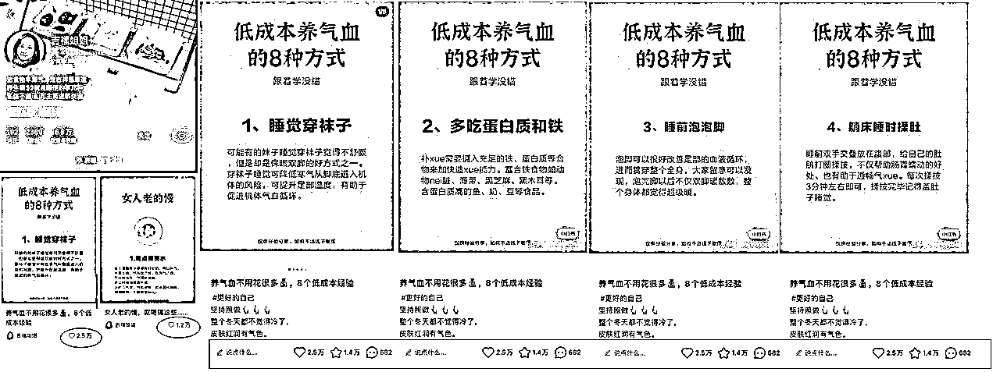

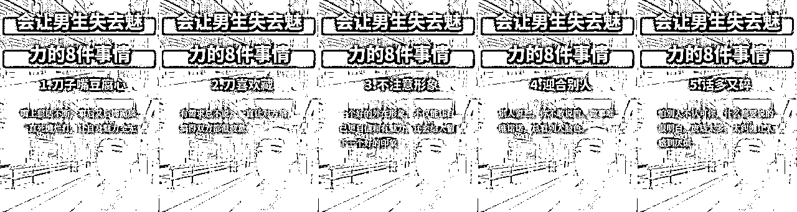

#### 类型②：同一模板，文字+图片同时替换

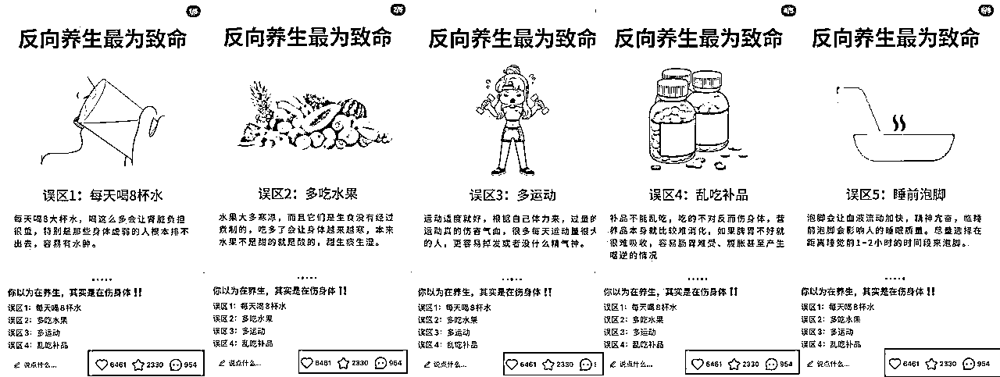

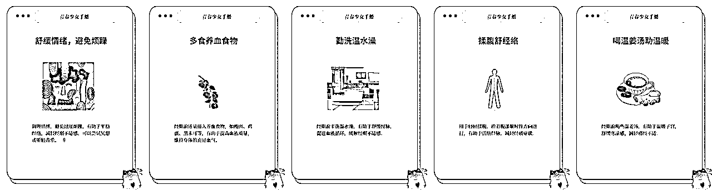

#### 类型③：同一模板，文字+多张图片组合

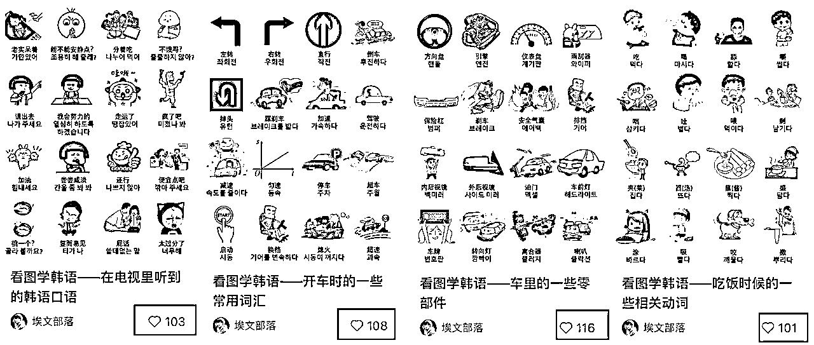

只要是模板化的笔记，只要你能想到的，它基本都能实现。

感兴趣的话可以点我知识星球头像链接。

不知道做什么内容？不用担心，我已经替你准备好了。

从零开始跟着软件教程走，5分钟就能学会，直接产出正念类内容就能发。

社群里我会提供：

从背景素材、内容模板

到账号定位、内容方向、引流避坑

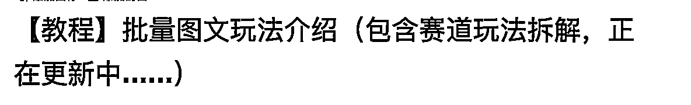

全套全给，教程持续更新。

同时也会拆解各赛道的批量玩法：教辅、星座、培训、虚拟资料等。最近还在研究📕的新变现打法，后续会陆续更新。

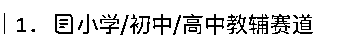

感兴趣可以点我知识星球头像链接我哦

# 最后聊两句

如果你已经有成果、是老玩家，这个工具能让你更快产出高质量内容。

如果你是自媒体新手，可以先看看，听我聊点实在的。

全职也好兼职也罢，我做自媒体也有两年了，你的焦虑我都懂。

每天花几小时做一个视频，结果播放几十、点赞为零，坚持久了谁都会崩溃。

我觉得能让你坚持下来的不是鸡汤，而是快速拿到反馈。用最少的精力先看到小成果，有了正反馈和信心，才愿意投入更多，做出更大突破。

我做这个工具和社群，也是因为想起当年那个迷茫的自己。整整两年，折腾过各种互联网小项目。早上7点起床，晚上6点下班，回家就关在书房对着电脑坐到12点多。

花了大量时间精力，却因为没经验、没方法、没技能，在自媒体的漩涡里打转，没有方向、没有结果、没有反馈，每次尝试都石沉大海。

如果你是个想入局却被伤得满身是伤的新手，希望这个小工具能帮你打开一扇门，让你真正感受到自媒体可以是朋友，而不是折磨你的敌人。