# 风向标拆解第 2 期--📕教人赚钱的博主在玩些什么--代一

这期来聊聊📕上那些教人赚钱的博主，背后到底是怎么运作的。

先说说我的背景：在知识付费和在线成人教育行业摸爬滚打多年，也做过📕渠道运营，带过流量和转化，最高做到单日引流私域500+，月引流过万，变现30万+。所以对这个赛道不算陌生。今天不单独拆某个账号，而是结合几个典型样本，把赚钱/副业/创业粉这条赛道的全貌捋一遍，希望能帮你看清门道。

这类博主大致分成两个流派：一类讲认知，输出赚钱逻辑、经验心法，偏“道”和“术”；另一类讲执行，给具体项目玩法、细分赛道方法论，偏“法”和“器”。当然也有两者兼顾的，赚钱就属于什么都聊的那种。

我随机挑了几个不同体量的账号，粉丝从28到21万都有，大多适合新手对标：
- 奶油泡芙收藏家：女性赚钱成长鸡汤，1481粉，靠接广告赚钱。
- 阿柠的创业笔记：拆解赚钱项目，3102粉，引流到私域卖虚拟资料。
- 桂花雪梨糖.：个人IP图文经验，21.2万粉，主要接广告。
- 自媒体监督侠南希：帮人诊断账号、直播教学，2518粉，引流卖课和陪跑服务。
- 水月冰云：聚光硬广素材，28粉，付费投放引流，做拼多多虚拟店铺教学。
- 慕易老师写作培训：教写小说副业，809粉，广告引流到知乎知学堂体验营转大课。
- joey乔TK说：TikTok带货教程，3311粉，用资料钩子引流，卖TK课程和陪跑营。
- 小达探索ai：AI副业变现，1278粉，群聊引流，做AI动画视频教学。

接下来看流量怎么搞。

先说图文。📕上图文内容占比高，成本低，适合新手持续更新。常见三种做法：一是纯文字转图片，套个背景模板、排排版就能发，小白也能做；也有带设计的变种，加上表格、导图、标注，图片更精致，爆款率更高。二是网图拼合二创，用案例截图和网络图做笔记，不用实拍，适合不会拍照的人。三是个人IP人设类，原创实拍加干货，人设感和信任度更强。对新手来说，持续发布比憋大招更重要，发多了、优化多了，爆款自然会出现。

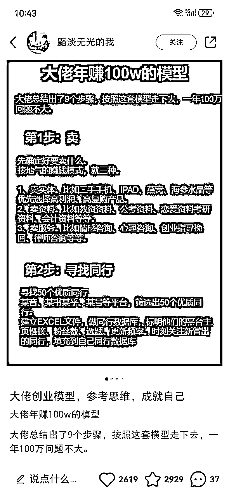
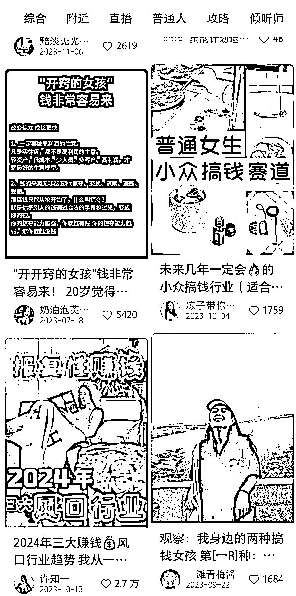
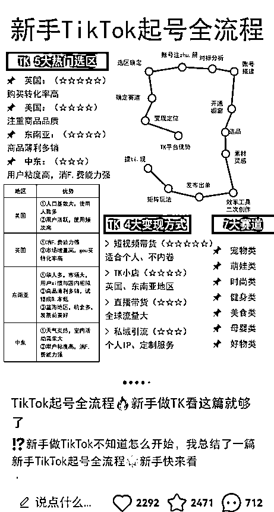

再说视频。视频比图文更直观、更有交互感，更容易抓住眼球。也有三种：图片转视频，不露脸、不用拍摄，会剪辑就行，现在AI也能做；实拍素材加配音，拍一些环境和动作，再配讲解；出镜口播，适合有镜头表现力的人，人设感最强，信任度最高，变现也最好。

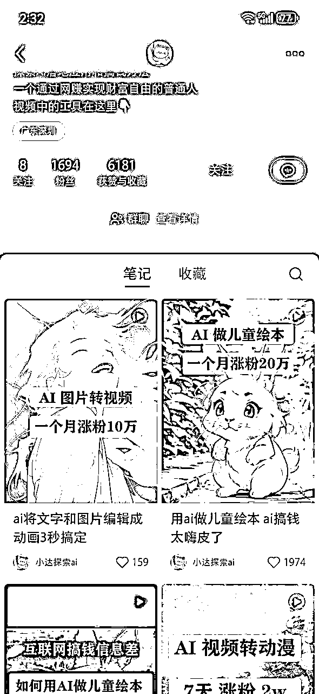
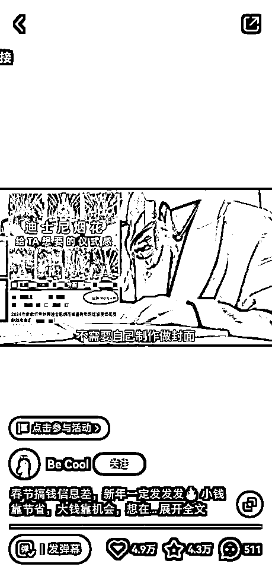
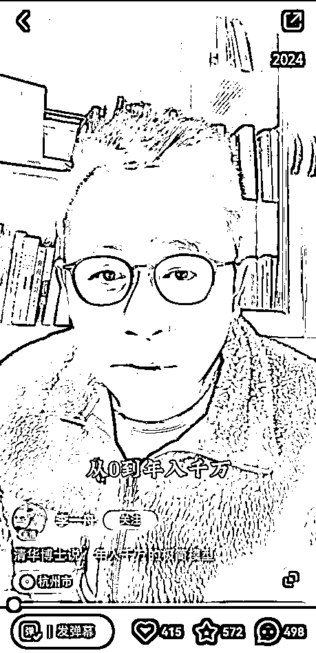

然后是直播。直播分两种：不出镜，对着电脑或屏幕讲；出镜直播，坐在镜头前说。内容大多是讲干货、看号、答疑，再用挂低价课或连麦小助理的方式引流。直播时间成本高，一般只有配了课程和服务后端的人才会做，不然效率太低。

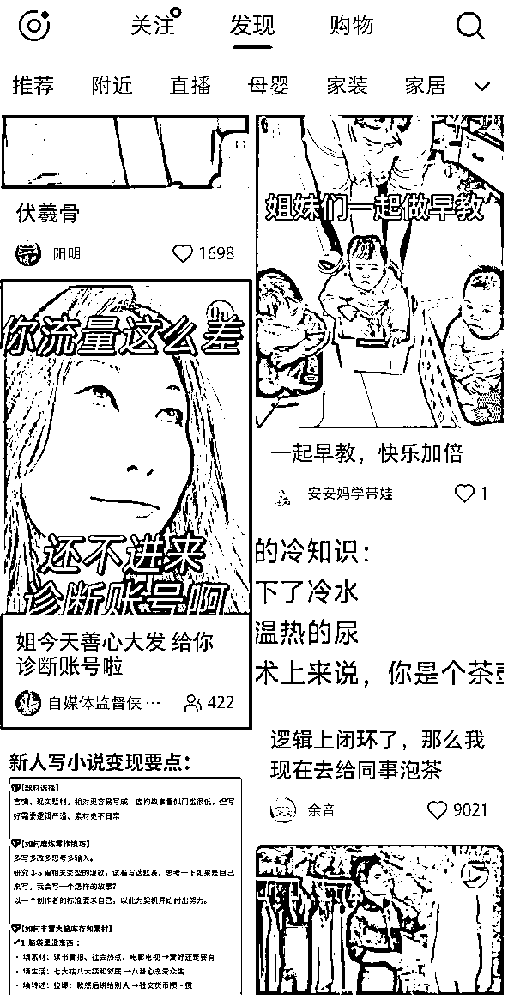
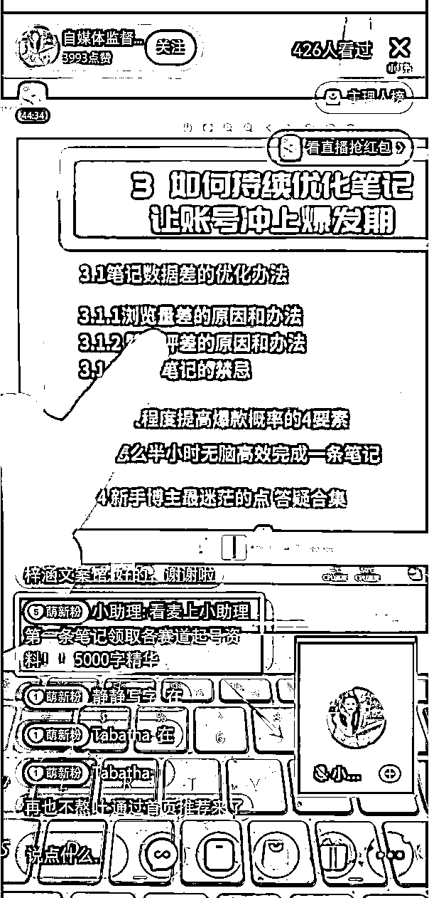
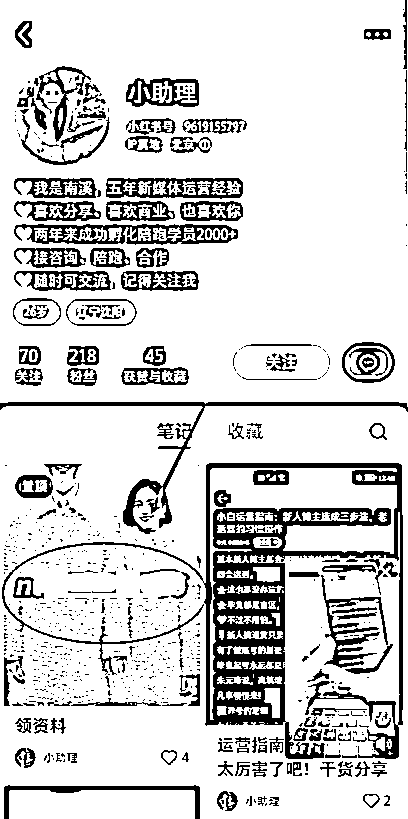
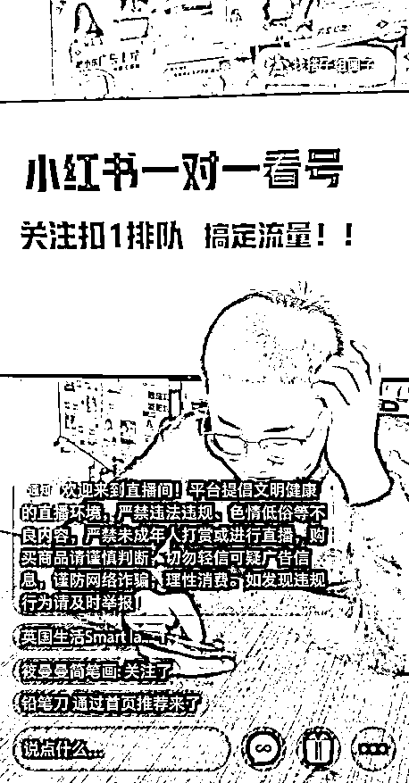

最后说付费投流。免费流量不稳定，而且引流有风险。📕近半年力推商业化、企业号和聚光投放，免费流量确实越来越难做，所以很多赚钱博主开始投付费。投流一般是直接上硬广，明确说自己在做项目培训，吸引精准用户私信加微。投流后引流权限高，发🛰️也不用偷偷摸摸了。目前📕的投流单价相对其他平台还算便宜。

我自己测过硬广和投爆款两种。硬广适合后端转化成熟的项目，用户精准但客资贵，如果后端转化和客单跟不上，ROI会很差。投爆款则是把自然流量的老爆款用聚光激活，继续用私信或评论钩子引流，流量更泛但便宜。我实测能做到单个私信咨询5元左右，单个好友15元左右，筛选后ROI可以到1:3。

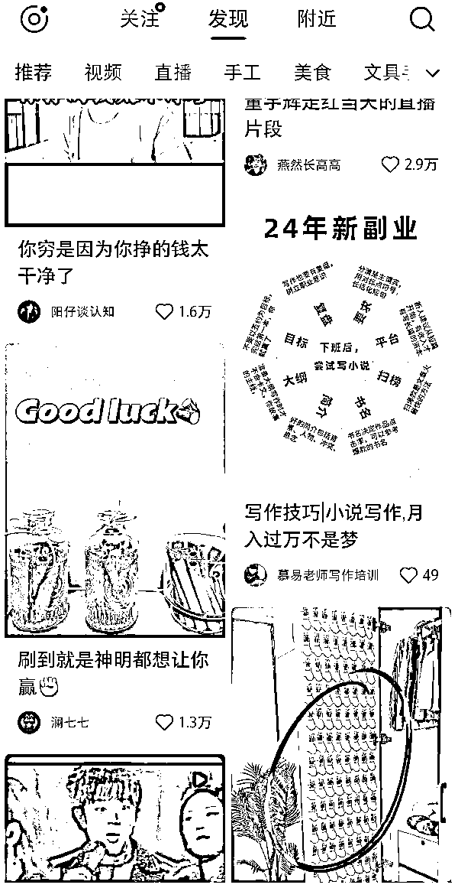
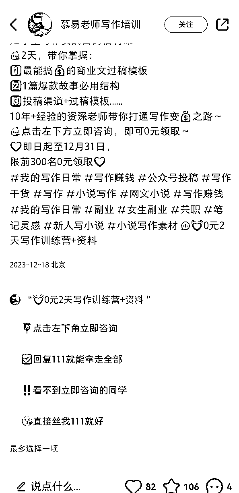
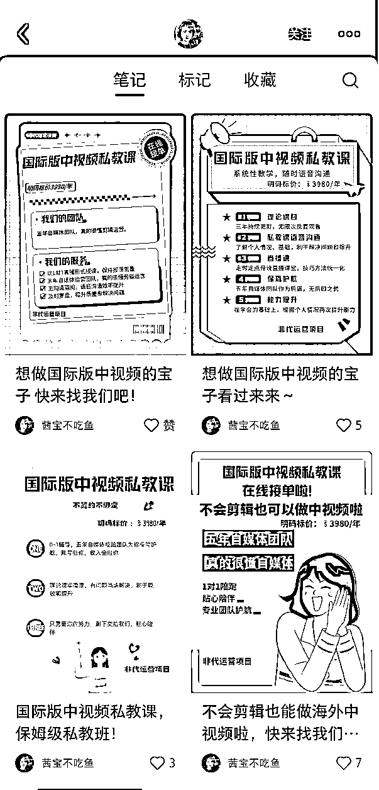
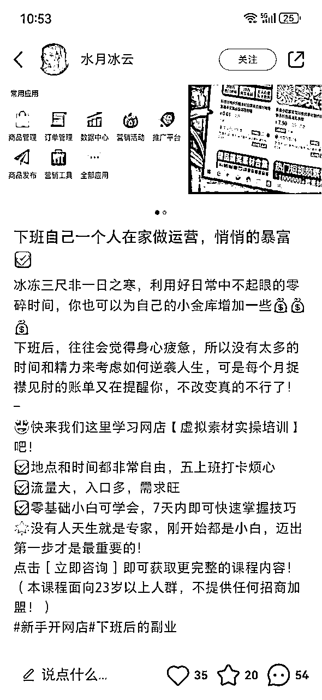

结论是：内容形式和变现效率强相关。只做图文的，多半是接广告或卖低客单；后端有高客单产品的，才会用直播或付费投流，先让人上体验课、低价课，再做低转高。视频流量转化率整体高于图文流量，制作成本越高，引来的用户价值越高。你可以对照这些案例，看自己适合哪种方式，再找利益最大化的路径。

再说产品端。教人赚钱的赛道没有对应的实物产品可卖，因为没有任何实物买了就能直接赚钱。变现基本两条路：一是涨粉后接广告，比如那个20万粉的账号，一个月广告收入也才1万多；二是引流到私域，从第一个粉丝就开始变现，天花板高得多。

引流就得有产品，要么自产，要么分销别人的。产品无非三类：资料、课程、服务。

第一类是卖项目资料。这是早期网赚玩法，卖资料站会员，有年费、永久费，还有分销加盟。需要自己建站、搜集内容，还得懂点技术。说实话，这种产品不太靠谱，真正做项目的人不可能每个板块都有实操经验，搬运盗版课程在所难免，交付也指望不上。说白了就是卖铲子，挖不挖得到金子就看运气了。

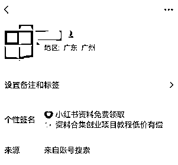
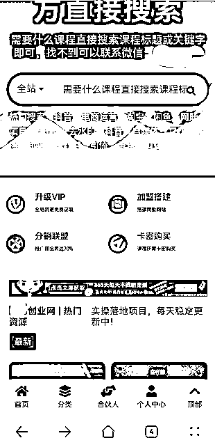
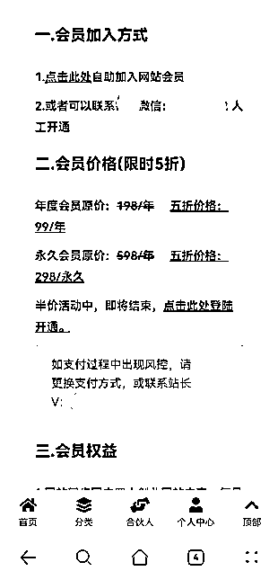
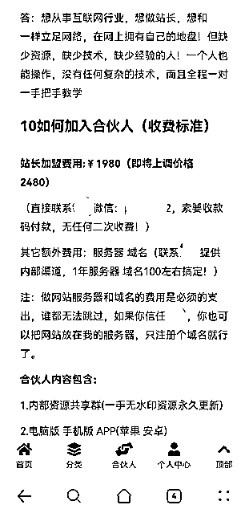

第二类是卖课程。课程得自己研发、生产、交付，所以能做独立课程的通常规模不小，比如新职高途、知乎知学堂。课程价格从99到5999都有。个人IP主要靠朋友圈和👸号持续触达，转化比较佛系，周期也长，一个新粉平均要10天到一个月才转化。公司化运作则有体验营、1v1助教私聊这些销售节点，转化周期更短，客单价也能卖得更高。赚钱最近加了体验营，其实就是这个道理。

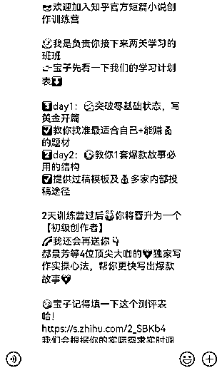
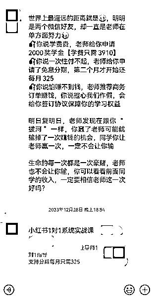

第三类是卖服务。打磨课程太耗精力，或者暂时做不出好产品时，可以先做服务，比如按次咨询、周期陪跑、项目交流圈子。各种形式都有人做，也都能吸引对应的人群付费。

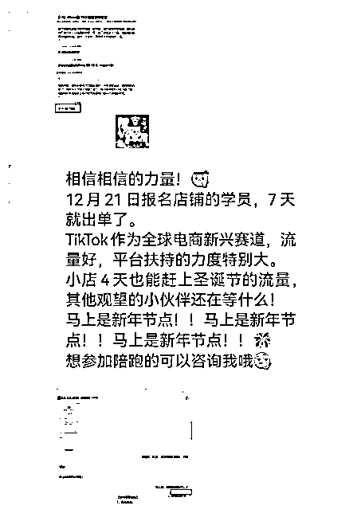
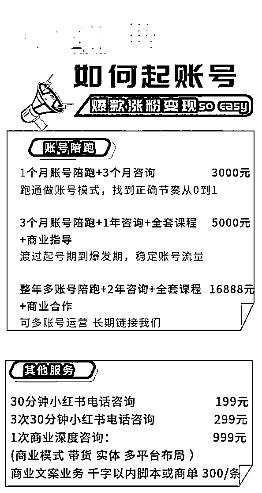

利润怎么算？接广告收益很少，前面那个20万粉的案例就是证明。真正赚钱的是引流到私域做课程服务。收益取决于引流和转化效率，具体数据比较私密，但根据赚钱圈友的帖子看：小博主卖资料，月入几千到几万；大博主做知识付费或高客单圈子，月入几万到几十万；公司级别，月入二三十万到几百万，看规模。给大家一个参考：📕副业类图文笔记的泛流量粉引流率约0.2%，也就是1万阅读大概加20个🛰️，单粉ARPU在30到40左右，可以据此大致估算总收益。

成本方面，知识付费主要是人员成本。个体IP成本是自己的时间，团队公司则是工资成本，包括引流、销售、交付讲师等。总体看，教人赚钱做知识付费的毛利率很高，团队运作去掉人工和投流成本，净利率也能做到30%左右。

项目怎么做大？从0到1，先搞流量，有流量才可能赚钱。流量内容从低成本到高成本、从图文到视频到直播。新手可以先从最简单的入手，但别一直停在舒服区，要尽量往不可替代的人设IP方向转，这样才有长期竞争力。没有产品时，先分销别人的，或者找靠谱后端合作，比如分销赚钱门票就是个不错的路子。要做大，最好自己搭建产品，从流量到转化到产品，能拿下的环节越多越赚钱。另外，把赚到的钱拿去投流，靠广告买流量来放大，而不是一直守着免费流量。只有敢投广告、能靠广告买来流量的项目，才真正具备放大的潜力。

最后聊聊价值观。财从来都是很多人最大的欲望之一，所以教人赚钱永远有市场，也永远会有套路。选哪条赛道，都有人赚到钱，但想长期赚钱、持续赚钱，还得想想自己到底能给别人创造什么价值。帮人避坑、少走弯路、帮小白提升能力、真诚交付，这钱赚得才安心。做这行，有的是为了割韭菜，有的是认真做交付，像赚钱那样真想帮人赚钱的。能走到最后的，一定是后者。

所谓价值观，不过是看透所有真相和套路后，依然选择当那个真诚的人。愿你我看遍世间套路，仍能守住心里的光。