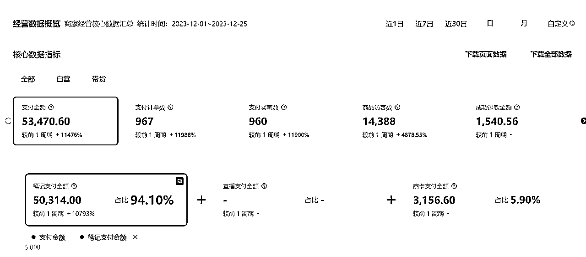
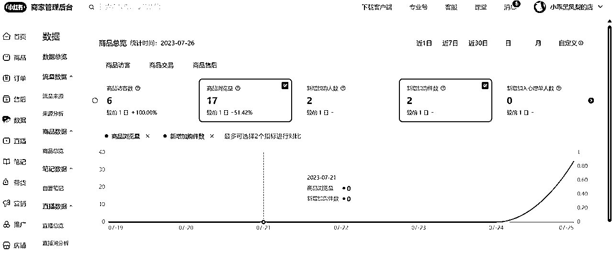
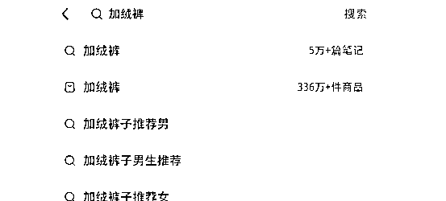
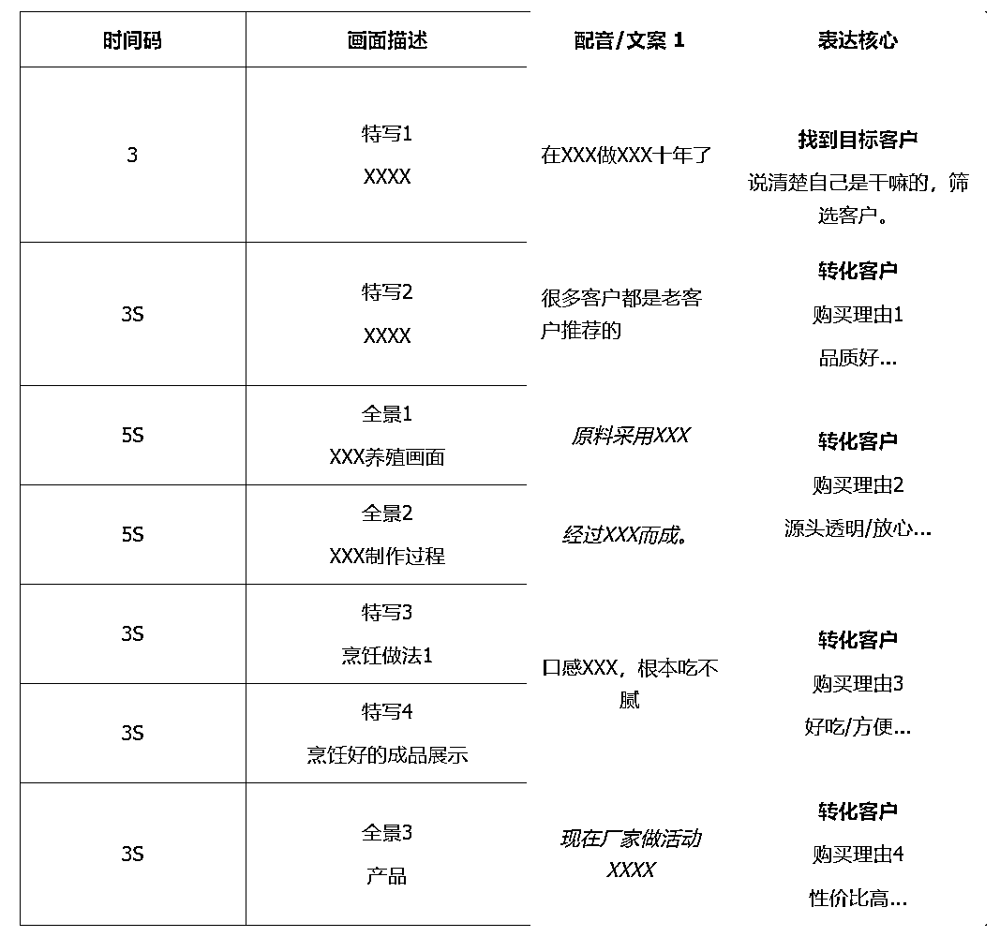
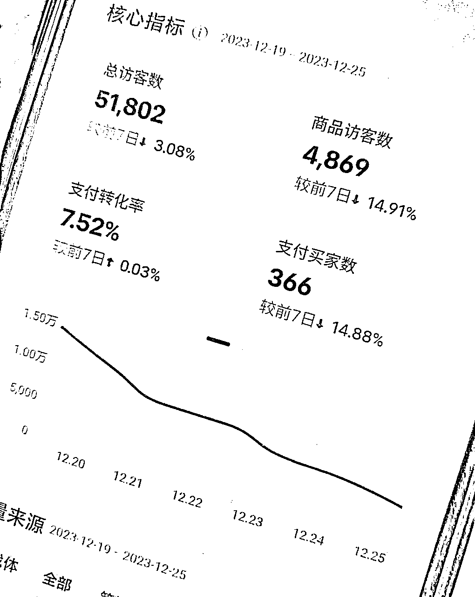

# 走了两年的弯路，12月📕店终于GMV破5万

从7月摸索到现在，算上停停开开，加起来也做了好几个月。120多条笔记砸下去，12月7号才迎来第一次日破千。眼下12月整体GMV已经站上5万，日常稳定在2千左右，峰值能冲到4千+。

这一路踩坑不少，幸好星球里前辈的经验帖给了不少方向。今天把自己从崩溃到起量的过程掰开讲讲，给还在懵圈的新手一点参考。

# 一、怎么一步步走到现在的

最开始入场是7月，跟着大神的思路去做女装。那时候觉得女装首饰这类品类爆发力强，水深鱼大应该有机会。于是就用纯混剪起步，播放量大概就200左右，点进来的人很少，加购有但就是不转单。

发了几十条起色不大，我就关店重开。还是女装，还是单品混剪，又投了几十条，播放反而更差了。

后来复盘想，可能一个糙汉子压根get不到女装的点吧，也可能这个赛道实在太卷了。其实问题叠加：选品没抓准，视频缺乏成交力，甚至保证金都没交，基础条件就不齐。

两次被打回原点，心态一度很崩，店铺也是三天打鱼两天晒网。

直到看到同行在圈子里晒成绩，被冲动拉了回来。说实话，我这种人就是典型的时而上头时而摆烂。

时间推到10月，2023年都要结束了，大佬们都在收割，我总不能一盆水都没有。

那段时间读到史铁生一句话印象很深：拖延最伤的不是时间，而是让人变犹豫、变没自信。决定了就立刻干，行动本身就能让人重新燃起来。

我拖延的本质，其实是不想从零开始面对失败，怕达不到预期。之前那段时间美名其曰找机会、再准备，其实就是没心气做了。

想明白后我换了思路，不追求完美开局，先求一个正反馈。10月17号第三次开店，这次目标很简单，先让单子跑起来。

我重新审视选品，也反思自己能做什么。女装确实能出几十万，但对新手来说门槛太高。我更需要的是体感和信心。

# 二、选品怎么选的

说到选品，先讲下我的背景。近两年我主要做抖音电商服务商，给商家对接头部主播。合作过的商家里有不少带过百万GMV的，关系和信任度都不错。

这些合作几乎全是食品类，尤其是非即食零食。所以一开始我压根没考虑在📕卖这些。

做直播选品时养成的习惯大概有：

1、找类目：用灰豚这类第三方工具看近期潜力品。
2、找店铺：抖音里搜产品，只挑有旗舰店、评分4.6+、单品好评率90%+的。代表品牌在电商上是认真的，品控和售后相对靠谱。
3、找联系方式：问客服、找精选联盟、或者天眼查主体公司。
4、选人：聊佣金、聊价格，同时看品牌方的配合度和格局。

这些是直播那边的打法，搬到📕只能借鉴。

这次我没看数据，直接在老合作商里挑。思路就是选自己熟悉、有资源、有优势的，而不是选最火的。

如果你是纯小白，没有资源也没积累，建议先选自己喜欢的，至少能沉下心研究。

然后去📕搜一下看商品池大小，女装随便一个细分词都是上百万结果，竞争已经卷到天上。

📕本质是内容带货，去中心化，晚起步不代表卖不动，先上架不代表能卖。

基于经验和商家反馈，我锁定了一个品类，每年年底是小旺季，而且不是太小众。去平台一搜，万+销量的一抓一大把，说明需求是真实存在的。

我的要求不高，能卖就行，证明有流量就能转化就行。别一上来就搞复杂。也就是腊肉这个方向，有兴趣可以自己去看看，📕个人店也能做。

目前店铺只做这一个SKU，原因很现实：

第一，📕是靠笔记爆单推单品。
第二，很多品类受资质限制，需要个体户和食品备案，我不想刚开始就搞一堆证。
第三，也是有点懒，把选择压缩到极致，把精力全堆在一个品上。代价就是单品生命周期会更快。

# 三、笔记怎么发的

说实话，现在的数据基本都是工具批量混剪出来的，谈不上高光，有点拿来主义。素材池有限，所以这条路很快会遇到天花板，新店已经在转实拍了。

混剪逻辑很简单：拆多个视频取片段，重组、剪反转、加特效、换配音。

爆了一条后，我会拆它的结构，用剪映免费配音，把文案套到同结构上再发，复用率很高。

文案是转化的关键，我常用的脚本框架我之前分享过，可以参考。

📕的打开逻辑是封面+标题先定生死，视频再牛没人点白搭。

画面没必要太精致，但封面标题必须花心思。在一堆精美封面里，你的笔记为什么值得被点？好吃的看起来要香，好玩的要吸睛，好奇的要勾人。

新手发笔记千万别太激进，单条一百多播放是常态。我从开始发到第一次破千，发了五十多天、120条才起。

中间心态起伏很大，但我一开始给自己定的KPI就是先发满100条，不求爆，先求量。先把主图、标题、文案做到位，能稳定的更新。

天选之人发几条就爆，绝大多数人都是慢热。先把过程做到位，结果自然会来。

# 四、开店执行的细节

产品上架我直接用工具一件代发搬运，市场上工具很多。如果不是大牌也没价格优势，建议把品牌名弱化，减少用户去站外比价。

食品类一定要找正规源头，包装标签信息完整合规，不然很容易被薅羊毛和打假。

我上架第二天就出单了，后面做了十几个销量、两个好评。

11月下旬交了保证金，12月上旬流量才慢慢上来的，具体有没有因果我不确定。但如果要长期做，建议有几单后尽快补齐保证金。

发货我直接用子账号对接商家发货，自己不用囤货。

# 五、最后的几条感想

上面说的有些是常识，有些只是我个人的体感，仅供参考。

整体操作其实很粗放，选品也粗放，视频也没多精致。好处是精力平均在长线，不会某个环节过度投入。

坏处也很明显，能上天花板就这么高了。

📕有个好处是笔记有长尾，你永远不知道哪天旧笔记会突然又爆一段时间，这也是我能坚持的原因。

但爆完必衰落，这几天流量已经开始回落了，正常。

心态比之前稳了很多，因为真的尝到过正反馈，对这个平台心里有底了。

再给新手一个建议：起步成本一定要压低，别搞成差生文具多。成本越高期待越大，失望也越大。

我之所以能坚持发120多条，就是因为混剪成本低，花一点时间就能批量。每个人的情况不同，实拍成本低的品类也没问题，理性看待。

随着越来越多的人进来，卷是必然的，平台规则也在变。我也准备从粗放期转向实拍、多品类、多账号。路上如果有同路人，欢迎交流。