玩AI绘画的你，是不是已经听腻了WebUI？今天聊聊ComfyUI这个后起之秀。它凭着“节点式工作流+显存友好”这两大绝活，吸引了一大批开发者和个人玩家。搭配AnimateDiff，能一键生成丝滑短视频——抖音上超火的那个“一个女孩/一个男孩的一生”就是典型例子；做AI摄影写真时，真人照片一键换脸的效果也相当能打。

先看看它都活跃在哪些场景。

**AI短视频**
AI生成的画面天然抓眼球，视频内容进化正被AIGC加速，连央视都开始用AI短视频了。OpenAI的Sora更是把短视频玩法推向新高度。

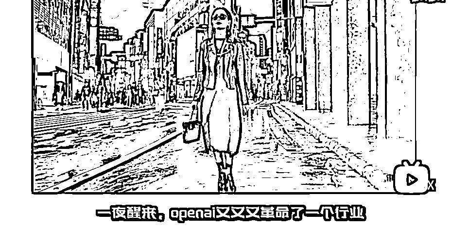

**AI写真摄影**
在摄影领域，ComfyUI的工作流模式让出图效率大幅提升。挑一张想替换的人脸，再传一张姿势参考照，配上提示词，就能得到一张以该人脸为风格参考的成片。估计老铁一眼就能认出这是谁的原型。
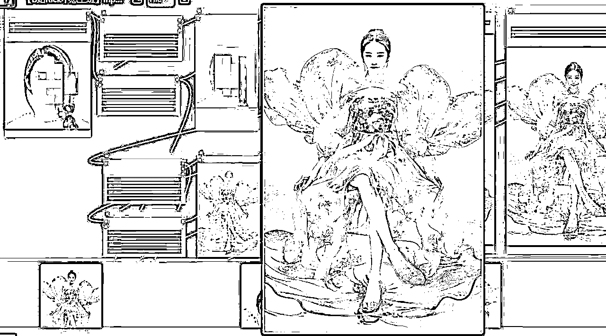
下面这组是我帮朋友做的AI写真换脸效果，朋友表示很满意：
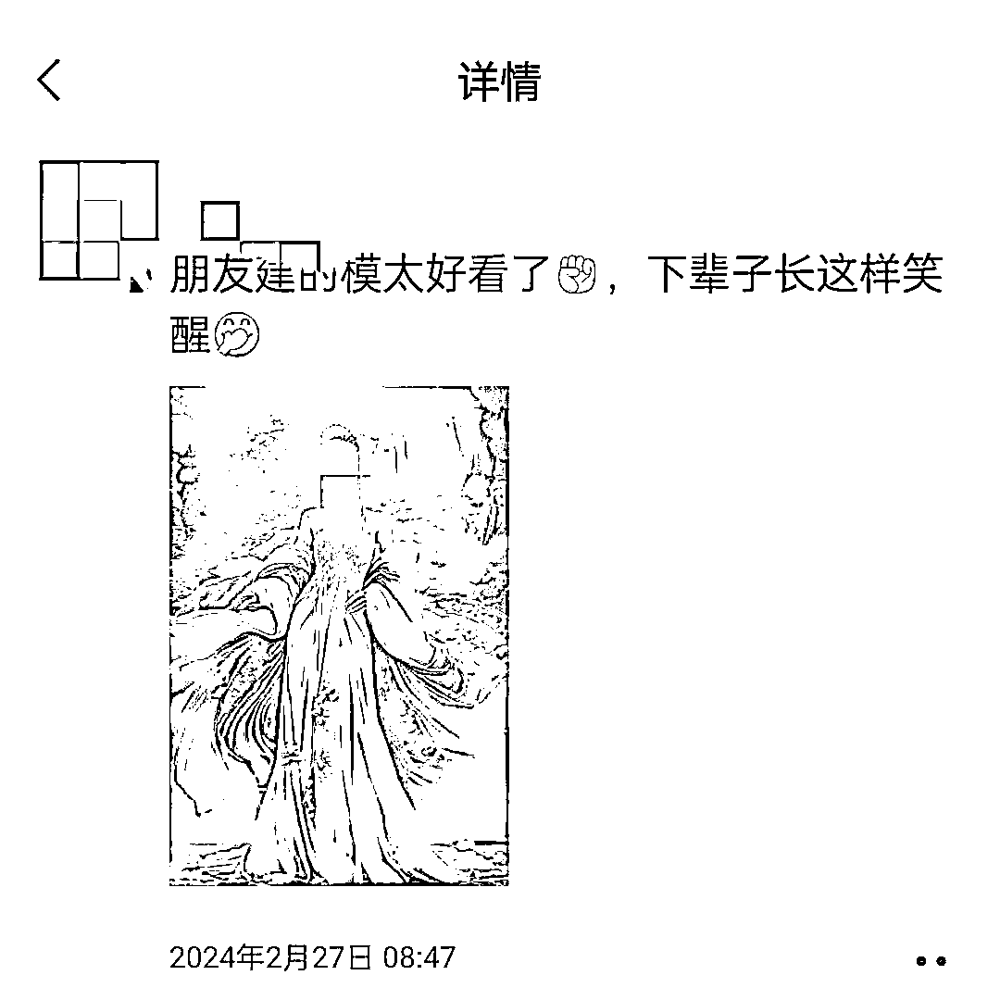
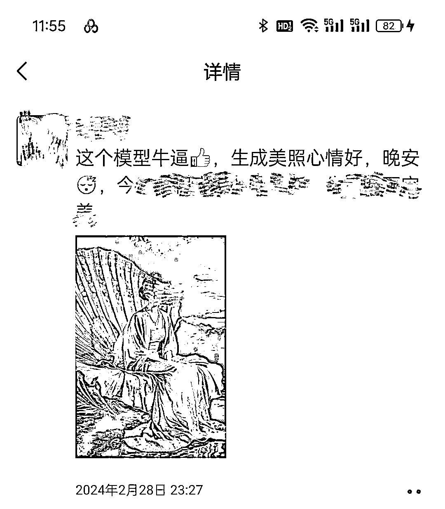

**AI美女号**
抖音上已经冒出一批AI美女视频号，画面质量几乎以假乱真，涨粉速度也是飞起。比如下面这两个账号：
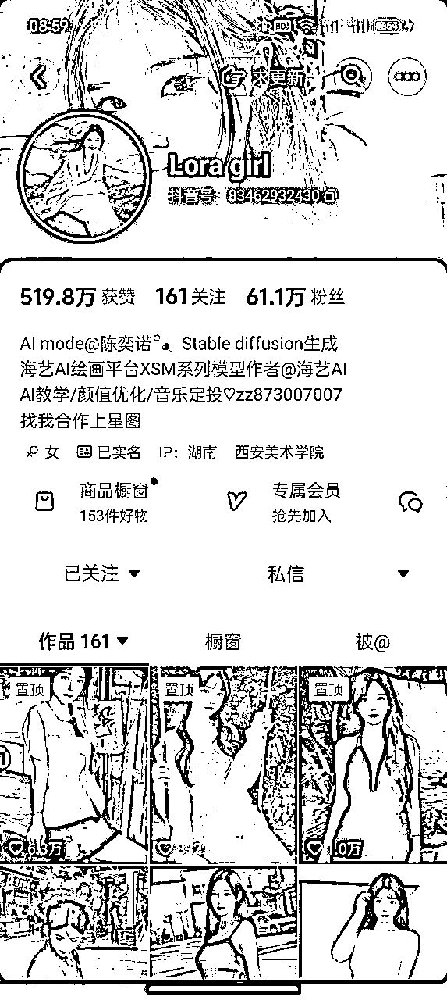
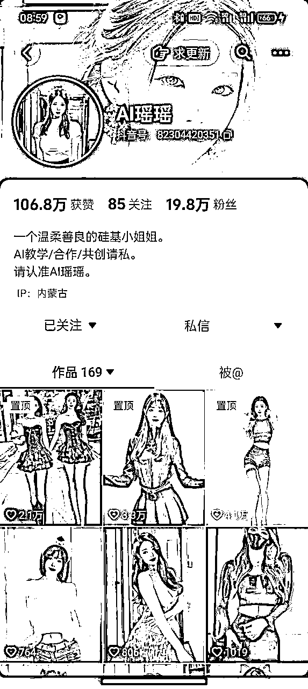

**老照片修复**
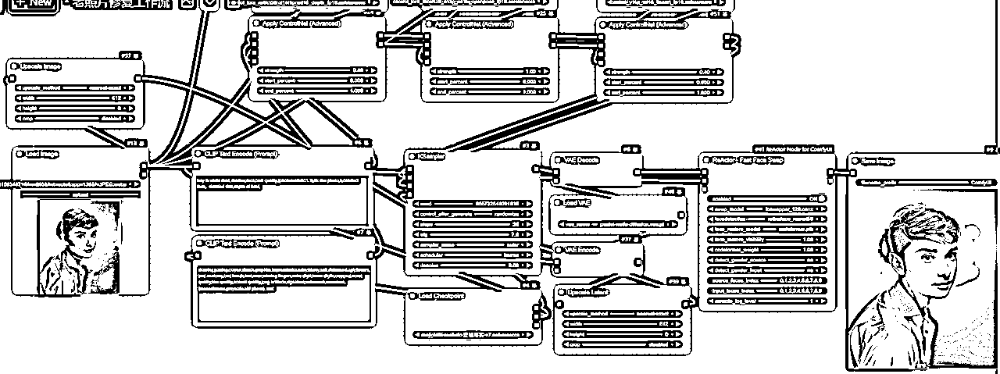

**动漫转真人**
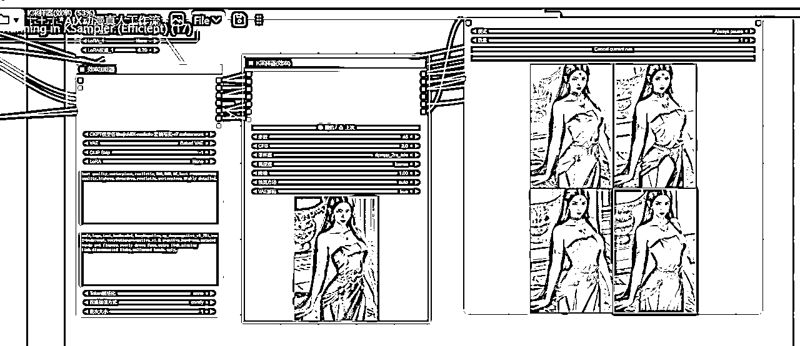
当然，真人转漫改也是同一套逻辑。

**热播影视剧Q版人物**
给热播剧做Q版人物，既有现成流量，又能靠IP赚一波回忆杀。这组图出自“一只小鹿鸭”之手，在某音和某书的数据都挺亮眼。
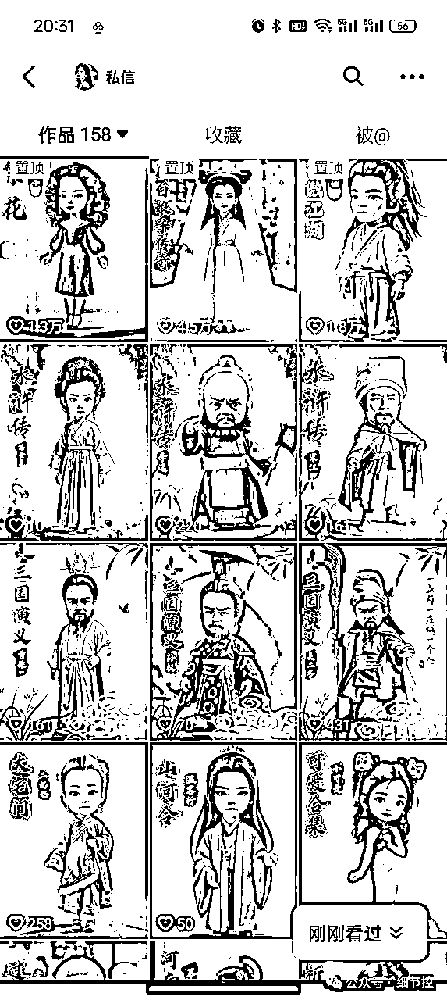
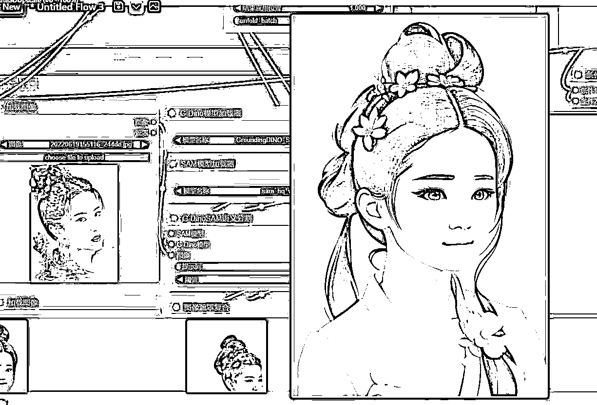

当然，ComfyUI的玩法远不止这些，现在好多老SD玩家都纷纷投奔过来了。

**ComfyUI到底是啥？**
简单说，它是一种把Stable Diffusion流程拆成节点来玩的绘图工具。你可以把它理解成“内置了SD能力的Substance Designer”：把SD的生成流程拆成一个一个节点，从而实现更精细的工作流定制和超强的可复现性。当然，节点式结构也把入门门槛抬高了一点点。
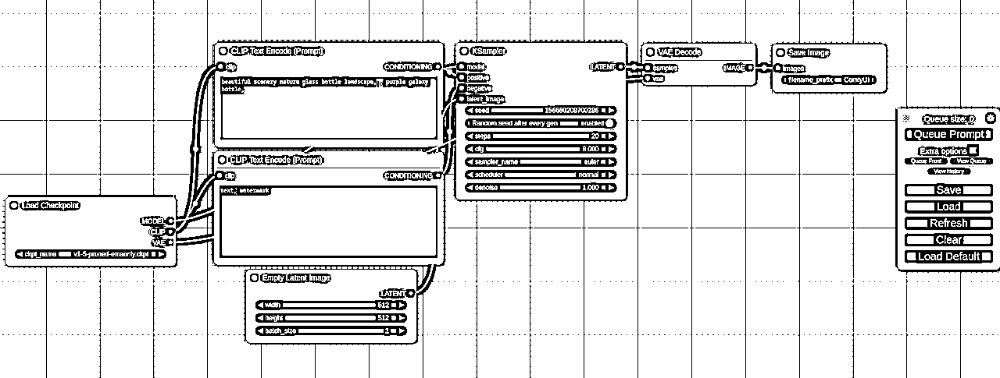

**为什么要选ComfyUI？**
它给Stable Diffusion装了一个强大的节点操作面板，自由度和可复现性都更好，同时显存压力更小。出图速度比WebUI快10%到25%，显存占用也更低，现在8G显存就能在ComfyUI里跑XL工作流。

除了显卡友好，它的工作流设计也容易上手：可视化搭节点、快速切换工作流，文生图、图生图、高清修复、面部修复、局部重绘、LoRA这些常用功能全都有，还支持Reactor、Controlnet、IPAdapter、AnimateDiff等一票插件。在团队内部，把工作流搭好之后，点一下就自动跑完，一键换背景、抠图、摄影流程都能这么玩。最香的是，别人分享的工作流你可以直接导入，加载完就能用。

所谓“一键工作流”，就是DIY好的节点、参数、模型设置全部保存好，之后只用上传参考图或者换脸图（图生图），或者直接写提示词（文生图），就能出图。
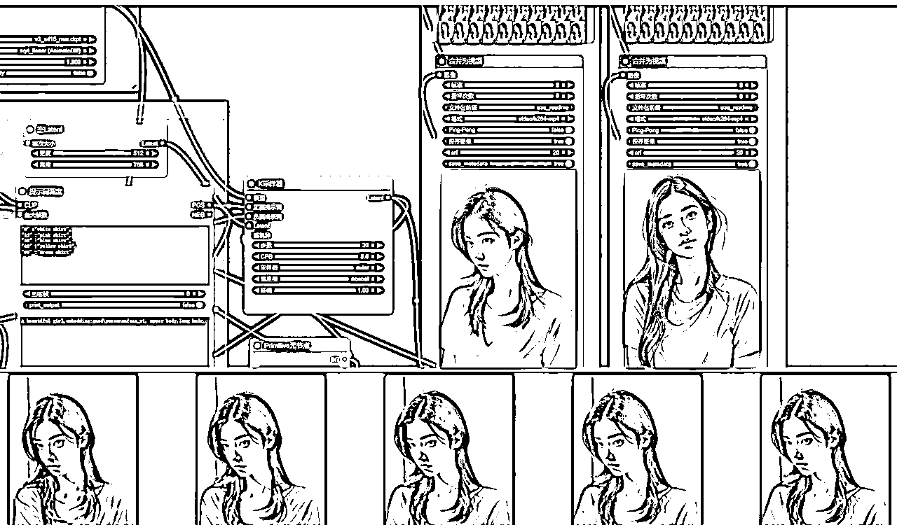
（上图是ipadapter_animatediff的视频生成工作流）

**怎么下载和安装？**
ComfyUI既能本地部署，也能用云平台。本地只要NVIDIA显卡、显存4G以上就可以。没错，它的显卡门槛比WebUI低不少，WebUI往往要8G显卡才玩得爽。

安装方式主要有几种：

**官网纯净版**
GitHub地址：https://github.com/comfyanonymous/ComfyUI
先去官方GitHub的Release页找最新安装包，下载解压就能用：
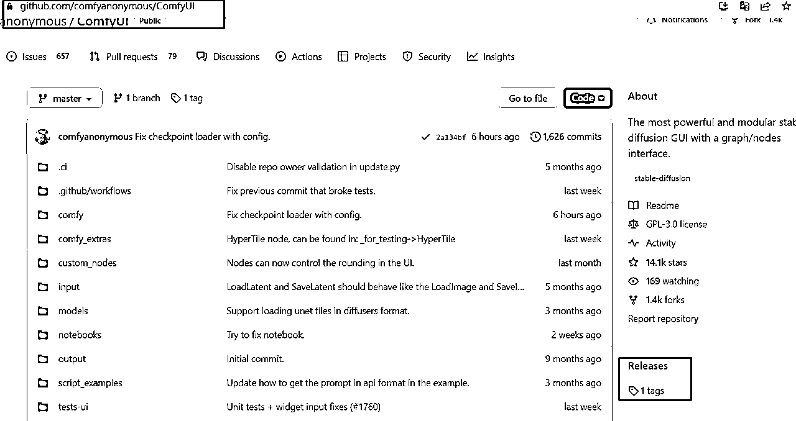
点进Releases，选“Download link with stable pythorch 2.1 cu121”下载即可。
https://github.com/comfyanonymous/ComfyUI/releases
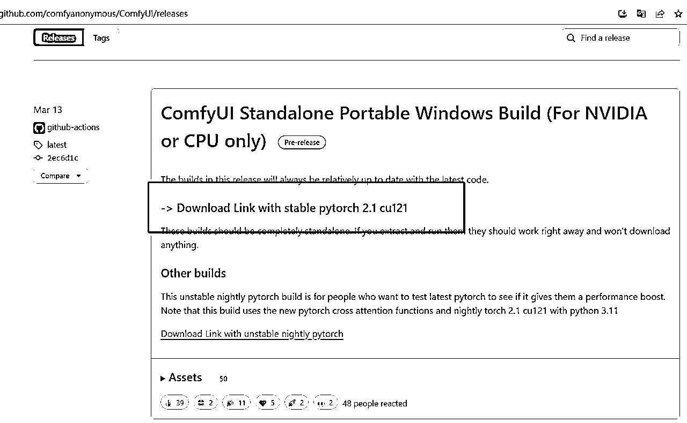
解压到合适位置后，文件夹里有“run_nvidia_gpu”文件，双击就能启动。
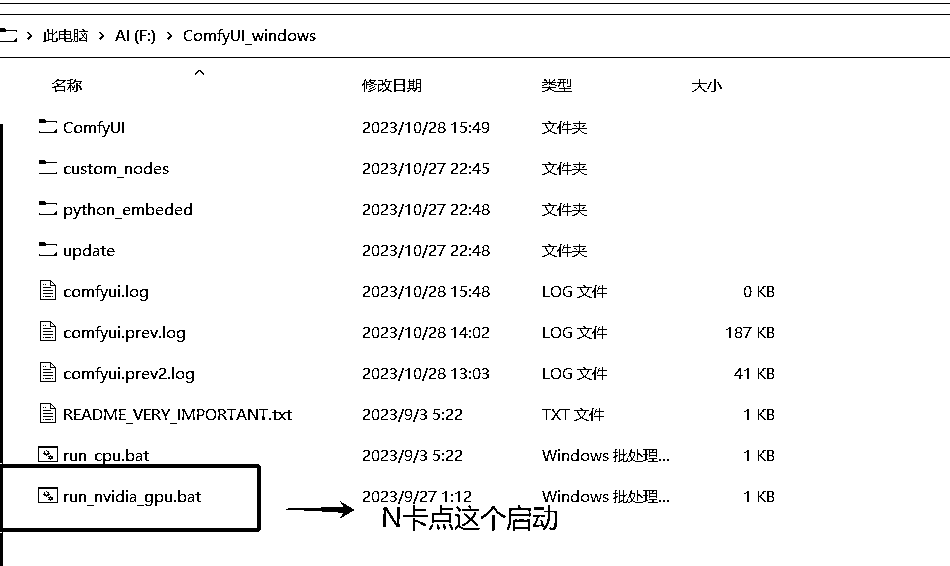
顺便说下，run_cpu.bat是CPU模式，没显卡也能跑，但出图很慢，而且部分插件用不了；GPU模式则完全看显卡的配置，显卡越好，出图越快。
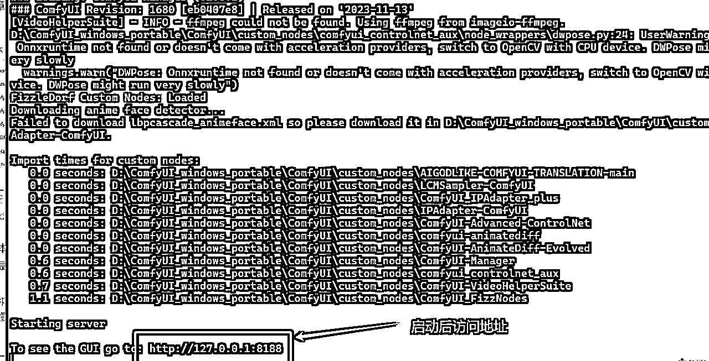
启动后浏览器会自动打开访问地址，默认就是文生图工作流。

**使用整合包**
官方纯净版默认不带模型和插件，想省事可以下整合包，比如秋葉aaaki、Blender无限圣杯、铁锅炖等大神的包，里面整合了不少插件、模型和工作流。
新手本地部署，最推荐B站秋葉aaaki的整合包，解压即用、一键启动。
教程视频：https://www.bilibili.com/video/BV1Ew411776J/?spm_id_from=333.999.0.0
网盘链接：https://pan.quark.cn/s/f3e377d6f394
当然，你也可以用我自己的整合包，只是更新停在去年11月，新插件还没补上，之后有需求我再重新打一份。
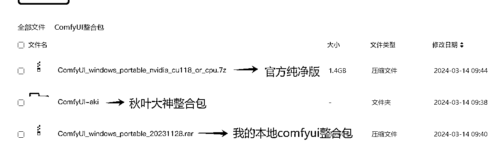

**云平台使用**
推荐仙宫云和揽睿这两个云平台。因为玩ComfyUI经常要装插件、下模型，为了方便大家，我在仙宫云上部署了一个ComfyUI镜像包（AI写实摄影+视频镜像包），开放给大家使用。

镜像包名称：细节控ComfyUI AI写实摄影+视频工作流
镜像主页：https://www.xiangongyun.com/image/detail/98308b39-7d4c-5735-907c-a9b913819bc1
邀请链接：https://www.xiangongyun.com/register/1W8BDK
新用户通过邀请链接注册，能拿仙宫云5元奖励，够体验2小时4090出图。
镜像支持多语言，已经预装并配置好Animatediff、IP adapter、Face ID、InstantID，也内置了一些常用LoRA和好用的工作流。

部署步骤：
1. 注册登录后，点击“部署GPU计算容器”。
2. 选4090显卡，在社区镜像里搜索“细节控”。
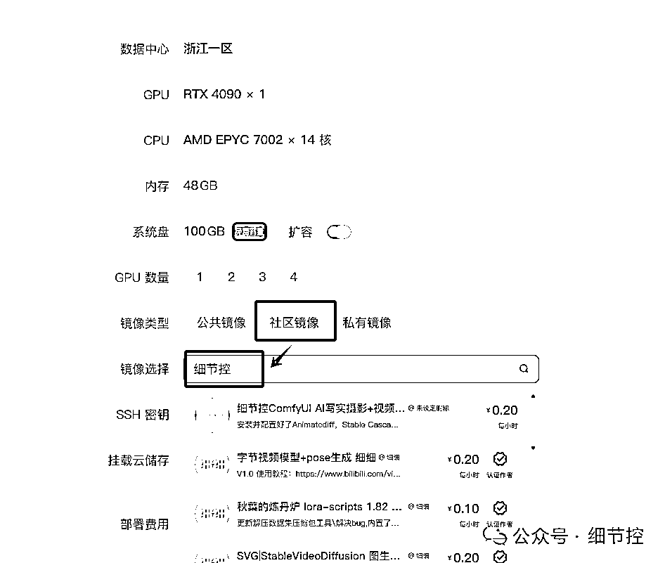
3. 开机需要2-3分钟，然后点容器里的“运行”。
4. 进主页后点使用文档，里面有详细使用说明。
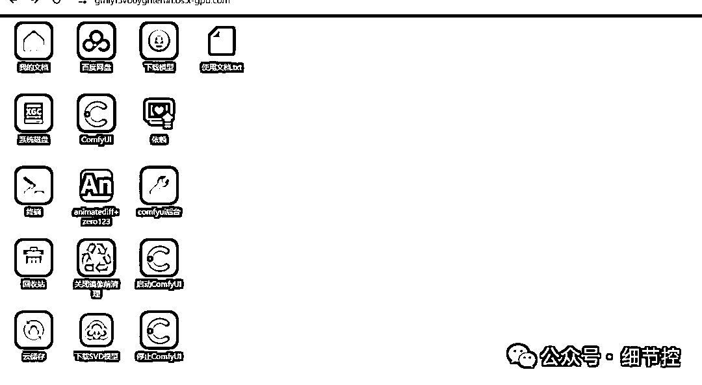

镜像内置了当前热门的IPAdapter FaceID、InstantID、AnimateLCM、Portrait Master肖像大师、Animatediff视频动画、sdxl_lightning、Stable Cascade等工作流，左上角的Workspace插件里就能打开，也可以点Import加载本地工作流。快去玩起来吧。
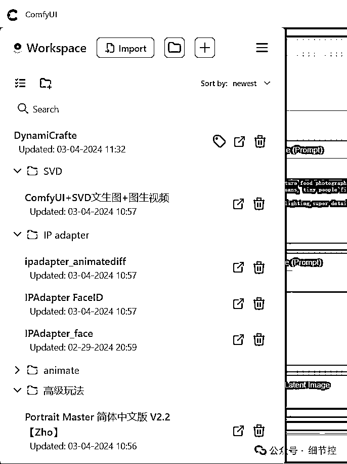
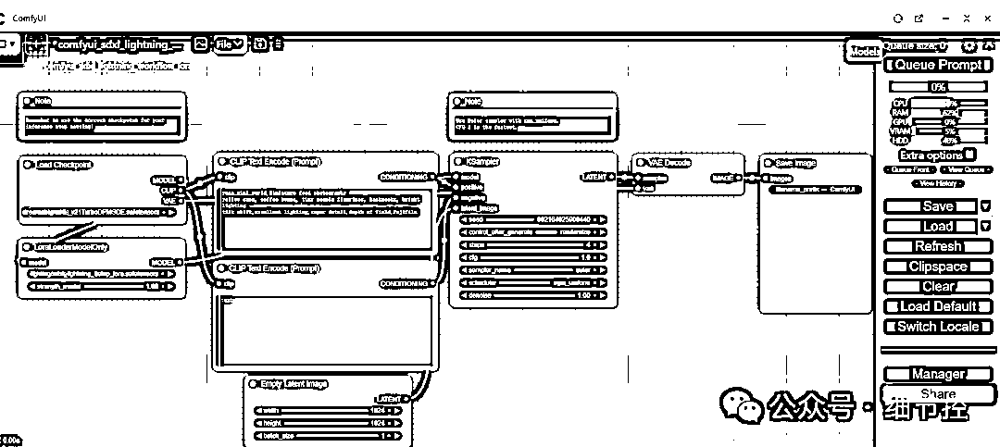

**模型和LoRA怎么放？**
ComfyUI自带PyTorch和SD环境，但不带模型，所以你得手动把模型放进对应目录：
- 大模型：`ComfyUI_windows_portable\ComfyUI\models\checkpoints`
- VAE模型：`ComfyUI_windows_portable\ComfyUI\models\vae`
- LoRA模型：`ComfyUI_windows_portable\ComfyUI\models\loras`
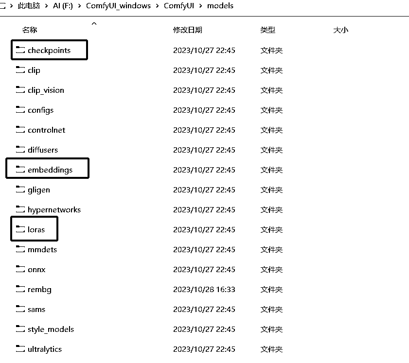

如果你以前用过WebUI，模型通常放在stable-diffusion-webui目录里，直接复制过来太浪费空间。作者为此留了一条共享路径：把`extra_model_paths.yaml.example`的后缀去掉，改名为`extra_model_paths.yaml`：
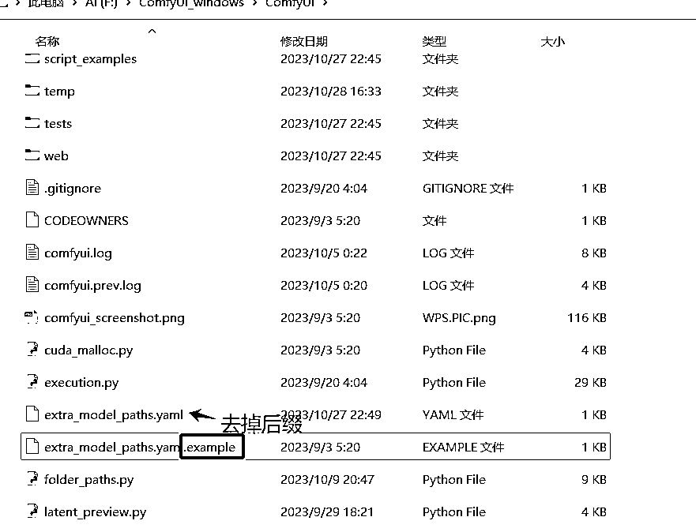
然后用记事本打开，把`base_path`改成你本地WebUI的路径，比如我的“F:\novelai-webui-aki-v3A”：
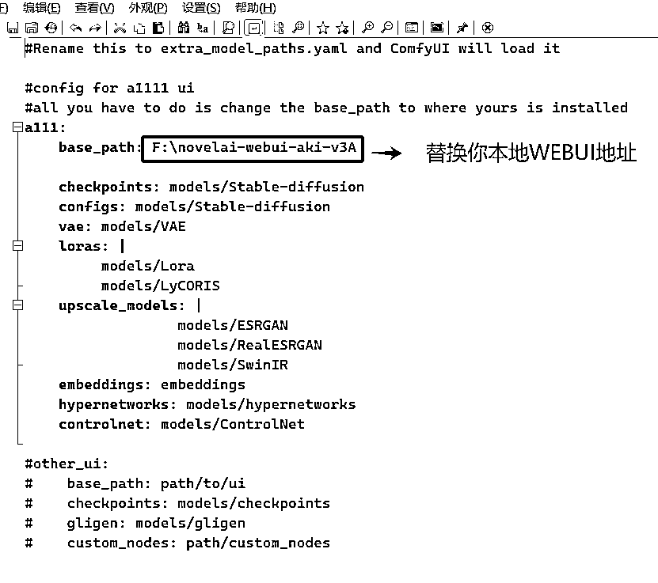
另外把controlnet地址改成WebUI的controlnet模型目录，路径类似`extensions\sd-webui-controlnet\models`。启动ComfyUI后，就能在模型栏直接读到你已有的模型了。
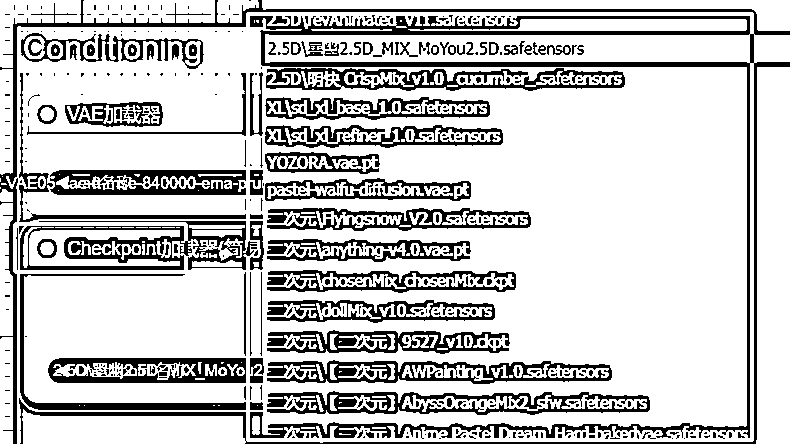

**怎么更新ComfyUI？**
后面想升级，不用重新下载配置，用安装目录里的更新脚本就行：
在`ComfyUI_windows_portable\update`里找到`update_comfyui`和`update_comfyui_and_python_dependencies`两个文件。
用`update_comfyui`更新核心，看到“Done”就是成功了。
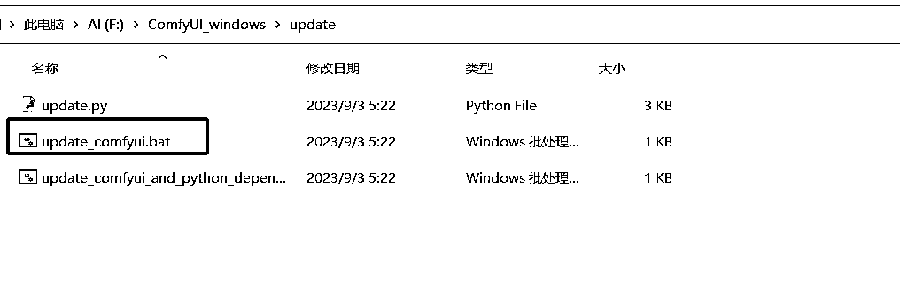
一般情况下不需要更新环境依赖，除非有特殊需求。
不过提醒一句：ComfyUI新版本别急着更，免得更新后旧工作流没法用——因为插件版本和ComfyUI可能不兼容，最好等插件适配了再升。
如果你用的是秋叶整合包，直接在整合包的插件管理里更新即可。
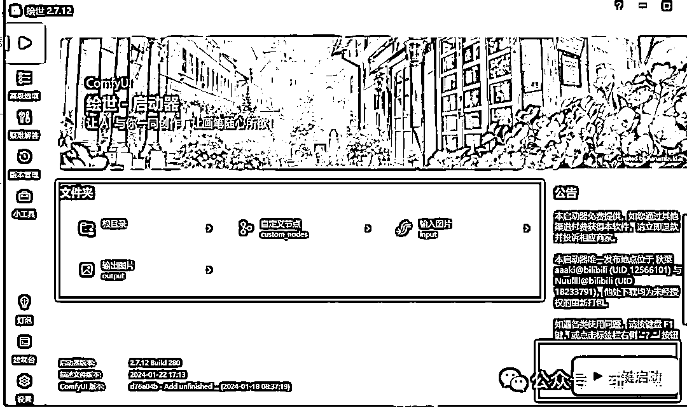
主界面跟WebUI类似，左侧是菜单，中间是文件目录（点开就能看），右下角是启动按钮。扩展界面里还能管理插件，支持更新、切换版本、卸载。
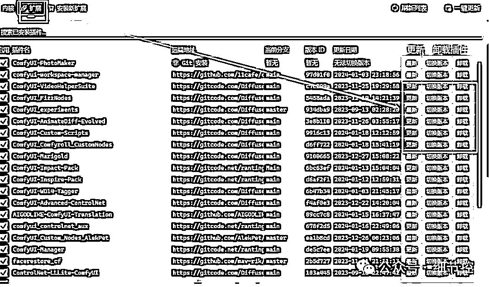

**基础工作流怎么搭？**
以文生图为例，整个网络分三段：Clip阶段（黄色）、Unet阶段（红色）、Vae解码阶段（绿色）。

节点有两种创建方式：
- 鼠标右键呼出节点目录，从目录里选。
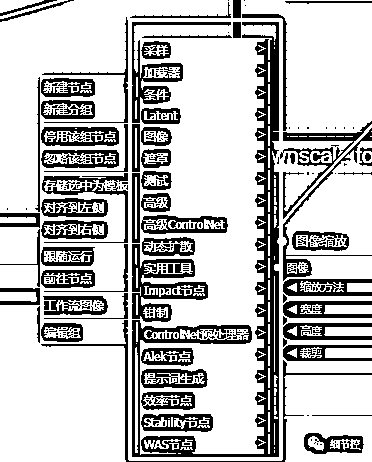
- 双击鼠标呼出搜索窗口，知道节点名的话直接搜，更快。
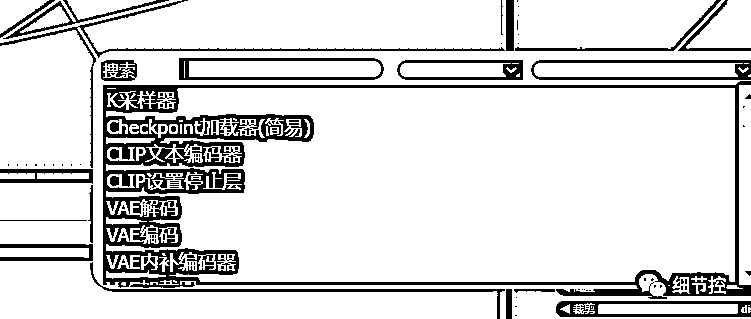

节点建好并连好线后，点右侧工具栏最上方的“Queue Prompt”就能生成图片。
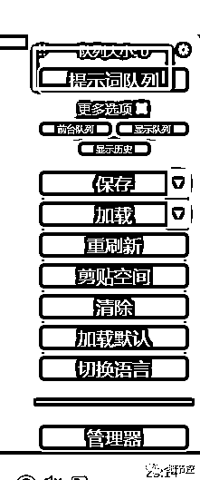
连线很简单，鼠标点住节点上的输入/输出点拖到另一个节点上即可。

一个完整网络通常包含这些阶段：

**大模型加载器**
右键新建节点，选“加载器”，然后找到“Checkpoint加载器（大模型加载器）”。在“Checkpoint名称”里选好你要的模型。
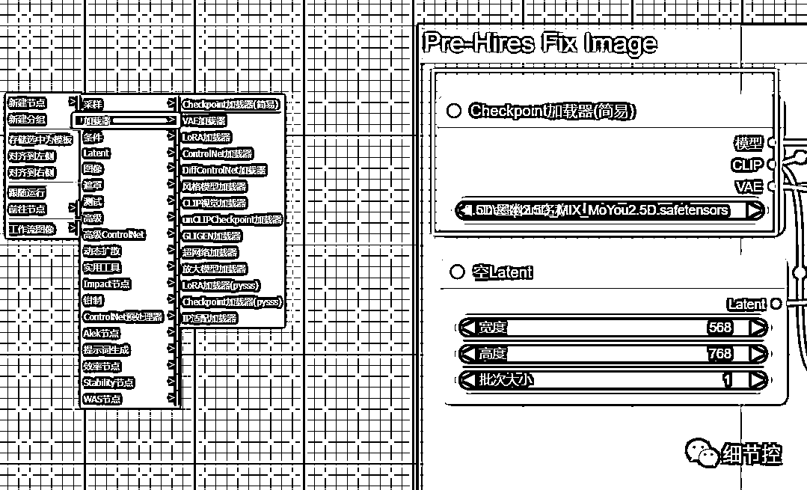

**文本输入节点（CLIP 文本编码器）**
关键词输入要用“CLIP 文本编码器”节点，正面和负面提示词都用它。
右键新建节点，选“条件”下的“CLIP文本编码器”，总共要放两个，一个写正面词，一个写负面词。
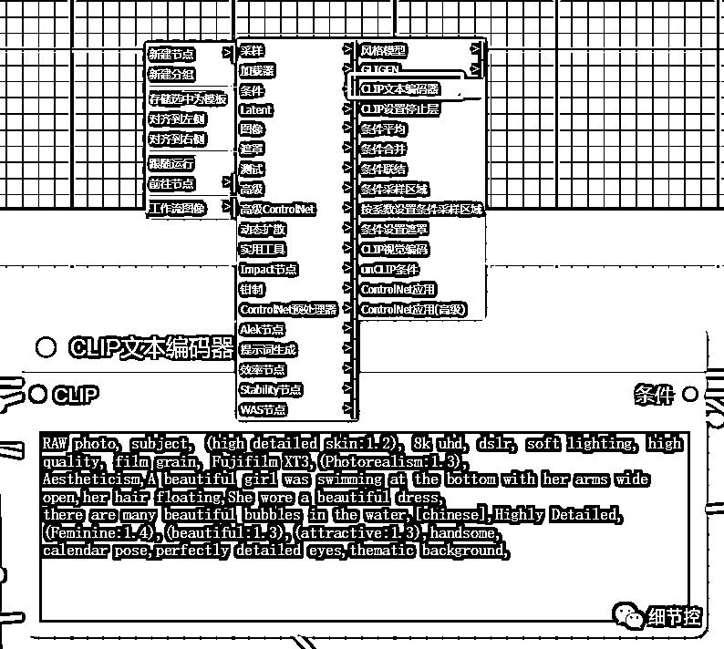
由于两者都是同一个节点，可以右键标题改名字，再右键改颜色，方便区分。
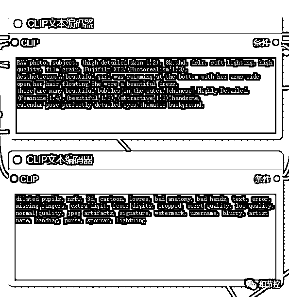
注意：Checkpoint加载器上有一个黄色连接点，名字叫“CLIP”，CLIP文本编码器上也有对应连接点，鼠标按住拖动就能连上。
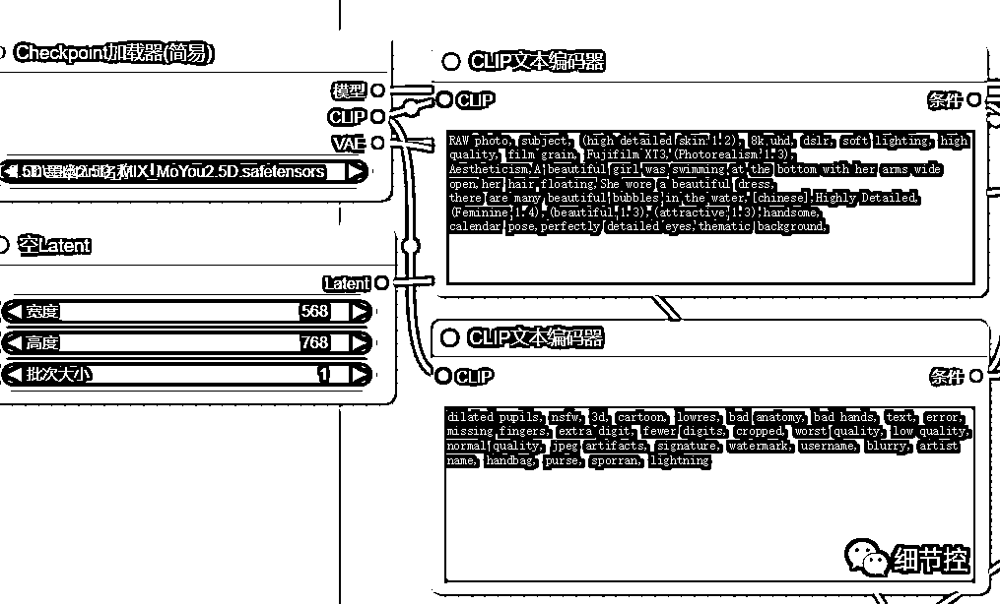
请留意，Checkpoint加载器只有一个CLIP输入点，而我们需要接正面和负面两个提示词。理解一下：节点可以有多个输出连接点，但作为输入点，它只能接一个。

**采样器**
右键“采样”选“普通采样器”。
ksampler负责在潜空间生成图片，参数和WebUI基本相同：
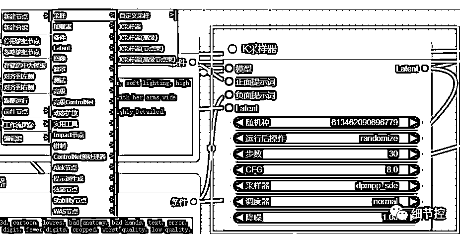
- 随机种子：每张图都有一个随机编号。
- 运行后操作：种子可以固定、增加、减少或随机，常用固定和随机。
- 步数：生成图片时去噪的次数。
- CFG：提示词引导系数，越大越贴合提示词，一般8左右就够。
- 采样器：可选很多，通常我选euler_ancestral（WebUI里的Eulera）、dpmpp_2m（DPM++ 2m）或dpmpp_2m_sde_gpu。
- 调度器：控制每步迭代中噪声量大小，一般选normal或karras。
- 降噪：和步数有关，1表示完全按上面的步数处理，0.1表示只走10%。这里填1。

采样器左侧有四个连接点：模型、正面提示词、负面提示词、Latent。
分别把“模型”接Checkpoint加载器的模型，“正面提示词”接正面提示词的条件，“负面提示词”接负面提示词的条件，剩下的“Latent”接控制图像宽高的节点。
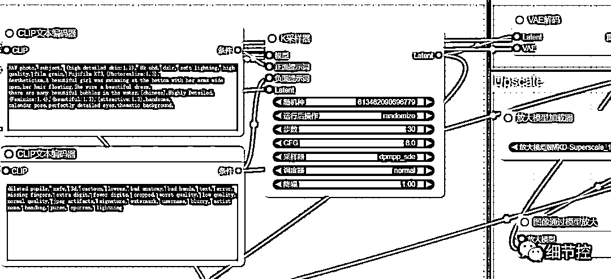

**宽高（空Latent）**
从“Latent”点拖一条线出来，选择“空Latent”节点连上，就能设置尺寸。
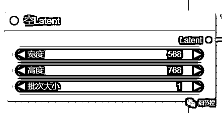

**VAE解码**
解码阶段把潜空间图像转成RGB色彩空间。右键新建节点，选“Latent”下的“VAE解码”，也可以直接拖动添加。
不同VAE接上去，解码出来的效果也会不一样。

总之，ComfyUI没有想象中那么神秘，把节点串起来，工作流就是你的创作流水线。希望这篇宝典能帮你打开AI绘画的新世界。

玩转ComfyUI，其实并没有想象中那么复杂。先把“VAE解码器”输出的Latent接到“采样器”的Latent入口，左侧就会多出一个VAE节点。此时“Checkpoint加载器”上还有一个VAE接口空着，把它和另一个VAE相连就行——大多数大模型内置的VAE可以直接拿来用。

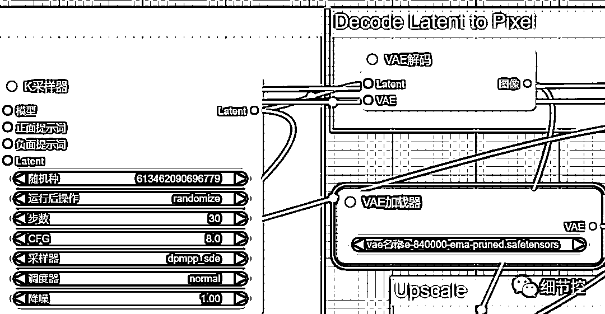

#### 图像保存怎么做？

右键新建节点，选“图像”分类下的“保存图像”（也可以直接拖进来）。这里有两个常用节点：“保存图像”和“预览图像”。预览节点只负责展示，不会把图片存下来；保存节点则会把生成结果写到ComfyUI根目录下的“output”文件夹里。

#### 开始生成图片

所有节点接好以后，输入提示词，调整模型、LORA、VAE、步数、宽高等参数，然后点击右侧面板的“提示词队列”，或者按快捷键Ctrl+Enter，就能开始生成了。

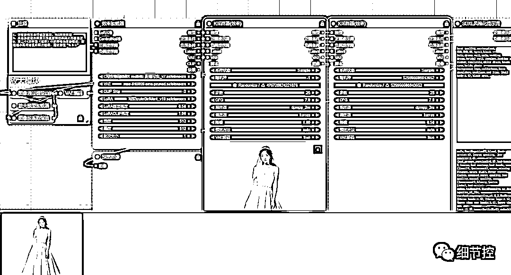

生成过程中，当前执行的节点会亮起绿色边框，你可以清楚看到跑到了哪一步，这对理解整个流程非常有帮助。

### 八、灵活多变的工作流

ComfyUI不仅能做文生图，还支持图生图、高清修复、面部修复、局部重绘、LORA等节点，并且可以挂上Reactor、Controlnet、IPAdapter、AnimateDIFF等插件。

#### 图生图工作流

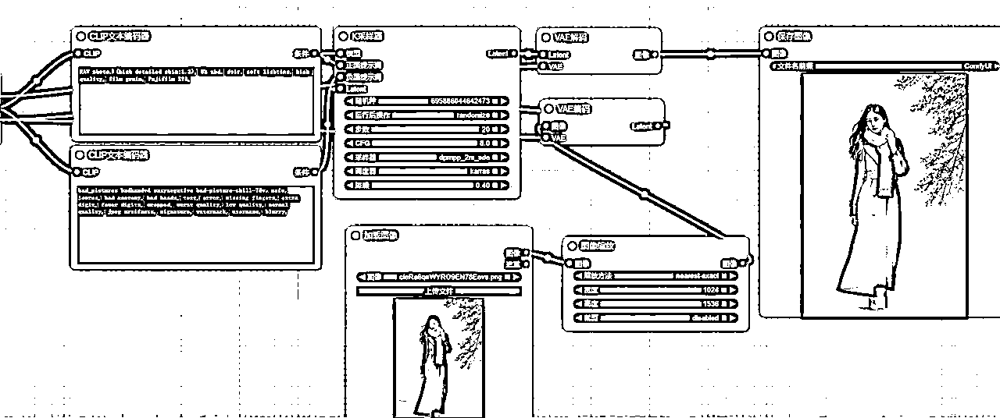

和SD WebUI一样，ComfyUI也接受图片作为输入。配合WD14 Tagger反推提示词，就能把参考图片自动转换成文字描述，实现“以图生图”。

#### FaceDetailer 面部修复

A股（注意：此处应指ADetailer？素材写的是“A股”？实为“ADetailer”？但素材原文是“A股”？我们依据素材： "人脸修复神器ADetailer在comfyui中无法使用" 所以写ADetailer）在ComfyUI里用不了，通常大家会改用FaceDetailer插件来完成人脸修复。

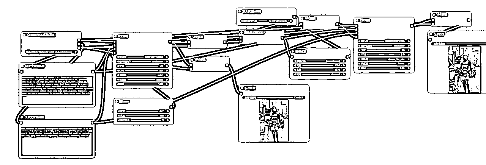

#### IPAdapter FACEID 真人换脸

IP-Adapter是腾讯AI工作室发布的ControlNet模型，功能类似Midjourney的“垫图”，可以迁移图片风格，最新的FaceID模型换脸效果也很不错。目前SD WebUI和ComfyUI都能使用。用FaceID或Full Face模型时，只需上传一张脸部照片，再输入想要的关键词，就能把生成人物的脸替换掉。

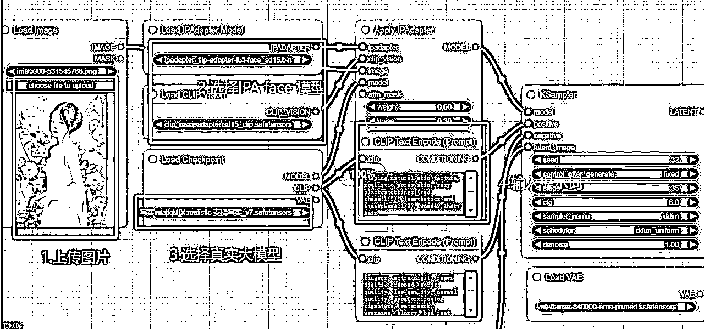

#### InstantID 真人换脸

InstantID通过ControlNet和IP-Adapter的组合来控制扩散过程中的面部特征，同时支持WebUI和ComfyUI。它对单张图片的相似度极高。我自己实测下来，InstantID的换脸效果是这几个插件里最自然的。

它支持官方提供的8种风格，还能和PhotoMaker Styler通用。

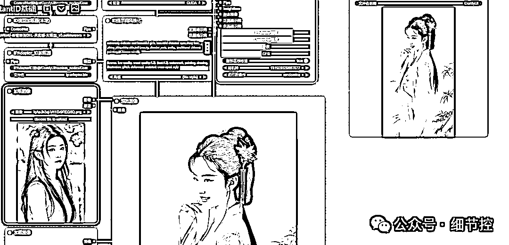

#### IPAdapter + ControlNet

把IPAdapter和ControlNet结合起来，可以实现两张图片的融合。比如用Candy来定构图，用OpenPose来控制人物姿势。

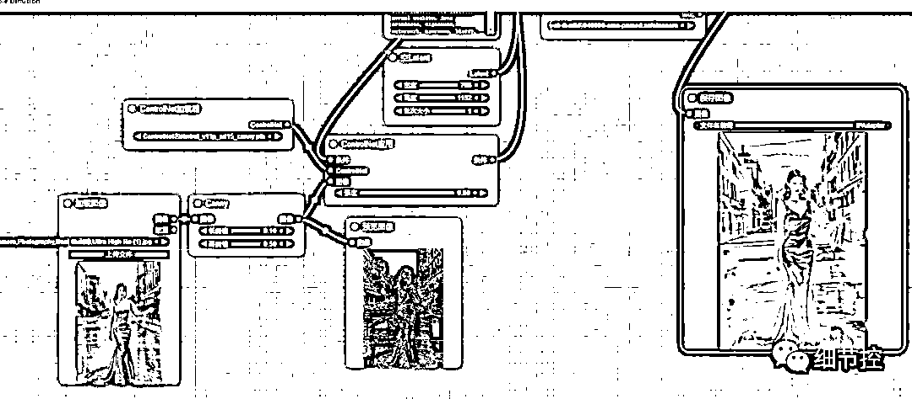

#### AnimateDiff V3 文生视频

用ComfyUI加上AnimateDiff，可以生成非常丝滑的视频——之前抖音上很火的“一个女孩的一生”“一个男孩的一生”就是这么做的。

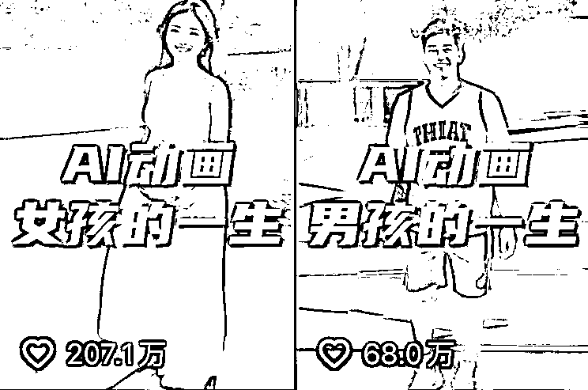

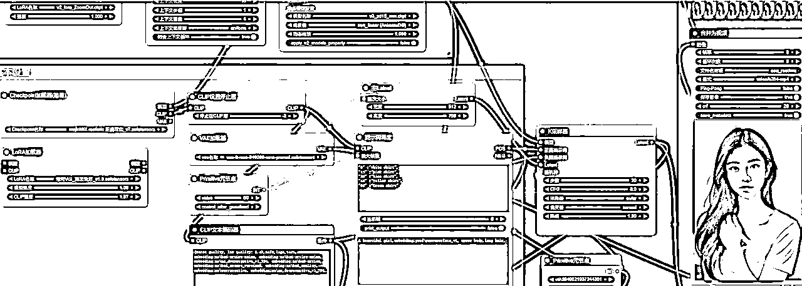

#### IPAdapter + AnimateDiff 生成视频

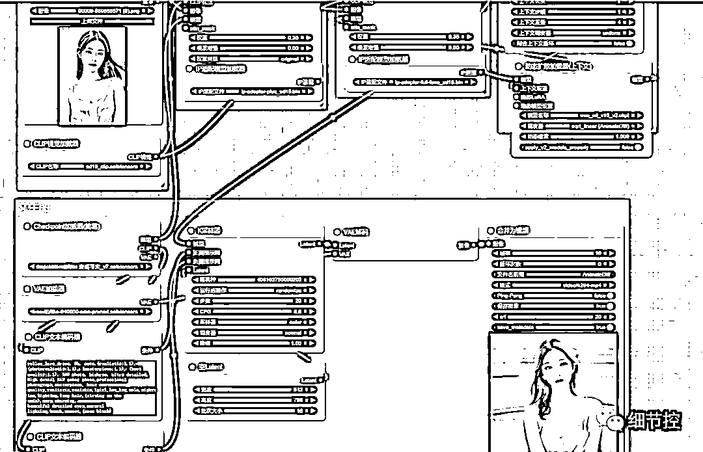

#### SVD 图生视频

Stable Diffusion母公司Stability AI推出了视频生成模型Stable Video Diffusion，简称SVD。它的训练数据量非常庞大，初始阶段就用了5.7亿个视频片段，这些片段加起来总时长有212年。

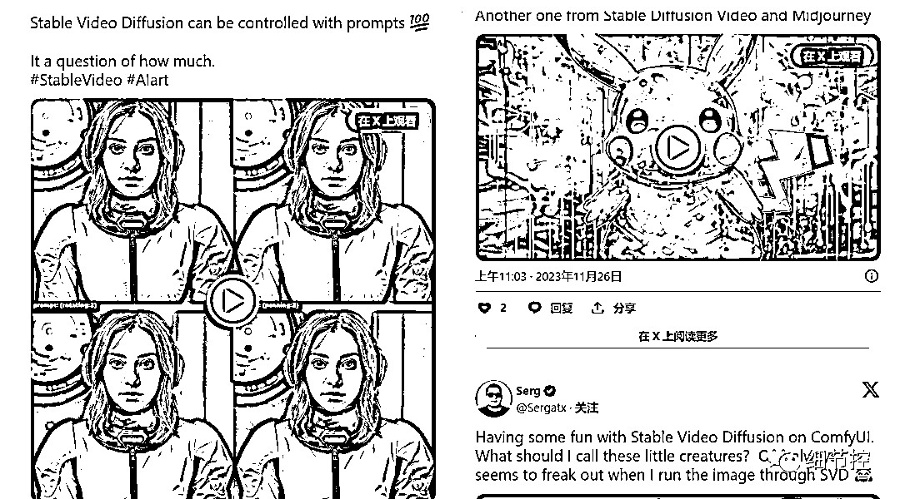

如果还没有部署ComfyUI环境，可以直接去官网在线体验，那里有很多玩家上传的视频可以看。

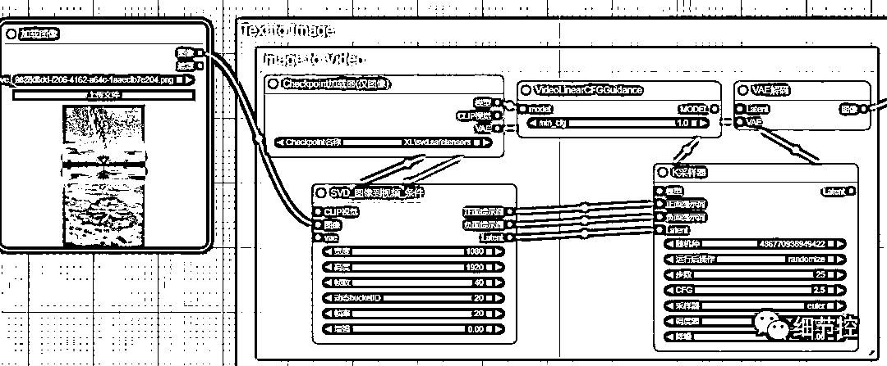

#### LCM + 绘图工作流

#### SDXL-Turbo 实时渲染

SDXL Turbo是一个可以实时生成的模型。从官方演示来看，输入提示词后几乎马上就能渲染出图像。在A100上，它只需要200多毫秒就能生成一张图，相比以前四五十秒一张的速度，简直是质的飞跃。

#### Krita + ComfyUI + LCM 实时AI绘画

### 九、更多工作流资源

#### 官方工作流

ComfyUI官方发布了许多现成的工作流。打开官方GitHub页面，找到ComfyUI_examples就能看到。

网址：https://comfyanonymous.github.io/ComfyUI_examples/

官方的常用工作流只需要保存图片，再拖进ComfyUI界面，就能自动识别并载入整个流程。

#### OpenArt.ai

网址：https://openart.ai/workflows/dev

OpenArt.ai是一个在线AI绘画工具，能帮你用人工智能创造和编辑图像。不管你是艺术家、设计师、作家、游戏开发者还是营销人员，都能在这里找到合适的AI图像生成器，把想法变成现实。

这个网站汇集了大量海外创作者分享的工作流，比如之前很火的“一个女孩的一生”。

### 十、常用插件推荐

ComfyUI支持很多插件，能大大增强使用体验。

- 辣椒酱界面汉化：把ComfyUI界面翻译成中文，对国内用户非常友好。  
  https://github.com/AIGODLIKE/AIGODLIKE-COMFYUI-TRANSLATION

- 提示词风格样式：自定义提示词的风格和样式，让生成更有创意。  
  https://github.com/twri/sdxl_prompt_styler

- 提示词中文输入：直接输入中文提示词，方便中文创作者使用。

这些插件都可以从GitHub下载，按说明安装。具体方法：进入插件链接，点击“Code → Download ZIP”下载，解压后放到ComfyUI的“ComfyUI_windows_portable\ComfyUI\custom_nodes”目录中。

也可以直接用网盘里的整合包，里面已经集成好了常用插件（比如汉化补丁、插件管理工具），省去了一一安装的麻烦。

或者在ComfyUI的插件管理器里搜索插件名称，点击“安装”按钮即可。

### 十一、ComfyUI与SD WebUI优劣对比

**优势：**

1. 显存要求更低，启动更快，出图速度也更快。
2. 自由度更高，可以自定义工作流程，随意调整模块连接。
3. 能和WebUI共用模型和环境，两者可以同时使用。
4. 可复现性强，流程可以导出分享，出错时也能快速定位问题。
5. 图像还原功能：生成的图片能完整还原整个工作流，模型选择也会一并保存。

**劣势：**

1. 操作门槛偏高，需要清晰的逻辑和一定理解能力，学习曲线比WebUI陡峭。
2. 生态相对较小，虽然常用插件都有，但WebUI的插件数量仍然更多。

相关链接：  
ComfyUI项目：https://github.com/comfyanonymous/ComfyUI#installing  
Manager插件管理器：https://github.com/ltdrdata/ComfyUI-Manager.git  
汉化插件：https://github.com/AIGODLIKE/AIGODLIKE-ComfyUI-Translation.git

ComfyUI为Stable Diffusion带来了一个强大的节点式操作界面，让你拥有更高的自由度和可复现性，同时降低了对显存的要求。它是深度学习领域里非常实用的工具，对于想深入了解Stable Diffusion的朋友来说，绝对值得一试。

最后，我是行者，欢迎链接我，一起聊AI绘画、AI视频、ComfyUI工作流的玩法和变现思路。