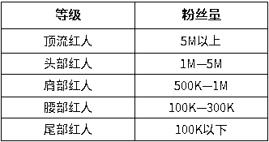
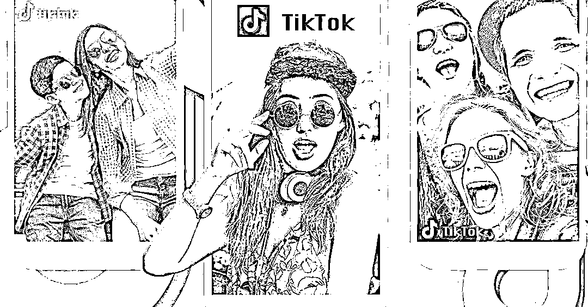
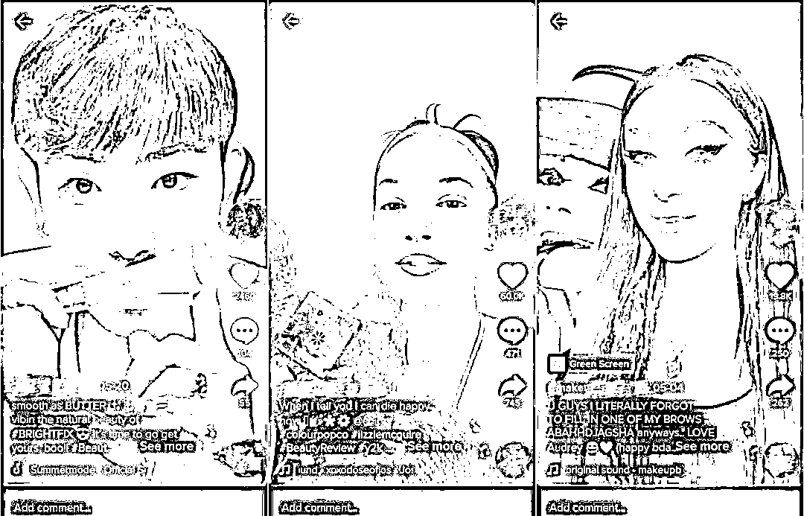

# 风向标拆解第2期——TikTok海外红人还有戏吗？Choco视角
作者：龙哥

社交浪潮之下，TikTok已成为海外最具爆发力的内容阵地之一。其短视频形态和全球化分发能力，让创作者得以跨越国界与不同文化背景的观众产生连接。平台上，众多海外红人靠差异化内容吸粉过百万，热度视频更在无形中左右着用户的购买选择。相较传统投放，红人营销以高互动、低成本著称，既能为独立站导来精准流量，也是品牌信任背书的重要来源。

那么，押注TikTok海外红人，机会到底在哪？

# 一、TikTok红人营销全景

## 1.1 红人营销是什么

红人营销是传统广告与内容营销的融合形态，核心逻辑是用创作者的个人魅力与影响力，为品牌植入内容场景，进而拉近品牌与目标人群的距离。

在TikTok做红人投放，必须吃透平台特性。用户群体偏年轻，对新奇内容接受度极高，社群与小众亚文化的渗透力很强。平台重娱乐、重互动，品牌需要借助这种氛围建立持续连接。视频前3秒决定生死，创意抓人是硬指标。

基于这些特质，并非所有品类都适配。零售、美妆、生活服务类目因娱乐属性强、短视频承载力好，更易出圈。尤其是客单价低、功能直观的零售品，在平台上更容易被用户接受。东南亚市场里，小家电与美妆时尚就是直播带货的常青树，正是平台内容生态的缩影。找准产品特性，匹配对的人，投放效率才会放大。

## 1.2 做红人营销想达成什么

### 1）借势背书，建立信任

新品牌进入海外市场，本地用户天然存疑。过往做法是签约本土明星做宣发。如今，品牌可用可控预算撬动多位红人，用真实短视频消解用户戒备，提升在地认知与亲和力。

### 2）抢夺流量，放大声量

TikTok搜索流量占比持续上升，用户习惯用关键词和话题找内容。图文时代的逻辑已过时，品牌必须通过自有团队或红人持续生产内容，截取搜索心智，抢占hashtag首位曝光。

红人投放是提振知名度的捷径，尤其在月活超16亿的全球舞台上，声量效应被极致放大。

### 3）撬动购买，培养忠诚

本土红人对自家文化更敏感，善于用生活场景戳中痛点，激发购买冲动。初期可优先选择带货力强的达人，追求转化。真正的红人营销不是硬塞信息，而是围绕用户需求与情感共鸣做文章，通过互动不断沉淀品牌好感，形成长期忠诚。

互动是红人营销最大卖点。红人以日常分享+产品亮点展示结合，击中用户痛点，放大购买欲，最终沉淀为品牌情感资产。

### 4）试水新品，回收洞察

测评是新品破冰的关键。红人通过开箱、试用、点评，为品牌搭建与消费者的沟通桥梁。在互动评论区，红人能第一时间收集用户需求与反馈，为产品优化和后续推广提供一手情报。

## 1.3 红人营销怎么做

### 1）先定人，再找人

海外投放第一步是锁定目标受众。通过数据分析勾勒人群画像，是学生党、都市白领还是小资文艺青年。即便是日用品，也要做圈层细分，才能找到真正匹配的红人。

### 2）目标要写在纸上

策略有效的前提是目标清晰。是要提升站内访问、还是拉升某SKU销量占比？明确KPI才能评估效果，也才能算清ROI。

### 3）选对红人比选大更重要

扩大内容覆盖面、触达潜在人群，是红人投放的核心。受众明确后，要依托偏好和行为筛选出真正有影响力的创作者，确保调性契合、沟通顺畅。

筛选维度建议：

更新：近期的内容是什么？更新频率是否稳定？

流量：播放量、点赞量体量如何？

圈层：是否常做我们品类或周边内容？在品类圈口碑怎样？

内容质量：素材是否值得二次利用？剪辑和呈现是否专业？

### 4）时间线要提前排

一次完整的投放周期约一个月：找人→接触→敲定合作与合同→寄样→脚本确认→拍摄制作→上线。每个环节都耗时间，建议做排期表，倒逼团队与红人协同推进。

参考节奏：

* 第1周：人群定位与数据分析
* 第2周：营销目标与推广指标确认
* 第3周：红人筛选与初步沟通
* 第4周：签约、寄样、细节确认
* 第5周：脚本定稿与视频制作
* 第6周：集中上线与预热

多红人联动最好同时间段发布，形成声势，制造话题热度。

### 5）做竞品拆解，找差异点

投放前要研究对手打法，梳理关键词效果，找出可超越的点。分析产品差异，提炼卖点，让红人在内容里有明确的发力方向。再配合一句好记的slogan或品牌符号，便于口碑裂变。

## 1.4 哪里找红人

### 1）关键词搜索

在TikTok直接搜品类词，如美妆、宠物，进入Top、视频、话题榜单，筛选相关创作者，通过主页获取联系方式。

### 2）借大牌撬资源

在竞品或大品牌账号的视频评论区，常能看到@合作红人，从中挖掘优质达人池。

### 3）官方达人超市

TikTok Creator Marketplace提供官方数据，可按品类、粉丝画像筛选达人，并发起Campaign邀请。

### 4）TikTok小店渠道

进入TikTok Shop Seller Center，使用Affiliate—Find creators功能，按内容类目、粉丝画像、区域匹配红人。

### 5）联盟计划

通过TikTok联盟计划以佣金制合作，将创作者与商家绑定，按成交付费。

### 6）第三方工具

市面上有多款红人数据工具，支持排行、价值评估等精细化筛选，可按需求选用。

## 1.5 怎么判断红人靠不靠谱

很多团队犯的错就是只看粉。更稳妥的做法是找与产品有相关性的垂直红人，效果更精准。

核心判断维度：

### 1）影响力

粉丝量是参考项而非唯一项。可根据投放目标匹配不同量级。

商家可以根据商品和品牌需要，寻找不同粉丝量级的红人。

建议大品牌考虑粉丝数在500K以上的红人，如果是为了提升销量，预算有限可以考虑300K以下腰尾部红人。

### 2）内容相关度

花时间看红人过往测评、合作品牌、频道主题是否一致。垂直度越高，粉丝画像越精准，投放复用价值也越高。

### 3）粉丝画像

性别、年龄、国别、设备等决定投放匹配度。TikTok月活用户集中在16-24岁，Z世代是主力，女性为电商核心购买人群。

### 4）粉丝买不买账

* 互动率：近30天点赞、播放、评论综合表现，15%以上可视为优质资源。
* 更新频率：活跃度高则号召力强，长期停更需谨慎。

综合以上，才能选出真正能带量又能带声量的合作对象。

## 1.6 合作形式、费用与佣金

### 1）常见合作形式

1. 口播种草：红人在视频或直播中口播功能与推荐理由，展示使用方法，激发购买兴趣。
2. 开箱展示：寄样后由红人做开箱，突出品牌调性与产品亮点。
3. 教学植入：以美妆仿妆、穿搭教学、烘焙分享等干货内容软性植入。
4. 情景剧：用生活化剧情带出产品特性，增强共鸣与记忆点。
5. 生活Vlog：以日常记录形式自然植入，种草力强。
6. 专业测评：适合长期深耕垂直领域的达人，内容更具说服力。
7. 才艺展示：舞蹈、健身等高粘性内容，偶像效应明显。
8. 资讯科普：适合科技、时尚等品类，以知识输出植入产品。
9. 直播带货：互动强、转化快，适合测试需求与快速放量。
10. 标签挑战赛：约80%用户参与挑战，品牌可邀头部红人发起，腰尾部发酵。
11. 广告投放+红人：In-feed信息流与红人内容结合，实现曝光与转化的双重收益。

### 2）费用结构

* 分佣：按成交抽成或联名赞助，适合有独立站实力的商家。
* 直接付费曝光：明码标价，按时长、出镜次数计费，需谈好素材使用周期与版权。
* 免费赠送：寄样换内容，主要做小范围曝光与素材沉淀，需提前约定版权。

费用受粉丝量、领域热度、产品类别、所在地区、投放时段与节日影响。合作前务必书面明确内容范围、价格、服务、版权与预期效果，避免生硬推销感。

## 1.7 聊合作的话术要点

### 1）写开发信的注意事项

* 用企业邮箱或Gmail，🐧/163等国内邮箱易被屏蔽。
* 信中避免“price、discount、review”等敏感词，可用同义词替代；首封信不放图片与链接。
* 按粉丝量分层触达：>100万为大V，10-100万为中V，1-10万为小V，<1万为小小V。粉丝越小回复率越高。想投特定国家，可先搜关键词定位在地红人，东南亚等区域红人成本更低，甚至可免费寄样换推广。

### 2）一封好邮件的要素

* 标题简洁明了：To John Smith, TikTok collaboration / free testing / unboxing等。
* 称呼得体：Hey Mr Smith, I'm glad to email you!
* 正文包含：自我介绍、品牌与产品亮点及链接、为何看中该创作者、能为对方带来的价值如曝光、样品、长期合作。
* 结尾致谢并期待回复，可加附件资料但避免邮件臃肿。

合作商谈阶段，核心是让广告调性与红人风格统一，保持自然种草感，而非硬广。

在请红人合作时，大致会碰到两种报价方式：一类是红人上来就直接问你的投放预算；另一类是红人会提供一份完整的合作报价单，上面清晰写明了内容形式的价格、交付周期以及发帖时长说明。

业内的经验是，第二种方式更值得优先考虑。能拿出标准化报价表的红人，通常意味着合作案例多、流程成熟，专业度更高，后续执行也更可控，效果往往也更稳定。

### 3）执行要点

**合作注意事项梳理：**

1. 尊重文化差异
*   在发起联系前，先做功课了解对方所在市场的风俗习惯与禁忌，避免踩雷，让合作更顺畅。

1. 费用侧重点
*   欧美头部红人报价普遍偏高，更适合预算充足的大品牌。中小卖家若想把钱花在刀刃上，可以优先关注东南亚等红人资源，性价比更高。

1. 粉丝量≠转化
*   账号粉丝规模大不等于能带来成交，粉丝少的红人未必转化差，评估时要结合受众匹配度、互动质量等综合判断。

1. 时差与发送时机
*   记得考虑时差，选择红人在线活跃的时间段发邮件。可以设置定时发送，避免半夜打扰影响回复率。

1. 预算要合理
*   充足且合理的预算是合作顺利的基础。适当议价可以，但过度压价容易让红人失去合作意愿，反而错失机会。

1. 适度跟进
*   如果长时间没有回音，可以间隔性地再发一次信息，提高被注意到的概率。

1. 保持互动与正向反馈
*   持续保持积极沟通，对红人作品的亮点给予认可，再提出具体的优化建议与需求点，合作氛围会更好。

1. 激励与责任并重
*   设计合理的绩效激励调动红人积极性，同时明确双方的责任边界，用机制保障权益。

1. 达人结构要均衡
*   头部达人与腰尾部达人要合理搭配，不要过度依赖高价低转化的头部，也不要只堆价格低但影响力有限的KOC。

1. 拓宽达人标签
*   不要局限在单一垂类，多维度丰富红人属性，引入跨领域创作者，扩大覆盖面。

1. 克制创意干预
*   减少硬性植入，给予红人创作自由，保持内容原生感，才能真正发挥其对本地文化的理解优势。

1. 缩短项目周期
*   提前准备好产品资料、参数与需求 brief，预留充足物流与沟通时间，压缩交付链路，避免错过销售旺季。

## 1.8 效果复盘

1. 粉丝增长量
*   对比合作前后红人的涨粉曲线，看是否出现明显增长。

1. 成交表现
*   追踪合作期间商品的实际销售数据，衡量推广对业绩的直接贡献。

1. 曝光与流量
*   监测品牌或产品在平台的搜索量、浏览量、曝光量是否提升。

1. 评论区互动
*   统计点赞、评论、私信、分享等互动指标，判断受众参与热情。

1. 品牌联想度
*   观察用户提及品牌时的认知与关联，评估品牌心智是否被建立。

1. 合作后参与度
*   看合作结束后用户是否持续关注品牌账号、参与活动、产生二次传播。

1. ROI
*   计算投入成本与产出收益的比值，评估经济回报是否达标。

1. 用户口碑
*   收集用户真实反馈，判断产品体验是否得到认可，红人影响力是否有效。

1. 红人声誉效应
*   观察合作后红人是否获得其他品牌或用户的正面评价，形成二次背书。

1. 红人活跃度
*   评估合作后红人是否保持持续更新与高质内容输出，判断长期价值。

1. 销售转化率
*   基于推广期的访客与下单数据，核算最终转化率。

1. 后续合作潜力
*   判断本次合作是否具备续约可能，为长期资源沉淀打下基础。

系统化的复盘能帮助商家看清红人投放的真实价值，为下一轮投放提供优化依据。及时的反馈与沟通，也是维系长期合作关系的关键。

# 二、海外红人营销的痛点

坦白说，红人营销本身就是件费力事，环节多、链路长、变量大。在国内做就已经费时费人，放到海外，再加上时差、语言、文化等障碍，难度会指数级上升。

## 1）红人难找

整体来看，海外红人营销的生态成熟度远不及国内。

第一，缺少统一的撮合平台。国内有巨量星图、蒲公英、磁力聚星、花火等成熟平台，但海外至今未形成类似的集成生态。Facebook、Google等也未推出全场景对接工具。现有的搜索标签太粗，品牌很难基于粉丝画像做精准筛选。

举个例子，你在YouTube搜 drones，会得到海量无人机相关视频，却很难快速锁定真正有带货能力、受众匹配的创作者。数据不透明的情况下，身在中国的外贸卖家，要判断大洋彼岸哪位红人最值钱，几乎像大海捞针。

有句话形容得非常贴切：在数据模糊的境地下，中国卖家评估海外红人价值的难度，就像一个卖螺蛳粉的西方人想找中国博主拍广告一样困难，信息差巨大。

## 2）沟通难

红人营销重在沟通，而跨国沟通天然存在壁垒。

1、工具习惯不同。
国内团队习惯🛰️、飞书、钉钉快速对接。海外商务沟通的主流仍是邮件，响应节奏和中国卖家预期差异很大。

2、语言门槛高。
粉丝量可观的海外红人每天邮箱里堆满上百封品牌邀约，平均只花几秒筛一封邮件。邮件必须足够抓眼、够本土化才有机会被打开。
绝大多数出海卖家并非母语使用者，用当地语言写出高转化邀约的门槛很高，往往需要配备双语同事或借助AI工具辅助。

## 3）职业化不足

联系上不代表合作顺畅，很多海外红人的职业素养偏低。

常见情况是收了样品就失联，消息长时间不回。这与国内博主接商单后全天候响应形成鲜明对比。

根本原因在于出发点不同。国内多数红人已把内容创作当职业，对商业合作流程熟稔。海外很多创作者最初只是出于兴趣分享垂直领域内容，红人身份只是副业而非职业。

## 4）红人“不好管”

国内红人普遍配合度高，甲方提的要点基本会执行。海外红人则更看重创作自主权，不太愿意被过度脚本化。

硬塞“这是我用过最好用的产品”这类生硬背书，往往效果适得其反。一旦产品体验不符，用户会在评论区直接反噬。所以想激活海外红人，最好的方式是放权，让他们用真实视角表达。

## 5）成本高且不透明

海外投放的成本结构复杂，是最大的挑战之一。

*   费用不透明：缺乏统一报价体系，每位红人的定价逻辑不同，预算难以预估。
*   物流与履约成本：跨国寄样、关税、损耗都会增加隐性支出。
*   外汇与手续费：跨境支付涉及汇率波动与平台手续费。
*   付款安全：国际交易支付方式多样，存在资金安全风险。
*   本地化溢价：文化适配、翻译、本地化定制都会产生额外费用。
*   法律合规成本：合同起草、税务合规可能需要律师介入。
*   机会成本：长期绑定单一红人，可能错失其他渠道机会。

海外红人营销挑战多，但只要规划清晰、沟通到位、建立信任，这些问题都能逐步解决。长期稳定的合作关系，才是品牌出海的核心资产。

# 三、普通创作者的机会在哪里

## 1、加入TikTok创作者基金
严格来说这是TikTok账号的基础变现路径。收益基于粉丝规模、内容互动质量和更新频率综合计算。

只要提升视频播放量，就能获得平台官方的创作激励。甚至有账号通过搬运或二创国内素材，就获得了百万级播放。

加入条件为:
1.年满18岁
2.粉丝≥1万
3.近30天内视频累计播放≥10万
4.账号遵守社区规范与使用条款

创作者基金按播放量结算，更适合作为起步期的短期收入。要想做大做强，必须找到更可持续的变现模式，才能实现批量化、稳定化运营。

## 2）私域引流带货
做过跨境电商的创作者，可以将TikTok流量导向自有亚马逊、速卖通或独立站，实现内容到成交的闭环。

## 3）广告佣金分成
没有自有店铺也可以入局，通过给品牌店铺引流赚取佣金或广告费。

## 4）账号交易
把养好的TikTok账号打包出售给有需求的MCN或品牌方。

## 5）求职变现
掌握从0到1做号方法论后，可以进入国内跨境电商公司、品牌方担任TikTok运营、达人合作等岗位。

## 6）直播打赏与带货
才艺类创作者可通过直播打赏变现。随着TikTok小黄车、橱窗功能逐步开放，未来可直接在站内完成直播带货，无需跳转第三方平台。

总的来说，TikTok海外红人赛道机遇与挑战并存。用科学的策略和细致的执行，完全可以打出可观的回报。