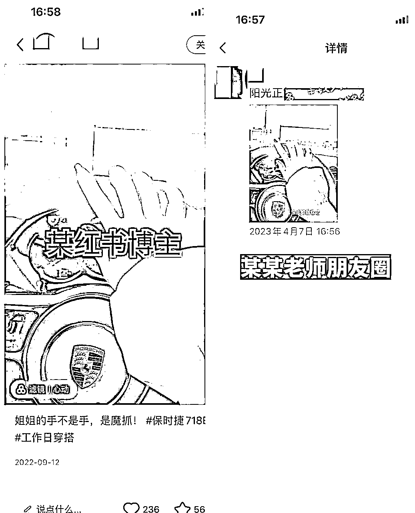
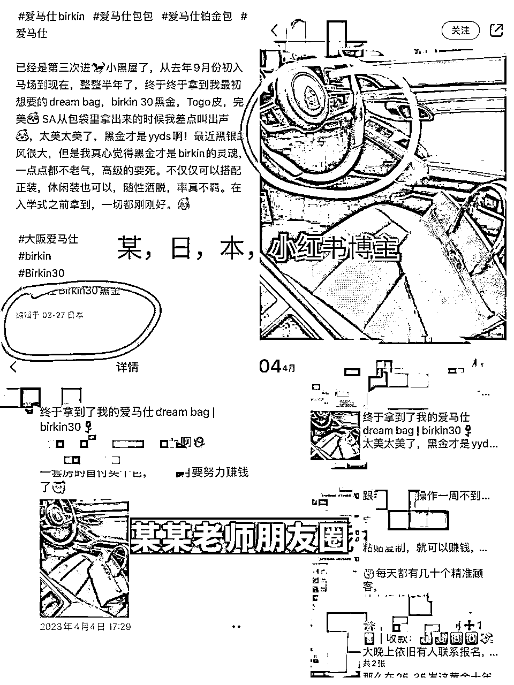
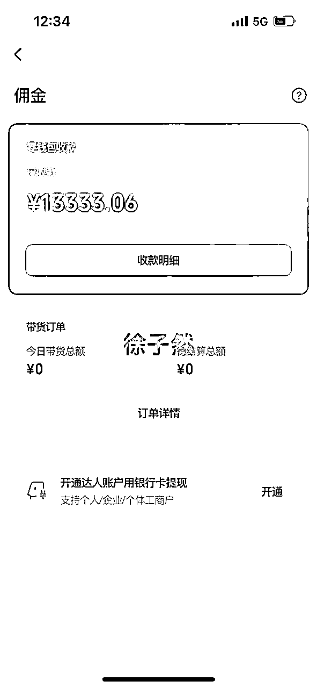

# ('生财小白经过6个月的迷茫期，进入生财后，成功转型月入2w+', (2, 31))

2023年，对我而言是翻天覆地的一年。我叫徐子然，干了十年销售，从没想过自己有一天能靠副业改写收入曲线。

这篇写给还站在闭环之外观望的你。去年以前，我还是个北漂。2022年10月，我辞掉北京的工作，结束六年漂泊，回到云南老家，完成了人生大事——结婚。成家之后，钱包压力也来了。2023年初，我们开始认真琢磨互联网副业。

那时候刷公众号，看到有人讲“学科资料项目”，觉得门槛不高，就加了老师，付了699元，正式下水。可能是运气站在我这边，七天后我就打通了整个流程。于是赶紧置办手机、电话卡，批量注册账号开干。笔记发得越来越多，引流人数从一天1个变成10个、20个，收入也从每天几十块涨到几百块。最猛的一天，直接变现3000多块。

尝到甜头之后，运气开始反转。到了3月中下旬，平台频繁给我限流。我只能注销重来，再注册、再限流，前前后后被我注销的小红书号超过三十个，依然无济于事。整个人彻底陷入焦虑和迷茫。

人一焦虑就容易乱投医。那会儿我看卖考证资料的老师，朋友圈晒的全是商务局、成交截图、客户好评，年纪轻轻就开保时捷718。坦白讲，我真的动了心。又花了999元，把她的课买了回来。结果呢？内容跟宣传完全是两码事，问问题几小时才回一句。更讽刺的是，有天我刷到一张特别眼熟的图，赶紧打开对方朋友圈对比——一模一样，但定位、头像、昵称全对不上。我不确定，也不敢相信。

不死心，我又去搜同款图，竟然翻到了另一张出处，这下彻底死心：原来人家的保时捷，是从小红书“借”来的。

被骗两次，我更迷茫了。4月中旬，我通过鱼丸拿到一张三天的体验卡，随后花了2000多块，加入了生财有术。进去一看，好多月入十万的大佬，还有一堆00后，瞬间更自卑了，感觉自己啥也不是。

好在赶上了航海。那段时间朋友圈全是卖小红书店铺课的，都说2023年是趋势，进来就赚，利润50%以上。我发现生财也有小红书店铺的航海，本想跟着走，可离出海还有十天，我等不及，再加上满屏的爆单截图刺激，脑子一热，又花了3680元买了外面的课，放弃了这次航海。为了快速回本，我和老婆一口气开了5家店铺，天天刷对标、选品、剪视频、发视频、下单、发货。有单，但每天就3到5单，客单价低，利润一天只有几十块。我问老师怎么精进，她说多发；我问怎么选品，她说去拼多多淘宝选。后来她主动跑来说：“宝，你那款出了20单，继续堆量就行。”那一刻我才明白，这“私教”水分有多大。

但我就是不甘心。耳饰、乳贴、儿童玩具、厨房用品、汽车用品、百货……试了一整圈。每个品都能出几单，却怎么都打不成爆款。我不知道问题出在哪，也找不到人问，就这么不死不活地拖了大半年。那段时间，我俩无数次怀疑自己是不是没这个命，要不回去上班算了。可另一个声音又冒出来：别人能行，为什么你不能？

转机出现在9月底。生财新一期航海开始，我一次性报了三条船：小红书店铺、视频号带货、选品特训。说实话，我本来没指望视频号，随手选了些品，按手册每天更新三条视频。结果第三天无意间点开后台，今日数据赫然写着：17单！

我彻底懵了。就这么出单了？我们立刻放弃小红书，全力转战视频号。限流、橱窗被封、各种坑都踩了个遍，但收入总归是在往上涨。10月23日，我经梁靠谱介绍，加入了玩赚合伙人。靠谱帮我理清了方向，行动力一下子提了上来，月收入稳在1万左右。

真正的转折发生在12月1日。那是我看了李千万老师的文章，直接加了微信，又进了他的视频号私教。在他的指导下，我像被打通了任督二脉：单日冲到3000+，一周做到8000+，十五天就破了万，上个月稳稳拿下2W+。当然，这只是个开始，我的下一个目标是5W、10W。路虽远，行则将至。

最后，想对还在摸索的新手说几句掏心窝的话：别迷信什么风口，真正重要的是沉下心去学、去执行，在执行中找反馈。你今天踩的每一个坑，以后都会长成你的经验；而当你能把经验分享出去时，变现的路也就悄悄展开了。

电影《误杀》里有句台词：如果你看过1000部以上的悬疑电影，你会发现世界上根本没有什么离奇的事情。做项目也一个道理：只要仔细研究过1000个行业案例，所有问题都不再是问题；只要拆解过1000个项目，你就会发现所有项目背后的逻辑其实是同一套。

感谢梁靠谱、李千万、芷蓝，也感谢那个一直没放弃的自己。希望看到这里的你，也能早日找到适合自己的副业，跑通闭环，拿到结果。我等你的报喜。愿我们都能在生财的路上，一路相伴。