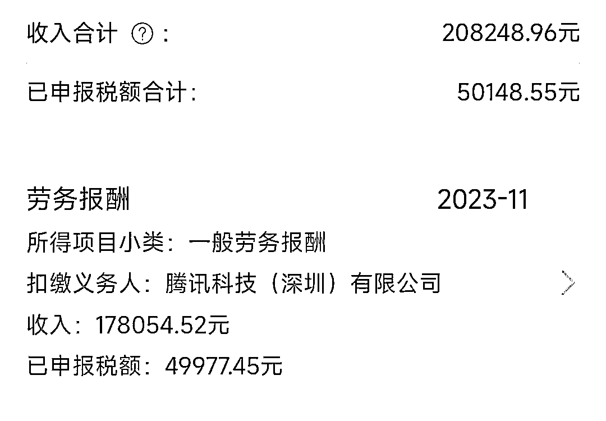
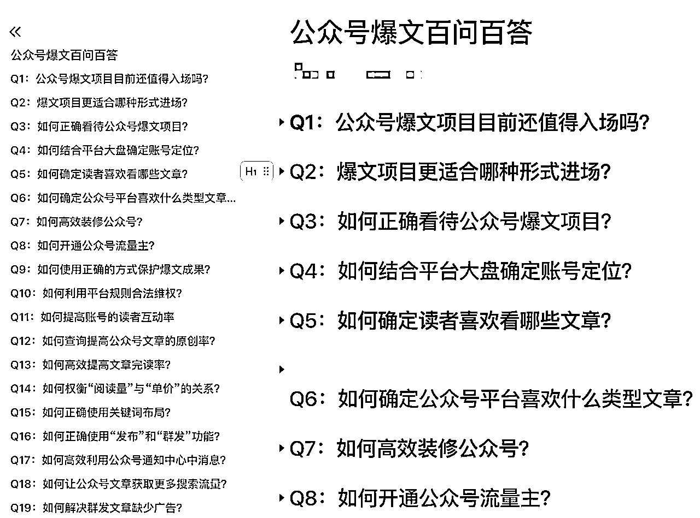

# 

## 1、我是越越

这是我的收益情况之一：

## 2、做爆文的心理变化轨迹

我的状态一路走来是这样的：迷茫、崩溃、摸索、顿悟、突破。

*   迷茫：项目一窍不通。

我踩过的坑不少，不知你是否也有同感：

1.  流量像坐过山车，昨日高光今日暴跌。
1.  因为同行举报被删文，收益还可能被扣，心里一直悬着。
1.  私信里全是投诉和谩骂，整个人被打垮。
1.  选的对标质量差、方向偏。
。。。。。。

初遇这些状况时，我完全无从下手。

*   崩溃：预期落空，心态失衡。

一旦负面连环出现，自信心濒临瓦解，甚至开始否定自己的付出。

我问自己：我真的适合做爆文吗？我为什么总提心吊胆？

我也想过放弃，是不是因为没有即时的正反馈？

回头想想最近都做了什么，其实就两件事：

1.  找对标抄对标。看到10W+就冲上去，抄标题抄素材，一点思考都没有。
1.  完全依赖AI创作。把大把时间耗在指令调试上，产出却不理想。

相信很多人都走过这段路。投入了时间，却等不来爆发的时刻，身心俱疲，最后只能停更。这滋味很难受。可冷静后看，底层逻辑没错，只是执行出了偏差，于是进入了后面的摸索阶段。

*   摸索：刨根问底，找到原因。

凡事皆有因果，我开始带着“搞清楚为什么”的态度，和教练反复沟通问题根源。

1.  这个现象为什么会发生？
1.  它是偶发还是必然？
1.  我该如何规避，或反过来利用？

我越来越坚信，能把项目做好，前提是降预期、稳心态、解问题、做复盘。

围绕这些疑问，我开始收集数据和案例。发现群里大家常问的问题，原来都是我的痛点。别小看任何一个细小的问题，它可能就是下一个坑。值得记录的我就归类整理成笔记供自己复盘。

总结出可复制的经验：

1.  每天整理航海群里船员的问题，哪怕自己已解决的。
1.  对照自身情况做调整和预防。
1.  结合平台规则做延展学习。

有一次我汇总了10个共性问题，其中4个是我没遇到过的。我就单独记下这4个问题的诱因、表现信号和潜在后果，并抄录大家的处置办法。这样一旦出现早期信号就能提前干预。

*   顿悟：顺势而为，别跟平台对抗。

我开始摒弃胡思乱想，用更理性的视角剖析问题本质。

我发现，想要从平台获得收益，就必须遵守规则，并且满足平台、读者、用户的真实需求。

吃透平台调性和规则后，我在爆文上的表现才有了实质提升，也拿到了第一桶金。

收益不稳，根子上是心态不稳，心态不稳的根子上是对平台的不了解。

导致这种情况的原因大致有：

1.  急于上手，连基本规则都不熟悉就开写，违规是常态。
1.  新手不重视规则，觉得规则枯燥无味。
1.  人云亦云，盲目跟风，不会甄别经验优劣。
1.  定位不清，不知道自己适合走精品长期路线还是批量短期路线，左右摇摆。

后来我开始系统钻研平台规则，并把AI从主力创作工具降格为辅助工具。

于是我的思路变为：

1.  目标定为长期精品路线
1.  定位是长期稳定可预期的收益
1.  资源是自建的经验沉淀+精品素材库+官方创作指引
1.  发力点是AI加人工手写，注入真实情绪
1.  难点是如何形成差异化和护城河
1.  原则是不跟风、不盲目、保持自己的节奏

*   突破：剑走偏锋，做差异化。

爆文赛道正处风口，人进来人出去，但核心逻辑不变。先跑通闭环，再放大复用，再塑造个人风格。

很多人说先复制再跑通再创新，我认同。所以我给自己定了三条线：

1.  别人写过的素材不碰
1.  别人用过的标题不抄
1.  别人验证过的方法不用

这三条都指向同一件事：打造差异化，别去跟大众抢同样的流量。

得到正反馈后心态才真正稳住。大多数问题都能提前预判风险和后果，并在关键节点控制影响范围，所以焦虑感大幅下降。

“抓住情绪”是做爆文的必修课，也是利用人性的关键。

1.  平台、读者、用户三方都有情绪。把他们的情绪哄好了，需求满足了，钱自然会来。
1.  人性在变，情绪可以被引导。锁定人群，提前预设某个事件可能引发的情绪，并提前布局。
1.  情绪靠文字、图片等载体传递。标题里能传递情绪，读者就会点进来。

后面我的文章会更聚焦在“情绪”这个维度上展开我的经验。

## 3、写这篇文章的初衷

从零基础的小白到入门有成，我踩过无数大大小小的坑。

平台机制一直在变，不得不把自己的避坑经验整理出来供参考。

最近在航海答疑群里，船员问得最多的就是：

1.  怎么选对标账号和对标文章？
1.  如何避免被举报违规？
1.  如何避免被洗稿抄袭搬运？

从教练视角看，这几个问题很基础，却也很典型，牵涉面广，三言两语说不清。

但它们有一个共同根源：不熟悉平台规范，不懂人性。

*   不熟悉平台规范

1.  你知道违规文章有哪些特征吗？
1.  你知道平台偏爱推荐什么类型的文章吗？
1.  你清楚举报投诉的流程吗？

*   不了解人性

1.  你知道读者、用户、平台各自喜欢什么内容吗？
1.  你知道别人为什么要洗稿抄袭搬运吗？
1.  你知道为什么有人要投诉举报你吗？

这些问题我也常问自己。归根结底是心态不稳，没静下心来研究底层逻辑。

## 4、阅读建议

*   静下心阅读

文章篇幅较长，涉及爆文底层逻辑，思路环环相扣。

建议找个安静环境阅读，做好笔记。

*   暂时放下已有认知

本篇定位给从未接触爆文项目的新人。

是从新人视角讲我的实战经验，有基础的同仁建议暂时放下既有经验阅读。

*   标签化跳读

对底层概念不感兴趣，可通过标签跳跃阅读，节省时间。

*   重实践

本文基于个人实战总结，个体差异大无法完全复制。但多实践，方法论自然会成型。

# 二、如何找到合适的对标

本文名词说明：

读者：公众号文章的阅读者即粉丝

用户：公众号的运营者和内容创作者

平台：公众号平台即腾讯体系

定位：账号内容所覆盖的核心领域

## 1、对标的定义

对标=比+学+赶+帮+抄，比是对比，学是标杆学习，赶是找差距追目标，帮是找对标伙伴，抄是超越。

用在爆文项目里，就是挑优秀的模范账号或文章做对比，找差距，然后学习超越。

对标账号：可用来学习借鉴的优质公众号账号，通常具备合规、定位清晰、符合平台发展方向的特点。

对标文章：可用来学习借鉴的优质公众号文章，通常具备高互动数据、好标题、好内容的特点。

## 2、对标的价值

对标相当于师傅带徒弟，资深者领路，徒弟在实操中融会贯通再创新。

1.  帮助新手快起步，降低试错成本。

*   装修风格借鉴：优质装修能提升新号权重和粉丝粘性，可直接1:1参考。
*   发文规律借鉴：发布时间、频率都是市场筛选过的，像素级模仿有助于快速掌握节奏。
*   文章标题特点借鉴：拆解风格、模板、标题，结合数据直接应用到新号起号。
*   粉丝画像借鉴：通过第三方平台看对标粉丝画像，针对性创作。
*   互动设置借鉴：点赞、转发、在看等数据可预测领域互动水平，模仿引导能提高互动率。

1.  帮助新手解决基础问题

*   是否开通赞赏？
*   文字排版如何设置？
*   广告如何插入？

。。。。。。

1.  为新手提供创作素材

但用错方法，对标很容易掉坑。

## 3、需要反思的问题

对标就是抄袭洗稿吗？

很多人只用AI改写降重，提升原创度，结果还是被判滥用原创，甚至被判定抄袭洗稿。

对标的本质是对比、拆解、模仿、超越，是在前人基础上做创新，而不是一味照搬。只学了形，没学到神。

对标就是找阅读量最高的文章吗？

新手常去搜一搜找关键词阅读量最高的文章来对标，其实不合适：

1.  高阅读可能存在偶然误差，需结合其他互动数据看。
1.  高阅读的文章已被大量对标。
1.  高阅读文章被投诉删文风险也高。

寻找对标就是盲目跟风吗？

很多新手追热点，举棋不定，一看什么火就换赛道。

1.  盲目跟风导致账号中途废弃。
1.  定位不垂直、没有固定方向。
1.  一段周期没收益就随意改更新策略。

## 4、确定对标的三大核心要素

#### 1.搞清楚利益相关方的需求

爆文项目里作者、读者、平台构成互利三角。

*   作者：通过分发文章消耗平台广告需求获取收益。
*   读者：通过阅读获取信息，满足情绪价值。
*   平台：通过展示广告消化广告商投放，获取广告费。

因此前期就要厘清三方的真实需求。

##### 用户需求

用户靠广告贴片收益，核心是阅读量和广告单价：

用户需求=广告收益+情绪满足=阅读量*广告单价

重点关注：阅读量、广告单价、综合完读率。完读率越高，单价越高。

提升完读率的做法：

1.  文首文末加互动引导。
1.  标题与正文强关联，避免标题党。
1.  段落短、口语化，减少生硬词。
1.  用异色字体突出重点。

这些都从满足读者情绪出发。

##### 读者需求

读者需求=获取信息+满足情绪+传递情绪

写文章前常问：读者凭什么看我？能得到什么？

1.  获取信息：新鲜、有趣、实用的信息。
1.  满足情绪：情绪共鸣、好奇心等。
1.  传递情绪：点赞、分享、在看等互动带来的满足感。

核心是满足情绪。需要思考：读者何时需要什么情绪？何时会主动传播情绪？需要什么信息？

##### 平台需求

平台需求=广告阅读点击购买的效益+合规运营+优质原创

平台需要读者看广告、点广告、买产品。核心是让读者持续阅读，而持续阅读的关键仍是满足情绪。

所以选对标时要兼顾三方情绪价值，合规是底线。

#### 2.搞清楚好文章的特点

##### 读者偏爱的好文章有5大特质

###### 对立观点

人有反骨也有从众。我们默认的“答案”被挑战时，大家会聚集讨论，这就是情绪触发点。

在符合核心价值观和平台规范前提下，适度对立的观点会更吸睛。

比如众人都在写许家印负面时，你从正面角度书写，也会激发阅读欲。

对立观点要：有依据、合规。

好处：提升反抗情绪、提高互动、形成差异化。

###### 情感共鸣

读者在挫折时，更愿意跟随能站在同一立场的创作者。

共鸣体现在文字、图片、互动引导中：

1.  多用设问反问。
1.  多从读者立场复盘事件。
1.  多用情绪表达型语言。

###### 观点独特

独特视角打破阅读疲劳和信息茧房，激发好奇和探索欲。

奇葩但合理的观点能带来高点击。

原因：满足信息需求、满足自豪情绪、满足平台对差异化优质原创的需求。

实践表明，大众观点+学者观点+从未出现过的观点三者结合效果最好。

###### 素材新颖

读者爱吃瓜，喜欢新鲜热议话题。除了即时热点，沉睡多年的旧素材在当下也可能焕新。

把握人性，用新颖素材提升点击是关键。

做自媒体，本质上是在跟人性打交道。读者是感性的，那些围绕家庭琐事、日常纠葛的内容，天然带着烟火气，最能映射人间百态，也因此最容易触动情绪。人都有朴素的正义感，看到败德行为会忍不住发声谴责；人也会同情弱者，对某些遭遇心生怜悯；人还被好奇心牢牢牵引，越是少见、新鲜的信息，越让人忍不住点开。

顺着这些人性特点，找素材就有了灵感。你可以抢抓刚刚冒头的新闻事件；也可以将流量爆棚的题材与冷门话题搭配，形成反差；还可以把很久以前的热点翻出来，给它们换个视角重新解读；大V正在讨论的焦点同样是好苗头。当然，出路远不止这几种，后续还能继续深挖。

排版这件事，讲究“看起来不像爆文的爆文”。读者对阅读体验极其敏感，舒服的排版是提高完读率、留住粉丝的利器。怎么让文章读起来轻松？短句优先，一句别超过二十个字；段落精简，每段不超过六句；重点用划线或加粗强调，一眼扫过就能抓住。逻辑要通顺，前因后果铺陈明白。图片也不能拖后腿：分辨率要高、别带明显明星或商品Logo这类侵权元素、跟正文有对应关系，最好还能留点余味让人联想。总而言之，站到读者那边去看自己的文章。

平台偏爱那些能被优先推荐的稿件，有个常见误区就是挖空心思“洗”出原创。我不鼓吹也不一棒子打死，毕竟大家都要在平台上生存。想长期获益，更稳妥的办法是：拿别人的好文当垫脚石，注入自己的观点；从千字长文里拎出百字硬核；再把几篇文章的亮点揉在一起做深度加工。这种做法的好处是反馈来得快，还能掩盖个人写作能力的暂时短板。而思想一旦真正融合进去，读者和平台都能感受到。

优质内容应该让人在轻快阅读中有所收获，它可以是知识、经验，也可以是观点。比如医护养生、商业金融、读书认知这类高价值正能量知识；比如实操经验、避坑指南这种真诚利他的分享；再比如对热点事件给出有见地、有深度的友好分析。这些都是平台鼓励的方向。

真实与权威也不能缺。金融、教育、医疗、司法等专业领域，只有持证人士发布的权威信息才可信，新手没资质最好别碰。避坑的细分领域包括：证券、黄金、期货、P2P、贷款；K12与学科教育；医疗器械、中药养生；还有社会影响大的未结案件以及敏感人物分析。热点素材能帮账号快速起势，也可能带来副作用：对标文章的基础不一定扎实、热点可能早已过期、同类内容已经泛滥。下注之前，先想清楚自己要做短线收益还是长线品牌。

写文章有六条准则。

一是简单易懂。爆文就是爆文，别玩花活、别炫技。账号别混用IP内容，别夹带广告或引流信息。

二是热门素材的筛选。阅读量高不代表质量好，反之亦然。按读者视角来判断：标题是否勾人，正文能否掀起情绪波澜，互动数据优不优秀。光有高阅读却没人讨论，果断放掉。

三是真实可靠。新闻观点必须事实严谨、数据可查；虚构故事要符合社会主义核心价值观，积极向上；专业内容要有依有据。避免被投诉的雷区主要有三样：违反法规、不实信息、煽动夸大误导。

四是标题劲爆。好标题能满足读者情绪，并保留一点神秘感，还得在平台规范内。数字对比能形成强烈落差；设问、反问、感叹能点燃情绪。看看这些10万+行家标题：“贪官，为什么越来越多？”——对象明确，怒气到位，一个问号刺中人心；“同志，你相信共产主义吗？”——神秘而好奇，设问拉满；“震惊！许家印交代被抓是因为犯了权贵大忌！卸磨杀驴这招玩得好”——情绪、热点、悬念全齐。标题里带上情绪，阅读量自然不一样。

五是合规性强。别跟平台较劲，多翻平台规范，反复检查关键词，核实事实数据，慎重挑选配图，让文章经得起推敲。

六是同质化低。一篇首次出现且合规的稿件，大概率被平台推一把。标题要搜不到相似度高的；观点要独特，既能让读者上头又能守住素材唯一性；对标不是随便定的，要把对方的来历研究透；自己的账号信息也要保护好，别让同行盯上。

记住：紧扣人性，打磨排版，用真实内容赢得推荐，一篇爆文就这么来了。