# 普通女生开窍后，3个月赚了10+个W

有个女孩，自觉平凡无光，却用90天，在站内撬动了人生第一个六位数。

2023年，我给自己打了满意分。年底照例写总结，没想到能发在赚钱这个平台。如果你此刻因焦虑、内耗而自我怀疑，觉得自己只是个普通女生，请一定看完。我用亲身经历证明：你可以成为任何你想成为的人。

我是龙哥，一个专注📕玩法的圈友。今年我的关键词是：阅读、觉醒、变现。

先说说阅读。我天生体质不算强，大学时得知自己不适合高强度拼搏，便收起了冲刺的念头。同学都在上海杭州扎根，我选了安稳。工作快十年，只换过一家公司，现在这家是第二份工作，没什么值得夸耀的。别人晒大牌包，我自嘲“不需要”。一顿简单饭菜、一本好书、陪陪孩子，就挺知足。今年读了40多本，每天早到公司读两小时，那种沉浸感妙不可言。书单选的大多是女性主义和文学类。强烈建议女生读《厌女》《父权制与资本主义》《第二性》。有人吐槽《第二性》翻译差，但它确实能解答女性一生的困惑：女人不是天生的，是被塑造的。读不进去的话，可以从《那不勒斯》四部曲开始。

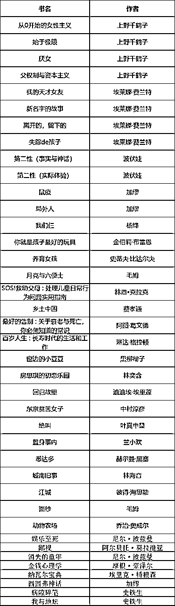

阅读之余，我也听播客、看纪录片。常听的播客有《海马星球》《After school》《燕外之意》《随机波动》《文化有限》。最爱红姐那期，聊一个硬核世界游荡者的养成，那种洒脱自由让人震撼，也第一次让我意识到该少用包装袋。纪录片方面，《老后破产》《无缘社会》《女性的贫困》加上《东京贫困女子图鉴》，像一记重拳砸在我岁月静好的心上，现在想起还会后怕。

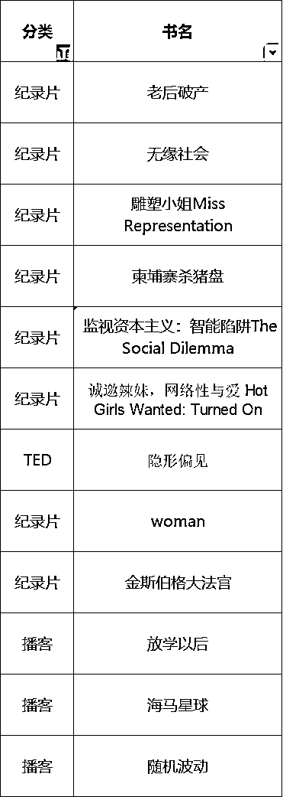

接下来人人都怕的事来了——裁员。6月底公司大优化，近一半人被请走。而我沉浸在书本里，毫无防备，简历六年没更新。每个月近万房贷压着，慌到不行。多重压力下，沉睡的我终于醒过来：必须搞钱！

可搞钱谈何容易。上班快十年，普通人根本不知从哪下手。

第一次尝试是瑞幸代下。我每天一杯咖啡，小程序原价太贵。偶然在闲鱼看到代下，一杯美式才5块，瞬间实现美式自由。公司园区咖啡党不少，我建群帮同事下单，甚至想找保洁阿姨帮忙发传单。后来大家懒得出门，每单加1元让阿姨送。但客单价低、流程琐碎，最后还是放弃了。

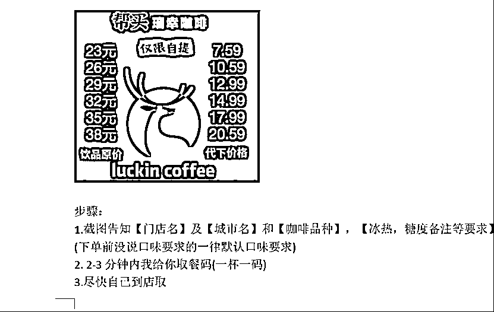

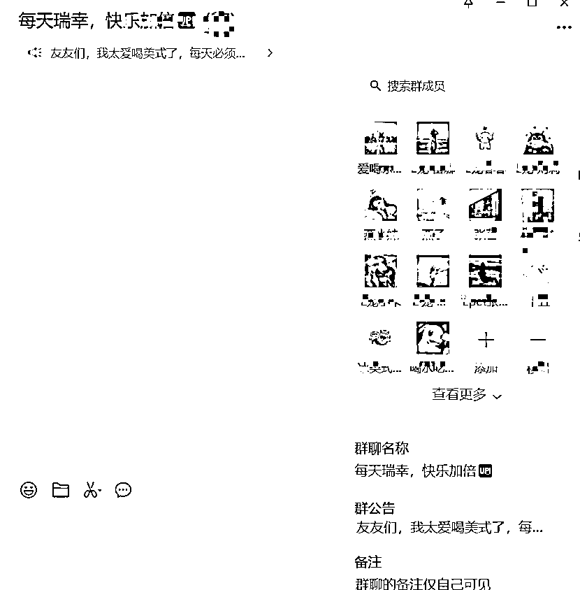

再说说这个平台。这几年我做过宠物号、母婴号、护肤号，纯属自娱自乐。看到点赞就满足，没有商业化概念，收到大件置换能高兴很久。我曾有读书人的清高，很看不上那些“看完60部纪录片脱胎换骨”的说法。但想做新媒体，这心态得趁早改。

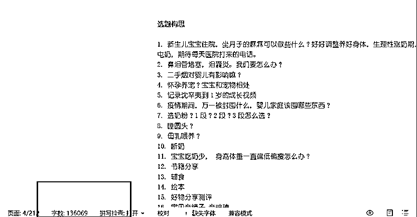

我的5万粉母婴号，派上了大用场。女儿常去社区医院推拿，我发现医院在拍视频做📕，便关注并联系了老板。老板见我粉丝量不错，而他们的号做几个月也不见起色，还频繁违规。于是约咖啡聊了聊，8月合作就这么定了，我的初次正反馈也来了。

说实话，当时心里很没底，毕竟没帮人操盘过账号。7月无意间接触到赚钱，加了鱼丸，开始翻航海手册，学谢无敌、盗坤、花爷的课程，边学边练。之后参加8月航海、10月续航，底气越来越足，最终形成自己的方法论。

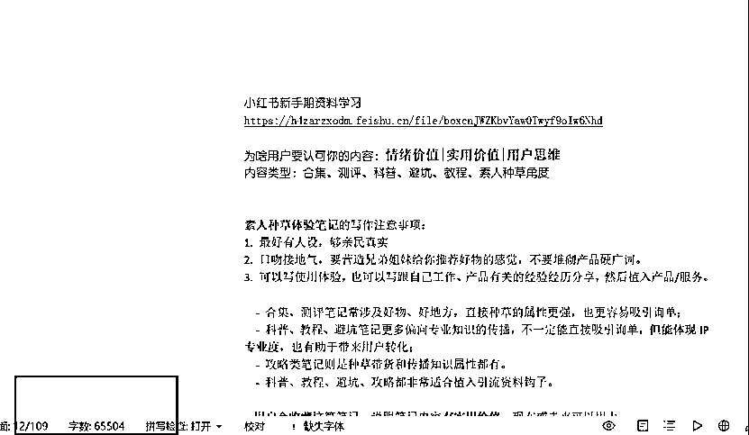

结果不错：小儿推拿做了6个矩阵号，爆文率和引流效果都挺好。关于这个赛道怎么产出爆文，我写过一篇干货笔记，链接如下：
📕小儿推拿赛道 23篇笔记17篇爆文的经验分享

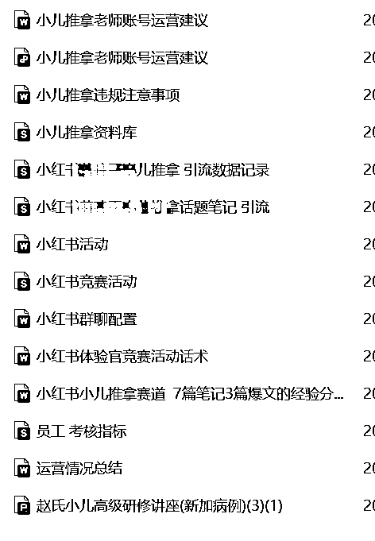

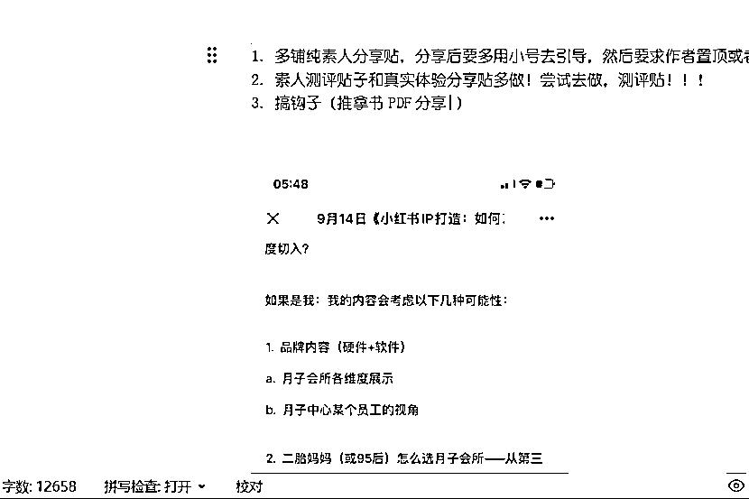

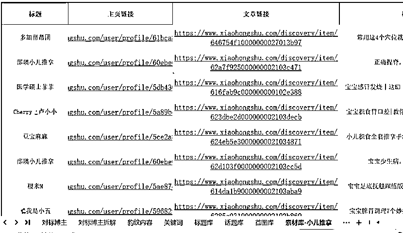

迪拜旅游的探索，始于9月。当时看到阿渡老师的文章，结合赚钱风向标和旅游类内容，我开始研究这个方向。第一篇笔记发布当天就有人私信加🛰️。约30天后，2个定制用户和几单包车敲定，首月就有正反馈。第二个月收入破2W，第三个月破3W，90天累计10W。

可千万别觉得轻松。做旅游就是一个超级受气包，累得人仰马翻。我目前还在深耕，也在搭建兼职团队做矩阵。我还分享过一篇实操干货：
📕出境游赛道 3周从0到1销售额12万的保姆级经验

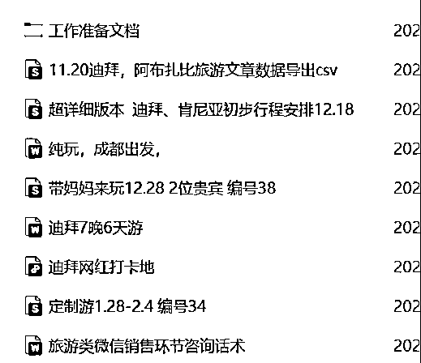

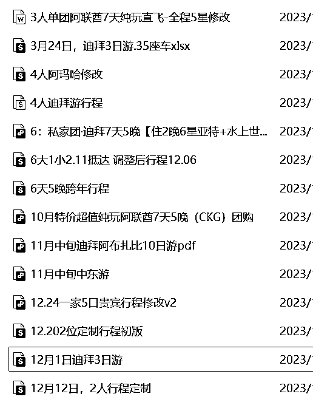

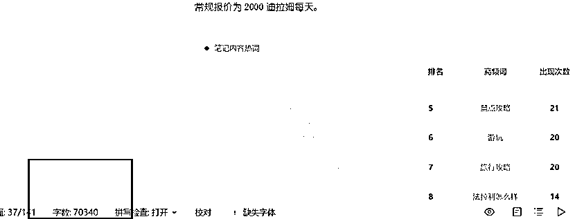

加入赚钱这几个月，我第一次发笔记就被龙哥加精，开心得不行，还连接了100多位圈友。第一次见面是和阿渡小姐姐，她真的闪闪发光。后来在重庆聚会当嘉宾分享迪拜旅游，虽然状况百出，但我已经不是那个想争却不敢争、等着被发现的小女生了。

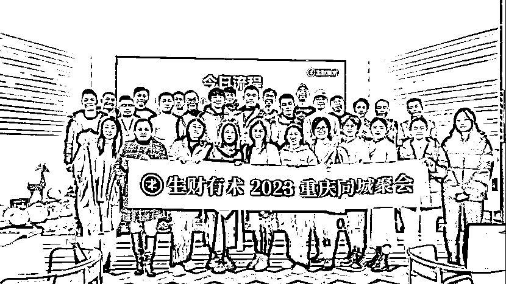

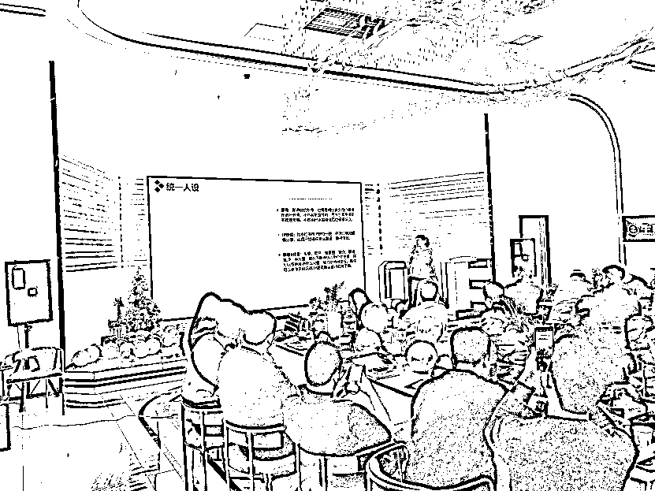

我还报考了比比教练的助教，过了两轮，第三轮主动弃权——因为当天的任务会挤掉陪娃时间，哈哈，不值得。

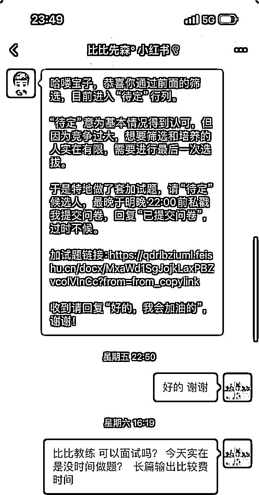

同时报名了赚钱航海出境游和📕运营教练，结果还没公布。但无论结果如何，我已觉得自己突破了不少。敢为自己争取，内核也不再轻易被撼动。

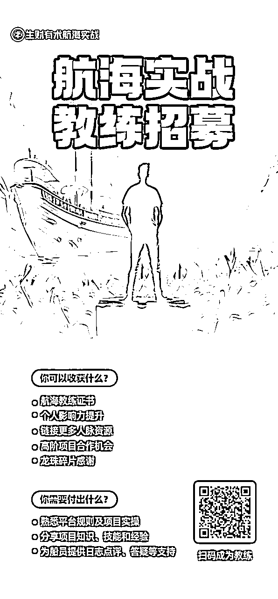

为了搞钱，我付出了什么？工作日全力变现，周末专程陪孩子。早上7点半到公司就开始干活，白天上班，下班忙副业到晚上11点。同事问“你没有家吗”，领导问“怎么还不走”。弟弟来重庆一星期，我们都没吃上一顿饭，只有晚上回家聊几句。说不愧疚是假的，但来日方长。

最心酸的是，和女儿同住一个屋檐下，却一周见不到面。我走她未醒，我回她已睡。她问我：“妈妈赚完钱了吗？今天还上班吗？”以前她每晚都和我睡，现在她跟着爷爷奶奶睡，也不再主动找我。这种“从唯一变备选”的失落，只有妈妈懂。如果你是男生，请好好谢谢你的另一半，因为你能安心冲事业，多半是她在承担。如果你是妈妈，请坚持你的选择。我们不是不爱孩子，只是换了一种方式爱她。我们不只是妈妈，也有自己想做的事。

所以周末我会放下手机，带她去各种地方体验，让她知道妈妈的爱没有变。忙碌的父母们，记得留时间给孩子。

最后，最想谢谢公婆，无条件帮忙带娃，对我的作息毫无怨言。谢谢你们。

这就是我的2023。虽然和赚钱圈友比不值一提，但我的对手从来只有自己。今年，我满意。

2024年关键词：变现、阅读、利他链接。变现目标50W，继续深耕这个平台，每月定目标、做复盘。阅读12到20本，继续享受沉浸式快乐。旅行带娃去阿联酋、沙特，国内游随缘。利他链接就是拒绝“闭关锁国”，多“改革开放”，主动向有结果的人付费学习。如果还能贪心点，我还想练好口语、学会开车、坚持锻炼。

谢谢你看到这里。我是Better，擅长📕起号、爆文、引流，欢迎连接，一起把路越走越宽。