最近红包封面这个生意又热起来了，今天聊一个叫“天谕红包封面流量主”的多维打法。严格说这路子有点偏BUG的玩法，很可能没多久就被官方给盯上、封禁，不过它背后的逻辑真的很有意思，过年期间特别适合普通人搞一波。

先说第一步：注册一个个人订阅号。
打开微信公众平台，选订阅号来注册就行，地址是 mp.weixin.qq.com。

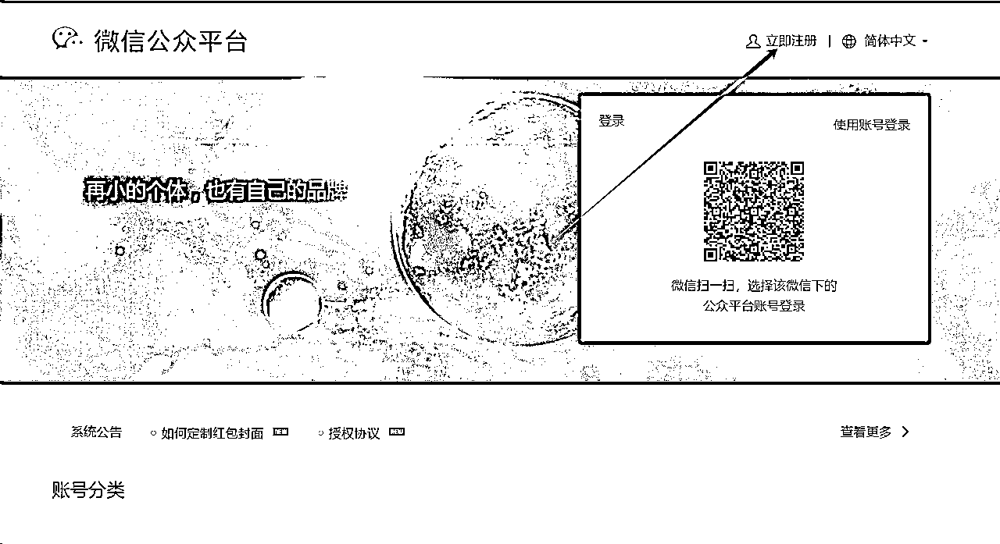
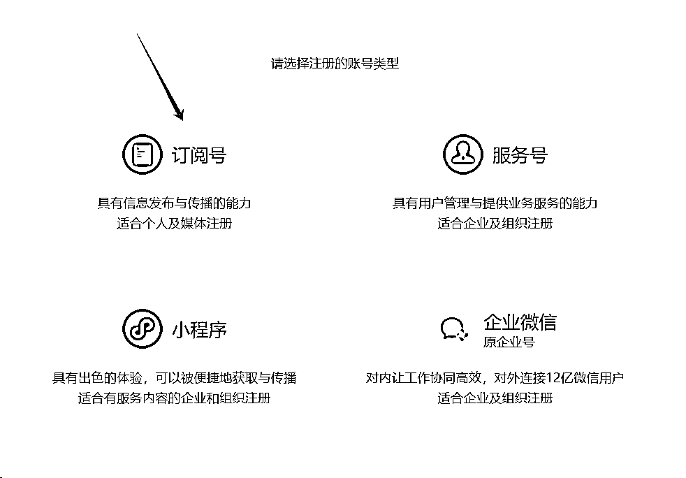

注册好之后，把自定义菜单和自动回复设置好。菜单内容按你的想法随便加，不想花心思就直接照搬同行的配置。

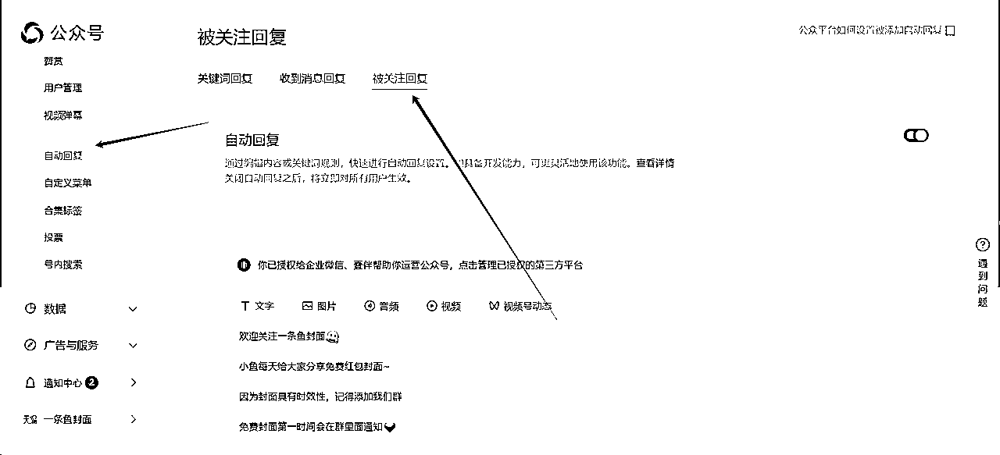
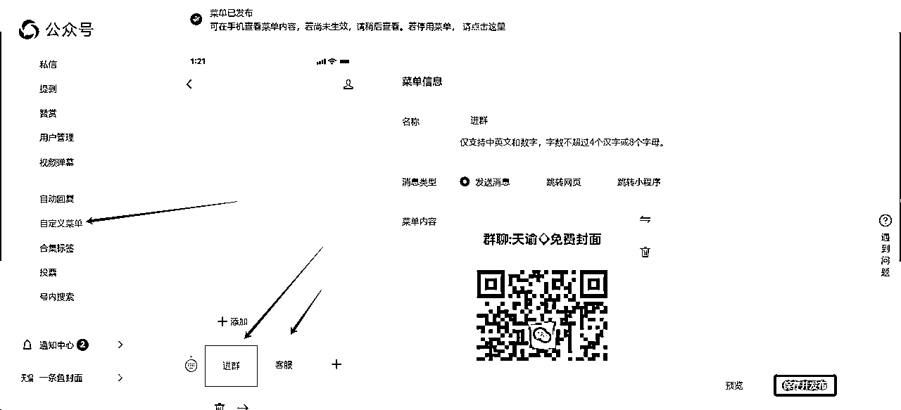

接着要开通流量主。条件是粉丝数达到500，新号没粉丝也没关系，去淘宝搜一下就能搞定。

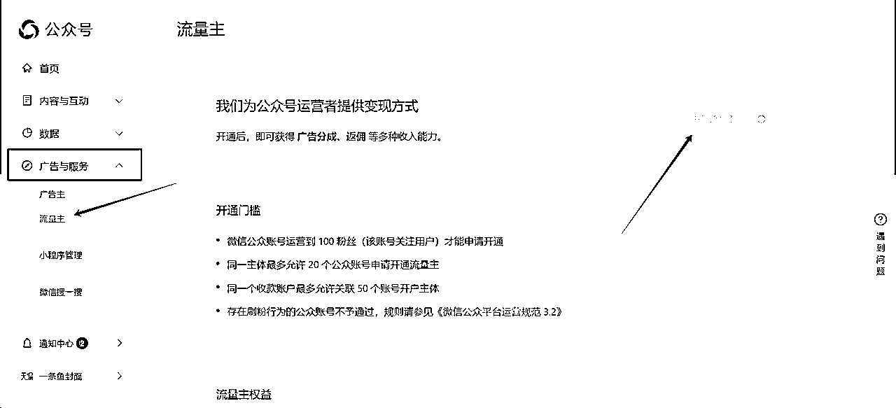

第二步，不写原创，直接同步同行的文章。
在公众号后台找到【服务市场】，开通壹伴编辑器，先用7天免费试用。

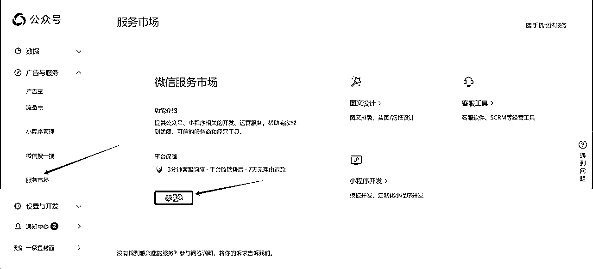
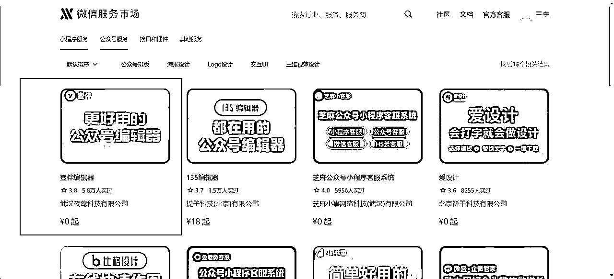

然后去找同行的文章，复制链接，把链接放到壹伴里一键导入，很快就能拿到内容。

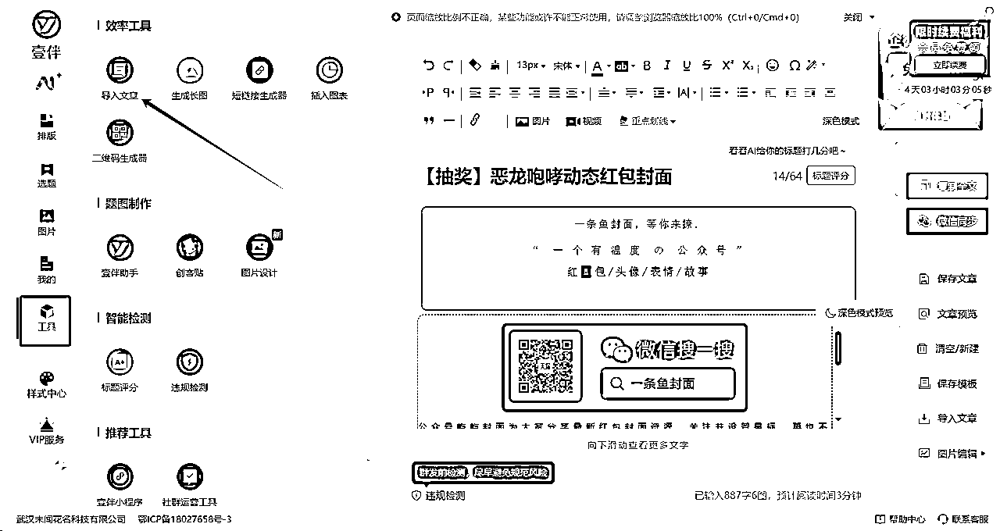

导入之后记得把对方的ID、昵称和图片都换掉，然后点同步。

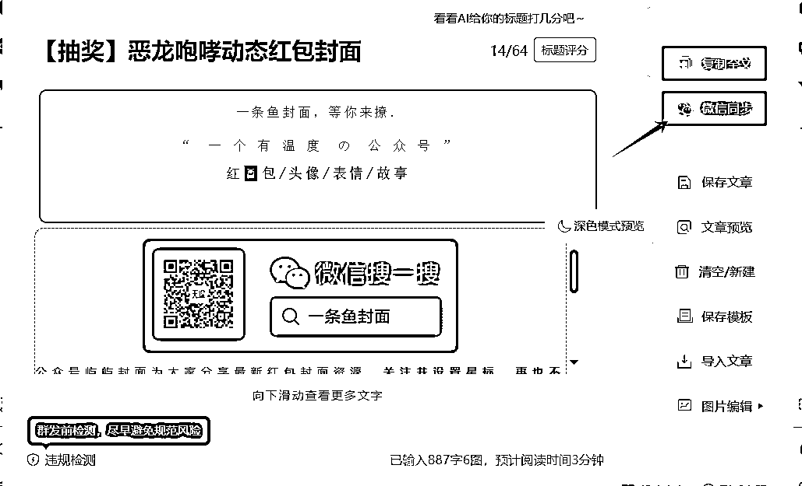

同步完去公众号后台的草稿箱，给文章添加广告再发布。

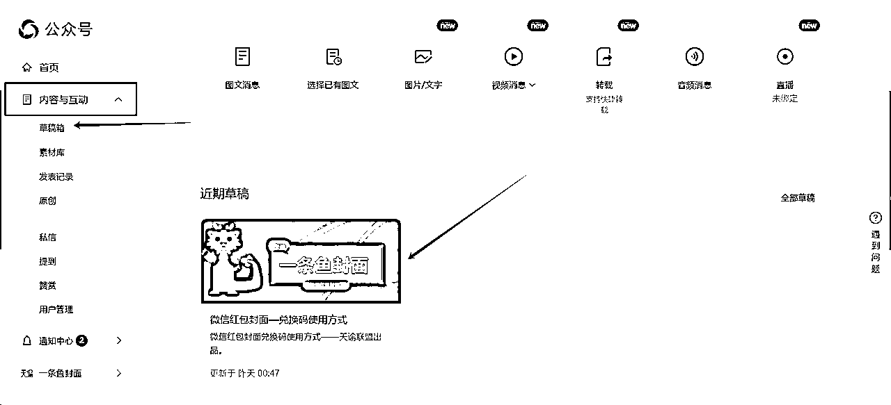
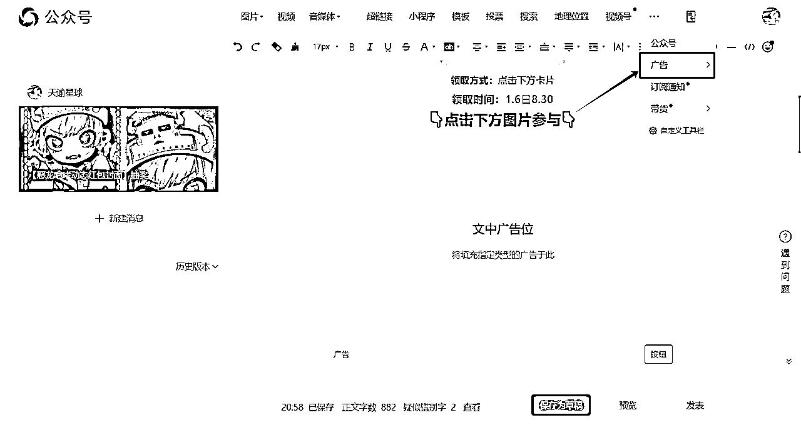

广告位一定要选手动插入，这样位置自己可控，等审核通过直接发出去就行。

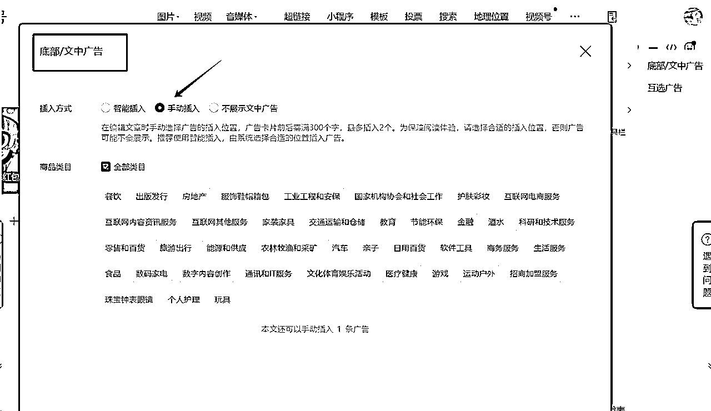

第三步，做引流群运营。
公众号菜单栏里放上进群入口，用户进群后每天维护，引导他们点开你发的文章。群多了别硬发，建群时用活码；如果每天几十个群、几百个群要发，直接上微信转发软件，一键全同步，非常省事。

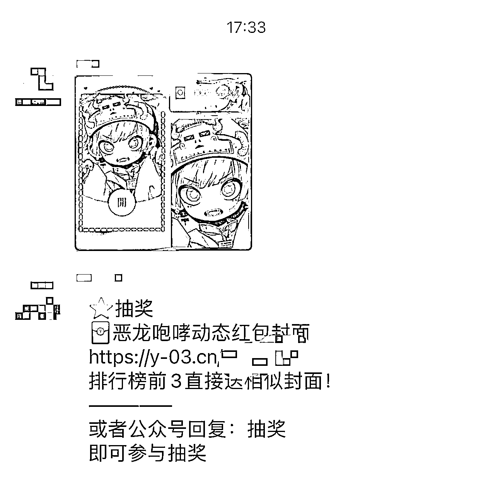

这里特别提醒：咱们用的是订阅号，推文章不会弹到微信聊天界面，所以群运营才是核心中的核心，不然根本没阅读量。

第四步，去抖音、快手、小红书上搞公域引流。公域引流大家各有绝活，我就不献丑了，只给几个视频案例参考，比如“老公给老婆发了5个大小不一的红包，让她随便挑3个”，这种互动玩法植入红包封面，很容易吸引人点击。

第五步，做流量多维转化。
这个项目生命周期不算长，本质就是一个适合普通人的过年节点项目。如果群引流效果不错，就可以再添加一个变现模式：教学收徒，把你的玩法打包教给别人，收入自然更上一层楼。