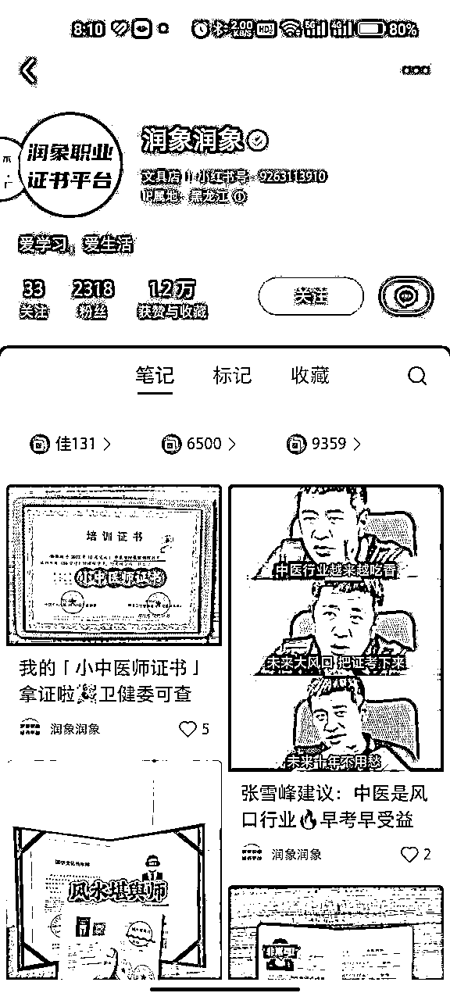
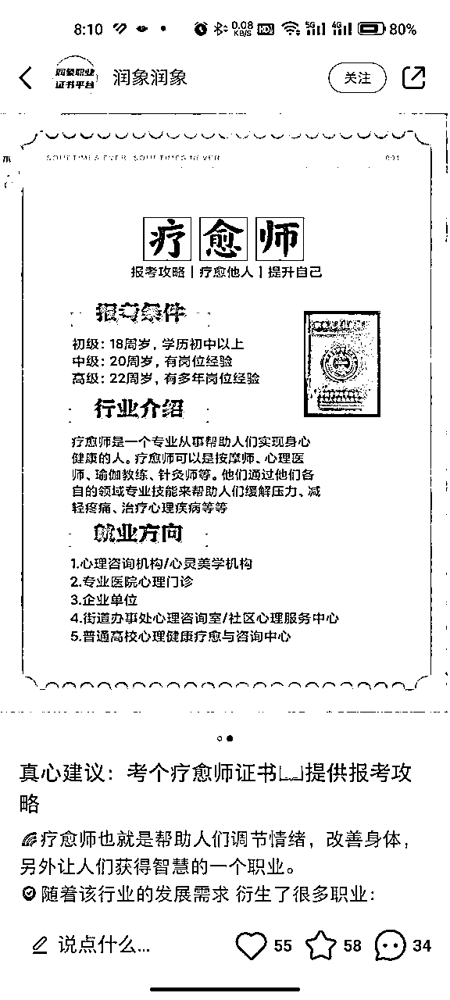
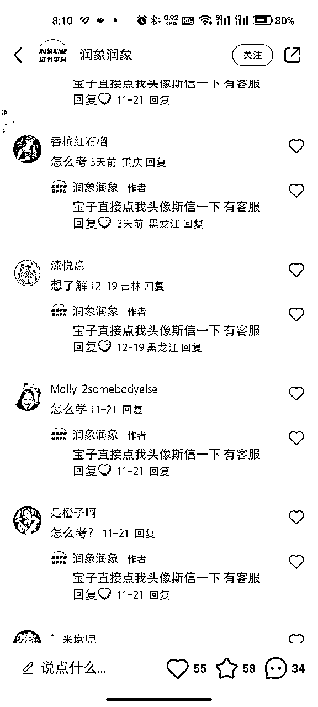
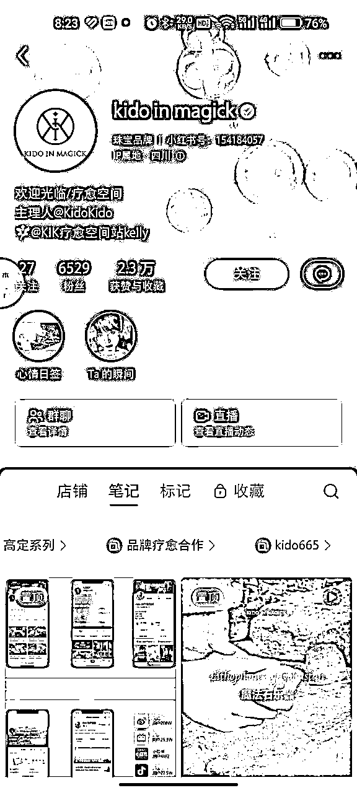
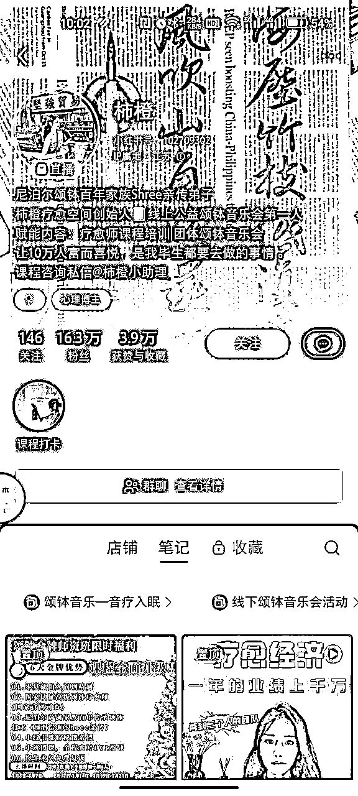
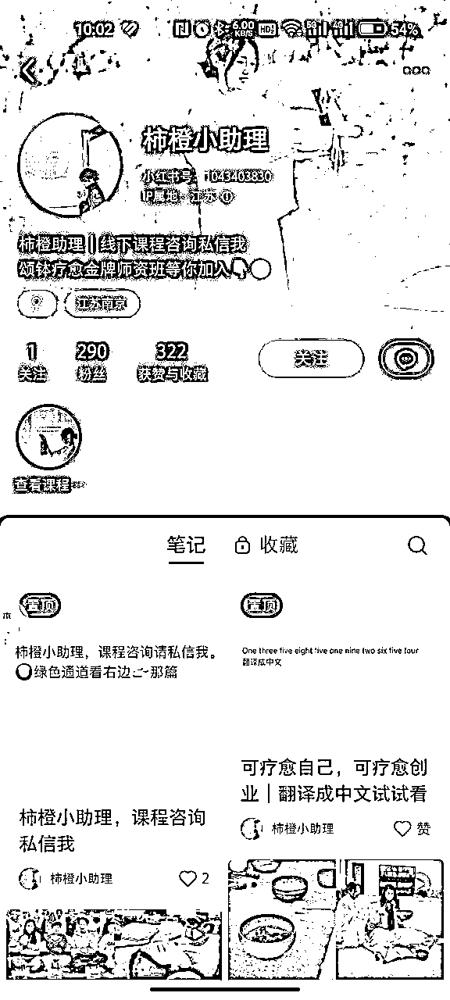

# 如何在平台做一个可变现的身心灵垂类号：逆周期赛道的私域打法拆解

当下，身体、心理与灵性被打包成一种整体性的生活方式，已经从圈层话题扩散到大众日常。正念、打坐、冥想这类用词，早已脱离修行语境，变成城市人群的工作间隙自述。

从商业视角看，这个方向具备两大特质：天花板高、抗波动。后疫情阶段，外部环境的不确定让人们更关注内在秩序的稳固。物质层和精神层构成成长的双轴，外部经济越动荡，内在疗愈的诉求越刚性。境外数据显示，2020年数字心理健康赛道完成44起融资，合计约9亿美元，同比增速超五成。

## 一、赛道地图

**心理咨询是基本盘。** 随对心理健康关注度上升，咨询需求持续扩容。线下门店在核心城市密集铺开，服务形态涵盖个体、家庭、职业等，线上远程咨询的渗透也在加速。

**瑜伽与冥想进入日常场景。** 瑜伽通过体式与呼吸调节身心状态，提升柔韧与专注力；冥想依赖呼吸与注意力集中来获得安宁。两者已从馆舍走向企业与校园，成为降压解焦的通用方法。

**成长与能量疗愈在增量。** 自我觉察与内省驱动心智进阶，能量疗愈则以调衡能量场为逻辑促进自愈。这一带的需求增速明显。

**心灵导师与灵性教育提供意义供给。** 导师角色聚焦内在探索、困局破解与目标校准，灵性教育侧重意识觉醒与精神成长。

总体供给丰富，但行业短板同样明显：准入门槛低、规范程度不足，未来靠专业度与自律来建立信任是关键。

### 市场体量

精神层问题成因复杂，单一咨询难以覆盖，需要全产业协同。以睡眠为例，2020年国内睡眠经济已达4000亿级，到2030年或上万亿，这并非靠药品或用品能解决的议题。

国内相关板块起步相对晚，尚无明确龙头，更无独角兽。2021年，壹点灵、简单心理、好心情、昭阳医生等多家机构均获过亿融资；KnowYourself也拿到数千万美元B轮。出手方多为头部资本，布局迹象清晰。疫情催化下，近两年资本与用户双涨趋势明显。

## 二、账号落地的三大痛点

### 一、流量与人群

**内容形态选择。** 可做图文也可做短视频。有行业沉淀且有线上线下产品储备的，建议优先短视频，爆发潜力更大；若对赛道认知不足、后端无产品，先从图文起步，降低试错成本，同步寻找合作供应链以锁定方向。

**人群画像。** 用蝉小红、灰豚等工具拆解对标账号，在评论区观察性别配比与年龄区间，快速锁定核心人群。

**规模化。** 多号矩阵并行，图文与视频双通道同步投放。

**对标寻找。** 以赛道关键词检索，挑选热推笔记，按赞藏评体量筛选具备参考价值的对象。

### 二、后端承接与变现

**未锁定合作方。** 先做增粉，开店并通过笔记、直播挂车实现公域变现，缩短转化链路。交付可轻量化，如冥想音轨、颂钵音轨等数字内容。

**已锁定合作方。** 图文视频混发，以数据决定倾斜。公域挂车保留，同时增加私域转化，如课程、咨询、定制服务。

**自身具备从业背景。** 闭环最顺畅，从对标到变现全流程可控，策略与上同。

## 三、实操案例

**案例一：润象润象**
账号形态为蓝V。导流方式为合集笔记+私信。交付为证书培训，客单约1000元以上。背后为公司化矩阵，证书品类覆盖中医、风水等热门方向。

**案例二：KidoKido**
账号形态为蓝V加个人号。导流为合集笔记+私信+群聊。交付为水晶定制+冥想，以及私域运势解读，客单1288元起。采用个人号+蓝V号双号运营，工作室模式。合集笔记引流效果稳定，有兴趣者基本会进。私域做四位数运势解读，叠加水晶矿石定制，形成复购与咨询闭环。

**案例三：柿橙**
账号形态为个人号。导流为置顶笔记+直播小课。交付为线下颂钵培训，客单4000元以上。双个人号工作室运营。公域以颂钵助眠直播+小课导流，后端交付线下颂钵培训，后续仪器带货亦可。导流设计巧妙，小助理号把🛰️号设为英文，既过滤泛粉又精准沉淀付费人群。

## 四、收束

身心灵赛道的增长动能持续，叠加离火运等话题的持续发酵，窗口被进一步打开。机会伴随风险，规避风险的前提是跑通闭环。只要将内容引流、私域承接、产品交付串成完整通路，该赛道在当前平台仍是高价值切入点。