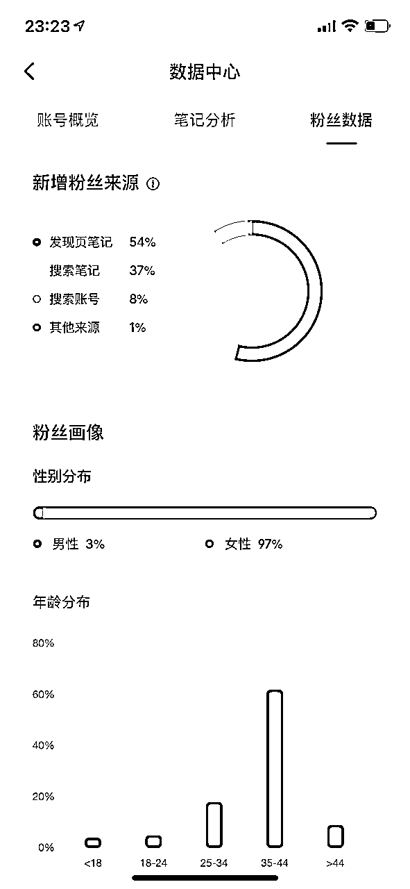
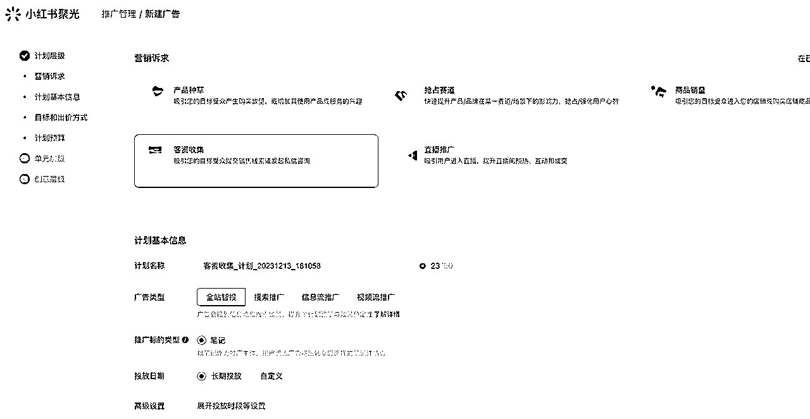
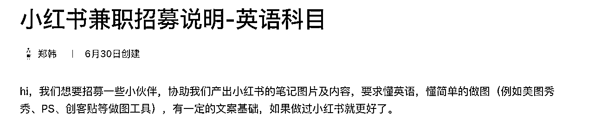
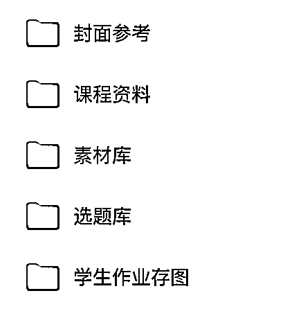

# 夫妻档做英语培训，靠📕闷声月入20万

各位赚钱圈友，我是龙哥，许久没动笔了。这次聊聊今年我们在英语赛道上玩📕的一些心得，希望能给打算靠📕获客的朋友一点启发。

年初那会儿，深圳的小陈和老王找到我。这对年轻夫妻刚创业，拿一套国外引进的教材自研了课程，想通过📕撬动精准家长流量，引流到私域成交，客单价设在了6000块上下。到5月份的时候，一个月已经能签下30多位家长了。两口的活儿分得特别清：小陈管前端引客和转化，老王扛后端教研和助教管理。真应了那句话，两口子搭伙，再累也高效。

到上个月，这对夫妻已经在新教材课程上完成了新一轮开发。也就是说，从课程打磨、流量获取、转化成交到售后服务的整套链路，我们完完整整跑通过一遍了。如今后端已经有十多个稳定的助教在跟着交付。

听起来确实亮眼，但能走到今天这个位置，中间交的学费也不少。坑踩过好几个，泥潭里爬出来才摸索出一条活路，下面慢慢说。

## 一、不折腾不测试，哪来的搜索霸屏？

年初他们刚下场的时候，报名的还基本是深圳本地的家长。那阵子YQ正紧，他们琢磨着从线下挪到线上，想服务全国的学生。

找我之前，两口子其实也自己试了几个月📕，但一直不温不火，每天能来一两个咨询就算不错，加没加到🛰️还不一定，更别提成交。

我把他们的产品和账号翻来覆去看了几遍，给了下面几板斧：

1、起号不整虚的，直接上话题类、热点类、密集干货类的笔记，先把互动数据撑起来，比如赞藏评这些。拿我们韩语号来讲，初期发的是类似《盘点那些你追过的韩剧/韩语歌》，两三条笔记下去，曝光妥妥破万。

2、封面不要为了整齐好看就搞千篇一律。前期的核心任务是拿不同封面去“试”，跑出一套适合自家账号的爆款模板，再琢磨要不要统一。而且试出爆款也不代表完事，还得不断往新方向试。

3、选题别光顾着自嗨讲课程。要多站到家长视角去想：你这个课能给孩子带来什么改变？内容倾向也要跟着变——多聊“怎么学才有效”，少讲“怎么教”，不然评论区里蹲的全是同行老师。

4、起步阶段死磕图文。图文门槛低、产出快、成本省，等你有余力了再动视频笔记。

很多新手一上来就憋一篇“完美笔记”，但现实是，对初学者而言，“发得勤”比“发得精”关键多了。发得多，才有机会撞上爆款；测出爆款以后，想方设法把它的流量榨干——复制到自己账号或者新号上重发，或者改拍成视频版，一次爆款吃干抹净。

照着这套路子调整了一阵子，我们把类目里的搜索流量吃了个干净。搜相关关键词，铺出来的基本都是我们家的笔记，搜索来的流量占比一下子蹿了上去。

有意思的是，有一阵我们发现自己大小号之间出现“互抢流量”的现象——一个号数据上去了，其他号就开始往下掉。后来是靠把选题盘子继续做大，才解决了这个问题。

本来以为一切顺利了，结果突然来了个急转弯——我们的账号被禁言了。

## 二、账号被禁，反而打开了投流的大门

6月17日，小陈慌慌张张跟我说，流量最好的那个号被封了14天。那会儿每天都有三四十人加过来，一禁言，引流量瞬间断崖式往下掉。我们熬了好几个夜研究对策，最后发现：开了专业号+聚光投放，问题就迎刃而解了。

普通账号花600块认证专业号，之后每天投点小额的聚光费用，就能豁免私信被限制的困扰。当然，已经被禁言的得先等禁言期熬过去才谈得上认证。

本来我们开聚光纯粹是为了解封禁言的限制，结果一投，发现获客成本香得不得了。像学而思那种体量的大厂，获客成本动辄几百块，而我们通过聚光拉一个新客户到🛰️，成本不到10块钱。这跟白捡有什么区别？

要知道我本来是个执着于“免费流量”的人，投了几个月后彻底真香了。现在团队3个英语号全开了聚光，在📕加🛰️再也不用提心吊胆，怕一觉醒来号没了。

聚光投放可以说是个“5分钟上手”的东西，难的是怎么把笔记做漂亮、怎么定出价、怎么圈人群。

几点实战总结：

1、我们主攻的是“客资收集”目标，直接把有意向的客户引导到私信。

2、拿自然流量表现好的笔记来开测，成本最稳。如果手头没有跑出过好数据的笔记，就一条计划里塞10篇笔记硬投，让系统自己跑，哪篇数据好会自动冒头。然后按私信成本和开口成本，决定是追投还是停投。

3、计划跑废了也有几个急救办法：
- 原封不动复制原计划，让系统重新给量；
- 新计划不起量？把出价拉高120%再试试；
- 好计划靠不断复制喂量，但新笔记的测试也不能停，防衰退。

想起以前一个朋友公司挂着横幅：“素材决定命运，消耗改变人生。”投了几个月聚光，我才真正理解这句话。笔记也好、素材也好，优质内容在自然流和付费流里都是硬通货。自然流量跑得好的笔记，再叠上投放，更能在短时间内撬动更大体量的优质流量。

还有个关键动作，就是抠“开口率”。投放的时候要分清“私信”和“私信开口”——前者是用户点进了私信但没说话，后者是人家主动开口跟你聊起来了。花真金白银买来的客户不吱声，等于钱打了水漂。对策也不复杂：

1、响应要快，或者干脆挂脚本自动回复。用户私信进来，30秒到5分钟内能得到回应的话，加🛰️的概率翻倍都不止。拖太久，人家扭头就不想加了。
2、对没回应的用户，要回访。换个角度刺激开口，比如问问“你家孩子英语口语怎么样？想不想再往上提一提？”
3、多准备几个钩子：免费试听课、一份精选资料什么的，总有一样能勾住人。
4、开个助手的号去关注用户，在评论区@一下，反复触达。手段多的是，目的是尽可能把每一个用户都拽到🛰️上。

## 三、建好SOP，用兼职复制账号矩阵

账号越铺越多，小陈一个人渐渐顾不过来了。我就琢磨着教她怎么用兼职的模式把产能拉起来。

一开始我也着急，直接在朋友圈帮小陈张罗了十来个干兼职的朋友。但总不能逮着我一个人薅嘛，于是我给了她两条找兼职的路子：

1、上BOSS直聘招英语新媒体实习生；
2、📕发兼职帖，勾搭懂英语又想赚零花钱的人。（注意帖子的措辞要委婉，我们另一个科目的号就是直接拿招兼职做诱饵引流，结果号废得特别快。）

兼职招进来以后，我们先把素材库这个基础设施搭起来，把选题、封面、文案这些通通标准化。如果想长时间运维多个账号，SOP库必须建起来，不然内容供应跟不上，矩阵就是纸上谈兵。

有的兼职只负责做笔记，那就按篇结算，一篇10到20块，难度再往上加价；遇到愿意肯认领整个账号的兼职，就给底薪+提成。底薪对应的是账号归属权协议里白纸黑字划归我们，提成则是让他们用心把号做起来，多劳多得嘛。

这套打法跑了快一年，现在已经很顺手了。接下来的方向也清晰：迈开步子做多科目、多账号、多渠道——多科目是为了对冲单个科目获客成本不断上涨的压力，多账号是为了应对单账号的流量波动，再往后还得布局抖音、视频号，免得在单一平台吊死，碰到天花板就上不去了。

掏心窝子讲一句：今年📕的流量确实好做，有机会的话一定要进来吃一口。以上就是我们做英语类📕账号的全过程复盘，希望能对你有一点点启发。

🛰️交流 zh474560985