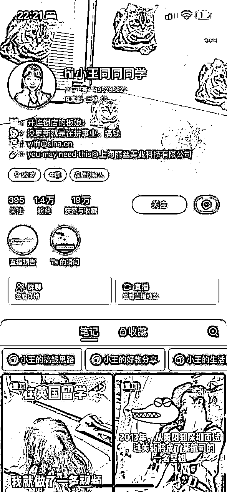
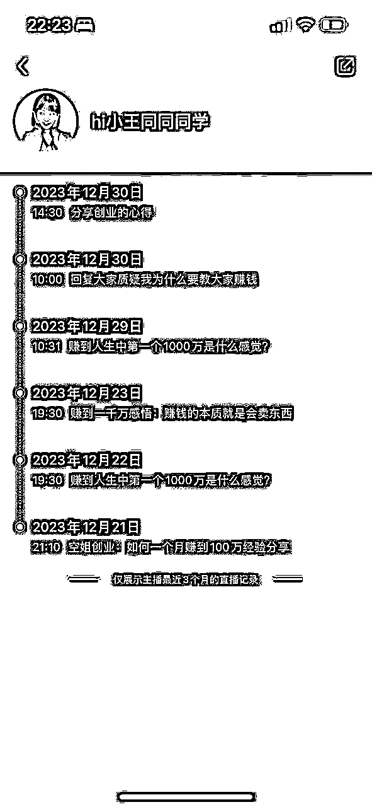
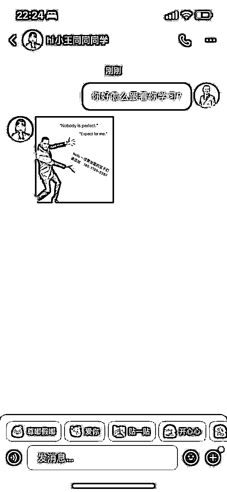
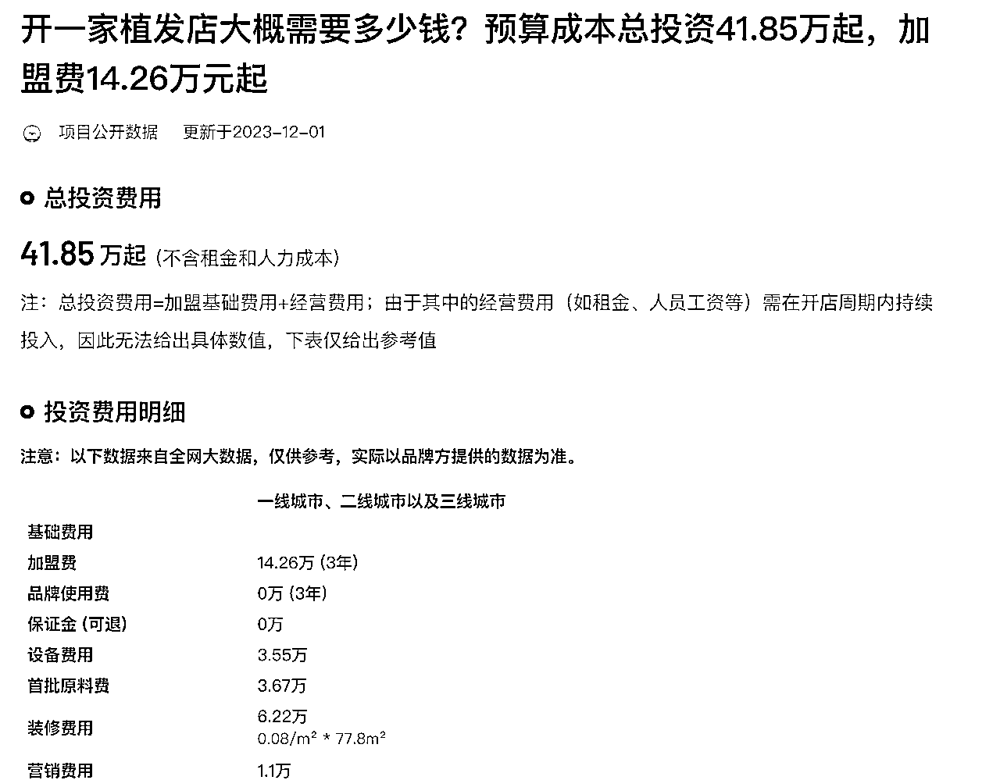

# 揭秘：📕那些“教人赚钱”的博主，自己到底怎么赚钱？

你有没有发现，📕上有这么一类博主：内容永远围绕“创业”“搞钱”“翻身”这些关键词，一副恨不得把赚钱秘诀免费塞给你的架势。可你有没有反过来想过：这些人自己，到底靠什么赚钱？

想明白了就一句话：教别人赚钱，本身就是最赚钱的生意。

信息差和认知差只要存在一天，“帮人搞钱”的生意就一天不会消失。我当年刚毕业在券商工作时，特别不理解那些提供投资服务、兜售所谓“内幕消息”的人，为什么愿意把赚钱的信息分享给陌生人。后来慢慢看懂：股民炒股能不能赚钱真不好说，但给股民卖工具和服务的公司，指南针、同花顺、东方财富，一家家都上了市，市值还都不低。再往后延伸到创业圈，服务创业者的媒体和机构也活得风生水起，i黑马和各类财经自媒体就是典型。

## 一、hi小王同同学：把轻医美干成了加盟生意

这个账号内容以短视频为主，图文和直播作为辅助。人设很清晰——离职空姐，独立女性，医美创业。主页上直接亮明来意：招收加盟商和学员。

目标人群非常聚焦：关注美容、医美的年轻女性，外加正在琢磨创业项目的潜在加盟商。靠这套定位，账号在细分的医美创业领域占了一块自己的市场份额。

先看流量怎么起。视频内容围绕创业故事、项目案例、实操经验展开，每周稳定更新2到3篇，节奏感很稳。评论区的运营也很用心：终端用户来咨询项目，她回；加盟商来询问合作，她也积极对接，一来一回把互动做得很热。

直播是重要的流量入口。2023年12月21日首播，之后每天下午6点准时上线，每场直播时长2到4小时。标题也相当有诱惑力：“空姐创业：一个月赚够100万，方法全分享”“人生第一个1000万到账是什么感觉”“赚到1000万的感悟：赚钱的本质就是会卖”。

再看产品怎么解决。她主推的项目是轻医美里的植发，卖点非常直接：投入门槛低、利润空间大、回本速度快、效果前后对比极其明显；再配合个性化服务，客户一眼就能看出变化。信任怎么建立？靠真实案例，把客户的实际效果摆出来，同时鼓励客户主动分享，慢慢养出一个用户口碑社区。对加盟商，她提供培训和支持，分享自己的经验，再把加盟商做成案例，用真实成绩去吸引下一批人。

利润当然也值得算。人员、设备、推广都属于运营成本，房租和工资是固定成本。（数据来源于网络，仅供参考）定价走的是兼顾竞争力与品质的路线，不同项目定不同价格；关键是客单价能做到万元以上，而公开数据显示植发类项目的毛利率能达90%以上。一边赚项目利润，一边收加盟费，两条腿走路。

生意怎么放大？横向拓展，推出新的医美服务和产品；纵向扩张，去更多城市开分店；再找知名品牌合作，跟时尚、美妆类品牌做跨界联名。流量端则靠矩阵玩法放大：短视频加直播的账号矩阵铺开，同时搭建达人分佣的合作模式，让更多人为项目带量。

这个案例的结论很清晰：个人创业IP已经成为各个品牌、各个项目的流量密码，尤其“女性创业者”这个标签，在📕上特别吃香。

## 二、阿璐要分析100个博主：拆解别人，成就自己

## 最后说两句

除了卖项目、卖课程，付费咨询策划服务同样是非常好的变现方式，只是今天篇幅有限，没办法把📕教人赚钱的博主一一拆完。后面我还会持续更新，继续挖更多案例。

总体来看，想在“教人赚钱”这个赛道里跑出来的博主，都离不开几个关键词：精准理解受众需求、持续输出有价值的内容、打造用户信任。同时，还要根据市场变化不断调整和改进内容，这门生意才能走得长远。