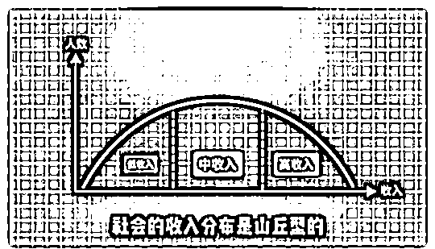
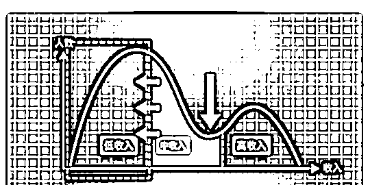
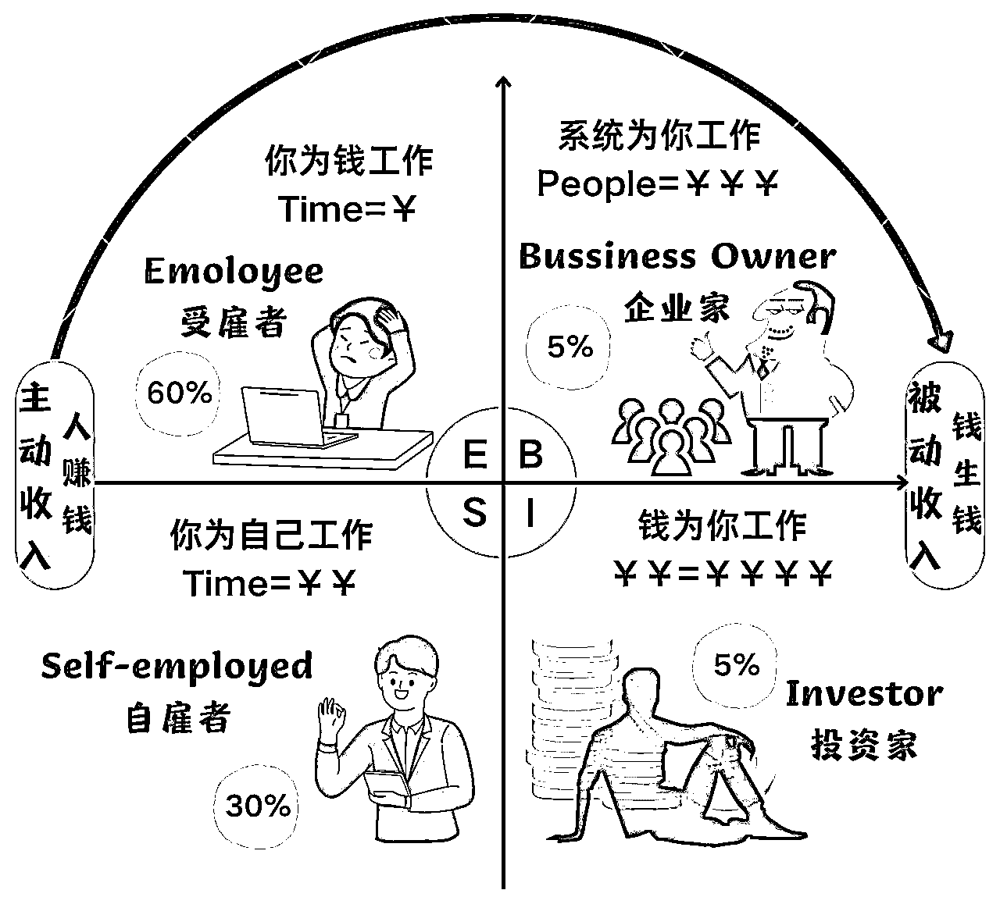
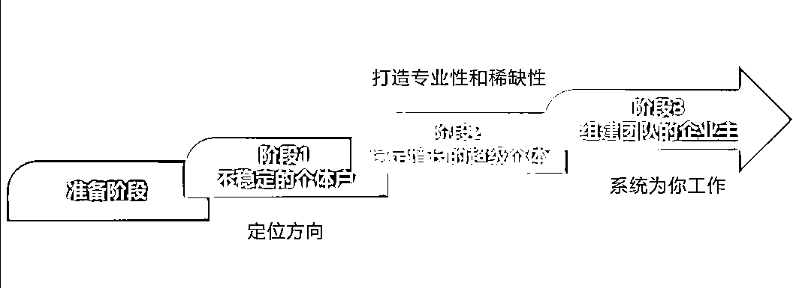
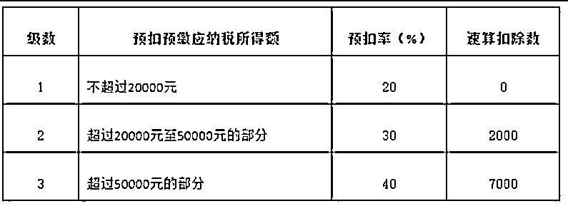
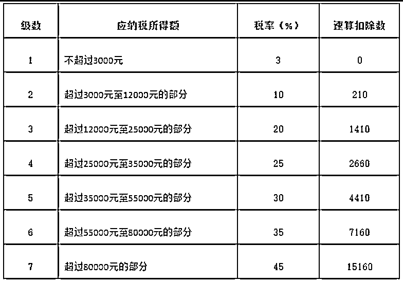

# 《自由职业者入门手册》

自由职业入门手册：先别急着辞职，看看你适不适合

今天想和你聊一份很有分量的实操手册——《自由职业者入门手册》。它来自一位深圳的99年知识管理专家，江湖人称“赚钱课代表”的七小。七小擅长把碎片信息整合成知识产品，这份手册就是他帮你梳理出的自由职业避坑指南。

手册的打开方式很清晰：如果你对自由职业还停留在道听途说的层面，先从“你适不适合”看起；如果你已经决定踏上这条路，后面还有赚钱逻辑、发展路径、财务社保、生活系统和项目资源。可以说，从萌生想法到真正落地，每一个环节都有人替你踩过坑。无论你是初来乍到，想凭兴趣做点小尝试，还是想升级为超级个体、甚至组建自己的团队，这里都有对应的阶段可以参考。

先回答那个最核心的问题：你适合自由职业吗？

什么是自由职业？用大白话讲，就是自己雇佣自己。你不再隶属于某家公司，不用每天打卡，所有盈亏自己负责。英文叫Self-employed，在香港也叫“自雇人士”。这个概念并不难懂，真正难的是看清它背后的时代变化。

过去的社会收入结构像一座山丘，中等收入群体最庞大。只要学历不难看，费点力进一家大公司，年薪二三十万并不夸张。再磨五到十年，升到小管理层，年薪百万也不是白日梦。因为那时的企业正在高速扩张，需要大量的人才。

可如今，收入结构正在变身“M型”，中间层被急剧压缩。一部分人被推到低收入区间，另一部分人则通过你曾经看不懂的方式成为高收入人群。看看那些涌入滴滴和外卖队伍的中年人就知道，这已经不只是趋势，而是正在发生的现实。而且这种挤压会从一二线城市向更低线城市蔓延，波及面只会更广。如果你还抱着“拼学历、当个忠诚打工人”的老观念，路只会越走越窄。

所以，第一步不是拼命努力，而是承认时代变了。接受变化，你才有机会留在中收入层，甚至向上跳跃。千万别把这当成危言耸听，更别捂着耳朵假装没听见。

职业发展也有自己的连续性路径。很多人每天的工作都差不多，靠惯性推着走，今天和昨天没什么两样，明天也不会有惊喜。 我们给这种连续性路径起了个名字，叫“第一曲线”。但任何一条曲线都有向下的时候，尤其在当下的经济环境里，第一曲线大概率不是年轻时的最优选。与其等到被迫滑到下坡才匆忙转型，不如在上升期主动开辟“第二曲线”。两条曲线重叠的那一小段，就是“非连续性”。 只要你主动种下种子，第二曲线才可能冒出来。开始，就有机会；不开始，就永远没可能。

自由职业的兴盛，离不开三个条件：一是社会得足够富裕，吃不饱饭的地方养不起自由职业；二是社会要多元、包容，允许不同活法存在；三是社会的不确定性增加，自由职业反而更容易适应变化。

从数据上看，截至2021年底，中国灵活就业人数已达2亿。政策在往灵活就业服务规范与权益保障的方向走；灵活就业也被看作人才蓄水池，为稳就业提供动能；数字技术则让供需两端能快速匹配。新一代年轻人就业观念更个性化，企业也越来越倾向按项目周期灵活用人。值得注意的是，这些新型岗位往往对学历和经验要求更低，工资未必更低，但福利水平常常缩水；而且华东地区招聘需求增长更快，越与数字经济紧密的行业，新型就业渗透率越高。

说完大环境，再看个人门槛。自由职业的准入门槛并不高：年龄不是问题，35岁甚至50岁，只要有一技之长，没人用年龄卡你；身份也不设限，女性、宝妈、低学历者都可以靠技能赢得客户；经验和背景更不是硬要求，谁不是从简单文案起步，一点点把客单价做高的？真正的高门槛在心理上。你要有拿得出手的核心技能，要有几乎苛刻的自律，还要会经营人脉和渠道。能跨越这层门槛的人，才能走得更远。

那么，自由职业到底有多自由？它的吸引力是实打实的：你可以重新感受生活，不再在加班里错过晚霞；你可以自主安排时间，但请记住，自由的底色是自律，先有能力掌控工作，才有资格享受闲适；你可以多点时间陪家人，远离办公室政治，省去勾心斗角和低质量社交；你可以减少内耗，专注在热爱的事情上，一台电脑一部手机就能开工；最关键的是，你可以自己做决策，不必看他人脸色。

但自由的另一面是重量。收入不稳定，社保要自己缴；没有上下班界限，工作时间可能被拉长到全天；技能必须始终跟得上市场，否则没有竞争力；一个人在家办公，难免孤独，视野也容易闭塞；家人不理解，更是很多自由职业者绕不开的坎。更隐蔽的挑战在于认知负荷：一个人要同时做业务、决策和管理，思维来回切换，消耗极大。过多的自由有时会让人“行为瘫痪”——什么都不想做，陷入无聊和漫无目的。在公司里，流程和制度会推着你走；而在自由职业中，你必须亲手为自己创造目标感，否则日子会过得很难受。

接下来，我们聊聊你最关心的赚钱问题。自由职业本质上是“一人公司”，你是老板，也是唯一的员工。它与打工最大的区别是，你从间接面对客户变成了直接面对客户。以前客户付钱给公司，公司再发你工资；现在客户直接给你钱。以前你只需要解决公司安排的任务；现在你要主动宣传自己的本事，吸引客户，帮别人解决问题，钱才会进你的口袋。

赚钱的路径可以拆成四步：第一步，找好个人定位，搞清楚你能解决什么问题；第二步，筛选客户，价值观不和的单子宁愿不接，不然做了也换不来认可；第三步，真正解决客户需求，从洞察需求到拿方案、落地执行；第四步，打造可持续的收入模型，一边建立个人品牌，稳住客源，一边扩展能力圈，服务更多客户。

《富爸爸穷爸爸》的作者罗伯特·清崎提出过一个著名的ESBI四象限， 打工者处于E象限，靠出卖时间领工资，占比约六成；自由职业者属于S象限，自己干自己收钱，占比约三成；B象限是企业家，搭建系统雇人干活，哪怕自己休息也有收益，占比约5%；I象限是投资者，让钱生钱。自由职业者的发展路径，大体就是沿着E→S→B→I去进化：从放弃稳定、获得自主，到让渡部分自主、建立团队、放大规模，最后走向投资，把主动收入换成被动收入。这条路径也对应着手册后面的发展章节。 当然，投资人这块内容比较特别，在这份手册里就先按下不表。

当你决定出发，第一步要做什么？至少得先配好基础装备——一台顺手的笔记本电脑。当然，更关键的是后续的技能打磨、客户拓展和节奏管理。这些软硬件，一起构成了你自由职业的起点。

自由职业不是逃避职场的温柔乡，它是一条需要勇气、自律与方法的窄路。希望这份手册里的经验，能帮你把路走宽、走稳。共勉。

想成为一名自由职业者，或者正在这条路上摸索前行的你，可能早就发现：这事儿不像辞个职那么简单。它背后需要一套从装备到心态、从定位到增长的完整打法和准备。今天这篇内容，就围绕“一个人创业”这件事，把那些零散但关键的环节串起来，聊点实在的。

**一、先把“作战装备”和“安全垫”备好**

不管你是打算全职投入还是先兼职试水，基础物资得跟上。

笔记本建议选一台续航能力强的轻薄款，5000到6000这个价位段其实已经很能打了，优先挑14英寸上下，既能胜任日常办公，带出门也不会成为负担。有了它，你的办公场景就不必困在家里——带上电脑去家附近顺眼的咖啡馆坐坐，咖啡因能让人更专注，换个环境反而更容易推进手里的活儿。要是那家店烟雾缭绕，那就果断换一家，别委屈自己。

常用的外设也很关键。电脑支架值得入手，十几块的那种就够，能折叠的更好。咖啡馆或小店的桌面高度往往不友善，垫高电脑，手腕角度舒服了，长期打字也不会那么累。另外，长期伏案的话，一把好椅子是对身体最划算的投资，人体工学椅虽比普通椅子稍贵一点，可坐上去的差别立刻能感受到。

硬件方面，有人习惯双笔记本配合一台显示器。游戏本跑重活，轻薄本管日常，显示器外接后可以随时切换信号源，毕竟盯着小屏幕干活和看大屏，观感完全不同。富裕点可以给显示器装个机械臂支架，预算紧的就用个小柜台垫高，按自己身高来就行。键盘则不必追贵，双飞燕这类品牌耐用性相当不错。网络环境里，网线会比无线稳定太多，百兆带宽足够应付大多数工作场景。

最后，留一笔安全资金，能覆盖3到6个月的生活开销为上。这能保证在收入不稳定时不至于陷入经济焦虑。资金准备到这个区间就好，太多了反而容易松懈。

**二、阶段一：做一个“不稳定的个体户”**

自由职业刚起步时，最重要的不是立刻赚钱，而是试错和定位。

这个阶段的特征很鲜明。一是方向不明确：不少人是副业做得比主业还好才跳出来的，可这方向未必能持久，到底自己要长期做什么，心里没底；二是客源不稳定：单子时有时无，这个月收入好看，下个月可能就空了。但恰恰这时试错成本最低，适合用来探索项目、搞清定位。

定位可以从三条路径入手：

第一条，看意图：明确你自己要什么，再去找能够满足你这个需求的用户需求。用“人群、场景、用途”组合去打，比如什么场景、为什么人、解决什么问题，然后以“需求是否真实、市场是否够大、竞争是否激烈”来验证自己选的路。

第二条，看自我：这件事你热爱吗？热爱能帮你熬过开头最难的时候。你过去的资源、经历能不能迁移到这里？机会成本又有多大？想清楚这几点再决定。

第三条，看环境：趋势和竞争也不可忽视。要么用“差异化”在红海里给自己开辟一块新高地；要么用“蓝海”思维，去一个人家还没挤进去的小赛道。

光靠感觉不靠谱的时候，专业工具能帮大忙。盖洛普优势测试能让你看到自己习以为常的行为模式里藏着哪些优势，又能看见哪些思维盲点限制了发展。它还能帮你排除不适合自己的工种，减少内耗，弄明白自己为什么动力不足，什么状态下更容易坚持，甚至指点你该用哪种方式建立影响力。得到职场优势测评则更适合求职、突破瓶颈、带团队等具体场景。借助这些工具，你能进一步明确自己适合什么、优势在哪。

接下来就要找项目了。从零到赚钱，稳妥的节奏分三步：先做可行性的初步分析，再小范围验证真伪，最后才谈大规模投入。跳过第一步就容易盲干，跳过第二步可能血本无归，跳过第三步就只能一直小打小闹。

选项目也有几个标准。一是扬长避短：你能比别人更高效率地生产同等价值，利润自然就来了。不管是天赋还是热爱，都是天生的成本优势。二是启动成本低：成本够低，你就能反复上场，只要不放弃，总有成功的一次。三是边际成本低：这个项目得越做越轻松，后期哪怕你投入少、甚至把环节外包出去，收入趋势也能向上走。四是能规模化：从1到2、从2到100，如果扩张过程需要不断追加大量成本，就不算一个好的个人项目——线上业务往往比实体店更契合这个条件。

试错期间，大部分人没做成的核心原因，其实出在自己身上。你真的用心了吗？教程贴脸上都能做歪的人不在少数，与其自创打法，不如先听话照做。你主动提问了吗？花了钱学经验就是要买时间，一个卡点老师一句话就通了，憋着反而浪费时间。你坚持够久了吗？日入万金的项目就算存在，别人也不会把好事拿出来分享，好项目都需要时间沉淀。换得太勤，什么都留不住。

当然，如果用心、提问、坚持全做到了还是不行，那可能真的不适合，换个目标就行了。而一旦熬过了这一步，很多能力、眼界、人脉都会水涨船高，你也很可能发现自己某些方面就是比同行强那么一点。那就是你的天赋所在，可以开始兑换了。

至于方向，不妨从几个常见赛道里去对号入座。如果你对人敏感，喜欢琢磨别人要什么，可以去做销售——卖别人的产品，靠洞察需求赚差价；如果你擅长整理和搜索，那就做信息差生意，把散落的资料整理成产品卖出去；如果性格外向、手里有资源，中介服务也值得尝试，做好客户和供应商之间的桥梁；如果有一技之长，那就走技能服务路线，把某个垂直领域的技能打磨到顶尖，自然有人找上门。

**三、阶段二：做一名“稳定增长的超级个体”**

等定位清晰了，便进入第二个阶段——积累实力，打造专业性和稀缺性。

收入公式其实很朴素：营收=流量×客单价×转化率×转介绍/复购。想增加收入，要么开源流量，要么优化转化，增长点一目了然。

而打造个人IP，绕不开两条核心法则。

拧螺丝一样地“对标拆解”。第一步，初入行时贴着你导师学，能近距离观察和提问；第二步，有了一点积累，就去对标那些起点类似、拿到结果的前辈，细致拆解他们的内容、路径和动作；第三步，方向完全清晰之后，就向行业顶尖人物看齐，把他们当作长期努力坐标。拆解时，可以围绕“远近高低”四个字下功夫——“远”是大量做背景调研，“近”是亲自购买体验、加入社群感受，“高”是学习怎么提出本质性的好问题，“低”是勤于复盘，把流程重新逆向拆解。

锻造“稀缺性”。要知道，知识不值钱，效果才值钱。永远围绕“效果”做事，你的交付才会被别人记住。稀缺是相对的，所以要主动换圈层：让一个专业能力在A圈并不起眼的人，在B圈成为唯一懂行的人，你的稀缺性立刻显现。无论“向外强化专业，向内展现先进”，本质都是在制造一种别人没有的相对优势。而在不确定环境里，“确定性”本身就是种稀缺资源，你能提供的确定性越高，你的报价就越有支撑。

最后，是“杠杆”的力量。价值的放大，靠的是杠杆效应。内部杠杆来自于你自身的禀赋：经验、技能、性格、价值观、心理韧性；外部杠杆则来自环境：信息差、平台规则、渠道关系、市场差异。用你自己的特征优势去撬动外部资源，你的人生和收入曲线才能跳出普通的线性增长。避开正面竞争，找到自己的微环境，多维杠杆一起用，这就是错位竞争的精髓。

当你越做越顺，一只脚已经踏进“稳定增长”的通道时，多一点复利思维：把时间尽量花在能重复出售的事情上，把杂务交给外包和工具，让业务逐步长成一台能独立转动的系统。再往后，你还能借助产品矩阵、品牌效应、知识资产等方式，让多元收入稳稳托住你的生活。

说到底，一个人创业这条路，前期比的是准备和试错，中期拼的是定位和稀缺，后期赢的，则是杠杆和系统。

做自媒体最怕的就是把一套逻辑讲成流水账，今天我们把“如何把个人价值做大、然后稳定变现”这套思路重新梳理一遍。

先说一个底层判断：绝大多数人的起薪公式其实就一句话，收入=时间×单位产出。想多拿钱，只能加班拼时长，或者靠晋升提升单位产出。但时间有天花板，组织是金字塔，往上越走越窄。所以真正的突破口是给基础模型加上杠杆。

### 先把杠杆看明白

杠杆也分三种气质。

脆弱杠杆，特点是吃环境、时效短、不稳定，更多是表层的忙碌。

反脆弱杠杆，则是长期抗波动、受冲击后能恢复甚至变强，靠的是本质和原理。

当你把系统里每个环节都往反脆弱的方向改造，整体才稳得住。

### 放大的三大杠杆

1. 时间杠杆
时间不可复制，但价值可以延长。不是拼命攒现在的时间，而是让过去的时间继续产生回报。

2. 管理杠杆
本质是用更低成本买到别人的时间。买工具、买服务、买外包，都在帮你把低价值动作外移。相当于自己组了个影子团队。

3. 金融杠杆
前两种还在收入模型内部打转，金融杠杆是跳出来再叠一层。公式变成收入=时间×单位产出×金融杠杆率×收益率。
杠杆放大收益的同时也放大风险，所以投资能力是必修课。不少打工人的财富跃迁，本质就是在用时间投资公司，Offer选择的那一刻就是一次重仓。

### 个人IP的变现路径

当个人价值跑通后，通常有两条主线可以深耕。

教育培训方向，适合能把原理讲透、也愿意输出的人。把方法论做成品牌，圈友鱼菇娘从普通文员到自由职业，3个月招理财学员变现3万+就是一个典型。

咨询顾问方向，适合想成为某个领域尖刀的人。用深度知识解决关键问题。圈友苏姐做职场优势教练，15个月变现120万+。

跑通之后，必然遇到瓶颈：一个人忙不过来。这时就是阶段切换，从自由职业者到组建团队的企业主。

### 从单打独斗到带团队

组建团队的核心心态是：个人有限，协作无限。

早期要学会把低价值动作买断，让自己只留判断和思考。创始人先把闭环自己跑通、赚到钱、攒出至少半年的工资储备，再谈扩张。

找人要快，差不多就行，先跑起来再优化。分享影响力是招人的最好渠道，价值观要讲出来，吸引同频的人。也可以借船出海，依附成熟体系降低试错成本。

团队搭建要做几件事：用明确标准招人，兼顾技能和文化；职责清晰、制度先行；薪酬和激励挂钩贡献；建立可执行的纠错和授权机制；早期就要培养能管事的人，而不是什么都自己扛。

管理团队的关键在于统一价值观、尊重个体需求、沟通透明、领导者有魅力且能容错。规模到10人以上，必须开始做标准化：人才培养SOP和业务流程SOP。也就是人进来就能达标，事有人按标准推进。做不好就是一边开飞机一边修飞机。

绩效考核要从喊口号进化成系统。管理者要先统一业务目标和价值观，清楚岗位价值，掌握建设性反馈，懂员工成长规划。考核体系不必一次完美，小步迭代比一次性求完美更现实。

当业务继续放大，就需要职业经理人。合适的人要认可创始人、合拍、抗压、会学习，能在实习期经得起检验。放权和给钱要舍得，同时一起成长。

### 自由职业者的财务账

离了公司体系，社保个税要自己算。

个人所得税应税项目包括工资、薪金、劳务报酬、稿酬、特许权使用费、股息红利、财产租赁、财产转让、偶然所得等。

自由职业者主要拿劳务报酬，支付方代扣代缴，2万以下20%，2-5万30%，5万以上40%。劳务报酬按20%-40%预缴，次年3-6月汇算清缴，税率3%-45%。不做筹划，收入高了税负会很重。

筹划空间有三处：

小额免税，单次500元以下且月度不超过2万元，提供合法凭证可不征税。

六项专项附加扣除，包括子女教育每月1000元、继续教育每月400元或一次性3600元、大病医疗自付超1.5万部分限额8万、住房贷款利息每月1000元、住房租金按城市级别800-1500元、赡养老人独生子女每月2000元非独生子女分摊。

用灵活用工平台把雇佣关系转为合作关系，由平台结算并开具增值税专票，降低个税压力。但要避开真用工假灵活的风险，优先选择头部上市公司系平台。

个人所得税税率表三（非居民个人工资、薪金所得，劳务报酬所得，稿酬所得，特许权使用费所得适用）

总结一句话：先用时间杠杆和管理杠杆把个人价值做大，再用金融杠杆做复利；个人IP跑通后必须升级为团队，把反脆弱机制嵌入到人、事、钱的每个环节，自由职业才可持续。

自由职业这条路，自由是自由，坑也是真的多。税务、社保、发票、贷款、落户、报价、作息…每一块都得自己扛。今天就把一整套实战打法梳理清楚，直接抄作业。

**先把税和主体理顺**

做个体户是很多自由人最先考虑的减负方式。部分地区个体户个税可以核定征收，综合税负做到3%以内很常见。举个例子，同样200万的收入，按个人所得税正常口径可能要缴45%，换成个体户核定后可能只要3%。省下的就是真金白银。但个体户经营范围受限，比如咨询类业务在不少地方就不适合以个体户名义开展。

如果团队在扩张，成立小微有限公司更稳妥。注册资本5000万以下、年收入500万以下、人数300人以下的小微企业是政策扶持重点。年利润100万以内企业所得税按2.5%征收，100-300万区间按5%征收。有限公司的好处不只是税低，还有风险隔离。公司破产只赔公司资产，个人财产不会被牵连，更适合几个人一起做事的团队。

税务本身复杂，建议直接交给专业的财务公司代办，业务稳定后再考虑招聘专职会计。

**社保怎么交更划算**

方法一：居民社保。以城乡居民身份在户籍地社保局或税务局缴纳居民医保和居民养老。面向无固定工作、收入偏低群体，保费低、缴费固定。但待遇也低，女性要到55岁才能领养老金，比职工晚；居民医保一年一交，缴一年保一年，不像职工医保累计年限达标后可终身享受。已参加新农合的人不要重复参保，居民医保报销比例通常更高。

方法二：灵活就业参保。2021年起缴费档次可在60%-80%之间选，且可补缴。2022年起养老金连涨，缴费基数也在逐年上行。灵活就业人员有社保补贴，各地标准不同，记得及时去人社部门确认，避免断缴。

方法三：找机构代缴或挂靠亲友公司。风险很高，要查清公司资质，避免缴纳无效或被骗。

综合来看，能交职工社保最好，待遇明显高于居民。灵活就业人员的缴费档次可从60%-300%，收入不稳定建议控制在60%-100%，拉长缴费年限比冲高档次更有利。

商业保险可以作为补充。商业养老保险、养老目标基金、银行理财等属于第三支柱，靠长期复利增值。建议社保按最低标准稳定缴纳，同时配置一份定期寿险对冲风险，再根据需求补充商业养老。

**开票、贷款、落户、填表四件套**

开票流程：先在所在省份电子税务局注册个人账号并实名认证；准备好企业名称和纳税人识别号；登录后进入“我要办税”-发票业务-普通发票代开-在线办理；填写生产销售行为、购买方信息、销售方信息及商品条目，提交后系统会展示已缴与应缴税费，确认并支付后即可下载PDF电子发票发送给客户入账。

贷款条件基本固定：年满18周岁、具有完全民事行为能力、有本地户口或长期居住证明、有稳定住所、有正当职业和稳定收入、个人信用良好。自由职业者核心是信用报告和银行流水过关。可选担保贷款、实物抵押贷款或找正规持牌第三方借贷机构。

落户途径因城而异，成都、上海、北京等城市主流方式有：居转户/积分落户，看重学历、年龄、居住证年限、社保年限，最通用；购房入户，需购买一定面积商品房且社保达标；人才引入，看学历和纳税社保年限。北京对在科技创新或文化创新领域贡献突出且依法纳税的自由职业者开通了专属引进通道。

工作单位一栏直接填“无”，职业填“自由职业”即可。

**报价别把自己卖亏了**

报价三要素：先算清自己的生存成本和工作成本，包括生活开支和项目支出；再调研同行报价，通过行业调研报告、官网、👸号等把握均价和涨幅趋势，定位在中等区间更稳妥；最后盯紧市场供需，供给多价格走低，需求旺供给少价格就高。

常见疑问：按小时收费还是固定价？看人看业务。小时计费适合心理咨询、法律咨询等能提升效率的场景；设计、IT类项目固定价更合适。低价合作后可以提价，前提是客户满意度高。建议先小幅上调10%-15%，并说明市场行情变化或项目复杂度提升的理由。

**健康生活系统，自由人才配得上**

作息混乱：核心是精力管理。饮食上少吃精米精面，选粗粮全麦，多蛋白优质脂肪多蔬菜；先吃菜再吃肉最后主食；细嚼慢咽，间隔3小时可加餐。间歇上，工作半小时做3分钟微间歇眺望活动；困了可15分钟浅睡恢复；每周固定一天完全不工作；偶尔安排战略性长假。

饮食细节：少生冷油腻，多绿叶菜，可适当补充VC；固定三餐不省早餐，减少外卖，米饭换杂粮，增加鸡蛋牛奶；多喝水，晨起温水，口味清淡，少奶茶饮料。运动上可用Keep等软件在家练，站桩、瑜伽、八段锦皆可；每天贴墙站10分钟防驼背；能站不坐，能坐不躺；饭后散步，间隙做肩颈拉伸护眼；每周一次户外有氧或无氧。

睡眠上尽量午夜前睡，十点左右最佳，保证8小时，午睡半小时补足；睡前冥想听白噪音；睡前3小时不进食，避油腻；泡脚助眠，手机设免打扰。

生活工作边界模糊：明确告诉家人朋友你在工作，工作时请勿打扰；给自己做时间规划表，工作时间工作，休息时间彻底休息；划分专属工作区域，比如书房，工作时反锁，离开书房就回归家庭；保持公私分明，自由职业靠时间卖钱，内耗最伤人。

社交从0到1：每周认识一人、每月与同行聚餐是基本频率；从身边开始，给邻居打招呼、主动帮忙；日常路线固定，增加公共场所工作时间；参加健身房、社群、行业论坛、线下活动、学习班、本地旅行团、校友会等；围绕兴趣爱好加入组织。

心态问题：亲友不支持，先提升自己再降低预期，成果会是最好的说服；孤独是常态，安静自省才能产生力量，接受孤独并利用它；不敢请教大佬，核心是诚意大于面子。先深度研究对方内容提有价值的问题，可适当发红包致谢；购买对方付费产品建立长期联系；实践后给反馈复盘；甚至帮忙做杂活跟着学习。卖产品也一样，不敢卖别人没有买的机会，先让市场验证价值，再逐步迭代。

很多人做自由职业，卡住的第一关不是能力，而是“不好意思收钱”。

你有没有过这样的时刻：明明服务已经交付了，报价却怎么都说不出口；明明自己的时间很值钱，却总想用“免费”去换一个好评？

其实，你仔细想想，越是免费的东西，对方越不会当真。你辛辛苦苦输出半天，人家看完转脸就忘。价格从来不只是数字，它代表你的水平、你的段位，也是你价值的直接证明。

想做成一件事，首先得敢卖。你的产品有人喜欢，就一定有人说风凉话——可你要明白，那些在评论区阴阳怪气的人，本来就不是你的目标客户。我卖保险这些年，网上骂“保险是骗人的”还少吗？评论区天天有人来抬杠，结果呢？人家帮我贡献了热度，我反而要谢谢他们，推着我越做越好。

一开始卖不动太正常了，因为别人还不了解你。那就先给点“验货”的机会：卖课的，先开一节免费公开课；做内容的，定期发点资料包；卖货的，随单送个小样。办法总比困难多，问题只在于你去不去想。

还有一点你得想明白：你帮别人办事，不收费，其实是在浪费彼此的时间。你的经验是有价值的，如果双方不能做到价值互换，那不如明码标价。不然，别人凭什么得到你的倾囊相授？说句实话，就算我肯教，也会有所保留。能力和资源不对等的时候，连“价值互换”都无从谈起。

所以，收起你的“菩萨心肠”。要学会尊重他人命运，放下助人情节。时间是不可再生资源，留给真正重要的人才值。别觉得谈钱俗气，金钱关系才是全世界最干净的关系。我自己的成长路上，那些愿意收我学费的人，不知帮我省了多少弯路。投资自己的可能性，任何时候都不会错。

收钱也是收信心。你要学会筛选，那些说“你好棒”却从不掏钱的人，说白了只是围观；而真正信任你的人，哪怕一句话不说，直接打钱。把自己产品化，给支持你的人一个入口。愿意为你的价值买单的粉丝，才是真粉丝。打钱，就是最高级别的认可。当这样的认可越来越多，你就知道，你走在对的路上，尽管往前冲。

不过也要提醒一句：早期的钱，不是谁的钱都能收。如果对方让你感到不舒服、不对劲，千万别接。收了那种钱，才是噩梦的开始。赚钱的意义，就是为了拥有“不赚不想赚的钱”的自由。

在这个过程中，你会碰到一些能聊到一块儿去的朋友，三观一致、彼此可以交换资源、一起探讨问题。这些人，会成为你最重要的核心圈子。真正的一手信息差，只会在私聊里流转，不会公开发出来。

我也承认，很多时候“赚到钱”是运气，我就是赶上了那一波红利。也许有人比我更早看到机会，但他们没开口、没发声，没有吃到表达者的红利。我站出来说了，所以机会落在我头上。但你要明白，在你没跑通项目、没持续发声、没破圈、没融入核心圈之前，那些顶级的资源跟你无缘。资源互换的前提，是能力对等。先死磕一件事，做得漂亮，比知道一百件事有用得多。

再说说自律这件事。自由职业最大的敌人不是能力不足，是没人管你。那怎么办？给自己找点“外部压力”。

方法一：增加生存成本。买套房子，背上房贷；买辆车，背上车贷。有了这些必须支付的账单，你自然就有动力起床干活了。狠一点的话，生个孩子也行，一个不够，就再生一个。

方法二：找一个高质量环境。你身边的人都在搞副业、天天折腾自己，你身处其中，自然不好意思躺平。这就是环境的力量，它能把你的“进入状态”时间无限拉长。你缺的从来不是决心，而是持续投入的时间。

方法三：花钱请个教练。人性就是这样，花了钱不干点啥，总觉得亏得慌。再有一对一的教练在旁边盯着你，你还好意思摸鱼吗？

焦虑怎么办？答案是：去做。别指望想通了才行动，多数情况下是行动了才想通。

破解焦虑最踏实的办法，就是给自己定一个能实现的小目标，再附上一个截止日期。心态怎么练出来的？是无数个想放弃的深夜里练出来的。项目做死了，哭一场；起来，再做一个。第一次崩溃，难受得要命；崩到第四次，你已经麻木了。记住，失败才是一般人的常态。不要盯着那些爆款幸存者看，你可能发了二十个视频才爆一个，这已经很厉害了。非要每条都爆，那是自己跟自己过不去。

如果你已经尽力了，该做的都做了，该问的都问了，还是不行，那就换个赛道，不必死磕。很多人的误区是：以前做📕，就不能做抖音；以前做茶的，以后只能卖茶。其实没什么道理。底层的能力和逻辑是通用的——做短视频，在抖音没跑通，换📕可能就起飞了；做内容受限制，就换一个内容方向，比如很多平台不让你卖保险，但发母婴内容人家很喜欢，因为背后的用户是同一批人。流量泛一点没关系，先把量做起来。你以前卖茶叶，现在做微商，卖给同一批高消费客户，为什么不行？

哪有什么走不出来的路，只有不愿意走出来的人。

人脑是很有意思的，你不主动给它喂信息，它就会自己长杂草。记住：你是做了一件对的事，顺带把钱赚了，不是上来就奔着赚钱去。你做的事，真的已经做到极致了吗？所有办法都试过了吗？其实失败了也没关系，心态是可以慢慢成熟的。

只要在路上，哪怕暂时不赚钱，你也一定在成长。这些经验和教训，跨平台、跨行业都能复用。等你发现自己能把一套逻辑挪到任何地方，你还有什么好焦虑的？每天只需问自己一个问题：今天比昨天进步了一点点吗？有，就值得开心。

最后，关于去哪找项目。除了赚钱项目库之外，国内有不少自由职业社区和远程招聘平台，比如甜薪工场、电鸭、由己、云队友、圆领等，网址分别是：txgc.com、eleduck.com、7working.com、duiyou360.com、superthem.com。国外也有成熟的市场：Toptal、Fiverr、Guru、Upwork、FlexJobs、Freelancer等，网址分别是：toptal.com、fiverr.com、guru.com、growtal.com、upwork.com、flexjobs.com、freelancer.com，还有一个面向女性自由职业者的平台：jobs.freelancingfemales.com。

记住，别等万事俱备才开始。你的价值，值得被明码标价，也值得被更多人看见。