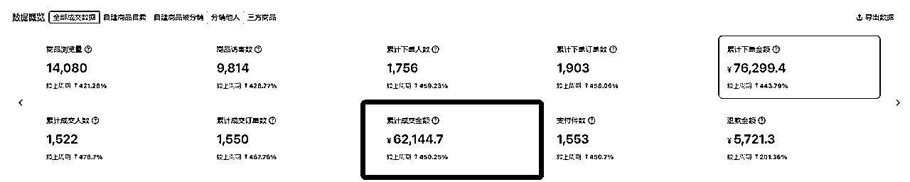
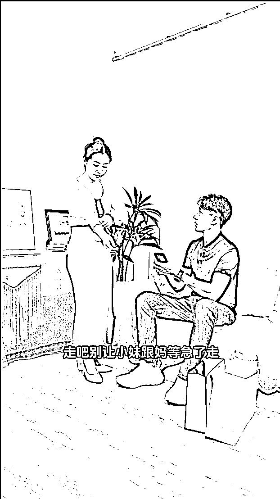
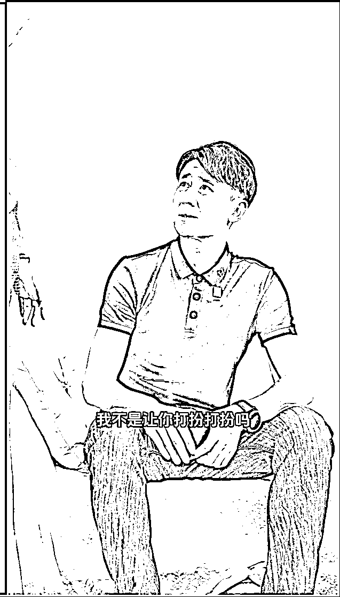
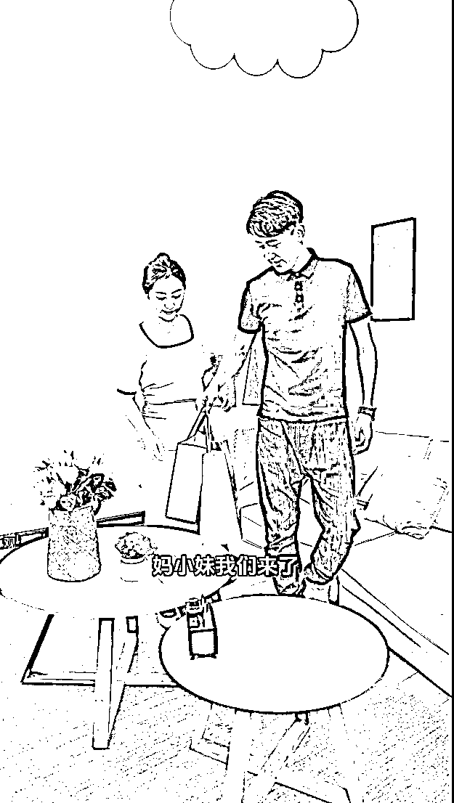
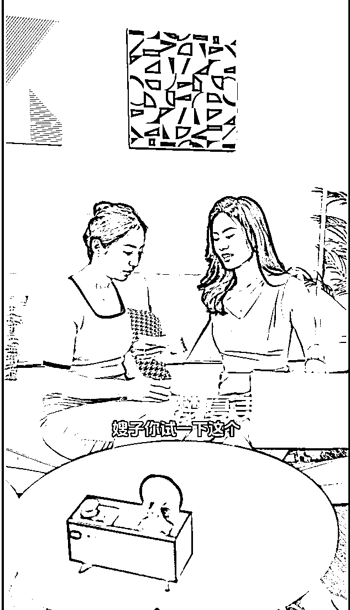
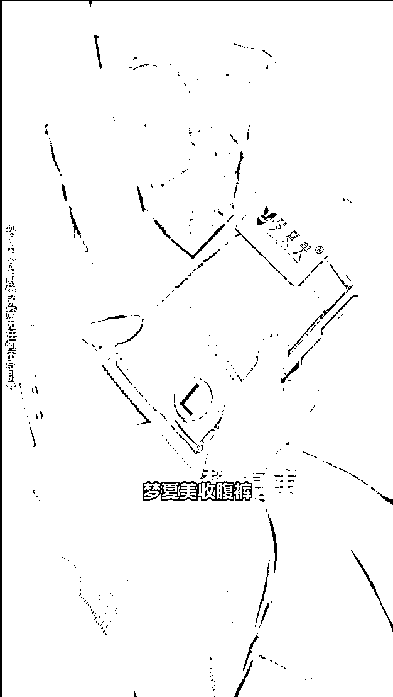
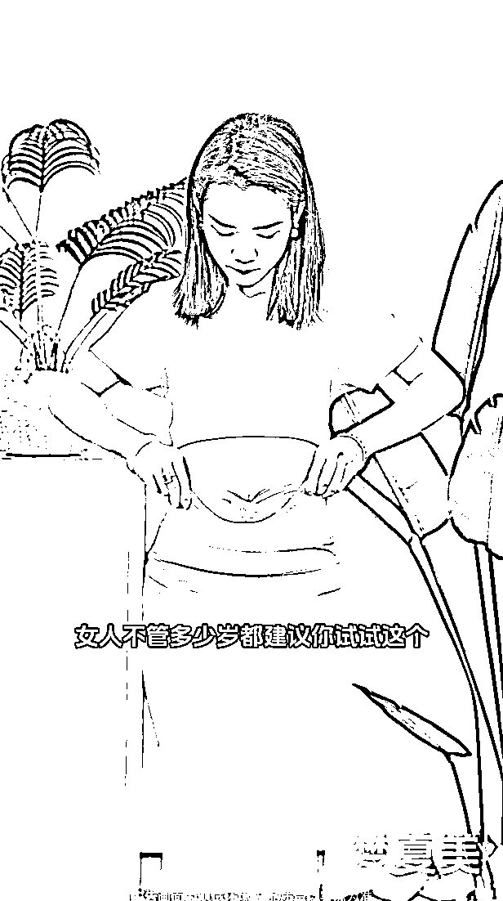
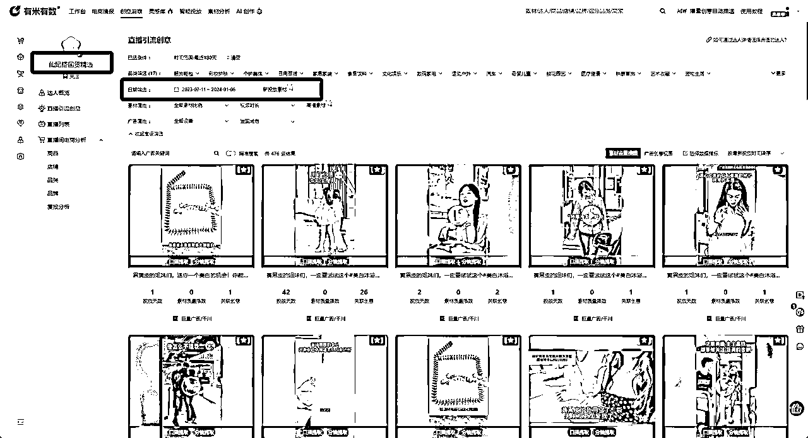

# 一条剧情就能自然流破6万+，我把自然流的底层拆开了

大家好，我是杭州龙珠的书豪，目前在小红书和快手做店铺和直播带航海教练，也是航海家俱乐部的一员。

非常感谢龙哥盟把我带进了电商这条路，让我开了全新的创业篇章。

临近年关，我在小红书和快手上对服饰、日百、小家电、白牌美妆等品类做了大范围测品，每个类目都试了几十款，素材库里已经堆了接近1T。

绝大多数素材发出去平平无奇，但有一小撮剧情类结构，却在两个平台同时炸了。更关键的是，几乎不用硬投，就靠自然推流就能跑得飞快。

就拿最近在快手跑爆的收腹裤框架来说，这个结构连续4天都在发力，累计出单20万，单条峰值一天6万，70%以上都是自然量，扣掉基础投放，直接靠自然流变现6万+。

把这些能跑自然的框架反复拆解后，我提炼出了一套可复制的方法论，只要框架能同时满足这几条，基本就能在主流短视频平台吃到自然流。

先问自己一个问题：平台凭什么给你推自然？

抛开投放和电商后台数据，只剩一个答案：用户停留时间。

内容电商本质上是注意力生意，谁能把用户时间抢下来，谁就值钱。这也是抖音能让淘宝、微信都头疼的原因，因为它上来就把用户的时长给吸走了。

能不能撬动自然流，核心就看框架能不能同时做好下面四件事：

*   完播率，最核心的指标，直接决定停留
*   从短视频进直播间的进入率
*   短视频本身的转化率
*   GMP值，也就是单条视频带来千次场观的GMV

先说完播率。

无论是付费还是免费，前3秒前5秒都是生死线。3秒5秒内没把目标人群圈住，没戳中痛点，没点燃继续看的欲望，就基本凉凉。

我们爆的那批剧情开场，几乎都是用猎奇画面+强冲突对话来定调。

老婆：“走吧，别让小妹跟妈等急了，走。”

老公：“我不是让你打扮打扮吗？”

...

两句话一个镜头，就把猎奇感拉满，同时把人群也定死了。看婆媳、夫妻关系的，基本都是30-50岁的女性受众。

紧接着剧情会自然进入女主爆发、夫妻吵架，把人留住。

后面就是去婆婆家的戏份，大约1分半左右，几乎占了整条视频的三分之一。很多人会问，视频越长完播不是越低吗？

我们说的是同赛道内的完播率赛马。

比如一条10秒的视频，用户平均看到8秒就划走，完播是80%。另一条120秒的视频，用户平均看到60秒划走，完播是50%。

平台会算哪个给平台带来的停留更长？当然是后者。

所以现在抖音大盘前100的消耗素材里，40%以上都是剧情长片。

原因有两个：

第一，长片镜头更多，去重更容易，同质化压力小。

第二，长片能拿下更有竞争力的完播率。纯硬广30秒，完播常常只有20%出头，在OCPM模型里基本没竞争力。但把前端剧情拉长，占到2/3以上，完播很容易来到40%-50%。哪怕部分人没看到卖点就划了，跑量能力依然很强。

这就是核心中的核心。

再说电商层面的三项考核：

*   短视频直播间进入率
*   短视频转化率
*   短视频GMP值

看完之前，先完整过一遍我们那条2分41秒的片子，就会发现它其实是典型的三段式：

*   引流段
*   过渡段
*   转化段，也就是硬广

过渡和转化的顺序会根据品类微调，但能大量跑量的，基本都是这个骨架。三个部分都做到极致，自然流才会持续起来。

引流段：

核心任务有两个，拉升完播、提升停留竞争力，同时圈定人群。

怎么圈人？引流段可以理解成千川的莱卡小通投，只要年龄性别对了就是好素材。

它不能太泛。想卖收腹裤，开头却用00后黑丝出场，色粉会进来，人群就歪了。我们观察到的头部剧情账号，几乎都用30-40岁左右的普通女性模特，贤妻良母的设定，精准且安全。

过度段：

为什么不能引流完直接上硬广？能，但会丢掉一大波转化。

完播其实可分两种：剧情完播和硬广完播。剧情完播做好容易，但直接跳硬广，跳失率能飙到90%以上，最后就是播放高、变现难。

在这个收腹裤框架里，过渡就是妹妹拿出收腹裤来解决女主小肚子的痛点。换成洗面奶、女装、化妆品都能无缝接上，观众带着好奇继续看，对比有多大。

镜头一转，女主穿上后的状态和开头像两个样，过渡段的任务就完成了。

转化段：

这时候上硬广就顺理成章了。为什么前后差这么多？什么工艺？是不是真的有这么神奇？观众自己会问。

只要过渡段跳失足够低，硬广完播率自然上去，转化也就跟着上去。

硬广部分就是把材质、工艺、痛点、效果往外倒，把剩下的人群说服就行，这部分老卖货的人都熟悉。

回到最初的四个指标，大致逻辑就很清晰了：

*   完播率，决定你能不能拿到自然流入场券
*   直播间进入率，决定你能不能拿到付费消耗入场券
*   短视频转化率，决定自然流起量的速度和斜率
*   GMP值，决定自然流能跑多长时间

小红书、快手实测下来，底层逻辑都是通的，只是时间和平台差异。视频号我看过一些家清个护的自然流案例，也是三段式，通用指标基本成立。

很多朋友担心剧情难拍，导演模特拍摄加起来上千上万，普通人玩不转。其实引流段不需要你原创，直接抄作业就行。

抖音上几百个头部剧情号，每天都在产夫妻、婆媳、家庭关系的素材，都是冲着30-50岁女性去的。只要你的产品在人群范围内，基本都能套。

我整理了一批成熟的头部账号，直接用有米有数盯更新就能薅：

仙妃格 美妆类

欧莱加 OULAIJIA 旗舰店 美妆类

轻龄大师旗舰店 美妆类

朱莉欧 JUELREOU 美妆旗舰店 美妆类

VC 品牌账号 美妆类

ZKYO 护肤旗舰店 美妆类

罗娜女神护肤旗舰店 美妆类

水初润素颜霜个人护理 美妆类

小橙子吖 美妆类

草安堂研究所 美妆类

协和护肤优选 美妆类

霸王院线高端护肤 美妆类

海儿优品好物 百货类

我是慧姐 食品类

她知 情感类

我和彩虹的约定 买课类

牛颂电商 食品类

孙艺冉电商 百货类

燕儿电子商务 百货类

梦中的梦 百货类

金凤（剧情带货） 百货类

艳艳商贸 美妆类

把周期拉到360天，每个号都有几百到上千条，足够普通人用一年。

去重也很简单，只需要把1分30秒的核心引流剧情保留高光、删掉水镜头。转化段用云朵遮挡特效把自己的产品主图盖上去，后面硬广套模板即可，整体原创度能做到50%以上。

这样做出来的素材，无论抖音、快手、视频号、小红书，都能吃到大量自然流量。你比纯搬运硬广多了原创层，也和只打短素材的对手形成了差异。

对投放熟的人，还可以用微付费的方式快速激活自然流，等第一波自然跑完再小额补投，反复循环，能把一条素材的生命周期压榨到极致。

希望这套拆解能帮到大家，年前都来一波自然流大爆。

我现在主要盘小红书和快手，但基本所有平台的短视频底层是通的，有问题欢迎交流探讨，知无不言。微信：wsh137552775