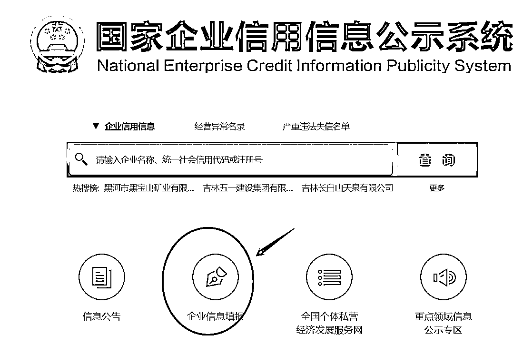
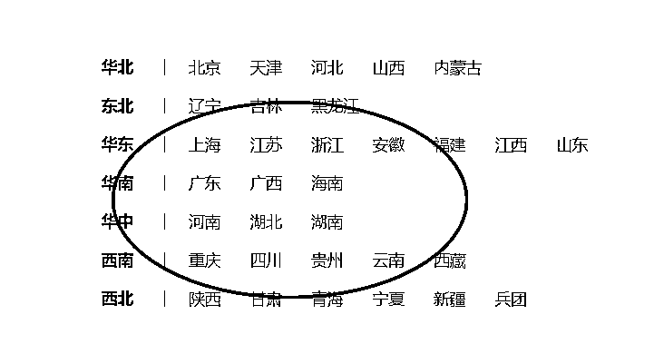
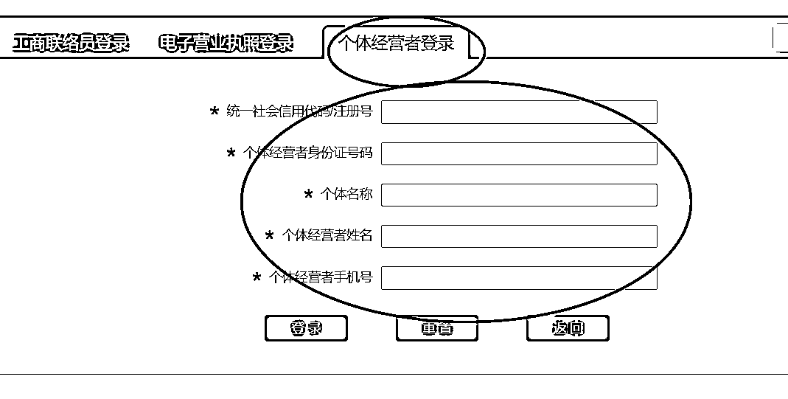
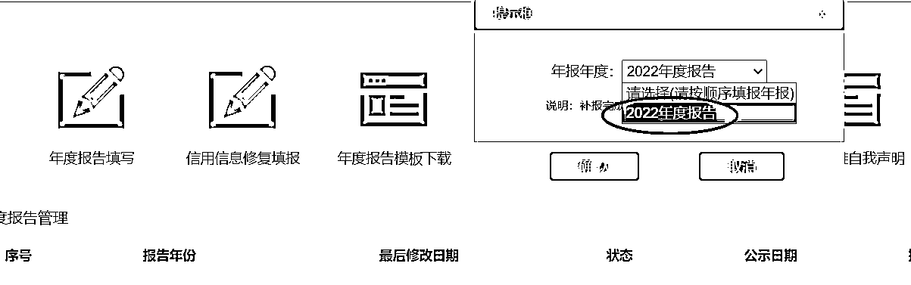
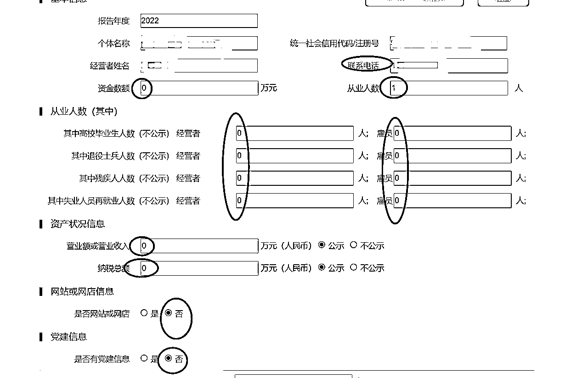
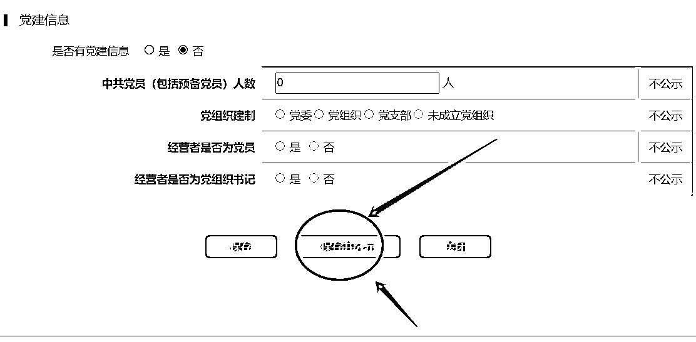
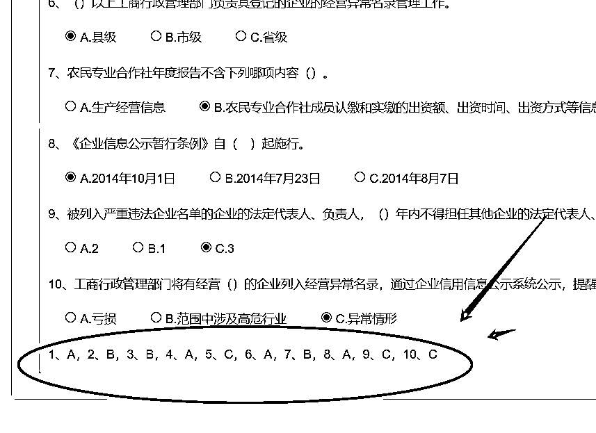

# 年报图文详解 —— 兼职副业拆解

想把年报这件事变成一份能变现的小副业？其实流程并不复杂，个体户和企业的操作路径完全一致。每年1月到6月，就是给上一年营业执照做年度公示的窗口期，跟着下面这套步骤走就行。

1，先打开国家企业信用信息公示系统官网：https://www.gsxt.gov.cn/corp-query-homepage.html

2，进入企业信息填报入口。年度检查的时段固定在每年的1-6月，用于申报上一年度的经营情况。个体工商户和有限公司的填报方式是完全一样的。

3，定位执照注册地。系统会要求你先选择对应的行政区域。

4，开始登录。最常见的是用个体经营者账号登录，按提示逐项完善资料即可。也可以通过电子营业执照来登录，微信里搜索小程序“电子营业执照”，扫码后直接进入。两种方式各有方便程度，挑自己顺手的就行，多试几次就熟练了。

5，进入年报填报页面。弹窗提示会弹出，点击“已阅”继续。

6，填写具体年报内容。各项信息都结合自身真实经营情况如实填写即可。

7，确认无误后保存并公示。

8，完成公示前的答题环节，正确答案在页面最下方可以找到。

9，公示状态显示成功，即代表本年度年报完成。

这项业务上手快、见效快，完全可以发展成一份小副业。不少人需要代办，你只要几分钟就能帮别人搞定，市面上收费通常在10到200元不等，价格看地区和服务量而定。

另外关于营业执照的一些基础常识，以及线上申办执照需要准备的资料，这里也做了整理可以参考。

如果有执照代办需求，也可以直接联系我~提供全国范围的执照代办服务