# 2023，我疯狂尝试，只为找到属于自己的那条路

一转眼2023年也快结束了，我是龙哥，又到写年终总结的节点。说实话，今天敲键盘时心情是愉悦的——积攒了太多想法，终于可以把它们倒出来，顺便把脑子里那些乱七八糟的线头理一理。

这篇文章主要聊商业。我会从这一年的经历讲起，再聊聊项目、行业和那些让我扎心的领悟。

## 一、这一年，我为什么要到处折腾

先简单过一遍时间线：

1月，卖赚钱案例库，冲榜冲到前排；还做了百度答题的小项目，赚了几万块。
2月，卖GPT社群，又小赚几万；顺便参与了GPT书籍出版的杂事。
3-4月，参与赚钱拉新，团队拉了200多人，GMV差不多40万；也卖了自己的私教产品。
5月，参与一门AI写作课程的发售，再次小赚几万。
6月，跑去杭州看按摩店的商业模式，学了点企业经营课程。
7-10月，一头扎进人生发展、社会运转、阶层规则、企业管理这些大课题里。
11月，参加一个养生按摩品牌的地推，看朋友开分店，还弄了个大学生圈子。
12月，到上海接触房地产，了解房产卖方代理这个职业。

这一年，真的够颠簸。

你问我为什么这么折腾？答案很简单：我想破局，想找出路。

我的处境挺拧巴：长板特别长，内容能力、分析能力都拿得出手，不少人看完我的文章直呼过瘾，记住我、认可我。但短板也特别短——没有清晰的定位，没有一个基本盘，别人想跟我谈业务合作都没抓手。每次被问“你是做什么业务的”，我都答不上来，只能尴尬一笑。

那为什么不自己搞个基本盘？你以为我不想吗？我的能力全点在底层能力上，也就是“给别人打辅助”的能力。围绕别人的需求做事，我能想得很清楚；但让我围绕自己的能力去设计方向，我脑袋一片空白。

我花两年多研究底层学习方法，这个能力点满了，学东西特别快。靠它做培训，我也跑通过，赚过十来万。但有个尴尬问题：学员学完，怎么证明学得好？你教物理化学，学生成绩提升就是铁证；你教通用能力，学完要拿什么证明？让他说“我一个月入门了新领域”？那“入门”怎么定义？没法衡量。

说白了，我擅长的都是底层通用能力，很难量化。你给我具体事情做，或者让我打辅助，我能干得很漂亮；但你让我自己想该干什么，我真想不到。所有喜欢和擅长的东西，都找不到一个具体的落脚点，也设计不出一套长期稳定变现的商业模式。我能看到的、能稳定赚钱且模式完整的，全是别人的业务。

这时候，你选择相信自己还是相信别人？是坚信自己做的事有价值，硬生生跑出赚钱路径？还是放弃积累，换一个现成的项目从头开始？

年初我就卡在这个局里：大家知道我厉害，但不知道我业务是什么；我有一技之长，但市面上没有可参考的模式——甚至上半年我连“商业模式”这个概念都没想明白。想往下走，全得靠自己摸索，但连摸索方向都没有。

所以我今年花大量时间到处尝试、到处跑。我信乔布斯的“连点成线”：一开始混乱没问题，疯狂打点，攒够了点，线自然就连起来了。

于是我的主线变成了：有啥项目能参与就掺一脚；朋友有现成的项目就去看、去学，看能不能复制。所以你们看到了：干了一大堆事，跑了大半年，没做出什么成绩，阶段性地看起来像个傻子。不过还好，到2024年我能安分不少。

## 二、关于项目的那些事儿

有段时间，朋友劝我：你也找个像📕虚拟资料、无货源、无人直播那样的项目跑通，然后包装成培训去卖钱，光输出认知有啥用？得卖项目。

我当时挺困惑：为什么在他们眼里，那些才叫项目，我卖社群、卖课程就不算？

后来我给自己挖出了一个定义：项目=流量×转化×产品。也就是，在哪个流量入口、用什么方式搞流量、在哪转化、拿什么产品交付。

### 1. 培训项目的本质是什么？

拿三个例子说：

📕虚拟资料项目：老师提供现成的学科资料作为产品，外加一整套SOP——内容素材、模板、私域话术、百问百答。学员负责在📕发布内容搞流量，在私域聊天转化，最终用老师给的资料变现。这个项目里，学员在前端，老师在后台，满足的是客户买资料的需求。

写作变现项目：老师教一套写稿技能作为产品，学员掌握技能后写出符合要求的稿子，老师对接收稿平台，赚培训费+稿费差价，学员赚稿费+技能。学员负责交付内容，老师负责流量和转化，满足的是平台对优质内容的需求。

百度答题项目：老师教用GPT+全网搜资料的方法，学员学会后快速答题，用户满意平台就给钱。平台提供流量，学员负责转化+交付，老师提供的是“赚钱机会+岗前培训”这个产品。

看得多了就明白：所有培训项目，本质都是让学员掌握流量、转化、交付中的一部分环节，通过分工，老师学员一起赚钱。

### 2. 为什么有人做培训？

大致分两类：

一类是教一到两个环节，老师攥着最关键的环节。只要学员出单，老师也跟着赚钱，赚的是供应链或结算渠道的钱。比如📕有货源电商、写作投稿项目。

另一类是教全部环节，老师纯赚培训费。学员赚钱了跟老师无关，但老师省了时间、降了风险。比如教投资理财，老师稳赚；百度答题项目，老师一单收299/399，学员一单赚3块5块，学员赚回本，但老师来钱快得多。

### 3. 直营和培训怎么选？

三个因素：复制性、控制性、利润率。

有些项目适合直营，但老板是新手，管不来人，想放大项目招员工反而可能倒亏，于是用培训来放大：不用养人，还有培训费前置收益。缺点是培训出来的人不好直接管控，出单速度比员工慢。

有些老板向往自由，不愿意养团队，干脆培训；或者自己留三五人，其余全靠培训。

能在市场上大规模培训的项目，门槛不会太高。要么项目本身简单，要么负责人把SOP拆得足够细，强行把难度降下来。但项目简单，进来的人就多，内卷之后利润就薄了。所以大多能快速上手的培训项目，都赚不了大钱——学员月入一万算优秀，月入两万是顶尖。

想赚更多，通常是两条路：自己多账号矩阵放大，或者干脆自己去做培训。

总结一下：利润高且难复制的，一个人一个账号，最多加几个助理；利润高、可复制、成功率高且可控的，开公司招人复制；利润高、可复制但成功难控的，搞培训卖商机；利润一般、可复制、成材率不低的，也搞培训。

我对培训项目的观点是：

目标是1k-3w月收，把一个培训项目做精，多开几个号、招几个兼职辅助，基本能做到；
目标是5w-10w以上，跟着别人做培训就难了，得自己找项目、自己带人做培训；
纯新手前期先跟着学技能，别太在意收入，技能精通后再决定是成为培训方，还是自己直营。

### 4. 大项目和小项目差在哪儿？

三个维度：行业规模、客单价、扩张方式。

前两个决定了项目“天生”的大小。有的赛道大到万亿级，比如房地产；有的赛道小，比如某些二次元细分类目，顶多千万。有的产品一单几万甚至上千万，比如留学规划、买房；有的产品一单几块钱到几百块，比如学科资料。

第三个维度是运作方式：单人单号单产品；一个人多产品；上RPA+GPT+Python做矩阵号；三五人小团队；上百号人公司堆量；内部做股权激励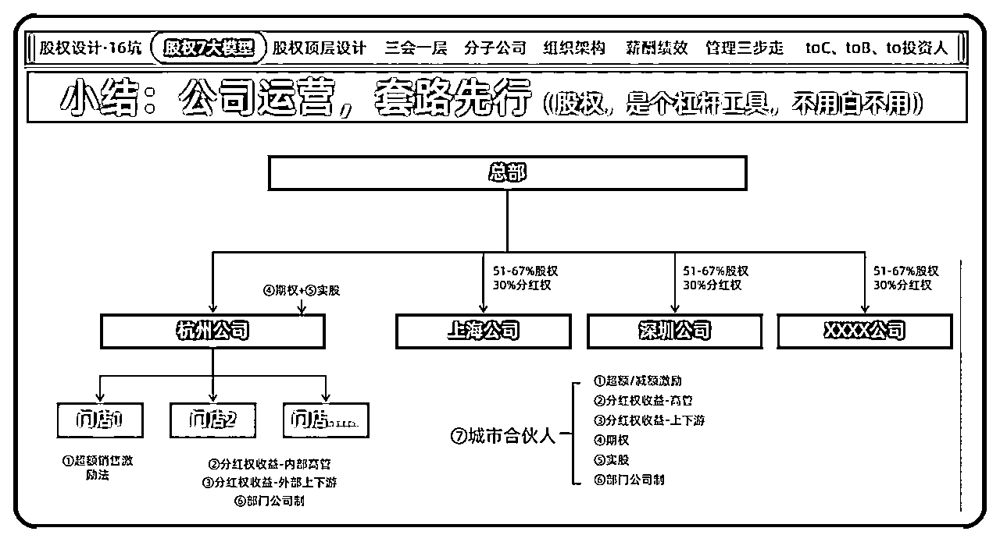；对外做招商加盟，全国开连锁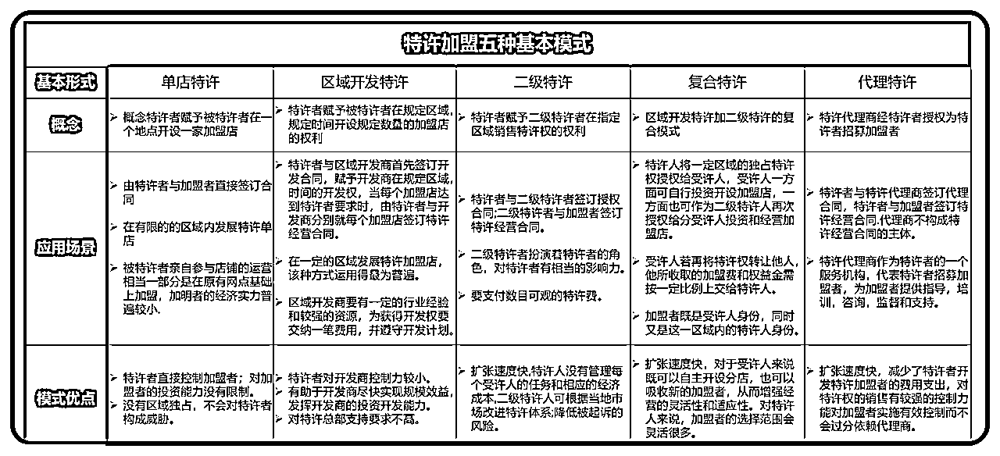。

有句话我很认可：没有小项目，只有把项目做小的人。当你觉得项目不行，要先想想，到底是项目本身没有复制性，还是你自己不会复制、没做对放大的动作？再小的项目，只要扩张方式对路，一年做到50-100万利润都不是问题。

### 5. 网络副业和正规公司有啥区别？

我大哥跟我说：项目没啥区别，只是运作的精细程度不一样。
龙哥老板说：正规化等于公司化+品牌化+付费投流。

我的理解是：
公司化=股权设计+组织架构+薪酬绩效+人员管理；
品牌化=品牌标识设计+商标注册+打造行业影响力；
从薅平台羊毛的自然流量，走向付费投流，跟平台共生。

个人看法：如果你只想要网络副业，月入几千到五万，记住“细分定位、流量、转化、产品”这几个词，努力干就行了。但如果你想当真正的创业者，开公司、招人、年入百万，那你得对下面这张图有概念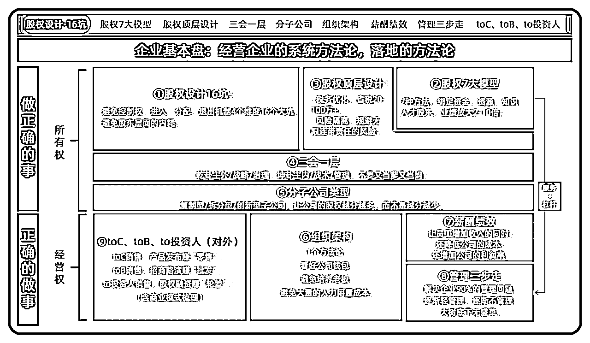。如果你想开中大型公司，建立行业影响力，拿融资，搞招商加盟，那商业计划书里的东西也得有基本认知，以后肯定用得上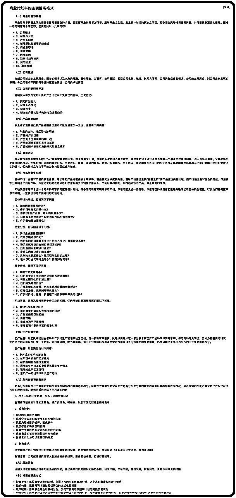。

## 三、行业、商业模式、扎根行业

### 1. 我到底属于哪个行业？

以前别人问我“你搞哪行”，我答不上来。甚至“有哪些行业”这回事，我都没概念。

于是我去找专业的行业报告网站，翻了大类和细分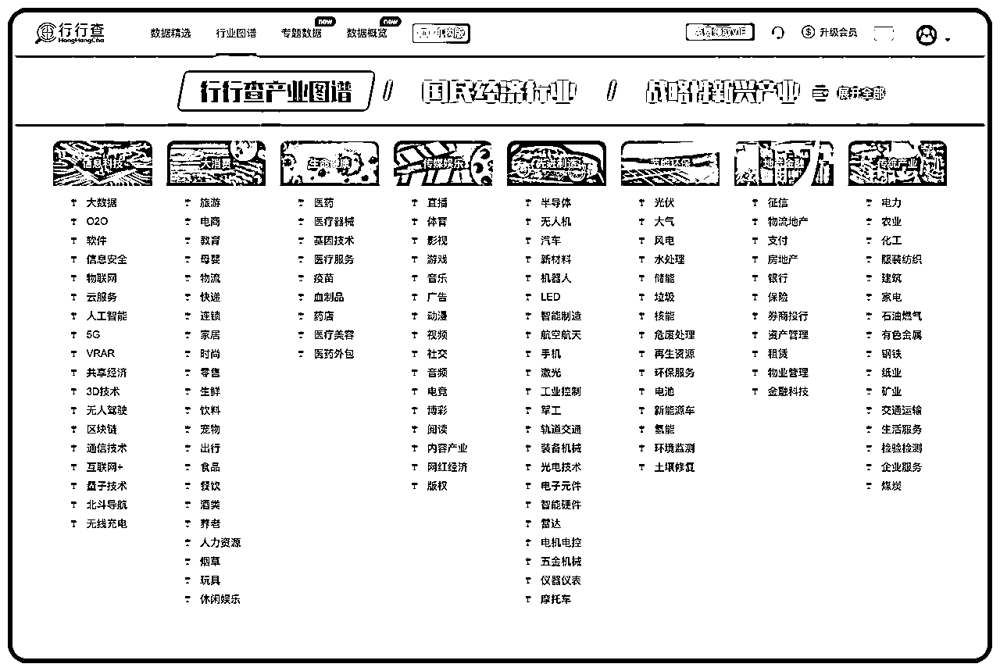，终于看到跟我沾边的分类：职业教育—非学历教育—职业技术培训—新媒体技术培训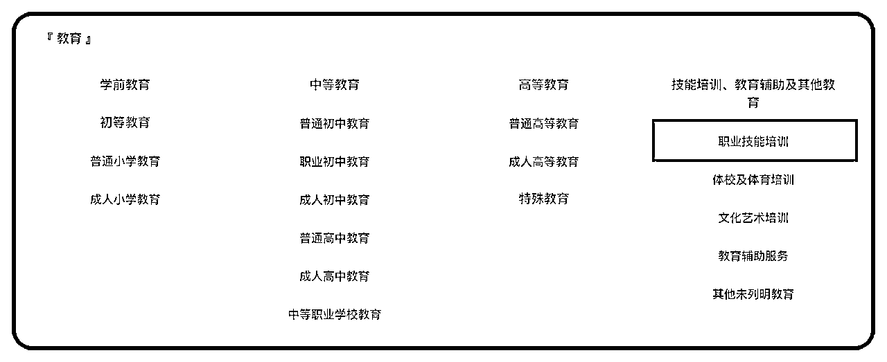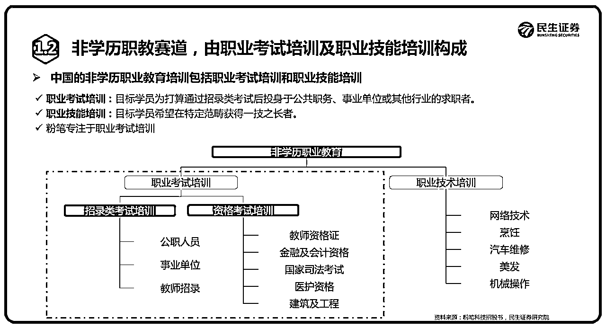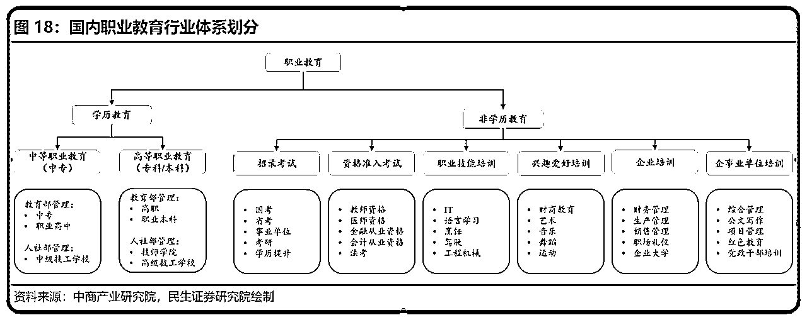。

我还发现，培训类的高级商业模式，是成立学校/培训机构，走校企合作，把学生、企业、人才机构、政府、投资机构全圈进来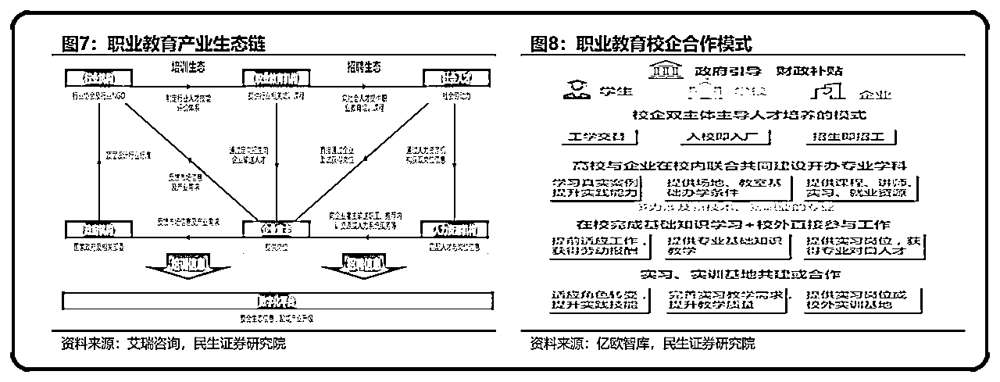。当时看到这张图，我整个人是震惊的：要是早看行业报告，知道成熟的模式长啥样，我个体户直接参考不就完了？哪还用拍脑袋想那么久！

看完职业培训，我又琢磨：职业技能培训+人力资源是绝配。那人力资源怎么玩？结果看到了“灵活用工”这条路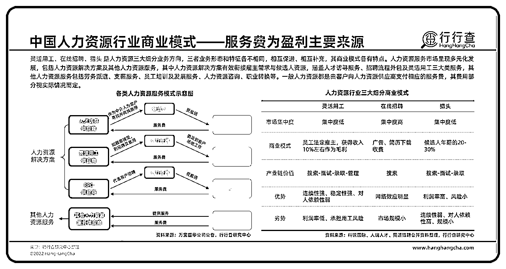，发现我之前想做的，其实就是灵活用工。

这里想说的是：新手设计商业模式，别自己硬想。去翻翻行业报告，先看自己属于哪个大类，再看这个类目下主流玩法是什么，拿现成的成熟模式做参考，肯定比瞎猜靠谱。推荐网站：hanghangcha.com。

### 2. 什么叫扎根行业、深耕行业？

以前一听“行业”两个字就头疼。什么叫深耕？我卖产品就能赚钱，干嘛还要懂行业？

后来看多了资料，用两个例子回答：

第一个是房产行业。看贝壳怎么解决行业痛点、怎么改变行业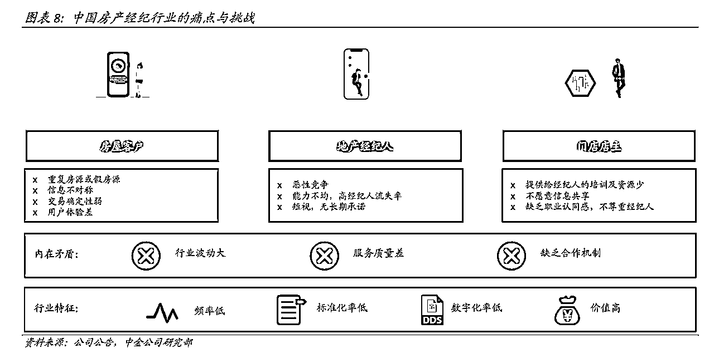。从中理解，所谓行业痛点，就是这些事：消费者有啥需求没被满足？就算满足了，效率是不是低、体验是不是差？行业里的从业者（中介、店主）同样有啥痛点？别的行业已经在用的技术、模式，这个行业是不是还没用上？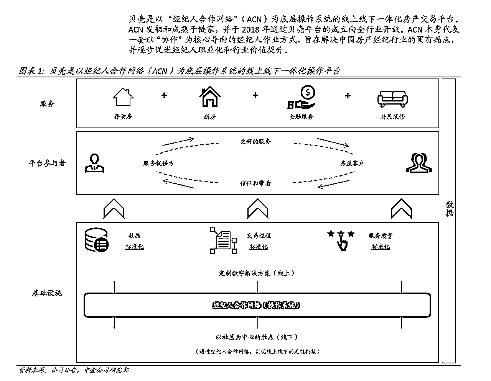

第二个是价值链。深耕一个行业，从价值链角度看，就是先占据其中一个环节，站稳脚，再慢慢吃上下游的环节。这理解来自《商业模式与基因工程》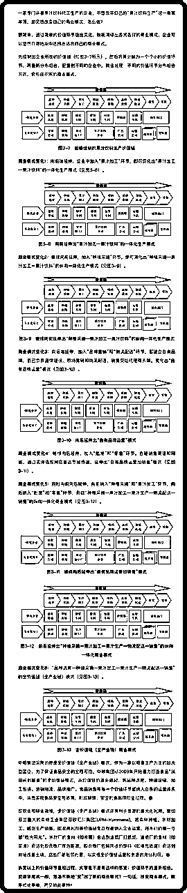。

总结下来：围绕C端、B端和行业的痛点，拿出更优的解决方案；先在一个价值链环节做基点，再往上下游延伸。这就是我目前理解的“扎根行业”。

那跟赚钱什么关系？我觉得，普通人想年入百万，挑一个七八十分的产品，疯狂搞流量和转化就够了，不用在产品上下死功夫，也不用琢磨技术创新、商业模式创新——那是大人物的事。但你想开一家年入千万到上亿的公司，就必须对“行业”和“产业链”有感觉。学不学，取决于你的目标多大。

## 四、今年最惨痛的领悟

今年最痛的一课，是我以为自己啥都能干，结果啥都没干成。

以前靠着超强的学习能力，我一度觉得，想做什么都能学会，都能做到80分。结果呢？因为这个“啥都能干”的错觉，我陷入更大的迷茫——选项太多，不知道选啥。

现在回头看，这个想法太蠢了，坑了我大半年。如果我能穿越回半年前，给当时的自己做个定位建议，我会说：

别再说你啥都能干。只要不是傻子，给一个聪明人足够的时间，他啥都能学会。真正有用的定位框架是什么？常规说法是“喜欢、擅长、市场需要”。在此我调整一下：……

有几个词，我今年重新换了一套定义：热爱，优势，以及需求。

以前常问自己喜不喜欢某件事，后来发现这个问题太模糊，很难答。真正的热爱，是可以往里砸时间的：做的时候不难受，不被逼着也愿意花上几个小时，甚至越做越起劲。要说一个人对什么有感觉，看注意力够不够用最准。有的人一上手就烦，几分钟都坐不住；有的人能一头扎进去，做满四到八个小时。你能不能举出一件事，让你愿意天天花四到八小时，连续啃上两三年？

再说擅长。这个词太虚，我改成“你有多少胜算”。所谓胜算，就是放到人堆里比：你的专业能力是不是比大多数同行强？你的履历、背景是不是拿得出手？你手里的客户和资源，是不是又广又优质？三条占一条，你才谈得上长板。

市场需求，我更愿意叫它“价值显眼”。一个东西好，你得能让人一眼看见：有数据，有对比，能一句话说清它到底帮人解决了什么。客户花完钱，你也能顺手把案例写出来。反过来，如果它确实有用，可你三句话讲不出它好在哪，也找不到任何数字或画面来证明，那它就注定卖不大。

如果当年我能用这三把尺子量一量，估计会少走很多弯路。很多事我都能做两下，但放到人群里，大概率被秒成渣；也有一些事，我认为有价值，可真要卖出去，别人根本无感；还有更多的事，是我图新鲜试了试，最后都无疾而终，因为我压根没有长期投入的热情。

脑子转得快，并不全是好事。人要是觉得自个儿什么都能干，什么机会都想去抓，最后往往什么都做不成。先划掉不适合自己的路，比闭眼往前冲要紧多了。

今年我跑出去看了一圈，最大的收获，是和一个老寓言对上了号——《小马过河》。

有位朋友在做调理馆，主打中医推拿。我去体验过，手艺确实好，还撞见有客人几万块买下高级项目。照我看，这种店完全有潜力铺到全国，做成连锁。可我把这个想法拿给身边人听，十个里有九个摆手：这行早就是红海，砸钱多、风险大，别指望它赚钱。

要不是亲眼见过朋友的店经营得有声有色，我估计早被劝退，把这生意当成禁区。

转头我又去观察房地产。如今说到房子，大家几乎统一口径：下行、夕阳、别碰。连两位资产过亿的大佬也这么提醒我。可现实总有点讽刺——我那位做地产的兄长，愣是在人人喊冷的市场里，每年照样进账几百万，还越做越有奔头。

这两人谁说得对？其实都对。松鼠说水深，老牛说水浅，它们都是站在自己的体型上说真话。可那水适不适合我，得我亲自下水试试。我试出来的答案是：既没那么深，也没那么浅，能过。

所以判断一门生意能不能碰，只需要问一句：凭我这样的人，这件事能不能做成？别人做成做不成，跟我的选择没有关系。

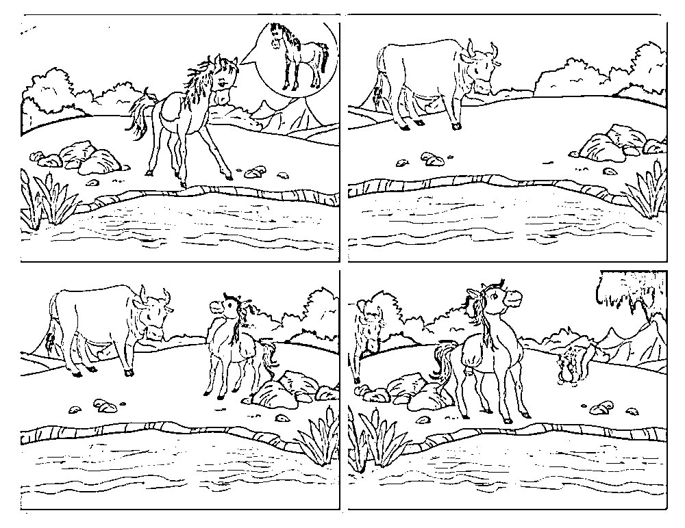

早年学投资时，有一句话我记得很深：别预测未来，多准备预案。

具体怎么做？把自己手头能动用的钱全部摆出来，切成几份，根据市场变化灵活调配。什么时候补进去，什么时候认赔离场，什么时候落袋为安，拿什么工具做对冲，这些都是上场前要定好的规矩。买点、仓位、风控，都齐了，才算得上投资者。只管猜涨跌，然后闭眼赌一把，那不叫投资，那叫赌命。

二、关于友情

1）终于过上有人管饭的日子

2022年4月2日，我写过一句心里话。一年后的冬天，再看那句话，居然已经兑现。

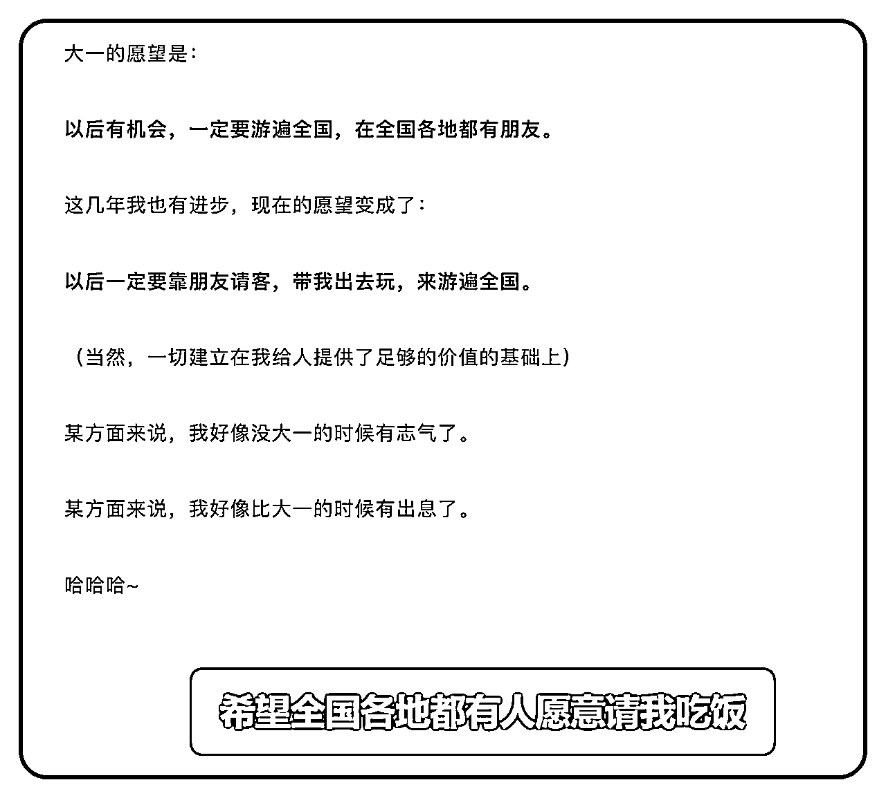

今年跑了不少城市：深圳、广州、东莞、杭州、梅城、郑州、南京、合肥、上海、南昌、长沙。几乎每一站，都有朋友张罗好吃的，有人还开着车陪我兜风，舒坦极了。

这个愿望能成真，多亏龙哥盟，多亏圈里朋友照顾，也多亏自媒体给了我出去见人的机会。

2）我怎么就动了开公司的念头

以前我特别向往独自单干：不用养办公室，不用管社保，每个月挣个五六位数，自由自在。这样的日子，正常人谁愿意给自己加一道公司的枷锁？

直到两件事发生。第一，我撞见几位很合拍的朋友，三观一致，能力性格还互补，天然适合合伙做点事，不好好利用这份缘分，我自己都觉得浪费。第二，我遇到几个特别喜欢的小朋友，有的在读研，有的刚毕业。我脑子里冒出一个念头：好不容易遇到合缘的人，一定要把他们留在身边，一起闯一闯；让他们去外面给人拧螺丝，我心里过意不去。

第一件事的结局：我们已经注册公司，开始合作。第二件事则逼着我把盘子做大：至少要做到一年一两百万、两三百万的规模，我才有钱分，才养得起这帮想跟着我的人。

3）这份朋友名单，我记下了

今年值得感动的瞬间太多。

有位姐姐像老家长一样，操心我后面的路，特意约了我和溟桥一起吃饭，从感情到风险，再到下一步怎么发展，全帮我想到了。又一位姐姐带我瘦了十斤，还让我近距离看到了公司管理、面向企业客户做生意的世界。

有位大哥，陪我吃喝，也把半辈子的经验讲给我听；有位大哥，把上千人的舞台交给我站；还有位大哥，给了实打实的项目；另一位，凌晨两三点还在电话那头，一个字一个字地帮我把合同捋清楚。

和东莞那几位，我们组建了饭搭子联盟，不是我去他们的别墅蹭饭，就是他们来深圳找我下馆子。和广州的兄弟，经常一个电话就打：我从深圳冲到广州喝咖啡，或者他从广州跑到深圳来吃日料。到了郑州，和一帮兄弟撸串、飙摩托、草地下午茶，还顺手弄了家公司。

今年，我也有了媳妇，有了得力的左膀右臂，有了十几个愿意信任我的私教学员。

盘点一下，这年的人际关系，我给自己打高分。新朋友很多，故事也很多。感谢他们，也感谢赚钱这门桥。

三、关于爱情

1）一个电话，捡到一个女朋友

这要从一位粉丝讲起。他是我和溟桥共同的老朋友。去年年底，我刚认识溟桥之前，这位粉丝先跑去和溟桥安利，说七小这个人有点东西，建议她进我社群。她听完没什么反应，人呢也没加。

粉丝回头也跟我提了一嘴。我当时没太往心里去。神奇的是，第二天我刷👸号，平台居然把溟桥的文章推送给我。我顺手点进主页，看到🛰️就加了，聊了几句。

那天下午我正好闲着，便问她要不要电话聊。我那边的算盘是：看看这个同龄、同城的女生什么成色。她那边大概就想着多交个朋友。电话打完，我心想：也就平平无奇嘛，跟这个年纪的女孩没什么两样。正要客套收场，她却说聊得不错，还付钱进了群。我一愣：行啊，都表示支持了，那就多来往吧。

后来赚钱要推广案例库，我参加了打榜。溟桥看到消息，主动说帮我一把。我嘴上说谢谢，心里没当回事，只觉得多个人多分力，真正出单还得靠我自己。

结果她给了我一个暴击：将近50单。我整轮数据是200多单，等于四分之一的业绩都来自她！这得好好感谢，必须请她吃饭。

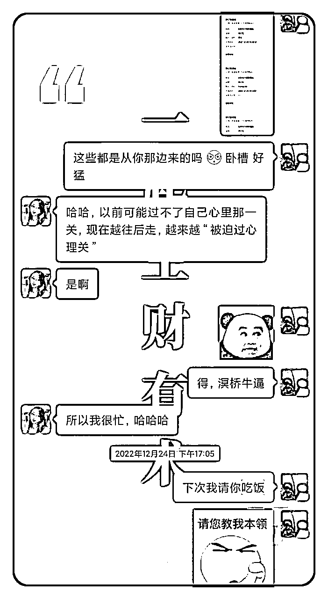

然后，我们才真正见面。头一回约饭，约在我家附近，我骑着那辆小电动车去的。吃完本该各回各家，我多嘴问她一句：要不要坐我车去兜风？

她居然答应了。江边晚风一吹，话匣子打开，我们直接多聊了一个小时。本来她打算坐地铁回家，我说我送你到XX站吧，省得转线。她觉得我想得周到，于是那一路，又多聊了一个小时。

就这么一顿饭、两次“顺路”，后来她就被我领回家了。

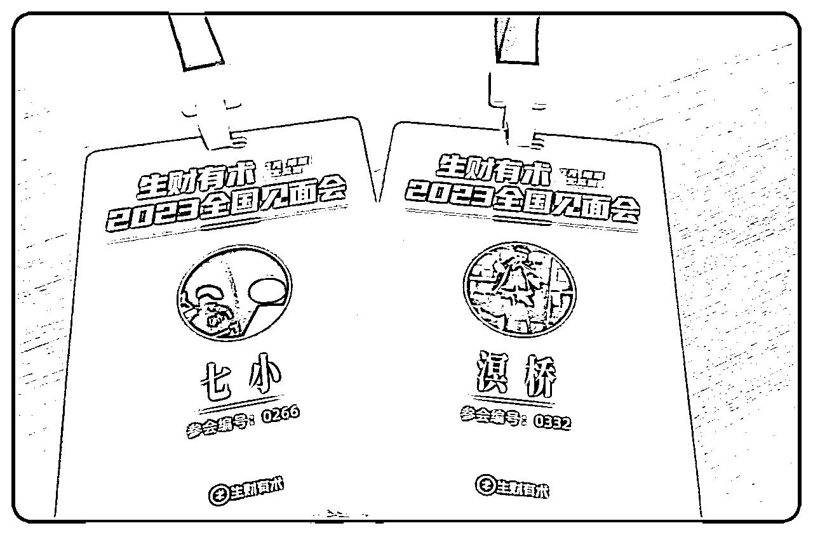

2）她给我开了扇窗

如果完全放养着过日子，我大概就是下面这幅样子。

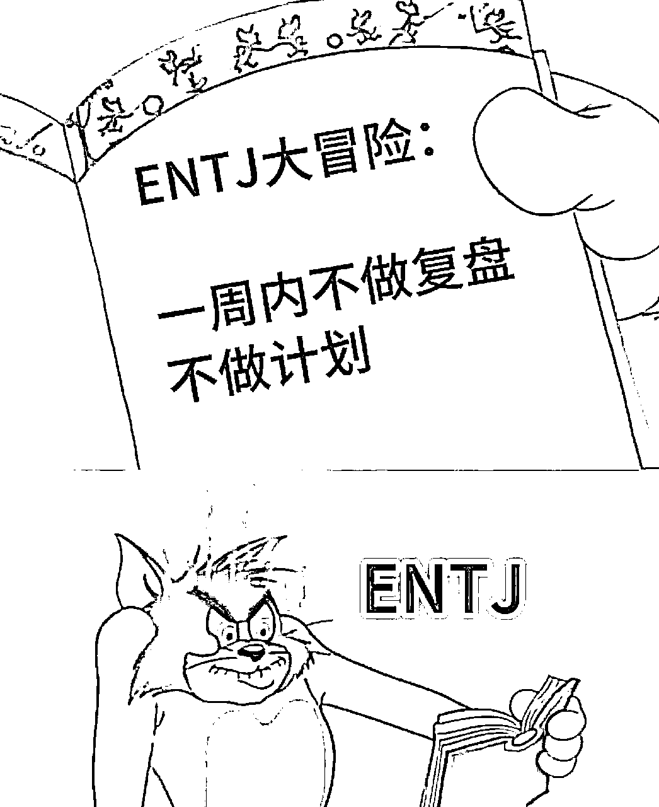

溟桥给我填补了两个窟窿：生活，和人情味。

从前我是个只会闷头干活的工作狂，如今会给自己放假，也会为路边一碗热腾腾的云吞心动。以前吃饭纯属填饱肚子，两分钟解决；现在会留意哪有好吃的，会认真计划周末去哪走走，慢慢懂了“过日子”三个字。

我和妈妈只隔三站地铁，过去一两个月也懒得回一次；现在每周都主动回家，也愿意多陪陪爷爷奶奶，听他们说些老一辈的话。

我从前判断一个人，几乎只看有没有用、能不能成事；现在会关心对方本身，会去想他此刻需要什么，而不是一开口就谈利弊。

还有一个变化是：遇事拿不准，我会让她给我占一卦。那套说法谈不上科学，也未必每次灵验，可奇了怪了，每次占完，我心里反而更清楚该往哪走。

她给我的鼓励和支持，是我这一年最稳的底气。

四、关于家庭

1）怎么就成了一家的指望

我出生在一个热闹的大家族。爸爸这边，上面是三个姐姐一个哥哥；妈妈这边，一个舅舅一个姨妈。

老一辈都在庄稼地里讨生活，父母那一辈靠进城打工谋出路。我爸妈小学学历，长辈中学历最高的也只是高中。到了我们这一辈：一位90后堂姐、两位90后堂哥、一位00后堂弟，还有三位00后表妹。他们中有的读专科，有的复读才上了二本，好像只有我，一次高考就考进一本。

毕业之后，同辈大多给别人打工，有几位也试过自己出来闯，基本都赔光了。算是只有我，把创业这条路稳稳走通，还赚到了钱。

我本来可以安心当个家里的小弟，有人罩着，不用管大事。谁知道一场折腾下来，我稀里糊涂变成了全家的指望。

被采访感想时，我大概会讲两条。头一条：真难。成长路上，长辈唯一教我的，是做人要正、要善良。至于功课、选大学、挑专业、找饭碗，他们不是不想管，是实在帮不上，我只能一路放养。总有人说，富人用资源，穷人靠突变。我多少有点中彩票的感觉——恰好突变成那个能杀出来的人。要是没突变成功，整个家族都在打工，那种结局，我不太敢往下想。

第二条：我们家很有凝聚力。过年过节一定聚，亲戚之间很热络。这份血缘，让我觉得自己不是一个人在走，而是一家人一起在往上挪。父辈没能实现的许多事，我想从我开始补上。既然全家把眼光望到我这儿，我就得争气，带着一家人往更高的地方走。

2）长大，是一下子的事

这一年，我能清楚感觉到：家族的接力棒，换到我手里了。

出门玩，从前是姑父开车，把一家人装得满满当当；现在变成了堂哥当司机，带着大家跑东跑西。

聚餐买单，从前长辈们拿钱包，我们小孩子只管埋头吃；现在一桌一千多，结账的人是我。

再看我们这代，当初一起玩的时候，堂姐还没嫁人，堂哥还在学校，我和堂弟都未成年。一转眼，堂姐的孩子要上小学了，堂哥上班五年买了车，我也离开校园快三年。只剩堂弟还在考专升本。等他走出来，这一代就算齐刷刷进入社会了。

这两年我在外面跑得多，北京、杭州、郑州、上海几乎轮着飞。常常是飞机在深圳落地，第二天赶回家陪爸妈和爷爷奶奶吃顿饭，过几天，又拎着箱子赶航班。

有时候，能请得起一桌饭、给长辈递上红包，那种靠自己挣来的底气，确实很舒服。可有时候，又得为了几两碎银在外头拼，没法守在深圳，多陪陪岁数大了、身体也不太好的爷爷奶奶。心里那点酸，躲不掉。嗐，长大就是这么个东西，一半骄傲，一半遗憾。

五、关于人生

1）30岁前攒到1000万，是执念，也是目标

谈钱，我从不避讳。2020年，我给自己立了个誓：30岁之前，账户上要有1000万。

立这个誓，不是凭空来的。

起因之一，是我学生时代过得不算好。小学初中，挨过骂，也挨过打；高中那三年，又和同学合不来，被人在背后编排了很久。憋屈的日子里，我总在心底吼：你们走着瞧，风水轮流转，等我混出个人样，这笔账迟早还回去。那股不服气，是我最早的发动机。

第二根引线，跟期待有关。2019年，我在珠三角卖掉5000多台洗衣机，业绩做到300多万。2020年我开始混圈子，几乎所有圈子里都混成了个有影响力的人，还收获了许多比我大五到十五岁前辈的认可。人家自己都混得不差，居然这么高看我，我要是只当个平庸角色，对得起谁？

所以，目标就这么定下了。

到今天，进展如何？年入50到100万这一段，已经落地。至于年入百万到千万的生意，该怎么选项目、怎么搭模式、怎么建组织，我心里也有了一张图（借花爷的文章一用）。

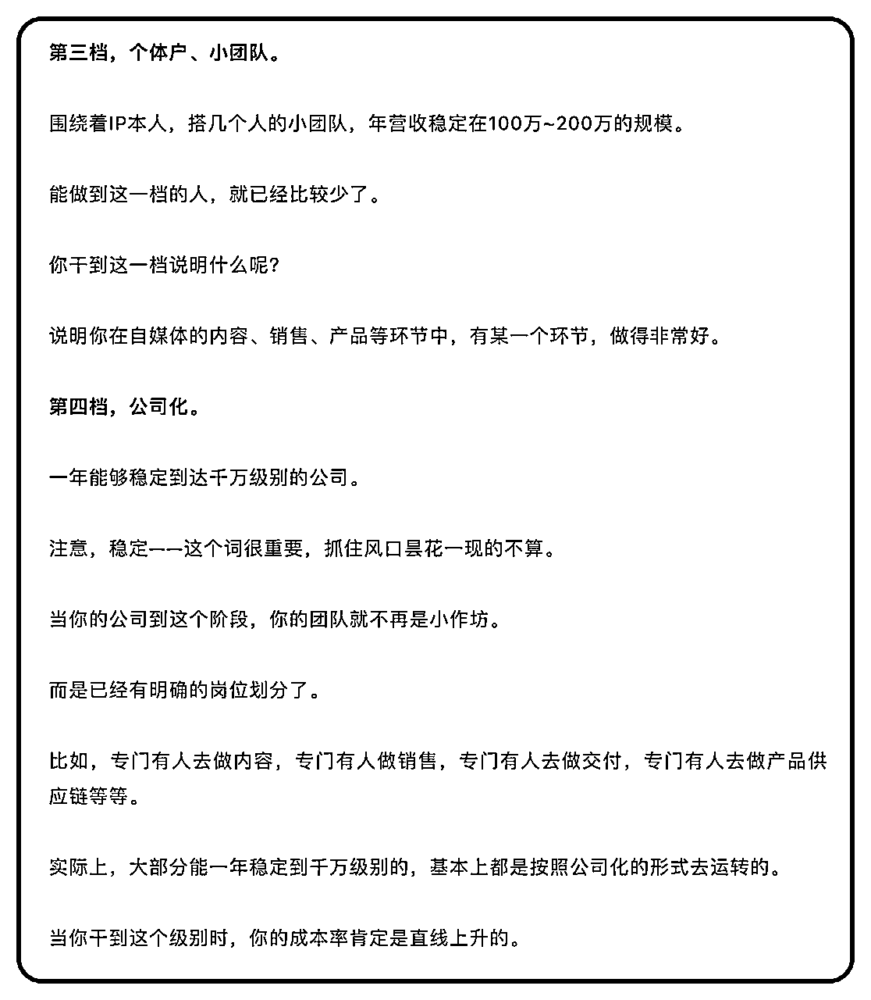

离30岁，我还有六七年时间。按现在的路子走下去，再把胆子放大一点，这个梦，可以有。

三年过去，心态早不是当初那副模样。最早，它是恨意，是想炫给所有人看。如今，那股劲已经泄了，因为彼此早已不在同一跑道，我跑得他们连影子都追不上。再说，往后多半也没有相见的场合，谁还惦记旧账？

现在留存下来的，是想知道自己能走到哪里。我一直悄悄觉得自己被运气偏爱：有点小聪明，接到的又是“穷人翻身”的剧本。既然剧本拿到手，总得演到底，看看老天给的料，够不够我做成一件大事。

人不到自己极限，心里那口气是不会松的。等哪天真正摸到天花板，无论它高还是低，我也就安心认命了。认下之后，带着这点故事去过普通日子，同样挺好。

我不装，我身上有很重的赌性。赌赢了，有吹一辈子的资本；赌输了，就回家好好过日子，横竖都不亏。

2）人生不在轨道上，而在旷野里

今年这句话特别火，我算是亲身体会到了它的分量。

因为待在不一样的圈子里，你会看到完全不一样的活法。

和老搭档待着，脑子里只有三件事：写了吗？赚了吗？长进了吗？六月的杭州，和做养生的姐姐住得近，每天被盘问的是：动了吗？吃饭有没有细嚼慢咽？昨晚有没有熬夜？而到了深圳那帮哥们身边，话风就变成：听说某处开了家新店，去不去？今天兜风拍照吗？滑雪走不走？

和玩MBTI的朋友、东莞饭搭子在一起，大家聊的是：我家那位如何如何，哎，我家那个也一样！他说了那句，我家也是！彼此像照镜子。

在搞钱为主的圈子，你一天没有日入斗金，一年没做到百万，心里就会发慌，总觉得跑慢了。可在另一群人眼里，张口闭口谈钱，本身就是煞风景，是野蛮人的做派。有的环境，你费劲打扮，业绩一般，人家说你花架子；有的环境，你业绩亮眼，穿得普通，人家又嫌你土。

以前见识少，我默认有钱人都该是精英。后来遇上几位深圳、上海的拆迁户和包租二代，论文化、论本事，真没看出多了不起，可人家就是富得从容。以前也以为富二代多少会继承点家传本事，后来发现，也有不少二代只求一份闲职，每月过万，月月光。

圈子见多了，人会变得开阔：你在乎的条件，别人可能根本不需要；你最无地自容的短板，别人也许完全不介意；你最得意的资本，别人或许眼皮都不抬一下。你觉得没有钱、没有本事，生活就完蛋了，可偏偏有人两手空空，照样把日子过得热气腾腾。

生活不是轨道，是旷野。这句话的意思，不是你以后可以乱走，而是提醒我们：眼下逼你往前跑的，不一定是你真正想要的东西，可能只是环境的回声。看够了别人，才能转过头重新认识自己，然后按自己的意思，重新选一条路。

3）内核稳的人，不动声色

过去我被安利最多的句子，就是“人要内心强大”。听到这句话，我总翻白眼：这不就是鸡汤？等到读了很多书，也都做过营销，吃到过几句话口诛笔伐的苦，才发现这四个字，真不是一句空话。

人活着，天天都在交换信息。你说出去的话，会落在别人心里；别人丢过来的话，也会砸在你的神经上。一来一回之间，全是较量。

什么叫内核稳？用我的话讲：外界的质疑、否定、攻击、逼迫来了，你不改既定方向，也不往肚子里吞太多苦水。

你长得不好看，太胖了，这样肯定找不到对象；你的计划不靠谱，照你这么做，能赚到几块钱？你性子太冲，迟早树敌；你性子太软，出去会被欺负；你做的东西不值钱，纯属割韭菜；你东一榔头西一棒子，搞了这么久，成绩在哪里？

听听，这些话是不是很熟？我们的外貌、身材、性格、人品、本事、收入、生活方式、人家的服务，甚至吃饭的口味，都可能变成别人挑刺的素材。

面对这么多刺，你可以整夜失眠，也可以有第三种选择。比如：你说的对，但我就是不改，你能拿我怎么样？再比如：你说你的，我忙我的，骂累了记得喝口水。又或者干脆：废话收好，不送。

人与人之间只要开口，就会互相作用。有些作用会让你变得更好，那就让它流进来；有些作用只是拆你的台，那就得把它挡在门外，守住自己做人的定力。

世界越来越吵，愿你练出一副稳当的骨头：自己的想法自己拿，自己的路自己走，不轻易被别人几句话带偏。

六、收尾

以上就是我2023年的全部交代。

这一年，磕磕绊绊，试了很多方向，成绩谈不上好看。但胜在没白折腾——那些以前空着的知识空格，总算被我一块一块填满了。

2024年，让我们保持拼劲，携手把“龙哥盟”落到实处，一起奔向财富自由！

## 2）联系方式，欢迎链接

最后补充一下：

我叫七小，1999年出生在深圳的知识管理从业者。

在信息检索、资料抓取、内容归纳、关键词研究这些环节上比较熟练，最擅长的是把零散的知识点梳理成可售卖的知识体系。

圈里朋友都叫我赚钱课代表，主要就是给刚入圈的新人答疑解惑，帮助大家真正用好龙哥盟这个平台创造价值。

🛰️号：rickea150，加我时请备注 赚钱圈友，可以随时聊。
👸号：七小的人生游戏攻略

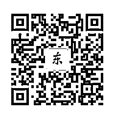