# 新手挖掘风向标，如何提高中标率？
作者：龙哥

风向标命中率42%的挖宝心法，新手拿来就能用

大家好，我是龙哥，全职做📕护肤赛道。前几天鱼丸跟我说，我在风向标栏目一共发了50条，中了21条，也就是42%的中标率，让我来分享分享心得。看到消息的瞬间，我既意外又荣幸，先感谢龙哥盟的邀请。正好趁着这次整理，我把一年的风向标经验从头复盘了一遍，收获还真不小。

今天主要聊三件事：新手也能上手的风向标挖掘法——评论区+淘宝/拼多多组合拳；怎样写出差异化的风向标；以及我刷风向标时离不开的3个小技巧。希望能给想提升中标率的圈友一些参考，也欢迎大家一起交流。

一、新手友好的挖掘法：评论区+淘宝/拼多多组合拳

现在开始写风向标的圈友真的很幸福。风向标航海手册里提供了十几种挖掘方法，航线图也把路径标得明明白白。新手只要跟着航线图，把每种方法都亲手做一遍，写出中标的风向标基本不难。

我写了大量风向标之后，发现自己最擅长的一条路径是：在📕笔记的评论区里找需求，然后去淘宝或拼多多搜相关关键词，快速验证这个市场的规模和需求热度。

如果你是新手，真的建议多去评论区看看。很多潜在且未被满足的需求，都悄悄藏在评论里。我的中标风向标里，很多就是从评论区挖出来的。

拿P图月赚200w这条风向标来举例，完整复盘一下我当时怎么挖到它的。

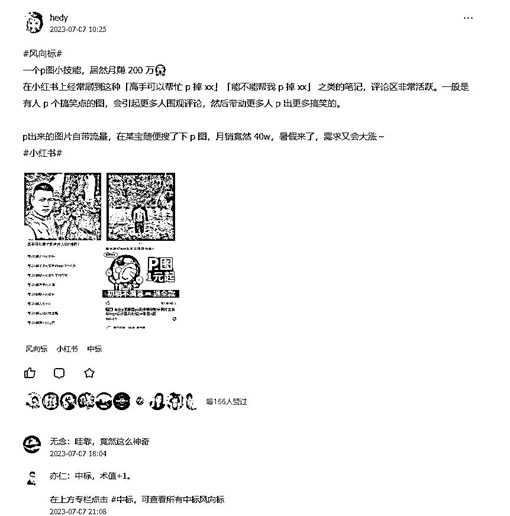

一共5个步骤：

1. 在📕刷到一篇推荐笔记，主动点进去看；

2. 连着翻看十几条带图评论后，发现很多人都在求“P掉路人”之类的操作——评论区的需求信号出现了；

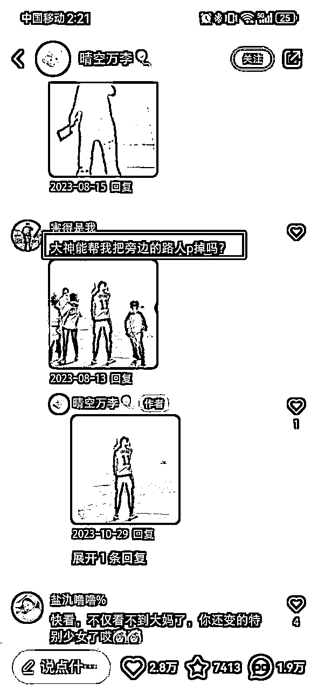

（PS:当时发风向标的截图找不到了，时间有点对不上，大家看思路就好。这张图从时间线看，也能间接说明P图需求一直挺大。）

3. 刷的过程中猛然想起，两个月前同事在淘宝花30元找人P了几个字——正好和个人经历连上了；

4. 在📕站内搜【可以p掉】，调出下拉词，用下拉词初步验证需求；

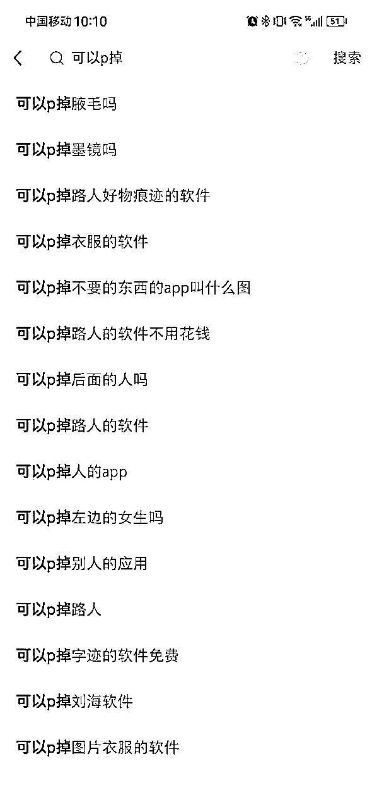

5. 再上淘宝搜【p图】，发现月销量居然有40w——付费需求和市场规模都得到了验证。

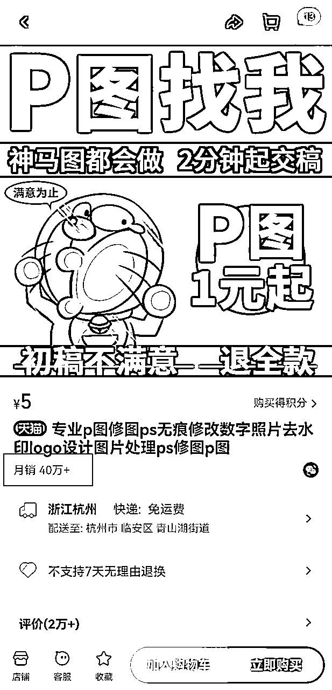

到这一步，“靠P图赚钱”这条风向标的信息链就完整了：📕上P掉各种东西的需求旺盛，淘宝月销量已经冲到40w。

再考虑到发布时是7月初，暑假马上到，外出游玩的人一多，拍照需求自然跟着涨。加上疫情放开后出游恢复的大背景，无论看短期高峰还是长期趋势，我都觉得这个项目值得写。

风向标发出去后，有圈友评论说，这玩法看到过好几次，但就是没想到能发风向标。我最初刷中标帖时也一样：明明我也刷到过，为什么别人能写成风向标，我却没有？这种状态很正常，商业嗅觉本来就需要长期喂养。

不过写了四五十条之后我发现，刻意练习“刷评论区+淘宝/1688/拼多多搜索”这套组合拳，非常适合初期挖掘赚钱信息。

除了P图那条，下面这条中标风向标，也是用组合拳挖出来的。

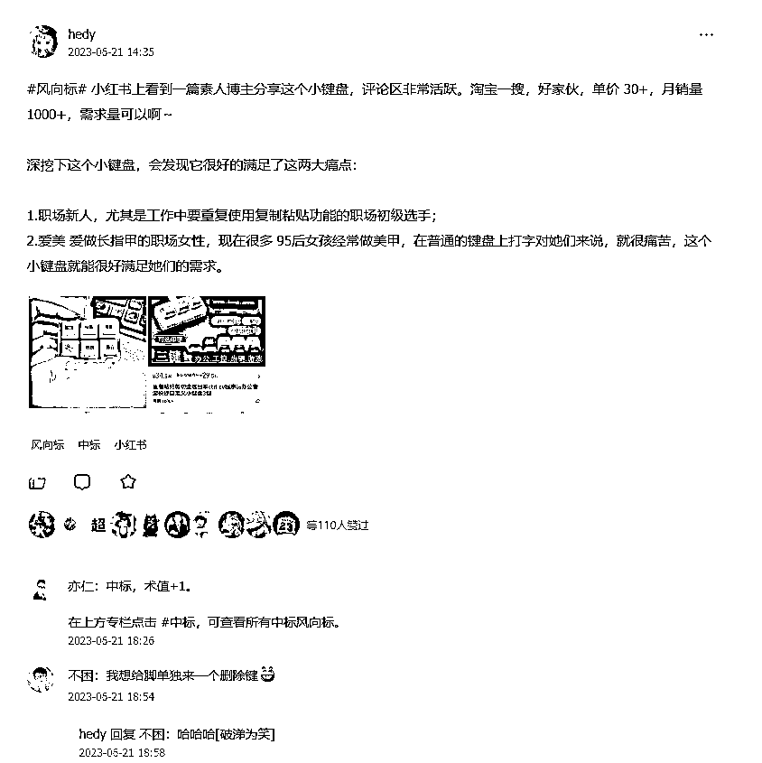

另外，这套组合拳不只是挖产品和服务需求，单纯深挖评论区，也能延伸出不同垂直领域的赚钱线索。比如从评论区的【脚臭】需求，一路做到账号定位。

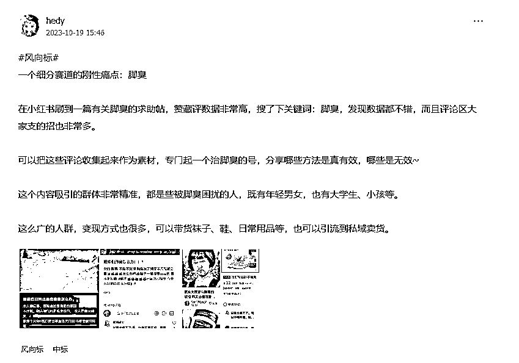

这条风向标是怎么来的呢？

先是刷到一篇讲脚臭的求助帖，笔记文案很有趣，一下子就把我吸引了。

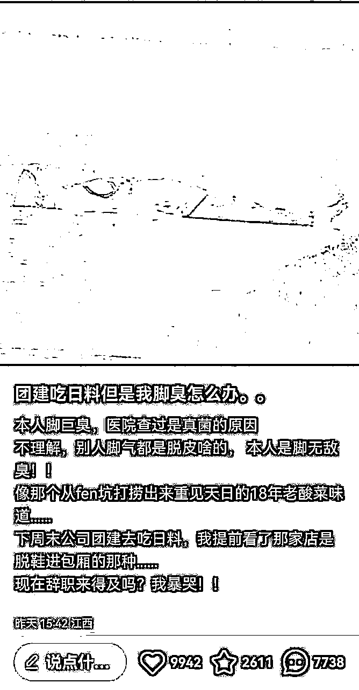

再点开评论区，发现评论量涨得非常快——异常值出现了。快到几乎每秒钟都有人留言。以我自媒体人的敏感度，确实被这种流量惊到了。接着我搜了一下【脚臭】这个关键词，发现需求不是一般地大，各个年龄段都有人困扰，而且网上出的办法也特别多。

综合这些信息，我的结论是：这个困扰足够扎心，用户想解决的意愿非常强烈。

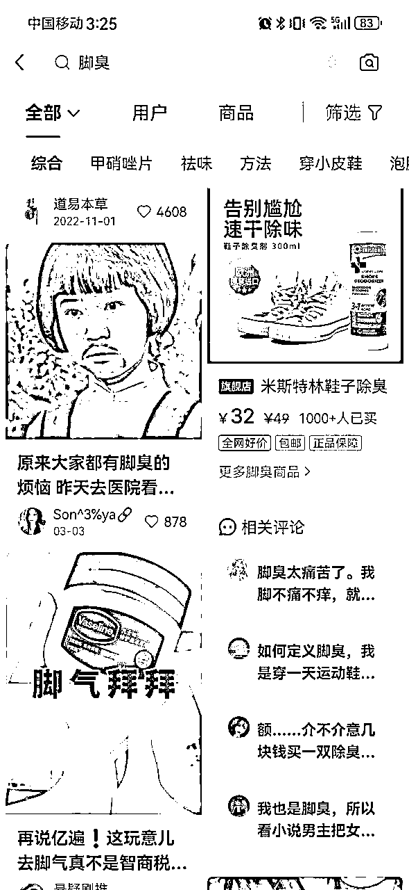

那么，一个普通人看到这么痛的痛点，要怎么变现呢？

作为自媒体，我第一反应就是做账号。成本低、容易操作。用内容把精准人群吸引过来，之后在📕挂链接带货，或者引到私域带货，都能跑通。

内容选题也不难，做一个治疗脚臭的信息汇总就行。

就这样，一条关于脚臭的风向标完成了。

最后，建议大家把圈友整理的评论区需求词库保存下来。日常刷评论区时，有意识地关注那些指引词，商业嗅觉就能一点点练出来。

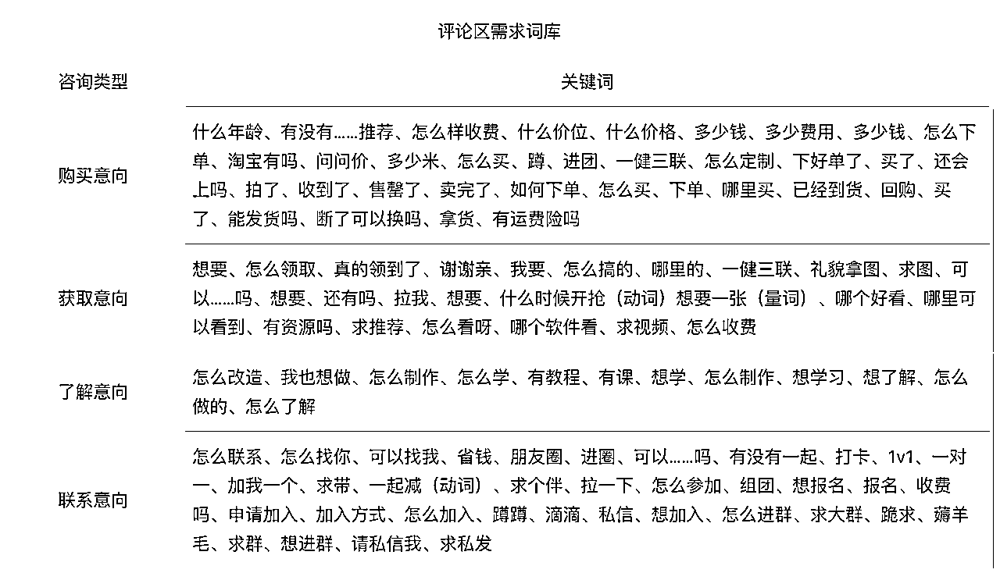

二、怎样写出差异化的风向标

在评论区挖到需求并发上风向标后，很多新手会面临重复的尴尬。就这么放弃吧，心有不甘，毕竟时间和精力都花下去了。

我也遇到过这种情况。我的解决思路是：从需求、产品/服务、流量、变现4大板块的不同维度切进去写。

拿📕夜校这条举例。我发布之前刷了下当天的风向标，发现有圈友已经抢先写了。

但仔细分析以后发现，他写的内容主要集中在热点本身——年轻人上夜校，以及夜校为什么会火。至于怎么触达那些上夜校的用户，完全没有提到。

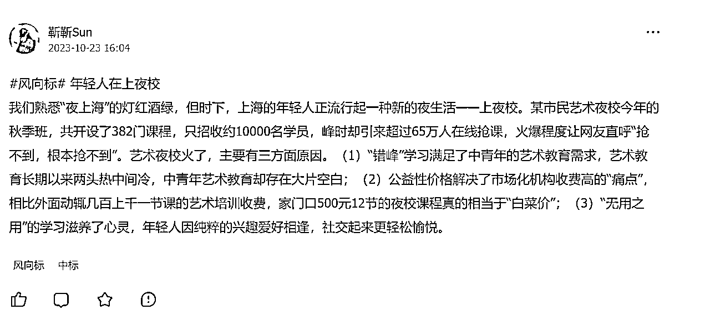

于是我就借“夜校”这个热点，从【流量】维度写了一篇：通过分享北京夜校相关课程的📕笔记，在📕建群，再引流到私域。这套玩法搬到其他城市同样能落地。

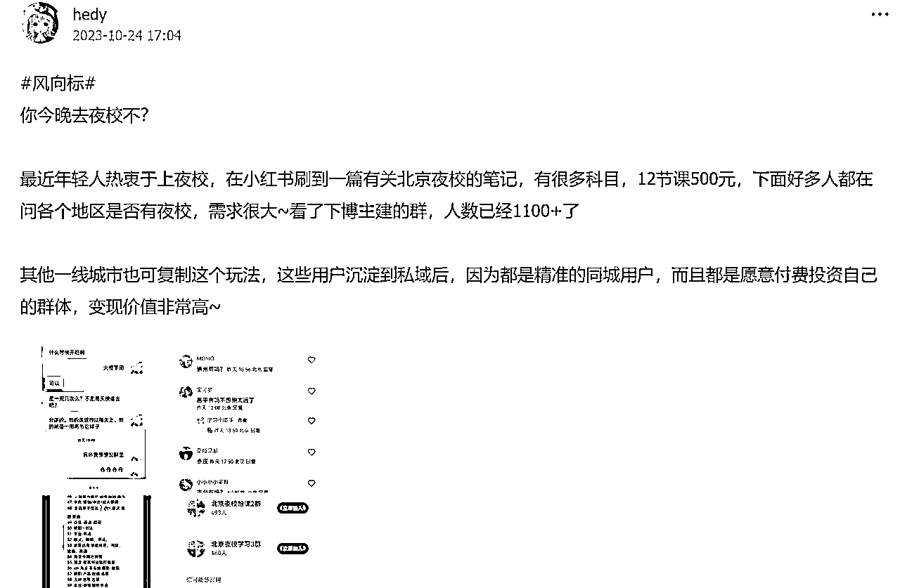

果不其然，这条也中标了。更值钱的是，通过这次经历，我学会了从不同维度去审视风向标，以及赚钱背后要考虑的各个要素。这种认知层面的收获，比中标本身更让我有成就感。

所以，下次撞上同题风向标时，先别急着放弃。换个角度拆解，你可能会拿到更多。

三、3个刷风向标的小技巧，帮你拉高中标率

最后分享几个我平时刷风向标的私人经验。不是我自夸，每个月都能稳定中标，真的离不开这几个小习惯。

1. 定时刷，别用碎片时间

操作很简单：给自己安排一个固定的整块时间，而不是想起来才刷两下。比如每个月15号，这一天专门用来刷📕、抖音或自己常看的平台，目标只有一个——写出能中标的风向标。

碎片时间有个坑：新手很容易被内容本身带跑，最后完全忘了要发风向标。我以前就是这样的，后来改成集中时间写，中标率才慢慢上来。

2. 把自己当成龙哥

还有一个低成本练商业嗅觉的办法：别直接看中标风向标，去刷最新风向标。然后把自己想象成龙哥，提前预判哪条可能会中标，并想清楚原因。

我个人建议，每天下午4点前把当天的新风向标过一遍，遇到有潜力的就点赞、截图。到了晚上10点以后，龙哥通常已经把当天的中标结果筛出来了，你再把自己押中的和实际结果做对比，看看猜对几条。

坚持一周，你就能对“什么样的内容会中标”形成完整体感。我的感受是，用这种扮演法，对中标的理解比自己直接看中标帖要深刻得多。好比让你当一次出题人，答题准确率比自己闷头刷几百道题高效多了。

3. 从熟悉中找差异化

最后一条经验：从自己熟悉的领域、熟悉的平台入手，更容易捕捉到异常信号。

比如下面这条关于差异化的风向标，就是我在上班时发现的。

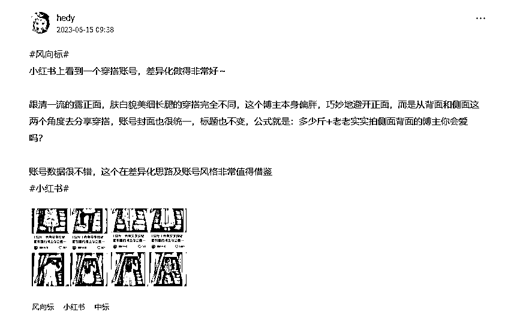

当时我还在职，负责给公司新出的衣物喷雾做推广，需要找穿搭类的📕达人种草。因为预算有限，我只找万粉以内的达人。在品牌蒲公英后台设置条件筛选时，意外看到了那位博主。

虽然最后没有合作，但她的账号信息我一直印象很深，就顺手发成了风向标。

所以，如果你本身就是某个平台的重度用户，那就优先从那个平台去找你感兴趣的内容。因为你最熟悉，也就最容易察觉异常。看到异常，机会往往就藏在里面。

以上就是我今天的全部分享。再次感谢赚钱官方的邀请，祝大家在航海期间写的风向标都能百发百中，商业嗅觉越练越灵！