# 跑通15个航海后，我总结了这套“副业项目实操手册”

加入赚钱快一年，看着大家频繁出海，我也亲手跑通了好几个项目。这次我打算把赚钱里的航海项目全跑一遍，从里面提炼出一些共性，让自己之后能更理智地跟踪项目状态。我以前做过项目经理、数据分析师，总觉得只要踏实实践，完全能做出一个通用工具，所以这次一口气报了15个航海。

这套模板融合了PMP、数据分析和其他常用工具的思路。它能帮你快速在每一个项目上做复盘，也能让你更快发现自己哪里不足，还能更方便地和导师、圈友交流。希望新的一年，我们都别在犹豫里耗着，把所有可能赚钱的项目挨个试一遍，找到最适合自己的那个，早日赚到钱。

## 01 找项目：先把数据囤够

找项目不能靠感觉，第一步是疯狂收集数据。项目平台、变现周期、项目收益等，能拿多少拿多少。先别管数据合不合理，数量足够才有筛选空间。当然，数据准确性也要同步关注，否则会误判方向。下面这张表是我整理出来的字段：

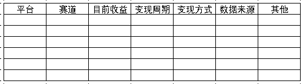

这个表头不是死的，填的时候发现缺什么，自己加字段就行。拿几篇赚钱的真实案例做示范：

- 聚光投放做广东公司团建业务，从0到1半年做到200万营收；
- 小白从0到1跑通小红书电商渠道，4个月卖了1000斤福州鱼丸，变现5万；
- 小红书做新西兰旅游，半年销售额260万+；
- 设计师下班后做小红书，一年涨粉1.3万，副业月入1万+；
- 夫妻搭档做英语培训，通过小红书月入20万。

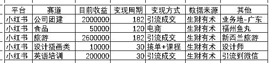

把这些案例填进去，哪些项目值得做、哪些不符合期待，一眼就能看出来。我筛选项目时主要盯两个指标：变现周期和变现金额。如果算来算去，收益或时间都达不到心理预期，就果断换，这个项目不适合你。

数据质量的重要程度再强调也不为过。它直接决定项目成败，也决定收益天花板与底线在哪。前期收集数据时，如果身边有资源，优先去问已经跑通的人，或者身边懂行的朋友。

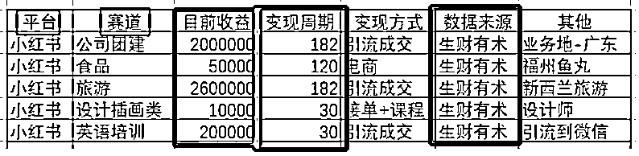

平台+赛道这两个信息，通常看一眼就能判断，很难造假，不需要太担心。真正要重点核查的是当前收益、周期和数据来源这三项。尽量问身边朋友或微信圈友能不能给个相对准确的数字；没有的话就看相关帖子数据；再不行就付费买课或直接付费咨询，拿到真实信息再继续。

拿到数据后，还要做一套验证：

- 一致性检查。对内看不同项目之间是否自洽，比如团建业务和新西兰旅游这两个案例，变现方式和周期都比较接近；对外则是把数据拿给做这个项目比较久的大佬看，问是否符合他的预期。
- 连续性检查。两篇分享的时间间隔不能太大。如果一个年初、一个年尾，时间隔太久，数据一致性就难以保证，最好找同期发布的内容。
- 完整性检查。除数字外，还要看是否包含业务逻辑、方法、感悟。虽然这些不会体现在表格里，但相关内容越多，数据越可靠。
- 综合验证。最后结合自己的实际场景做整体判断，这个需要长期积累经验。

特别提醒：小心数据陷阱，尤其是辛普森悖论。如果收集数据时没有合理分类，很容易被整体数据骗了。

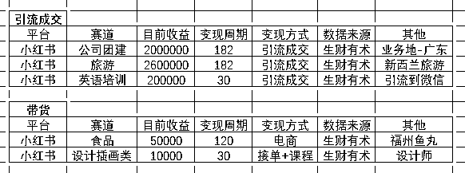

举个例子：引流成交类项目和带货类项目的收益量级差很多。自己做笔记类内容，月入1～5万比较合理；做引流成交类项目，收益可能到20万左右。如果笔记类账号突然出现几十万月入，或者老牌引流项目只有几万收入，不把类型拆开就做分析，结果很可能失真。

## 02 拆项目：盘点硬条件和软资源

项目定了之后，拆解成六个模块来看。

技术需求：

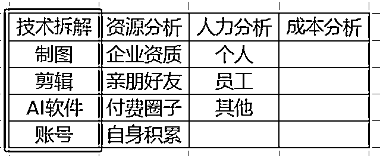

抖音、小红书、B站、视频号等视频平台，剪辑能力是基础；图文平台看首图，PS、创客贴、稿定设计等工具要会用；文案灵感不够，可以学一下GPT指令，调出一套能批量出文的prompt；某些平台需要大量账号，接码平台或电话卡也算技术储备。

资源分析：

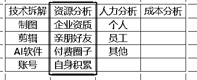

看项目需要哪些资源：企业资质——平台是否要求企业或个体工商户资质，自己有没有能用的？亲朋好友——是否需要大量个人账号，身边亲戚朋友的手机号和身份信息能不能协助注册？付费圈子——现有圈子里有没有相关资料，能不能支撑项目？自身积累——已有知识够不够，是不是还得额外补课？

人力资源：

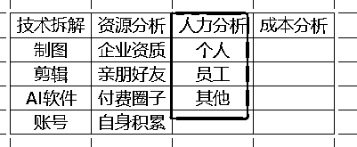

项目前期要几个人，每人每天投入多长时间，心里要提前有数。这直接决定投产比。很多小项目拼的就是人力，如果时间成本太高，就划不来了。

成本分析：

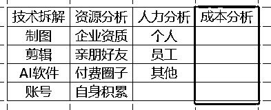

该花的钱都要列出来，比如GPT账号20美元/月、服务器成本、付费工具成本等。

竞争对手分析：找3～5个竞争对手做对标。这里我直接用通用表格。

对标库通用：

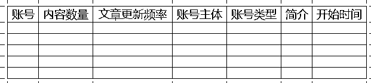

建立对标库，记录账号类型、更新频率、简介、头像等信息。

内容通用：

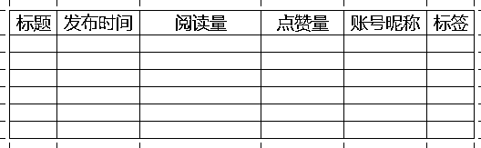

建立内容库，收集爆款帖子，分析阅读量，快速模仿，但质量要超过对方——借鉴对方，超越对方。

## 03 论证项目：动手前先过四道关

第一关，SWOT分析。

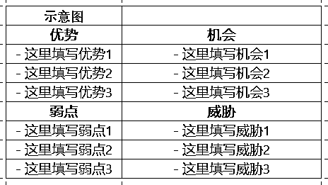

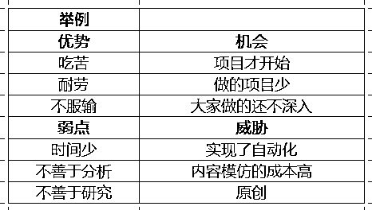

这关是看自己适不适合。比如项目需要大量时间，但自己平时忙得要命，就别骗自己说时间挤一挤就有。对自己诚实，才算有效分析。

第二关，贝叶斯分析。

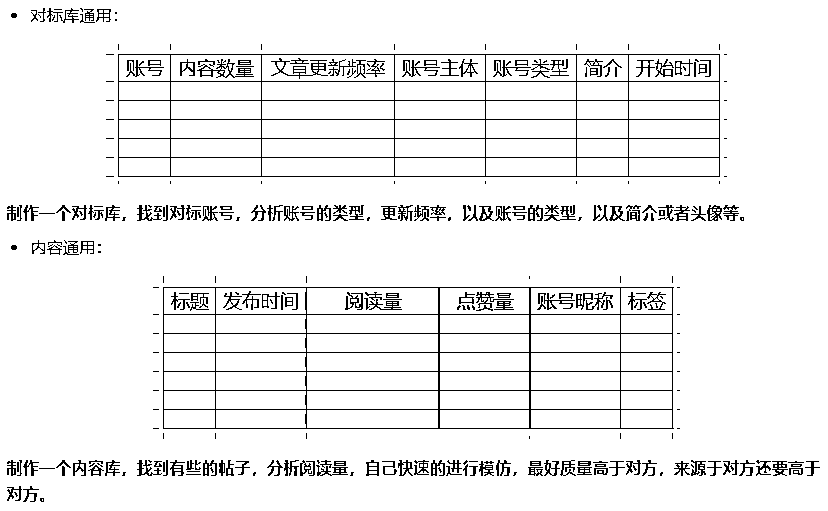

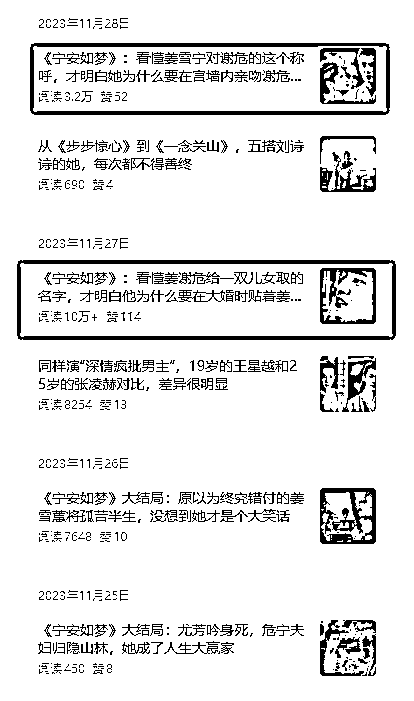

把对标库的数据填进去做概率判断。假设对标对象有12项数据，你的数据越接近，就越可能成功；如果对方有121项数据，而你只有1～2项接近，成功率就很小。要么做出创新，要么只能认命自己是天选之子。

第三关，最好/最差分析。收集的数据常有两极，有的阅读10w+，有的只有39。别拿极端数据骗自己，去找平均值，这才是账号多数时候的真实状态，提前心里有底。

第四关，风险管理：

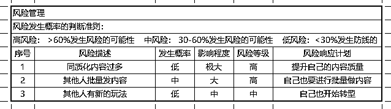

风险描述要覆盖识别、评估、优先级分配完整流程；应对策略则需要针对不同风险类型准备具体案例，方便执行时快速解决。

## 04 执行项目：记录比记忆靠谱

开始做项目后，遇到的问题要客观记录，别全塞在脑子里。把每天做了什么、踩过什么坑写下来，请教别人时也能快速说明情况。这里推荐参考《一页项目管理表》。

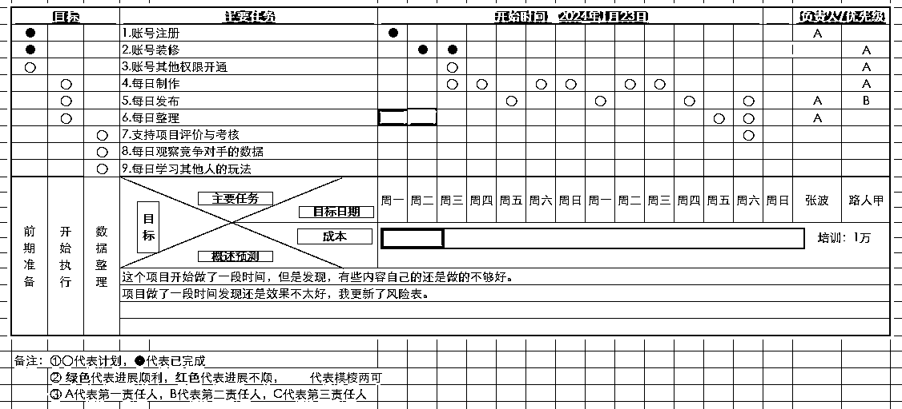

WBS拆解：

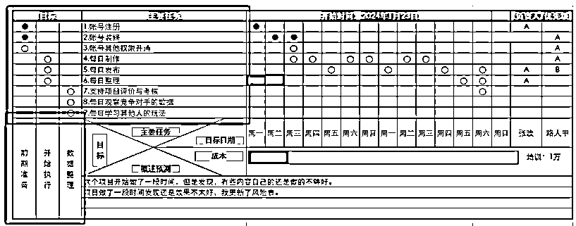

图中红框部分就是WBS。把项目分成几个阶段，每个阶段列明该做的事。任务拆解要合理，不要把内容堆在一起，要在自己实际条件下拆。逻辑是：项目→任务→工作→日常活动。大项目先拆成任务，任务再拆成可执行工作，最后落实到每天的日常动作。

进度表：

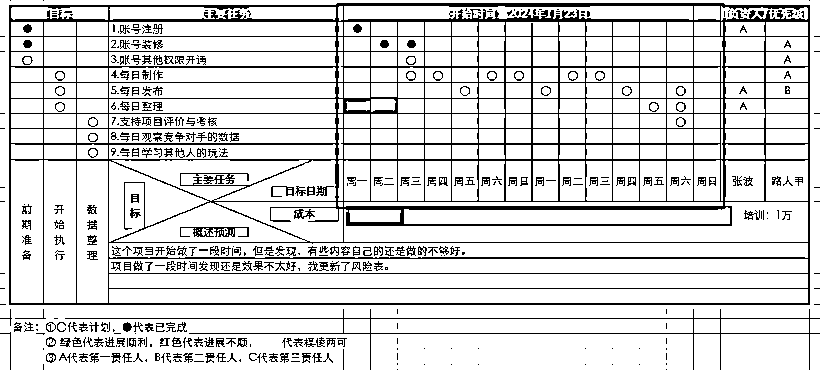

用图示填充数据，可以有效跟踪进度、监控项目时间表，方便后续及时追踪。目标日期建议精确到天，每天做了什么一看就知道，方便复盘。如果有新的操作，在“概述预测”里补充就行。

责任分配矩阵：

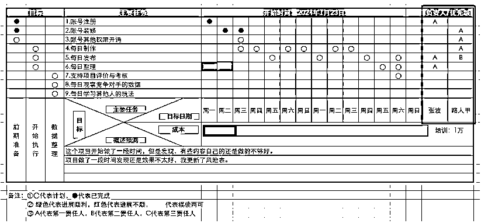

用RACI矩阵做实例，每个人按职责做事，记录越细致，越容易定位问题。沟通与协作也要做好记录，比如向别人请教了什么，自己做好了记录，后期复盘才有依据。

风险管理更新：

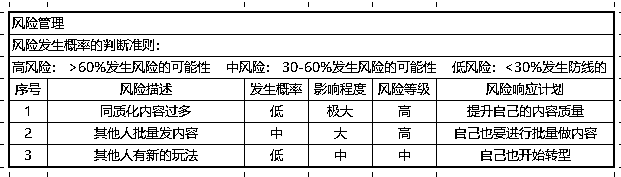

项目推进过程中，风险管理必须持续更新。及时掌握动向、发现问题，别玩“不撞南墙不回头”那套，该分析分析，该整理整理。

## 05 复盘项目：用数字说话

数据/收益分析：

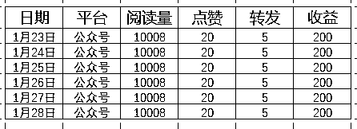

统计发布内容，以及阅读量、点赞、转发等指标，定期复盘数据，找到短板。收益方面，记录每天收益，看有没有递增、投入产出是否成正比、收益是在上升还是一直稳定。

执行表（进度、质量）：

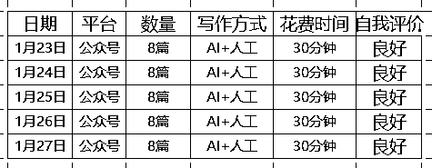

看进度有没有跟上目标，执行不过关的话，目标就只是口号。看写作方式是否仍然适合当前平台，有没有竞争力。控制投入时间，别做投产比太低的事。

## 06 规划未来：换道、加码、循环

换赛道：如果自己认真复盘、每个问题都考虑到了，效果依旧不理想，那可能真的是方向不合适，可以考虑换。但如果在一个平台测试出不错的结果，且技术有迁移性，比如抖音视频发到视频号或小红书，也许能打开意想不到的局面。

扩大规模：如果收益可观、时间投入不多，就可以考虑加账号。公众号爆文项目就是这样，很多人跑通一个号后立刻批量复制。小红书笔记也是，几篇数据好了，就逐步增加到每天多几条。

坚持复盘：

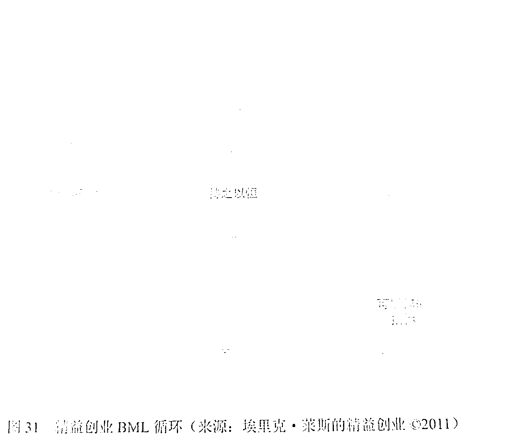

复盘是一个循环模式。一旦迈出第一步，就要在这个循环里持续转下去；要么彻底放弃，安于平淡，要么继续优化，直到挖出真正适合自己的赚钱路径。

完整的表格请访问：原文档。