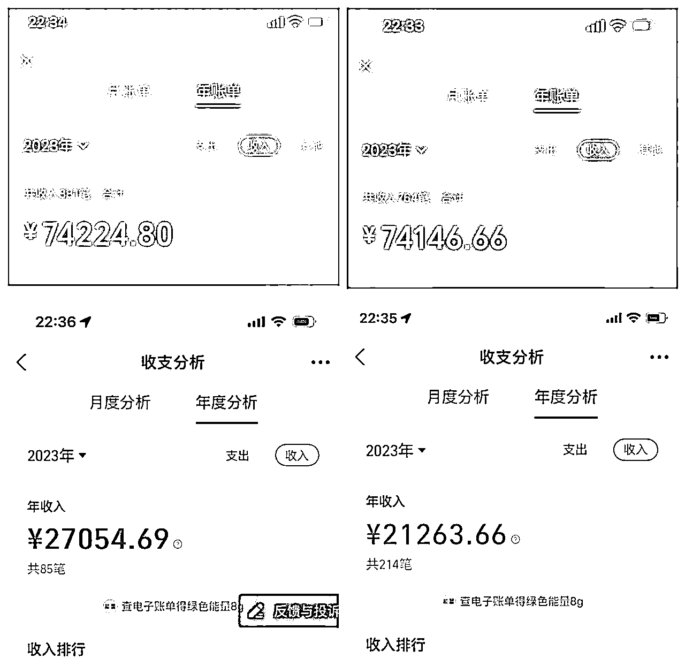
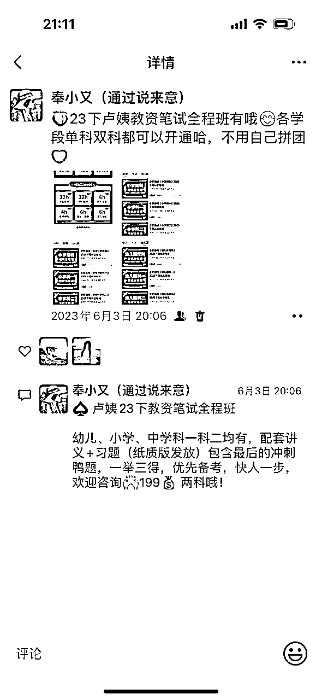
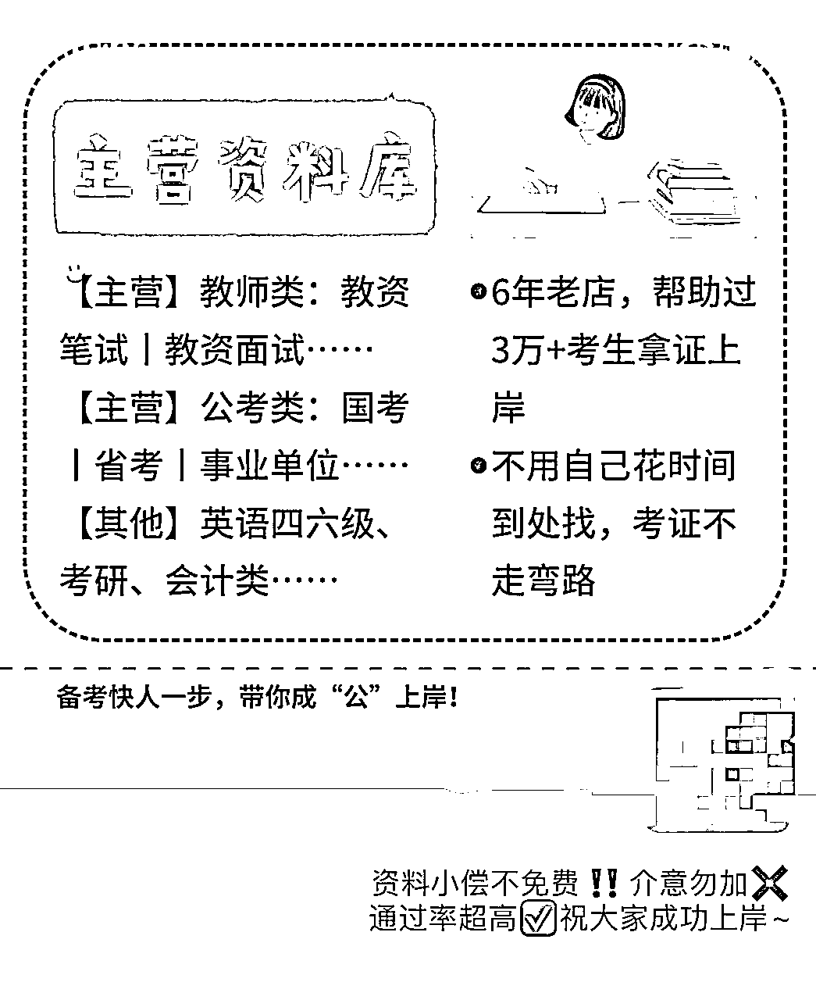

# 2023总结分享会，资料项目7天上手，没考过教资，如何提高专业度

2023年自媒体复盘：没考过教资，也能靠资料项目7天快速上手，月入1.5W都靠这3招

先给各位介绍一下，我是龙哥。

去年我干了一件挺大胆的事——裸辞，然后全身心扎进自媒体。算下来，2023年我的营收做到了19.67万，再扣掉合伙人那边的分销返点，加上从银行卡里提现的几千块团购收益，真正落袋的收入大约在18万。

这一年攒下的钱，几乎全交给了装修队。好在家里户型不大，装下来也就十几万的样子，正好跟我赚到的钱相抵。

日常收款的入口我有四个：两个🛰️号，两个支付宝。

说实话，跟同行里那些真正的大神比，这个数根本不值一提。但和我以前打工的状态比，那是翻了不只一番——平均下来每个月到手1.5万，而我离职前，最后一份工作的月薪到手才4500块。更让我满足的是，这一年创业的同时我还把娃带好了，真真切切实现了“左手育儿、右手事业”当年立下的目标。自媒体回馈给我的，远远超过预期。

其中贡献最大的，就是把我领进自媒体大门的起步项目：虚拟学习资料。

为什么我对这个项目死磕不放？之前在朋友圈也聊过，理由主要是这几条：

第一，它是目前我遇到的所有项目里，唯一一个能把自媒体综合能力快速拉满的赛道。从多平台运营、粉丝引流，到朋友圈人设、IP养成，再到产品的推广销售，一个项目全给你练个遍。可以说，资料项目你趟明白了，将来切到任何一个自媒体细分领域都会顺手很多。

第二，它直接补上你缺的“产品”这块拼图。很多人学了一堆运营、引流技巧，可账号做起来了，就是没有东西能承接流量、把钱收回来，结果只能看着好看的数据干着急。我也是从那个阶段过来的——号里有好几千粉丝，变现却不到一千块。但改做资料项目后，一个才600多粉的👸号，硬是给我带来了超过一万的营收。

刚上手那会儿，说实话我心里一点底都没有。熟悉我的人应该清楚，我主攻的是教资赛道，但我既不是师范出身，自己也从没报考过教师资格证。可就是这个背景的我，硬是靠着资料项目做到了能开笔试陪考班的程度，还先后带了两批学员，拢共15人成功上岸。陪考服务交付量比较大，为了保证质量，我每期最多收10个人。

凭啥？

不过话说在前头，我不建议新手一上来就奔着这种重交付的陪考服务去，我自己也是把项目跑了几个月、碰到瓶颈之后，才慢慢长出这条产品线的。

跟我一样没有证书加持的小白，要是想做资料项目，按照今天这套打法走，基本上7天就能进入状态。我自己的学员也是踩着这条路跑通的。

先说前3天，核心就一个字：练基本功。

第1天：把团队规则吃透。做这个项目通常都要进一个资料团队，团队会有一套自己的规矩。你得先搞清楚常用的资料都放在哪里；团队如果提供代更新服务，就花时间把更新流程、下单流程、题库开通流程都理顺。另外每个团队都有管理员，且分工各有不同，尽早摸清谁负责什么事，往后遇上问题才知道第一时间找谁。

第2天：把朋友圈收拾得像个“干这行的人”。拿教资赛道来举例，这一天的朋友圈就从资料截图、课程截图这些素材开始更新，每天稳定输出三四条。别嫌没人看就不发——等以后流量进来了，陌生人第一件事就是翻你朋友圈，空空如也的话，下单信任感从哪来？可以参考下面的效果：

顺带把朋友圈封面改成跟业务相关的视觉，昵称和简介也一并升级，比如“教资学姐”“安小小专注教资”，简介里挂上“资料齐全、欢迎咨询”类似的说明。参考示意见下：

如果你进的是网盘资料团队，云共享群里的存货就是你的“充电站”，抽时间快速过一遍，重点挑能提升专业度的内容。比如教资的公共课，每个章节挑一两节视频听一下，记一下授课老师的风格和亮点，以后给客户推荐时，话术会专业不少，底气也足。

接着去知乎翻翻备考干货帖，随便读个十篇八篇，对这门考试的重点和复习路径也就心里有数了；顺手还能研究下同行的打法。

第3天：动手打包产品组合。同行永远是最好的老师。去📕和👸号搜“教资笔试”“教资面试”，搜不到还可以换“教资作文”“教资结构化”这类关键词。看他们怎么引流，再用一个跟项目无关的账号去添加同行，亲身体验一下对方如何做转化，话术、产品、朋友圈全都留意观察。

每天加两三个同行，看着看着，“我该卖什么”这个答案自然就浮出水面了。

到了后4天，该真刀真枪跑实操了。

引流平台定在哪儿，就在哪儿开通账号，基础信息填完整，接着集中火力输出内容。

第1天，去📕注册账号，昵称、简介、头像一次配齐，然后进入养号期，疯狂刷同行的笔记。

第2天，开一个👸号，名称、简介、头像、菜单栏通通设置好，再写一篇“人设文”，交代清楚你是谁、这个号要做什么，文末顺手送出点资料。

第3天，压着之前收集的信息，列一份月度选题表，把每天的发布计划铺好。接着去🧣申请一个账号，到各个考试超话里蹲点，看看用户都怎么发帖互动。

到了第4天，📕账号也养得差不多了，正式进入全面输出阶段：📕、👸号、🧣三线并行。📕和👸号之间，内容基本可以一稿两用，微调一下开头就行；🧣更简单，熟练后一条不到一分钟就能发完。

内容摸不着头脑的时候，先模仿再原创不是丢人的事。去知乎刷几篇教资上岸经验帖，把考试科目、考核内容、难易程度摸个底，再把文章精华吃进去，重新梳理成自己的语言发出去，完全可行。

这里必须提醒一句：别盯着大博主学。他们的资料可能只是个引流钩子，真正赚钱的方式和我们不一样。前期建议找几百粉到一两千粉的小博主，他们的路径对我们才有参考价值。

接下来聊聊定价。

前面反复提到同行是最好的老师，定价这事也一样。拿着自己组好的产品，多问几个同行的价格，取一个中间值；要是对自己的交付有信心，再往上浮一点也没问题。定好价之后，从中挑一个核心产品，接下来朋友圈就重点推它。

核心产品的价位千万别压太低，想赚钱就得把它研究透。同样是差不多的内容，同行敢标128，那你就卖159，前提是你得附加一些别人没有的服务——专精一个产品，赚头一点都不会少。

拿教资举例，我又要推荐卢姨的课程了，它是真的容易出单。全程班一单利润能做到80，急救班也有20。你也可以自己把相关资源整合打包，再围绕这个点去主推，路子就通了。

说到底，这个项目就是两件事：引流+转化。前面那段会比较枯燥，因为人总得花点时间把陌生变成熟悉，熬过学习期，做起来自然就顺手了——坚持到第一单成交的人，一般都成了。

我自己也是从懵圈状态起步的，直到第一单砸下来，后面的路忽然就开阔了。

谢谢你能看到这儿，下一篇我会接着聊：做资料项目，怎么做到一年四季都有旺季。