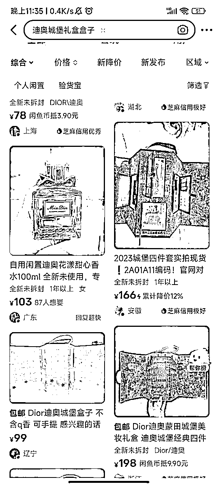
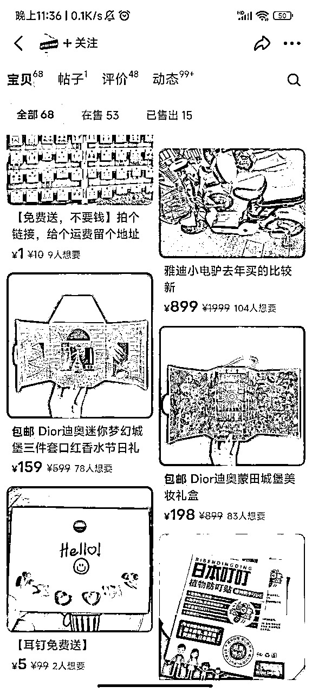
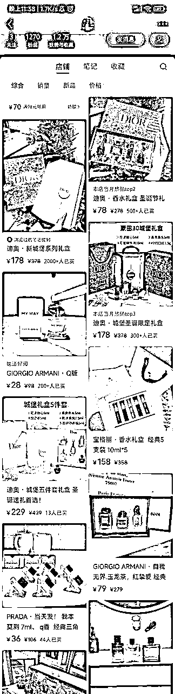
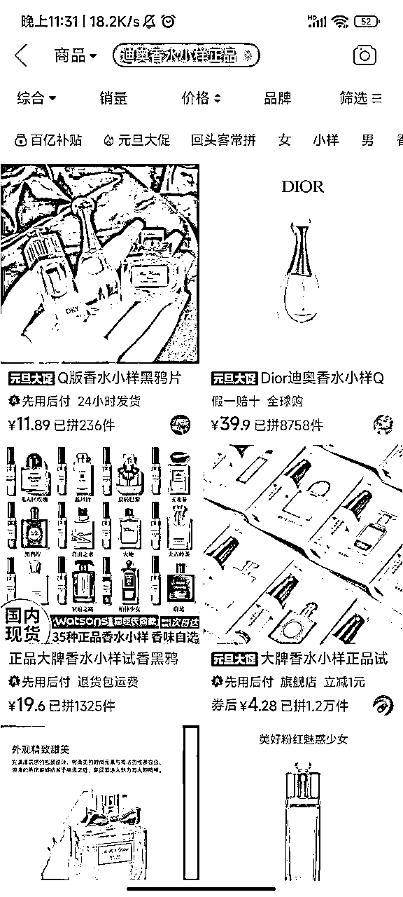
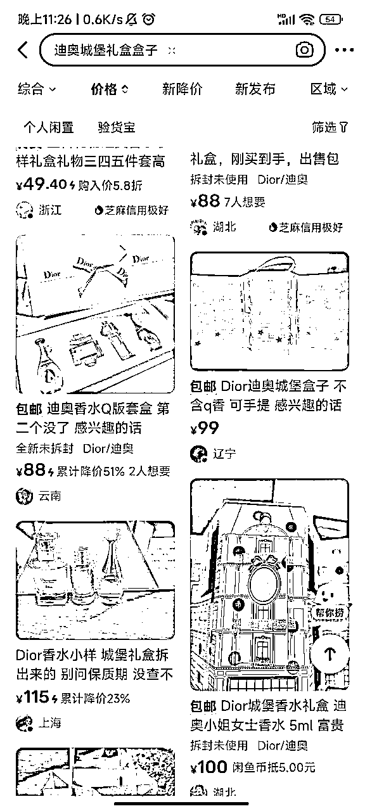
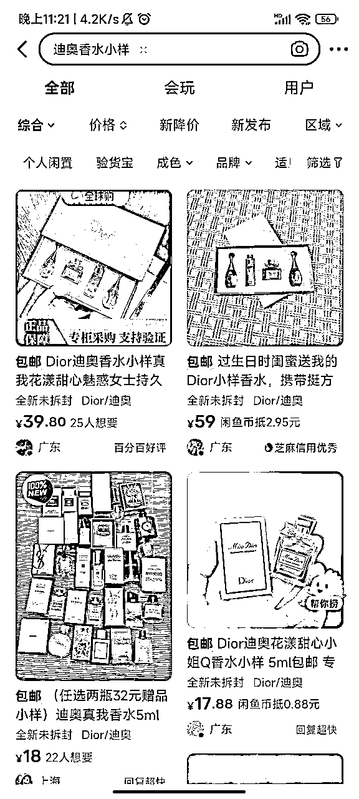

# 风向标拆解第2期：📕送礼号到底能不能赚钱？用“用味道写一封情书”这个香水号来扒一扒

做项目无非就两件事要搞透：流量从哪来，货从哪来。搞懂这两个环节，再算清楚成本和利润，最后看能不能复制放大，整个项目的底牌就全露出来了。

拆一个号，基本要回答清这四件事：
✅ 流量怎么养？
✅ 产品怎么找？
✅ 钱怎么算？
✅ 怎么上手，怎么放大？

下面就用📕账号“用味道写一封情书”来做实操复盘。

## 案例背景

账号定位是送礼垂类，专门做香水礼盒。起号方式很简单，就是靠图文带货，日更挂车。

为什么选它？
* 垂类店铺，专注香水送礼
* 纯图文起号，门槛低
* 单品销量2k+，带货能力验证过

## 一、流量怎么玩的

这个号的免费流量基本全在图文上。

图文近30天数据：
账号从12月3号开始发笔记。30天发了60篇图文，其中50篇都挂了车，基本全量导购。日更2篇，用数量堆爆款。内容很统一，就是同款香水不同图，大概每30篇就能蹦出一个几百赞的小爆款。
转折点在用了“显贵”这个词之后，流量明显抬头，后面笔记标题几乎都围绕“显贵礼物”做。

图文套路也很清晰：
多图展示，封面是香水外观。标题统一是“xxx却被误以为很贵的xx礼物”，精准狙击想送礼又想显得有面子、价格不贵的受众，退货率也相对可控。

视频近30天：
发了10条，全挂车，频率大概几天一条。应该是用来测内容承接图文流量的。

付费投放：
目前看不出明显投放痕迹。

总结：
图文是出单主力，挂车+高频更新+垂类+“高端不贵”人设，精准抓送礼人群。视频是补充，图文爆了可以再做成视频放大。

## 二、产品怎么解决

该号显示是📕个人小店。货源没公开，香水真假评论里也有争议，但不影响成交。

常见玩法有两种：

1）闲鱼拿货模式
闲鱼上能找到代理和散卖，可以整合发货。单品利润大概10%左右，但操作重。目前这个店的表现不像走这种模式。

2）自组礼盒模式
自己买空盒+小样拼配。
利润大概在10%-20%之间。
比如礼盒A：空盒100元+4瓶便宜正品100元，成本约200元，售价229元。
礼盒B：空盒80元+4瓶小样80元，成本约160元，售价178元。

## 三、利润怎么算

收益面：
利润率10%-20%，月销2000+件。

成本面：
开店要保证金、少许垫资、工商执照等费用。退货率行业普遍30%-40%，礼品类会低一些。

算笔账，假设月销售额40万：
最低情况：利润率10% + 退货40% = 到手约2.4万
最高情况：利润率20% + 退货30% = 到手约5.4万

扣掉前期开店成本，单店月净利稳定在2万-5万区间，是能赚钱的。

## 四、怎么做，以及怎么放大

### 怎么做
核心就一句话：持续发图文，靠坚持打爆款。

1. 开店准备：保证金+少量投流+垫资+营业执照，一个人建议最多2-3店，店太多容易连坐。
2. 开通橱窗挂车，需要实名认证。
3. 找对标模仿，选操作简单涨粉快的号去抄作业。
4. 选品：赛道越窄越好，比如只做香水。流程是选品-测品-小额付费测，单品一天能有20单，月利润过万基本没问题。选品看15天内起号快的同行新号。测品标准：5天内点击率超15%，支付转化超5%，就继续放量。
5. 图文制作：画质清晰，至少2张图。素材来自对标积累、其他平台、自己实拍。去重用贴纸、水印、抠图、拼图、换背景。日更至少2条，用量换爆款。

### 怎么放大
* 矩阵：1人可操作2-3家店铺，5个账号，每天10条图文，纯靠图文带货。
* 跨平台：📕跑通后，同样的图文+挂车打法搬到视频号、抖音、快手。
* 付费：付费主要用来测品，测出爆品靠自然流转化。ROI低于3就亏，基本不推。

## 结论
垂类图文+高频更新+爆款选品的送礼模式，是能做且能赚的。单店月利润2-5万，靠矩阵和多平台复制有放大空间。付费部分目前没有太多信息，但自然流的打法已经足够跑通。