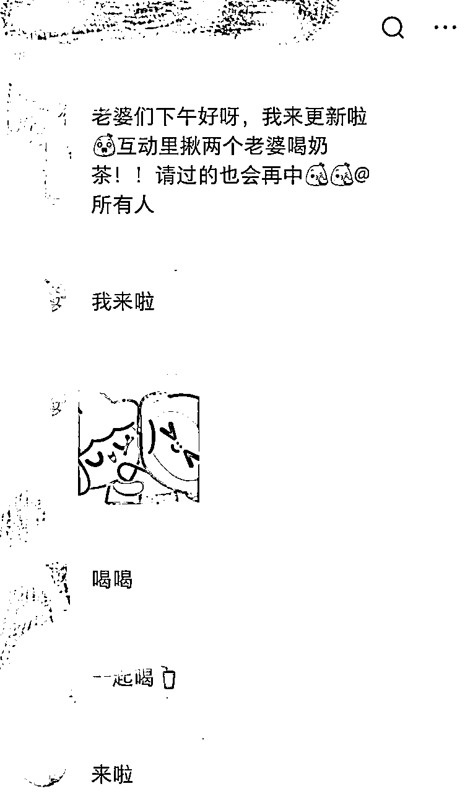
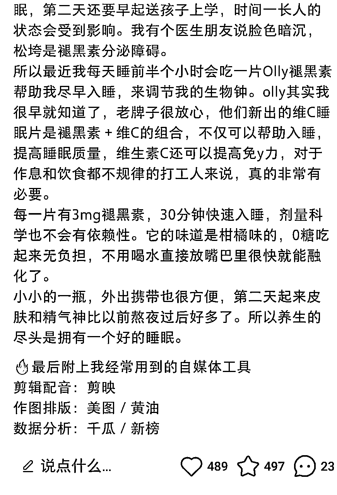
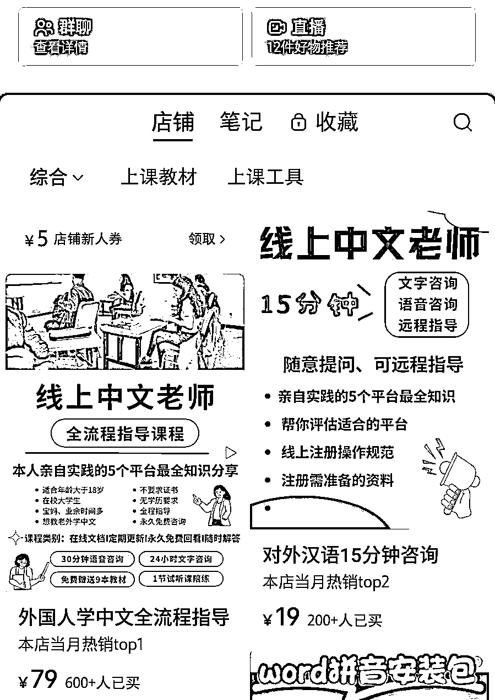
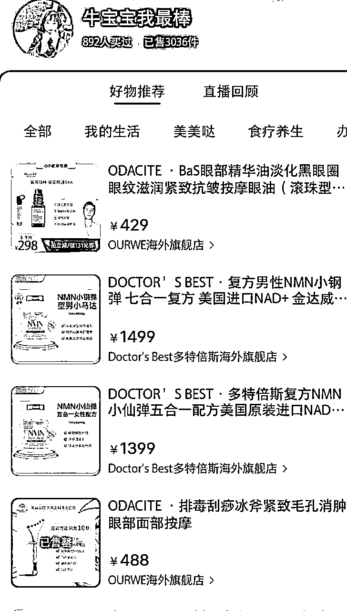
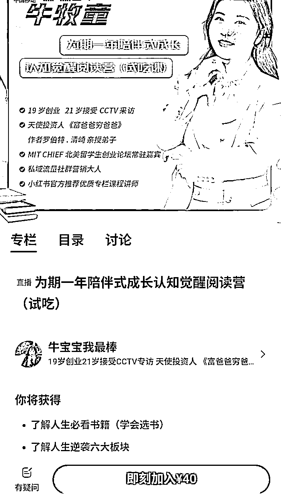
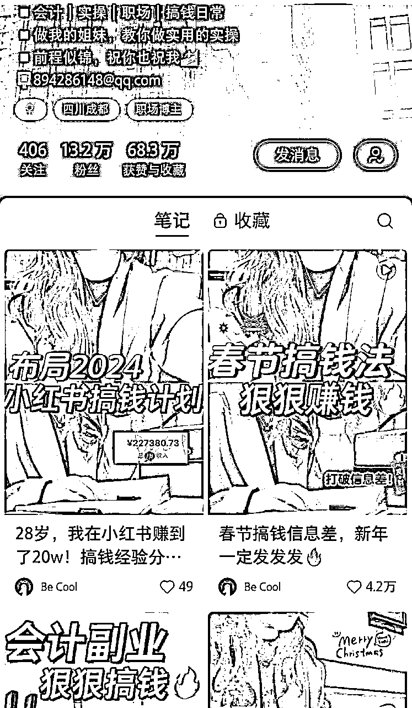
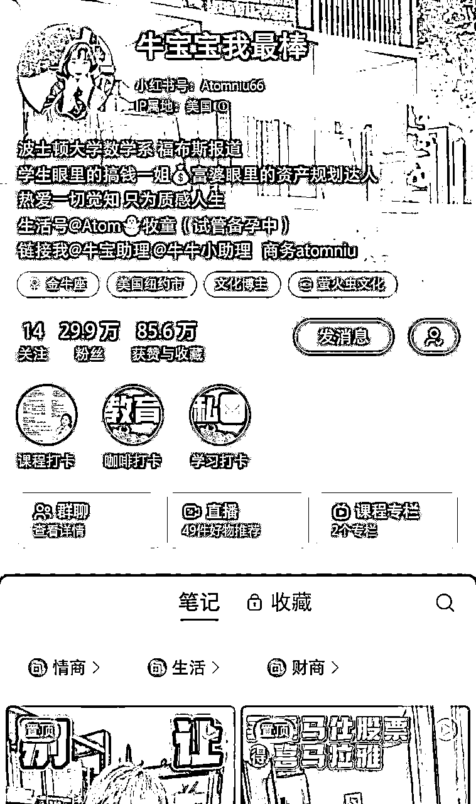
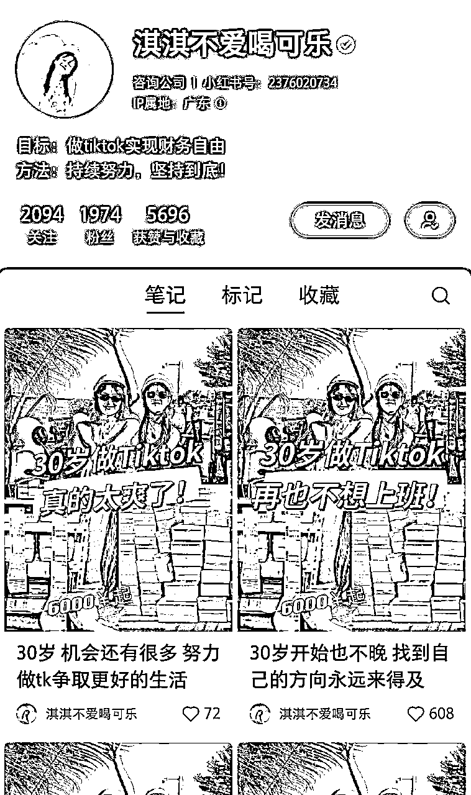
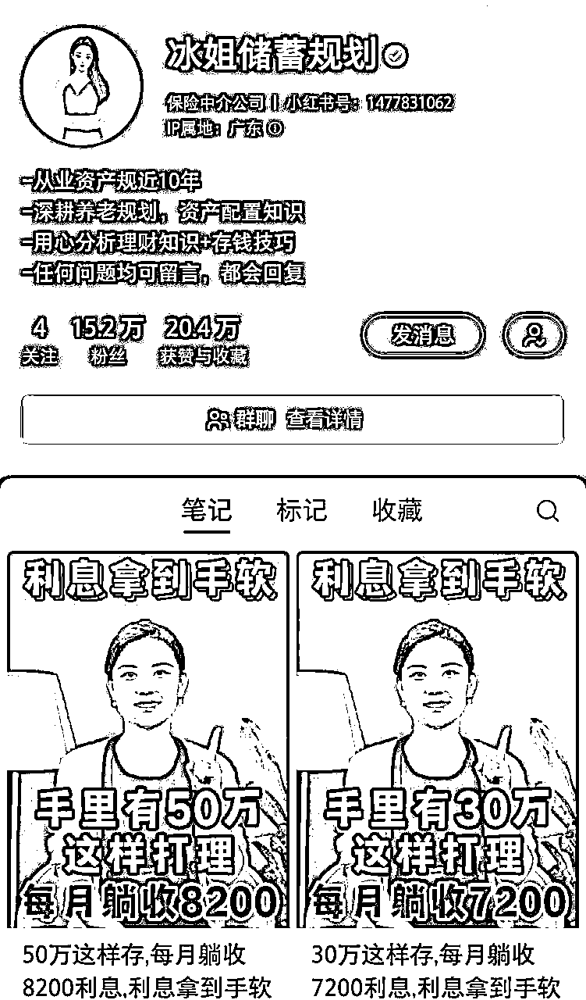

# 风向标拆解第 2 期--📕教人赚钱的博主都在玩些什么--薛佑佑
作者：龙哥

你有没有刷到过这种笔记：标题一个比一个猛，内容全是“教你搞钱”？比如“在家躺着也能赚美金”“做自媒体3年逆袭”“下班搞副业月入五万”。看的时候很难不心动，但心动完之后，你有没有想过一个问题：这些教人赚钱的博主，他们自己到底靠什么赚钱？

账号怎么运营的？流量从哪来？靠什么产品变现？又是怎么交付的？今天就把这帮“搞钱教头”的底牌一层层翻开看。

先给账号归个类。按人群画分，无非三种：上班族副业型——本质就是技能变现；创业型——自己做店、做自媒体都算；理财型——教人管钱。再说内容，翻来覆去也就三个套路：第一，讲经验，会计能接什么兼职、翻译怎么开发客户、写稿怎么赚钱，再加上自己做自媒体的心得；第二，搬信息差，把自媒体运营、AI搞钱、📕开店那套路子整理整理，不少还爱用“我有一个朋友”开头；第三，记日常，拍vlog/plog，时不时晒晒存款截图、收入截图，证明自己真的赚到了。

流量怎么来？主要靠笔记内容先把人吸引住，主页再挂上群聊、店铺、课程专栏等着用户点。有些笔记还会直接提自己的群聊、店铺和专栏，也有账号靠群聊把人导进私域。

粉丝怎么维系？分两头。站内就建📕群，给评论的粉丝抽奖，人留住了，评论数也跟着涨。 私域也不闲着，平时发发免费资料、建公益问答群、在朋友圈晒案例。

产品方面，说白了就三件套：课程——大课、1v1陪跑那种；服务——账号诊断、理财规划之类；社群——读书群、女性成长群、打卡群。

变现的姿势也就四种。接广告，品牌方给钱；卖课，大课、小课加陪跑；直播带货，挂车卖货；搞社群，收门票进圈。

下面拿四个号来拆。

第一个，上班族副业类，📕号1134488885。 博主本职是会计，内容围绕会计工作经验、能做的副业和自媒体心得来写，视频和图文混着发，全程不露脸。评论区几乎是会计同行在吐槽工作、倒苦水，流量精准得不行。变现主力是广告，最近笔记基本每条都带广。

第二个，赚钱信息差类，📕号Atomniu66。 主页挂着直播好物链接和课程专栏，内容以真人出镜视频为主，偶尔发图文，除了讲赚钱门道，也分享生活日常。变现路子很全面：直播带货已售3千件；财商课998元6节，已有293人购买；还有个阅读营社群，试听课40元一节，显示1036元已购。

第三个，创业类，📕号2376020734。 名字走的是个人IP风格，但认证了蓝V企业号。所有笔记全是图文，封面和标题一个模板，正文开头必戳社会痛点——女性要经济独立、上班打工工资太低，结尾统一留钩子说送免费资料，笔记左下角就是领取入口，点完会弹🛰️二维码，直接导私域。整个账号一共只发了4篇笔记，却攒了2千左右粉丝，篇篇数据能打，评论区清一色在要资料、求带。变现靠私域卖课。

第四个，理财类，📕号1477831062。 笔记清一色真人出镜视频，讲基础理财知识和方法，同样用“送资料”做钩子把人引流到私域。账号带着蓝V认证，背后是保险中介公司。人一进私域，服务就跟着来——比如资产翻倍增值方案这类。

说到底，赚钱博主能赚多少，因人而异，但分享本身总归是有价值的。手里已经做出成绩的，完全可以开个账号带小白上路；如果自己还是赚钱小白，那也能当个养成系赚钱博主，边学边记录。

这几天我翻了不少搞钱、赚钱话题下的爆款笔记，越翻越明白：爆款都是相似的。看多了之后，说实话有点审美疲劳。以前我也爱刷📕，指望提升认知，现在想通了——从输出的角度看，想吸粉就得不断研究爆款、模仿爆款；但要想提升认知，刷📕是刷不出突破的。新的一年，除了工作需要，闲下来还是多看精华帖、多翻书更实在。