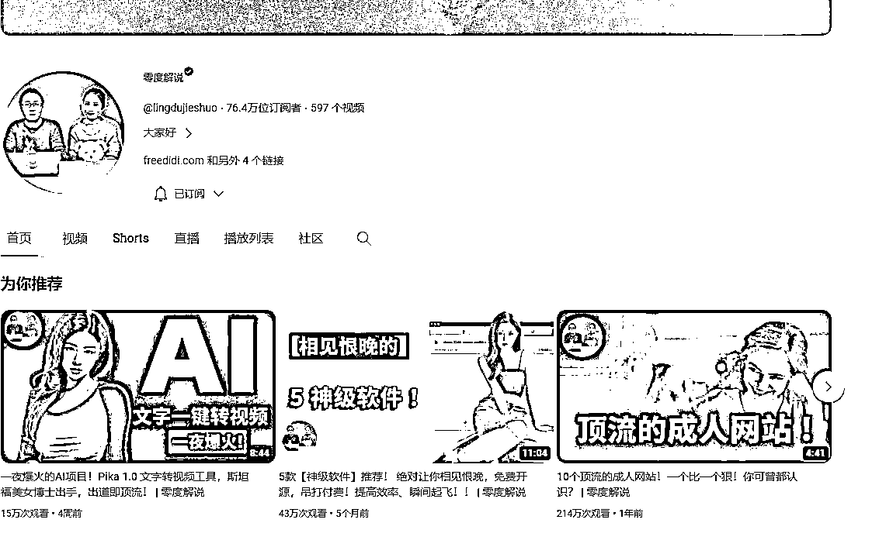
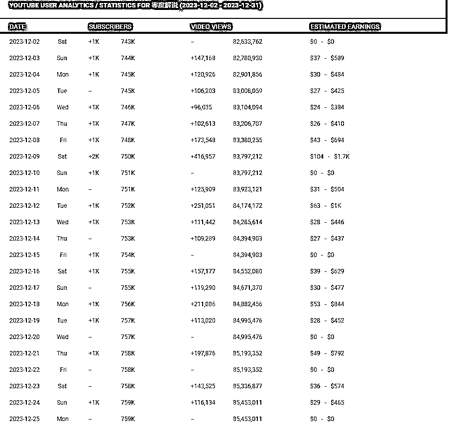
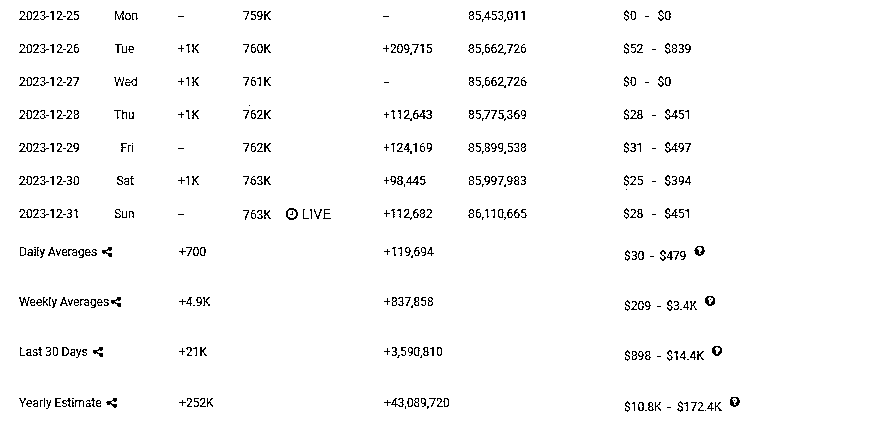
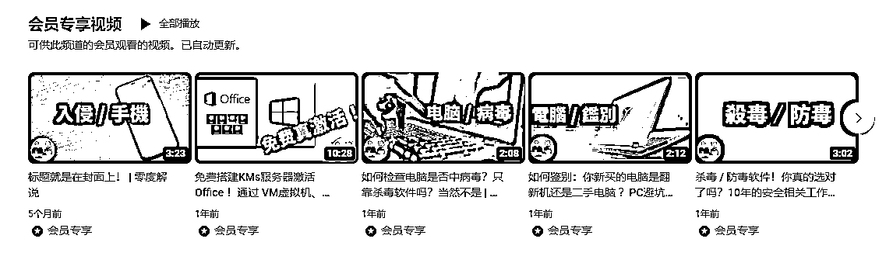
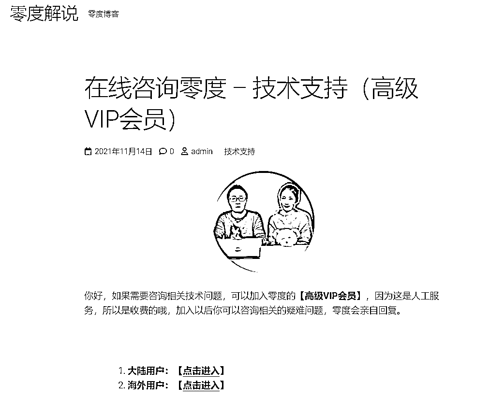
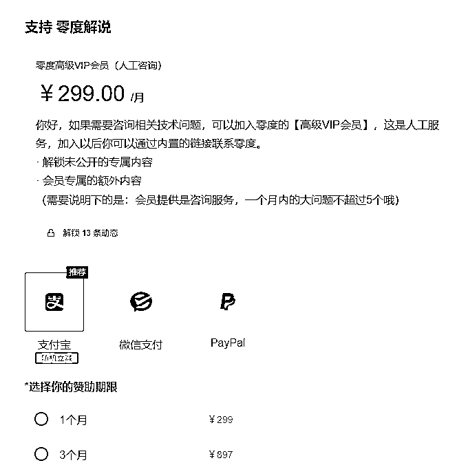

# 2023-12月风向标项目拆解

风向标拆解第2期

本次拆解选题：月入10万美金的AI工具类账号，成功逻辑是什么？

拆解人星球昵称：千知柠

案例账号零度解说概览：

该创作者主要在YouTube分享工具类知识与实操教程，属于中长视频更新模式，同时内容会同步到Facebook、B站等渠道。

选择拆解零度解说的理由：

a. 中视频是该账号的核心载体，也是主要流量来源，起号门槛相对友好。
b. 变现路径多元化，善于做跨平台分发。
C. 内容具备长期复利属性，单条视频可以持续产生收益。

#### 1.流量如何运作？

1.免费流量

零度解说的免费流量矩阵包含中视频、Shorts、直播以及社群互动。

周更的中视频是零度解说流量的绝对主力，Shorts只占很小比重，主要起到导流中视频的作用，直播和社群则偏向粉丝维护与需求挖掘。

中视频：

a. 内容形态统一为中视频，单条时长大约在10分钟上下
b. 更新频率为每周至少1条，旺季可达3-5条
c. 开场由真人出镜，后续讲解结合真人解说与操作截图
d. 每条视频均配有中文字幕，同时兼容简体和繁体
e. 单条播放量区间很大，从最低2.1万次到最高269万次
f. 视频简介区一般放置个人博客及社交平台链接、视频主题相关资源站、常用工具站如VPN、AI等，并会推荐几条相关优质中视频。

Shorts：

a. 短视频数量不多，均有真人出镜
b. 画幅全部为竖屏，并配有中文字幕

近30天数据：新增订阅21K，累计播放约347.77万次，预计收益在869至13.9K美元之间，折合人民币约6191.80-99.04万元。账号总订阅量已达76.4万。

2.付费流量

YouTube常见的推广手段有SEO优化、网红合作和广告投放三类。零度解说的付费推广支出约为200美元，即约1430.50元人民币。

近30天预计收益869-13.9K美元，推广成本200美元
按最低收益计算，ROI约为4.35%
按最高收益计算，ROI可达695%

#### 2.产品如何搭建？

产品形态可分为有货源和无货源两种。零度解说走的是无货源路线，核心是会员制，主要提供线上咨询和频道会员服务，未做实物带货。

产品具体形式：

a. YouTube部分视频采用会员分段，普通会员29元/月，高级会员299元/月含人工咨询。内地和海外用户分别有对应购买通道。
b. 个人博客网站也支持开通会员付费。

#### 3.利润如何测算？

核心公式：利润 = 收益 - 成本

收益口径：以近30天计，收益区间为869-13.9K美元，约合6191.8-99.04万元人民币。

利润率区间：2.45%-546.4%

成本总计：1812.72元

a.收益拆解
零度解说月收益约6191.80-99.04万元。

b.成本拆解
🪜费用47.57元，数据分析工具Keywords Everywhere年费106.65元约15美元，制图工具30元，付费推广1430.50元

综合净利润：4379.08元-98.85万元

#### 4.项目复刻路径与放大打法？

总结出的核心流程：

持续打磨视频质量，定期在YouTube发布工具方法论类中视频获取自然流量 —> 搭建个人官网，提供多种会员购买入口 —> 产品设计上区分引流款与利润款 —> 每月复盘利润 —> 对优质内容进行多平台分发并做平台化适配

项目如何落地：

1. 熟练掌握YouTube、TikTok等海外主流平台的操作规则
2. 在YouTube上明确定位并找到对标账号
3. 坚持每周更新，并不断迭代视频内容、音质、简介引导等细节
4. 起号初期以不依赖粉丝量的变现方式为主
5. 定期通过社群和直播话题与用户互动，精准捕捉需求
6. 粉丝积累到一定规模后，叠加视频会员、频道会员等付费模式
7. 后期可延展到在线咨询、一对一远程实操等高客单服务，提升营收天花板

项目如何放大：

a. 持续提升内容质量，单条中视频或短视频进行多平台分发，YouTube之外可同步到Facebook、Bilibili、TikTok等，扩大覆盖人群。
b. 扩充高价值服务，如在线咨询、远程一对一实操指导，进一步拉升收入。

* * *