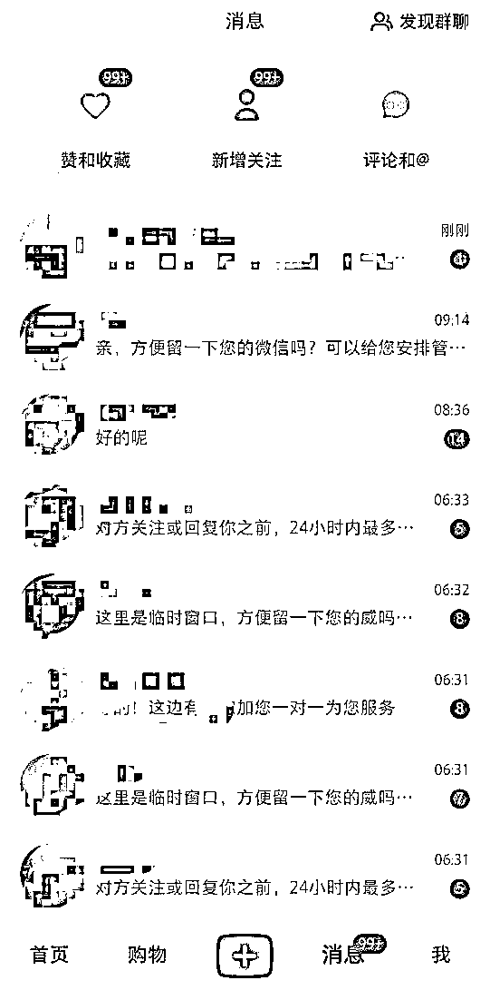
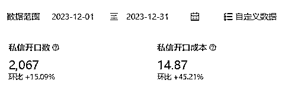
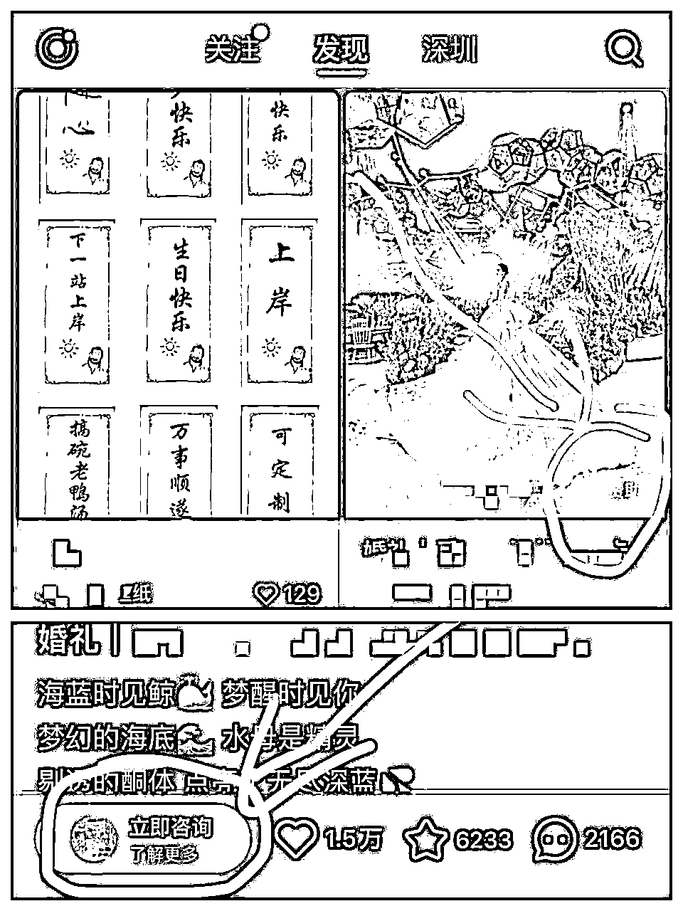
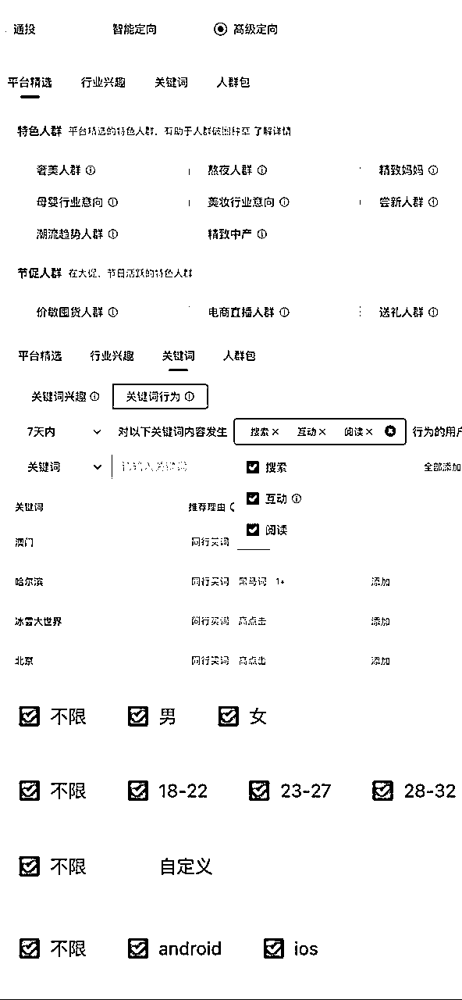
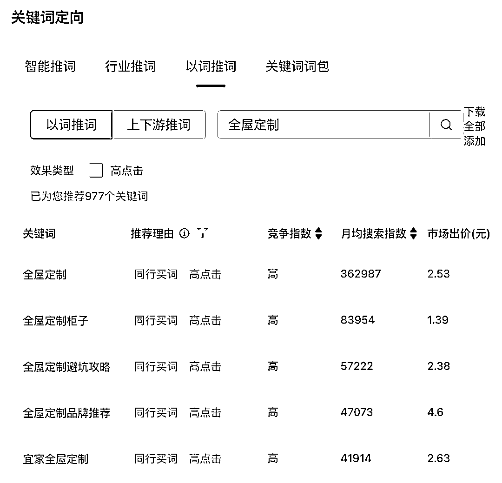
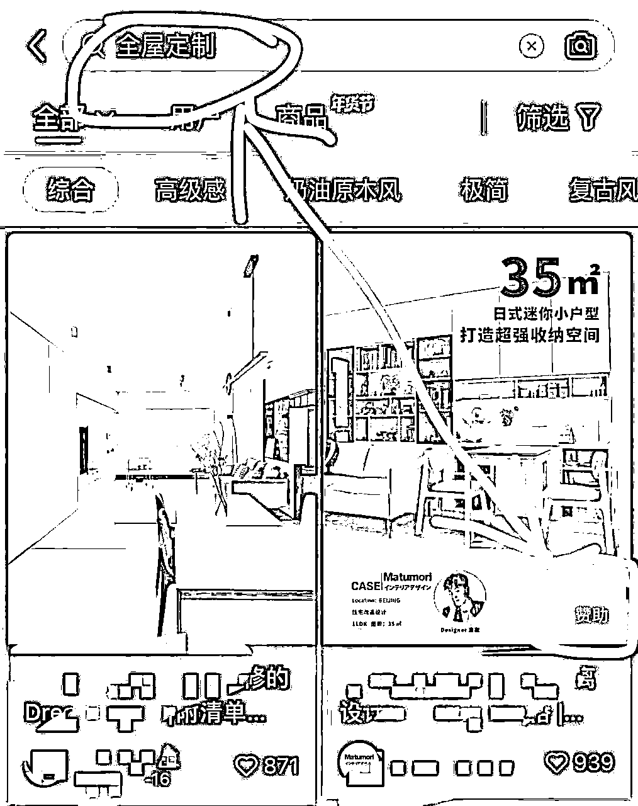
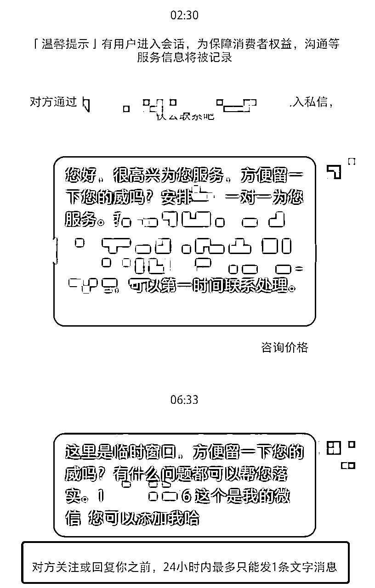
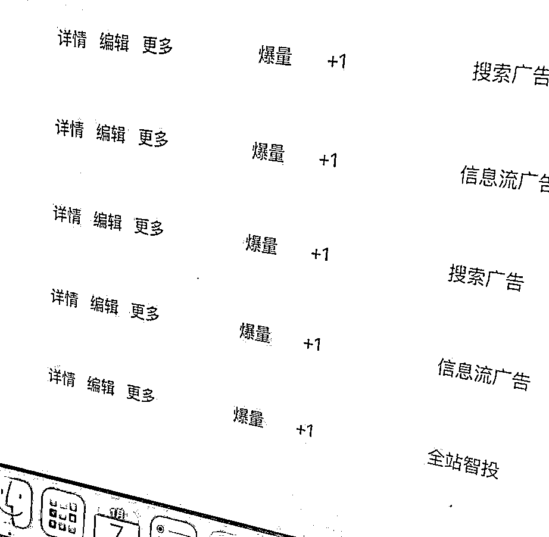

# 花8万投出40万利润，📕低成本引流实战分享

你有没有在📕引流这件事上，被“封号”狠狠教做过人？

做私域的人都懂，📕这个平台，真是让人既上头又头疼。上头的是，用户画像太精准了，质量也高，搞来的都是实打实的潜在客户；头疼的是，平台对个人号引流盯得特别严，稍有不慎，号就没了。

大家好，我是叁斤。大概从今年7月开始，我发现合作商家在📕上做正规引流终于被允许了，也是从那时候起，我试着去投聚光广告，结果真让我撞上了这波流量红利！

说实话，以前分享的那些个人号引流技巧，虽然现在还能用，但终归是“水下操作”，玩得心惊胆战。要想在📕站直了腰板搞客户，投聚光广告绝对是最快的官方通道。

给你们看一眼我实际在投的账号数据：

这个盘子的客单价不低，人均2W往上走，每个月广告消耗大概9W上下，但能换回来40W的利润。

具体是哪行我就不展开了，今天重点聊聊📕聚光广告的基础投放玩法：

# 目录

1.  聚光广告入门认知
2.  投放笔记怎么选
3.  投放数据怎么分析

# 一、聚光广告入门认知

在聊具体打法之前，得先搞清楚📕聚光后台的基本模块（这里只讲私信获客这个方向）。

## 1.1\. 目标选择

聚光广告的投放目标分这么几类：产品种草、电商推广、抢占赛道、客资收集。

如果你奔着私信转化去，真正用得上的其实只有「抢占赛道」和「客资收集」。只不过「抢占赛道」的代价太高，性价比一般，所以锁定「客资收集」就够了。

### 1.1.1\. 广告形态

主流广告形态有四种：信息流、搜索、视频、全站。

**信息流：** 就是用户刷首页时自然刷出来的广告，会带“赞助”或“广告”标识，笔记下方会挂“立即咨询”的入口。

这种广告支持按用户兴趣、年龄段、关键词等维度来圈人。

**搜索广告：** 用户搜索某个词后，在瀑布流笔记里夹着的广告。后台可以布控1000个关键词，每个词的热度、出价都一目了然。

不过要注意，这个位置不是固定的。你要是想死死卡在前三的位置，就得去投「抢占赛道」，那花费就上去了。

**视频广告：** 用户沉浸式刷视频过程中插入的广告，操作逻辑跟信息流差不太多。

**全站智投：** 系统自动匹配流量，把笔记同时推到信息流、搜索流里面，如果你的笔记是视频形式，还会顺带丢进视频流。

这几种形态没有绝对的好坏之分，都能筛人群。关键看你的产品属性和笔记素材适合哪种。拿不准的话，就把预算拆成几份，每个类型先跑一跑。哪个转化好就给它加预算，哪个跑不动就赶紧关掉。

### 1.1.2\. 投放目标

选完广告形态，还得定目标：表单、私信咨询、私信开口、私信留资。

-   表单：用户点开后是个信息填写页，填完即留资。
-   私信咨询：用户点“立即咨询”跳进私信对话，就算一次咨询。
-   私信开口：用户进私信后主动发了消息，算一次开口。
-   私信留资：用户进私信后主动递上联系方式，算一次留资。

跑得最多、效果也最稳的是「私信咨询」和「私信开口」。

但「私信咨询」有个坑：用户如果没有关注你，你24小时之内只能给他发一条消息。要是这条消息发完他没反应，这线索基本就凉了。

所以，除了设置好自动回复，你主动发出的第一句话，最好就直接把🛰️号带上。

## 1.2\. 投放时段

根据我自己的测试，每天咨询量最集中的时段大概是早上8点到11点、下午2点到6点，以及晚上9点到11点。

当然，不同行业会有偏差，同行业不同阶段也可能浮动。最稳妥的办法就是自己拿数据说话：先放开时段，只限预算，跑个几天看反馈，哪个时间段咨询进来最多，后面就把没量的时段关掉。

## 1.3\. 投放设置

后台设置里，真正关键的就两个：每日预算和私信开口成本。

新手刚开始跑，日预算设在200到500就差不多了，先跑跑看感觉。

私信开口成本（也就是单次开口花的钱）要仔细掂量。设太高吧，成本压力大；设太低吧，可能钱根本花不出去。所以得找一个自己能接受的中间值。建议从低价慢慢往上抬，直到找到一个既能跑动、转化也扛得住的价位。

# 二、笔记怎么选

虽说聚光能把你的笔记怼到用户面前，但广告到底有没有效果——点击率、转化率、获客成本，其实全靠笔记本身的质量来决定。

笔记内容够吸引人，广告费花小钱就能撬动大转化；反之，如果笔记看起来就是个硬广牌位，那就别指望转化能好看。

所以，素材的筛选之重，怎么强调都不过分。

## 2.1\. 笔记筛选标准

看笔记主要盯三个指标：点击率、转化率、基础数据。

-   **点击率：** 好笔记的点击率通常在11%以上。正常看笔记是看不到曝光量的，可以用薯条或小额广告测试一下点击表现。
-   **转化率：** 不是看点赞收藏，重点是评论区问的人多不多、私信咨询多不多。挑那些评论区一堆人问“怎么买”的笔记去投。
-   **基础数据：** 别去碰那种点赞互动极低的笔记，谁乐意点开一个0赞的内容呢？

## 2.2\. 新手测试笔记的方法

刚开始投，不知道选哪篇笔记的话，分享一套很适合新手的测试打法。

### 2.2.1\. 建一个大计划

先创建一个全站智投计划，把你觉得能打的笔记一股脑全放进去，设好预算，跑个3到5天。

因为系统是智能匹配，所以放进去的笔记最好选题相近或者同属一个产品线，这样人群会跑得更精准。

### 2.2.2\. 再拆单篇计划

大计划跑了5天之后，去翻总数据和每篇笔记各自的反馈。

看两个指标：总体的私信开口数量有没有达标？私信开口成本有没有低于平均水平？如果都符合预期，成本也能接受，就点开计划详情，把那些私信开口最高、成本又合适的笔记挑出来，单独再给它建一个信息流计划和搜索计划。

或者反过来，把没转化、转化差的其他笔记关掉，大计划里只留高转化的内容继续跑。

一般这么筛出来的笔记，都值得长期投放。可以一直投到它没流量为止。

# 三、数据反馈与调整

广告计划不是扔出去就坐等收菜，得时刻盯数据，随时做调整。

## 3.1\. 看互动

广告上线之后，要留意笔记的互动变化。

如果数据涨的只有点赞和收藏，没有评论也没有私信，那这笔记就不值得继续投了。

比起点赞收藏，更核心的是评论量。如果广告一跑，评论区冒出大量咨询产品的留言，那就说明这笔记路子对了，可以加码投。

对了，通过私信通可以直接去私信那些评论过的用户。所以哪怕用户只是把问题留在评论区，只要跟产品相关，你也能主动去捞他。

## 3.2\. 看咨询质量

很多人忽略了一个关键动作：咨询监控。

也就是要去看咨询过来的用户质量高不高、后端转化率怎么样。如果咨询量很大、单项成本很低，但来的人全是泛粉、转化不了，那这笔记照样不值得投。

记住，是“这笔记不值得投”，不是“📕不值得投”。问题多半出在笔记身上。

我自己踩过坑：投过一篇低价优惠类的笔记，一天能来几十条咨询，加🛰️的人也不少，几天下来🛰️加了500多个人，结果只转化了4个客户，转化率连5%都不到。

后来关掉这篇笔记，把预算挪到另一篇笔记上，私信量虽然明显降了，但一周能稳定转化十几个客户。

所以在投放中，一定要紧盯私信到成交的转化率。一旦发现转化走低，就赶紧换笔记、调内容。

## 3.3\. 计划调整

还有一种情况：你觉得笔记点击率不错，转化也没毛病，但钱就是花不出去。

这时候要动这几个方向：人群、关键词、出价。

-   **人群：** 如果人群圈得太死，触达量会非常小。钱花不出去，先试着放宽人群。
-   **关键词：** 关键词数量太少，同样会导致预算花不完。可以加词、放宽词，把精确词逐步扩展到相关词。
-   **出价：** 开口成本出价太低，系统自然不会给你太多流量。一步一步往上提，如果都提到行业均值了还是跑不动，那就回头检查前两个因素。

如果上面这通操作全试过了，预算还是花不出去，那就别死磕了，直接换笔记。

PS：怎么了解你们行业的平均成本？很简单——开户的时候会有📕直客经理加你，直接问就行。要是找代理开的户，逮着代理问也一样，他们心里都有数。

---

以上，就是私域获客投放的一些经验。企业想从📕稳定拿客户，投流这关绕不开。把这些内容吃透，足够新手开始自己的第一轮测试了。

最后，祝各位爆量发财。

