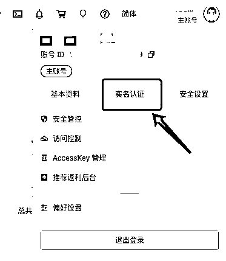
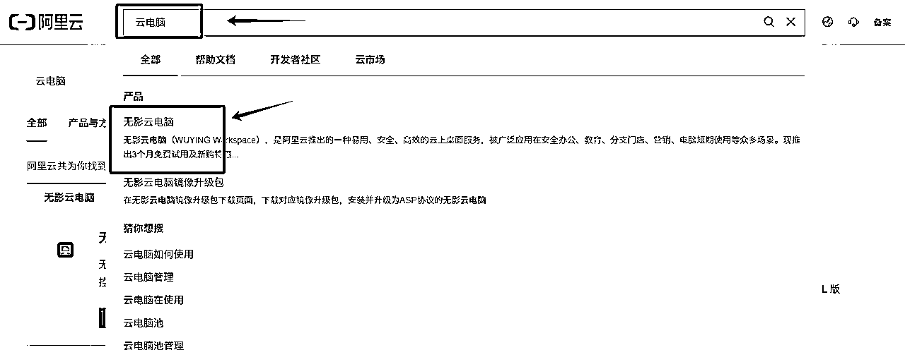
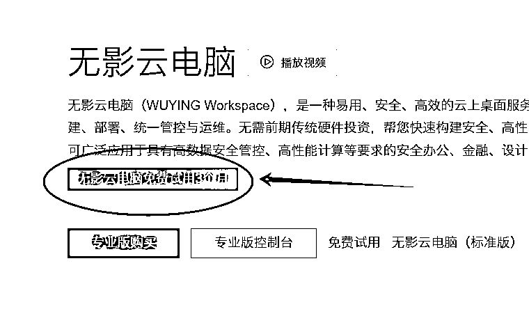
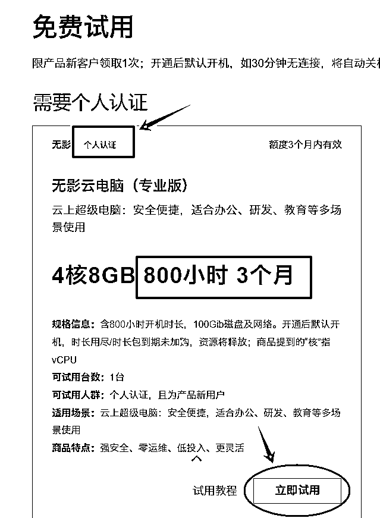
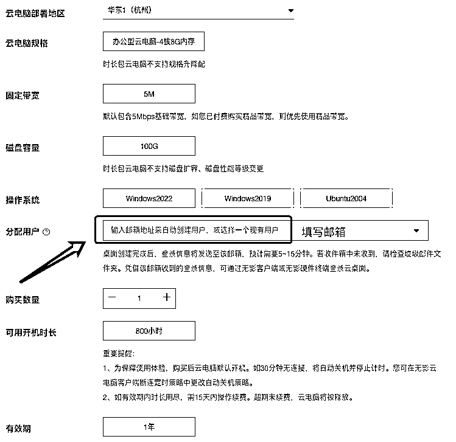
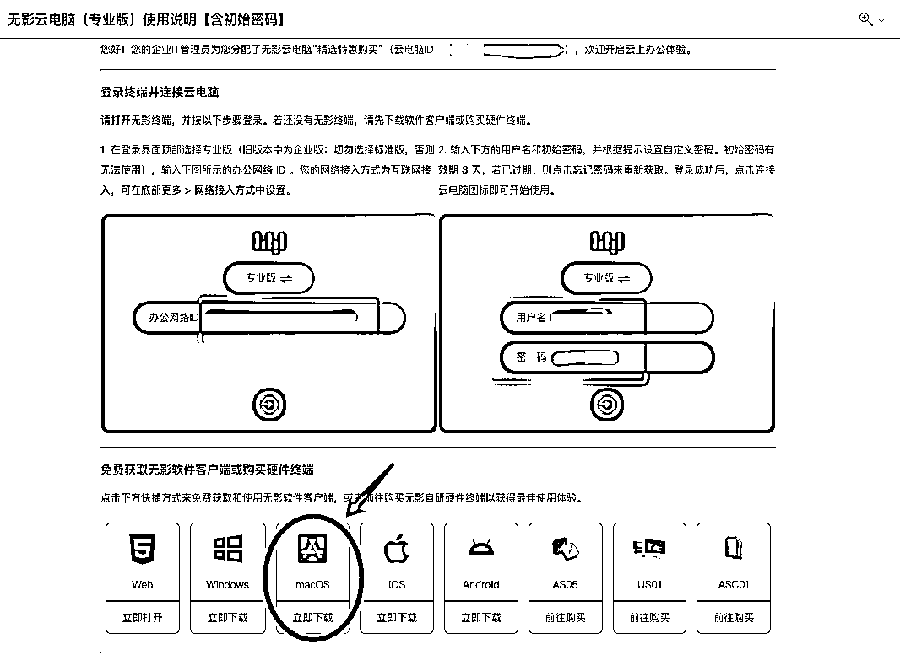
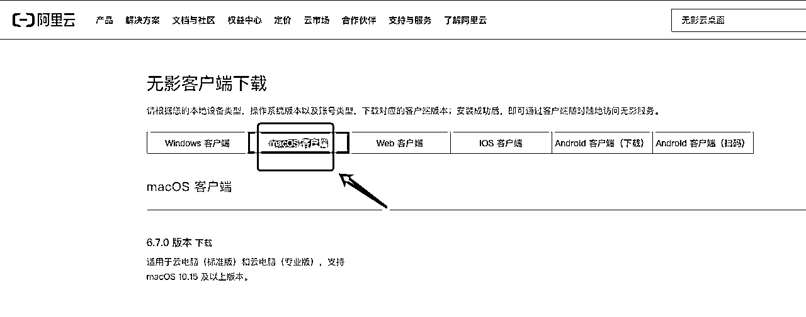
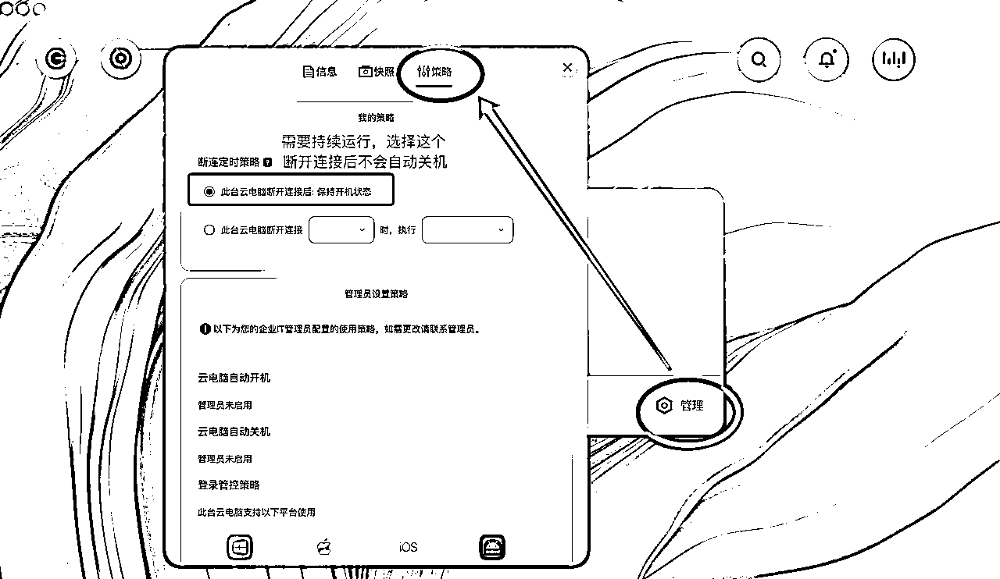
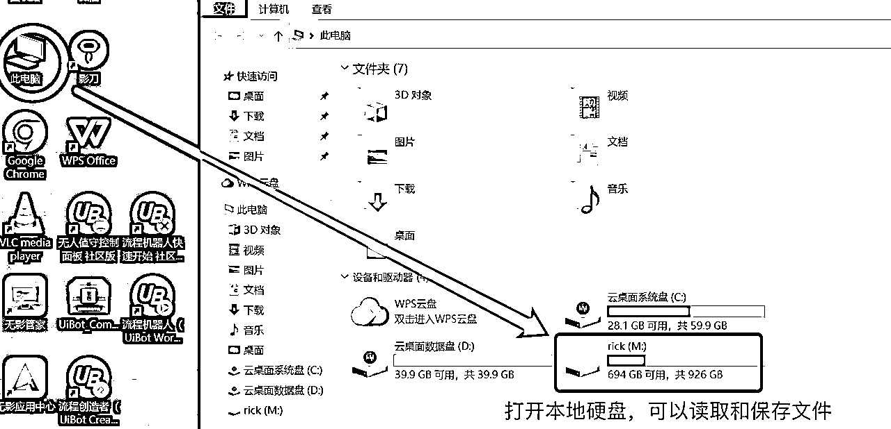

# MAC也能上RPA？用云电脑搞定，不用换机也不用折腾双系统

不少把Mac当主力机的伙伴，一头扎进RPA学习就先遇到了坎。UiBot压根没有Mac版本，影刀虽然出了Mac版，可功能完整度和稳定性跟Windows版比起来明显打折。

眼下专门去买台Windows笔记本等快递至少要耗上好几天，折腾双系统或虚拟机更是费时费力。那么Mac用户怎样才能花最少成本、最顺滑地开启RPA实操呢？

最近我也刚换了Mac，用下来觉得阿里云无影云电脑是个非常合适的免费过渡方案，核心优势有四点：

1. 新用户可领3个月免费试用，配额800小时，足以支撑从零到入门的完整练习周期。
2. 相比市面上其他云桌面，它的Windows环境还原度高，几乎不用额外调环境。
3. 官方提供了Mac客户端，远程操控体验很原生。
4. 试用到期后，年付199元就能续800小时，长期成本也很有竞争力。

有趣的是，这个思路对Windows用户同样适用。把RPA环境搬到云端，不会挤占本地电脑资源，想用就连上；本地Windows莫名报错、软件装不上时，也能先用云电脑把课程跟上，别把时间浪费在环境排错上。

下面是把RPA运行环境搬到云端的实操路径，一共6步：

1. 打开阿里云官网：https://www.aliyun.com/
2. 用手机号注册账号后，点击右上角头像进入“实名认证”，按提示完成。注意，免费试用仅限已实名用户。

3. 在官网搜索“云电脑”，进入“无影云电脑”产品页。

4. 选择“免费试用3个月”的入口。

5. 进入配置页，填入一个能收邮件的邮箱，用于接收云电脑的初始账号信息。

5. 登陆邮箱查收账号凭证，随后在页面下方找到客户端下载入口，用收到的ID和密码登录。

若邮件里的下载链接在Mac上打不开，可直接走官网下载页，手动挑选macOS客户端：

https://www.aliyun.com/product/wuying/download

6. 安装客户端并登录后即可进入Windows云桌面，自带Chrome浏览器，之后再装上RPA工具和WPS即可按航海手册开工。

默认策略是窗口关闭后30分钟自动休眠，这会影响长时间运行的任务。需要常驻运行的话，进入管理-策略里把休眠规则改掉即可。

为方便上手，这里直接放常用软件的下载入口：

uibot：https://down.uibot.com.cn/OFFICIAL/UiBot/6.0.1/UiBot_Community_Official_X64_V6.0.1_2022.06.29.1740.exe

影刀：https://www.yingdao.com/client-download/

WPS：https://platform.wps.cn/

🛰️PC版：https://pc.weixin.qq.com/

数据采集完成后，可在云桌面里打开“此电脑”，直接把结果拖到本地磁盘，也能反向把本地文件传上去。

搞定，Mac用户也能无缝切入RPA学习，Windows用户也能多开云机做批量。祝大家在自动化这条路上越走越顺。