# 小红书搞钱新赛道：拆解一个可复制的身心灵账号变现路径

## 为什么现在是身心灵的窗口期

疫情后，大多数年轻人的注意力从“怎么赚钱”转向了“怎么活得舒服”。在快节奏高压的日常里，大家渴望一种能迅速回血身心能量的方法。

白天喝枸杞红枣水养生，晚上靠正念冥想养心，已经成了身边人的标配。赚钱内部更是多次有头部玩家点名身心灵赛道潜力巨大，所以我们需要搞清楚这个赛道到底怎么赚钱，以及进入的门槛在哪里。

## 身心灵到底是什么

身心灵的核心诉求只有一个：摆脱痛苦，找回内外和谐的平静与幸福。

**身：身体层面**
聚焦生理健康与感官愉悦，包含健身运动、饮食营养、睡眠管理等。常见形式有舞动疗愈、芳香疗法、身体调理、瑜伽冥想、音乐疗法、中医调理等。

**心：情绪层面**
聚焦心理韧性与自我觉察，包括情绪健康、抗压能力、自我认知、情绪疏导、心理成长等。常见形式有情绪体验、正念练习、心理学工具、催眠引导、专注力训练等。

**灵：精神层面**
聚焦意义感与连接感，追求内在安宁与更高维度的自我整合。常见形式有儒释道、圣贤经典、佛学、国学、阿卡西记录、塔罗占星、能量疗愈、显化法则、命理风水等。

## 拆解模型：从需求到变现

**核心需求**
用户希望用身体带来的愉悦感来滋养情绪，再通过情绪疗愈来安抚精神。简单说，就是要被治愈、被陪伴、被安放。

**流量获取**
小红书流量分两类：
* 免费流量：笔记图文/视频、直播间、搜索关键词
* 付费流量：薯条投放、达人合作推广

**营销转化路径**
* 用免费体验课或低价入门课引流到私域微信
* 通过小红书群聊做沉淀与转化
* 直播间做信任背书与即时成交

**变现方式**
疗愈类周边商品如木鱼、手鼓、书籍；个案一对一咨询；品牌广告合作；体系化课程售卖；1V1深度服务；线上陪伴社群；线下修心/疗愈营等。

## 两种起号打法：图文批量 vs 真人出镜

### 一、图文图文号：快起量，但难变现

优势：
1. 不用露脸，降低启动门槛
2. 出稿速度快，用海量投稿换概率，起号更快，容易获得正反馈
3. 方便矩阵化批量操作

劣势：
1. 缺乏人设，信任感弱，后续高客单转化困难
2. 内容同质化严重

案例参考：空青，粉丝9.8w，赞粉比4:1
特点是清单式疗愈文案，配色清爽舒服。
制作方法：背景图用PS做形状+高斯模糊+渐变底，之后用稿定设计或可画做模板复用。文案素材来自知乎、抖音、小红书的疗愈语录搬运。
变现产品：疗愈陪伴营399元/21天。
目前小红书上的每日正念内容高度雷同，模板化严重。阅读体验问题先提供两个参考底图，

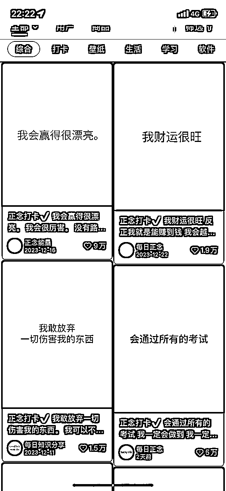

### 二、真人出镜号：重信任，高客单

全平台的共识是，用户要买的不是内容，是对人的信任。真人出镜是最直接建立信任的方式，有了信任，高客单才好卖。身心灵赛道最核心的关键词是“舒服”“愉悦”，所以视频的氛围感是入场前的关键要素。

**案例1：卖陪伴**
账号：朱诺，粉丝11.6w，赞粉比12:1
IP定位：为需要心理疗愈的人提供陪伴式生命教练。签约MCN，一周更新2-4篇，核心粉丝是一二线女性。
内容形式：真人出镜视频。
变现方式：1V1陪伴服务、课程专栏。
收费项目：
生命教练体验陪伴 500元
生命教练陪伴 5500元/12次
恋爱课程 138元
引流方式：评论区私信引流到私域。

**案例2：卖会员卖课**
账号：能量派钰昕，粉丝11.6w，赞粉比12:1

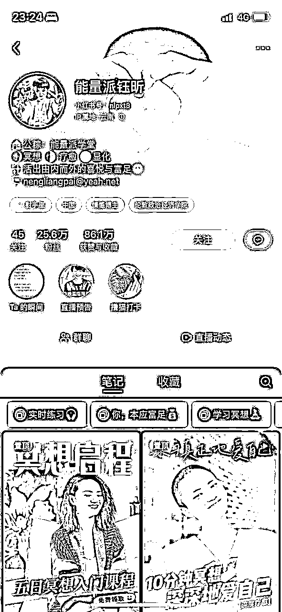

IP定位：为需要心灵成长和疗愈的人提供体系化课程和陪伴训练营。非MCN，一周更新1-2篇，粉丝同样是一二线女性。
内容形式：真人出镜视频。
转化路径：小鹅通课程+小鹅通会员。
利润预估约332w。
收费项目：
会员费 2088元/年，售出362份，约75w
会员费觉醒者 2988元/年，售出342份，约102w
训练营 4888元，售出232份，约113w
训练营 5888元，售出102份，约42w

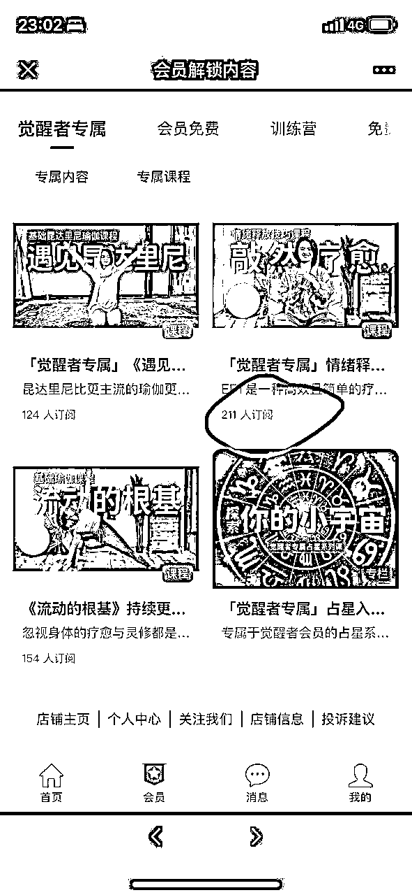

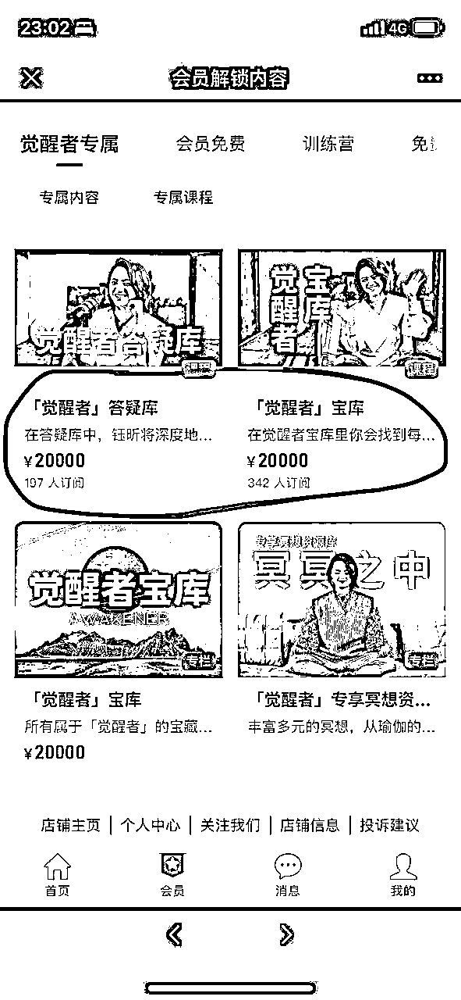

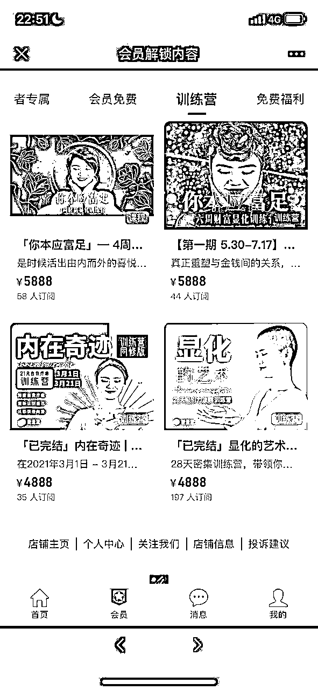

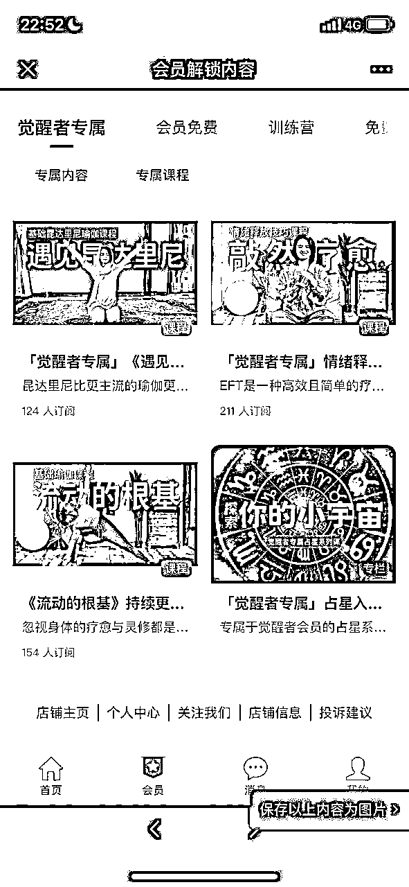

引流方式：
小红书首页置顶免费课程 -> 小红书群聊 -> 公众号

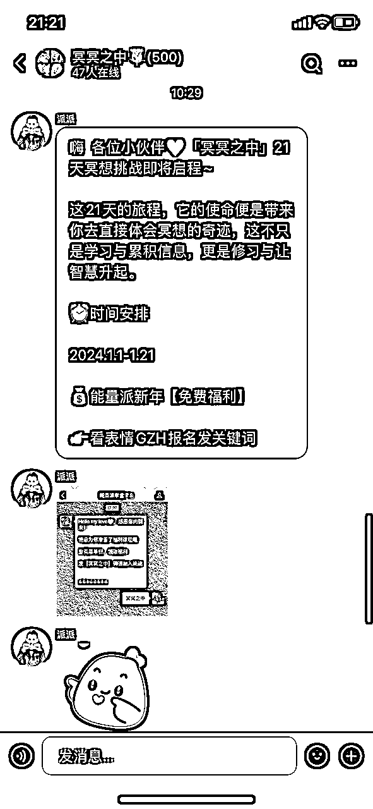

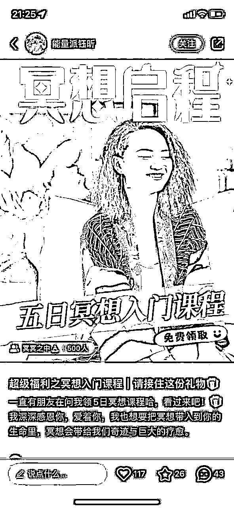

直播引导进群聊 -> 小红书群聊 -> 公众号

**案例3：教人做疗愈**
账号：柿橙，粉丝1663，赞粉比1:4.2

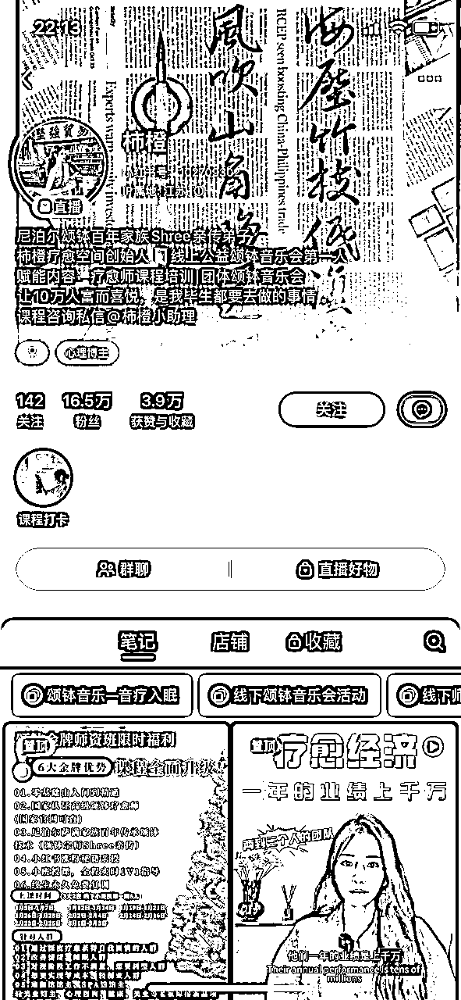

赞粉比看起来异常，是因为主打直播带课引流涨粉。
IP定位：为想学习颂钵疗愈的人提供线下实操课程。非MCN，一周3-6更，粉丝一二线女性。
内容形式：线下课程实拍+真人出镜，图文视频结合。
转化方式：薯店自制网盘音乐、直播带货。
利润预估：
颂钵疗愈音乐 39.9元，销量2000+，约8w-10w
进口颂钵 491元，售出34件，约16.69w
线下疗愈课程 4988元，销量未知
引流方式：小号评论区及主页引流到微信

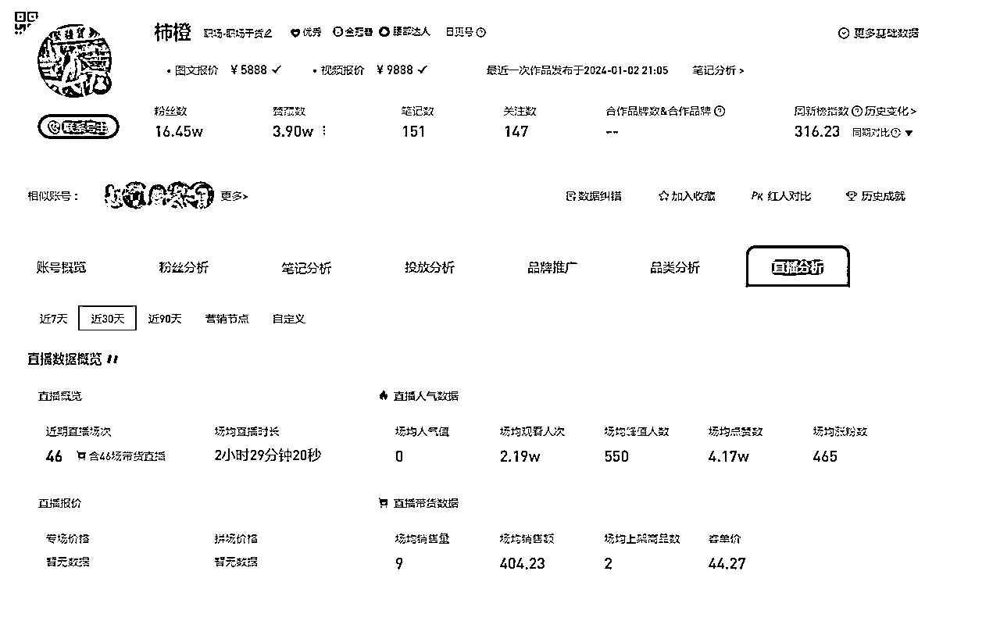

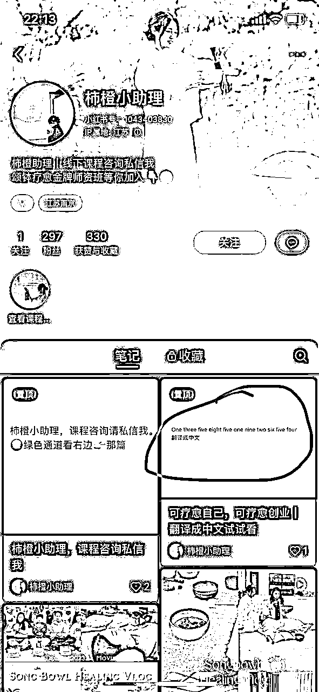

群聊沉淀

**案例4：线下训练营**
账号：SY三，粉丝1663，赞粉比3:1

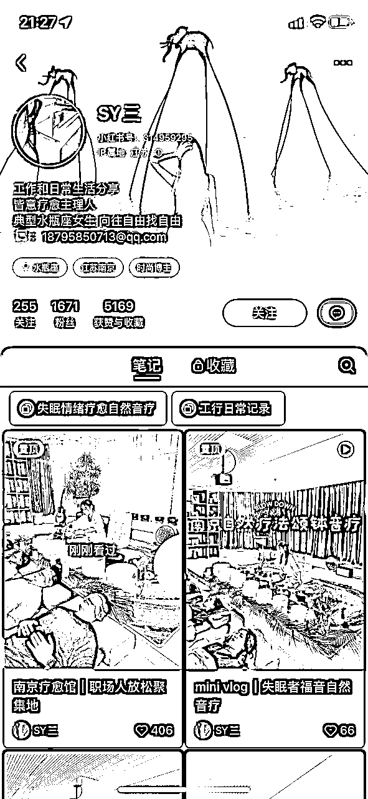

IP定位：为南京本地需要疗愈放松的人提供线下颂钵疗愈。非MCN，日更，粉丝一二线女性。
内容形式：疗愈馆场景+真人出镜，图文视频结合。
转化方式：线下疗愈馆体验。
价格参考朋友圈：线下疗愈198元/位，封顶10位。美团同类参考。

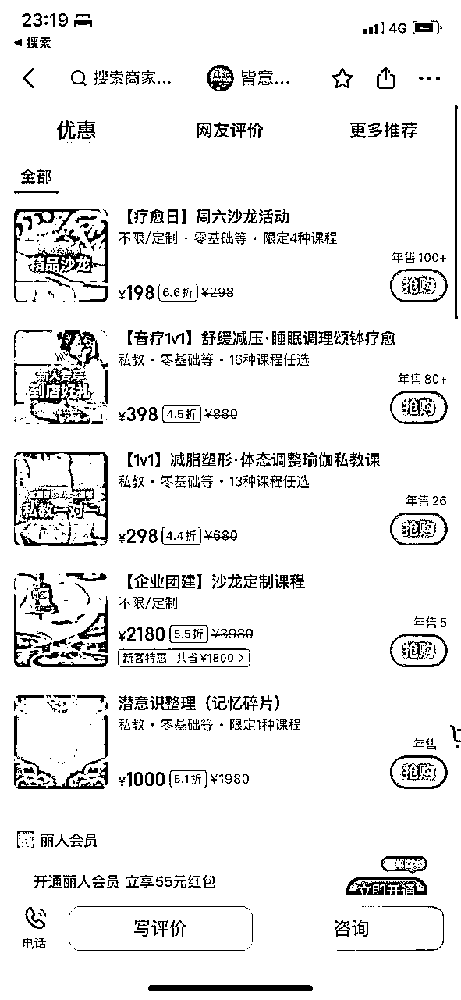

引流方式：
评论区用户私信 -> 微信
邮箱 -> 微信

总结：身心灵赛道在小红书的本质是卖情绪价值和信任感。图文可以快速起号找方向，真人出镜才能做高客单变现。先用免费内容建立舒服的氛围感，再用低价课做信任过渡，最后用陪伴、课程、私域社群完成闭环。