# 毕业九年，两度跨界，我拿到了想要的人生：8条成事心法
作者：龙哥

我叫舒丽，是一个三岁孩子的母亲，也是心理写作者、心理咨询师和心理赛道创业者。这些身份对我来说不是标签，而是一层层拓宽的生命经验。

时间往回退到2014年，我24岁，从一所普通二本毕业，进了财务行业。那时候的我，总在自我怀疑里打转：迷茫、自卑、焦虑，做着提不起兴趣的事，也看不见未来的方向。九年过去，我32岁，和先生共同创办了丽明教育，带着八人团队一起投身热爱的事业；上百名学生也与我走在同一条路上，各自寻找并成为自己。

我的性格类型是INFP，对自由有着近乎执拗的渴望。如今，我可以自主安排日程，自由选择在哪里工作，精神上也不再被外界捆绑。清晨带着期待醒来，夜晚带着满足入睡。做自己笃定的事，再忙也不觉得累。

这九年里，我经历过两次重要的职业转向，而且都成功落地。这些结果背后，是我一路摸爬滚打总结出的八条成事心法。

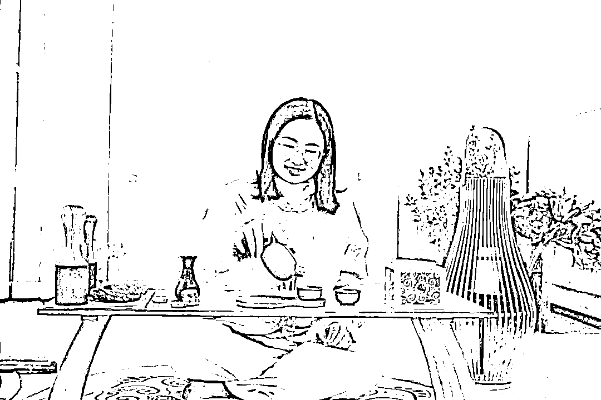

这些思考过去只在我的笔记里，今天是第一次完整分享。我能走到这里，你也一样可以。只要你真心渴望某件事，宇宙早就为你准备好了所有资源。请记得：每个人本自具足，你完全有能力创造自己想要的人生。

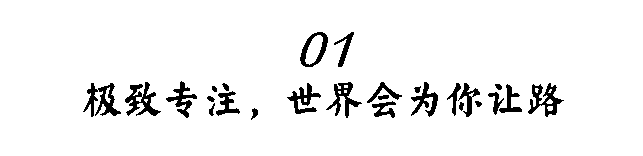

# 我最大的武器，是“沉浸式专注”

我身上最明显的特质，就是专注。这种专注近乎本能，只要我认定要做的事，就会自动屏蔽外界干扰，把全部心力压上去。大学备考时，我可以从图书馆开门一直待到闭馆，只为啃下一个科目。也正因如此，我考试常年稳居前列，还拿过国家励志奖学金。那不是为了证明什么，而是对自己负责。

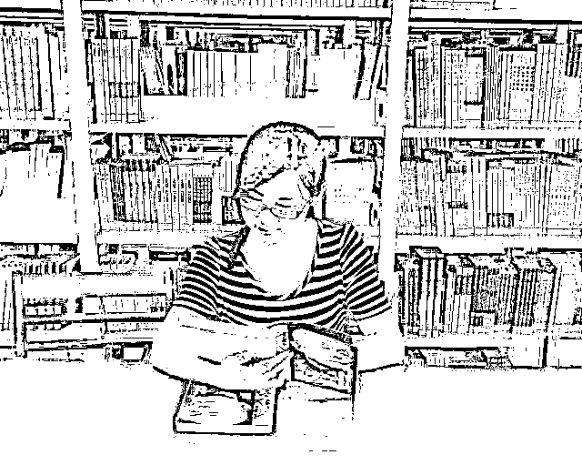

进入职场后，哪怕面对的财务工作并不合心意，我依然保持高效。领导把任务交给我，几乎不用过问，因为我总能在第一时间交付。五年前，我开始白天上班、晚上写稿，专注的优势被进一步放大。下班到家七点，坐到电脑前常常一抬头已是凌晨，几乎每天都能完成一篇稿子。最高纪录是一个月写30篇、上稿25篇，稿件发在有书、才储、潘幸知、樊登读书等平台，稿费收入也让我做到了月入过万。

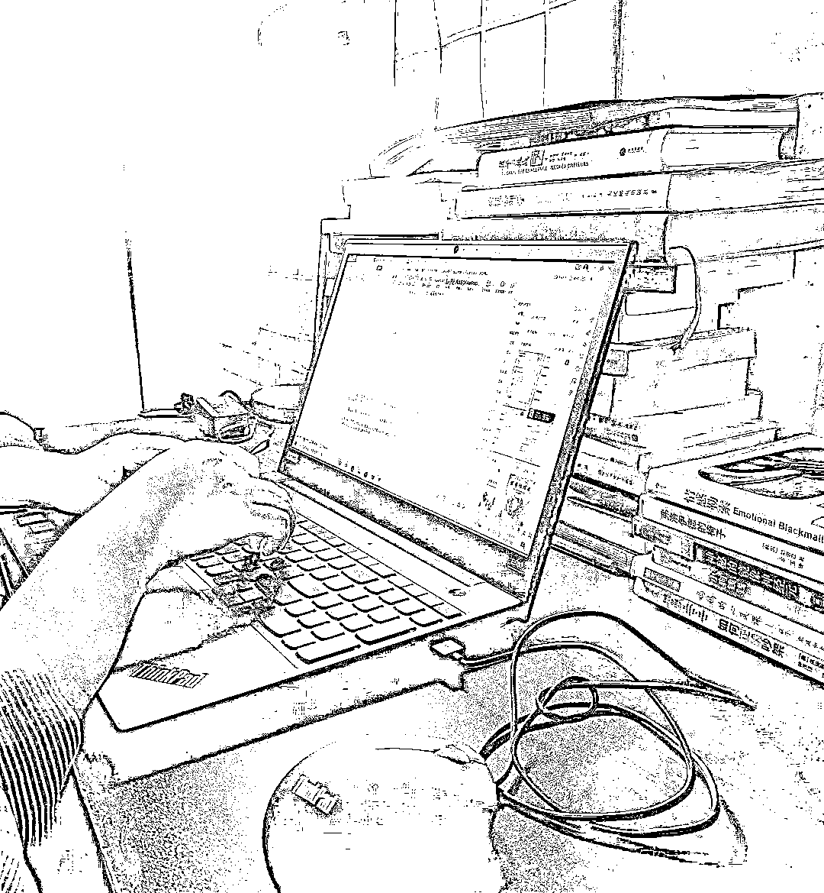

有几次约稿经历让我至今难忘。喜马拉雅约人物热点稿，我两小时交稿；王耳朵先生约稿，我在三小时左右完成，数据非常亮眼；潘幸知约我写过多篇热点，我基本都在三到四小时交卷，跑出不少十万加。没有高度专注，这些很难做到。写作时，外部噪音会被我自动过滤；一篇稿子我能反复读上十遍，逐字校对、删改、打磨。读一本书，我能连续沉浸四小时，边读边记边思考。凭借这种状态，我每年能读三十多本书，写五十多万字。

今年我转入心理赛道，专注再次给我加速度。一天内连做五个咨询没问题，连续四小时给书写疗愈营带集体疗愈，我依然能保持稳定输出。正因为这样，五个月内我积累了两百多个个案。学员感受到我的真诚与投入，也愿意把信任交给我；其中六成升级为合伙人，决定长期同行。给合伙人上课时，我不知不觉就能讲满两小时，她们也被那种高能量状态感染，每天都在期待开课。

当你心无旁骛地做一件事，成果会自己显现。那些你渴望的东西，会在不经意间朝你走来。专注不是苦熬，而是一心一意把眼下的事做好。它是一种修行，能释放巨大能量，让人把一件事做到极致。注意力稀缺的年代，专注本身就是稀缺品；谁能稳住自己的注意力，谁就能被世界看见。

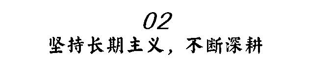

这个世界从不缺三分钟热度，缺的是长跑者。写作这条路上尤其明显。我见过太多人开局轰轰烈烈，后来无声消失。最早和我一起写作的人，八成已经不再动笔，还有少数人停留在断断续续的状态。拉开差距的原因并不是天赋，而是谁更持久。

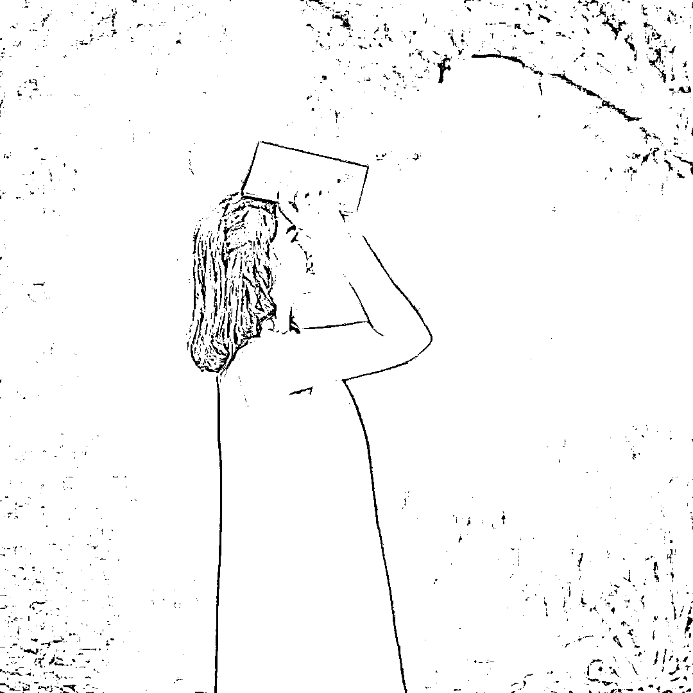

“这九年里，我确实没有真正停过笔。别人午休我在写，别人聚会我在写，别人闲聊我还在写。在桌前就用电脑写，出门就抱手机写；醒着时满脑子都是选题，睡着后似乎还在改稿。为了追热点，我在公交车上直接开写；同一个热点，我常拆成三个角度，写出三篇文章，分别发给三个大号。”

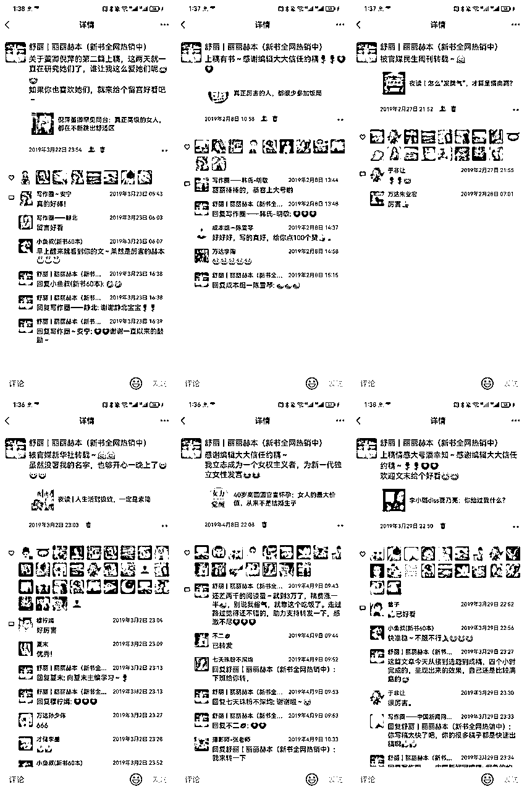

这样的写作方式留下了不少例子。董卿和倪萍同台那一波，我换了三个切口，分别给有书、国学精粹与生活艺术、喜马拉雅供稿；《都挺好》热播时，我又从四个不同入口写了四篇，发在插座学院、婚姻与家庭杂志、才储等平台，分别聊职场、原生家庭与个人成长。

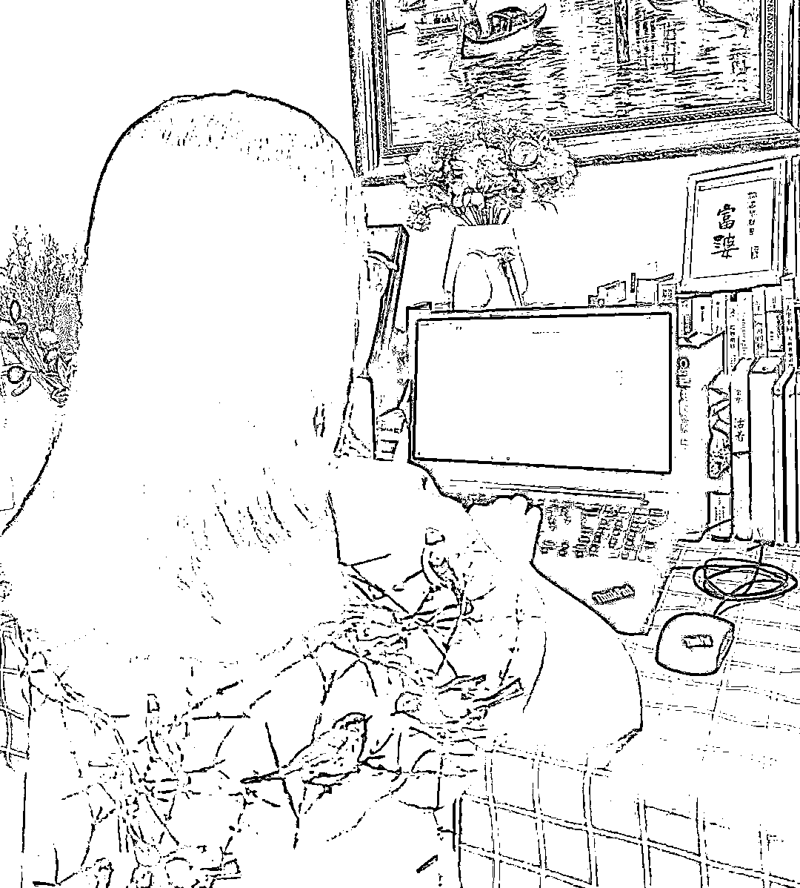

2019年春节，别人围着饭桌，我围着电脑。那个月我上稿二十余篇，再度月入过万。和财务工作带来的内耗不同，写作时我常进入心流；文章发布后，看到读者说被文字触动，快乐又会翻倍。大量输出也让灵感不断涌现。读完《高敏感是种天赋》后，我内心久久不能平静，第二天午休灵感突然来了，我在仓库角落一口气写下《高敏感，其实是一种天赋》。

那篇文章并不符合当时新媒体文的风格，我把它发在自己的👸号上，结果十几个号主来申请开白，其中还有壹心理的矩阵号；同步到知乎后，它成了大爆款，如今阅读量超过88万，收藏3.4万，评论1600多条。

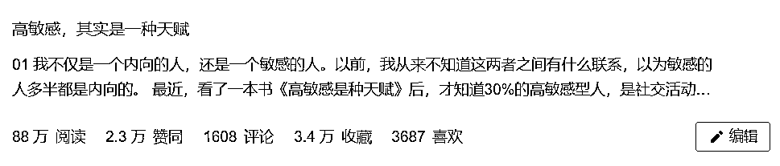

正是这篇文章，让我被一位编辑看见，也帮我实现了出书梦。

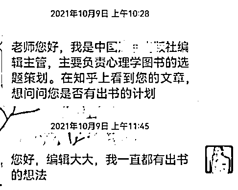

好内容自带传播力。我的第一篇刷屏文《为什么越内向的人越厉害》，最初只是随心而写，发布后却引来全网三百多个账号转载，单篇阅读量过亿。我的优势也在这时被放大：出稿快、质量稳，稿件几乎不需要修改，编辑们自然也愿意持续约稿。后来，我成为喜马拉雅、有书、读者、樊登读书、潘幸知、才储等平台的签约作者，也有文章被人民日报、新华社等官方媒体转载。写作确实是一件付出就有回报的事，但要看你能坚持多久。如今它已像吃饭喝水一样自然。不仅写作，我和心理学的缘分也持续了14年；我的爆文大多与心理学相关。持续输出背后，始终都有持续输入。

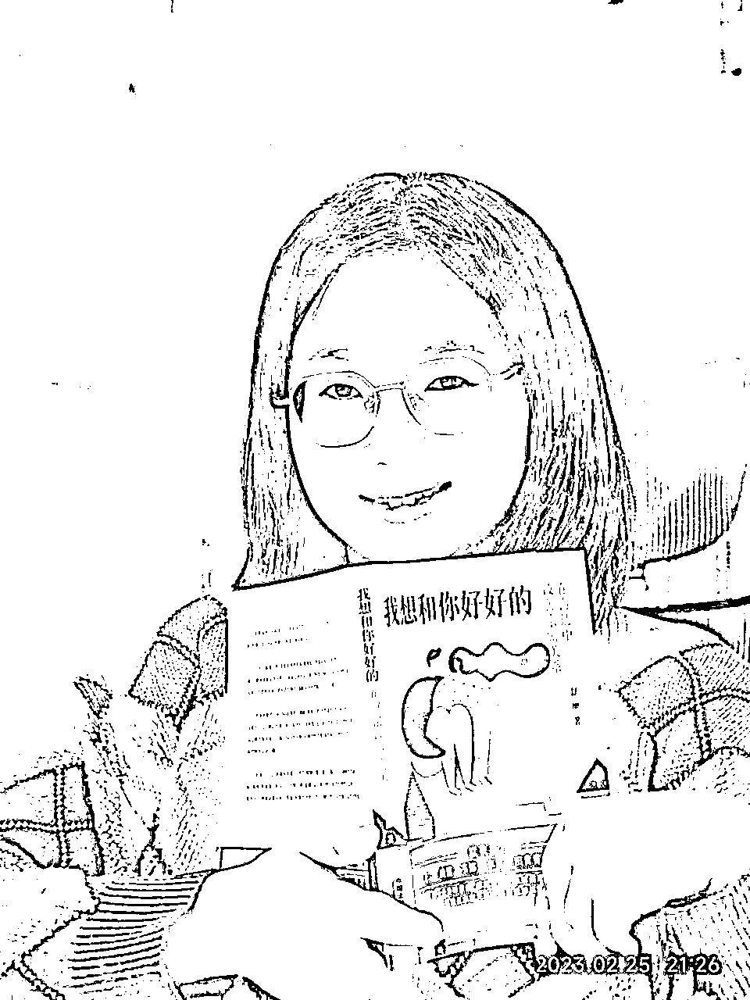

大学四年，我几乎把图书馆坐穿，读过的心理学书籍超过百本，这为我打下了扎实的地基。从二十岁开始接触心理学，到用它理解生活、写文章、出书、做咨询、开发课程，心理学像一条绕不开的路，慢慢成为我的使命。这份使命感越来越强，推着我不断扎根，再用公开表达把它的价值传递出去。

成长路上，诱惑很多，走着走着就容易丢掉初心。但梦想本来就要穿越非议、孤独与代价。也正因为坚持的人少，成功才不那么拥挤。所有大事都需要时间沉淀，耐得住寂寞的人，才等得到想要的结果。

人生不过三万天，总要先让自己尽兴。我是偏理想主义的INFP，向内探索了14年，始终在寻找真正热爱的事。做财务的五年里，我辞过四次职、换过四家公司，用不同岗位试探自己的可能性。最后我确定财务不是我的路，于是及时止损，在2018年转身走向自由职业。

《她力量》里提到过“内心导师”这个概念。我以前不知道这个名词，但回头看，每次重要选择，我都听见一个内在的声音。它给我看过一幅画面：一个中年女人在书堆里伏案写作，日子简单自由，神情清冷又温柔，看上去有些孤独，内心却丰盈安宁。看到那幅画的一瞬间，我几乎落泪，因为那就是我深藏的梦想。

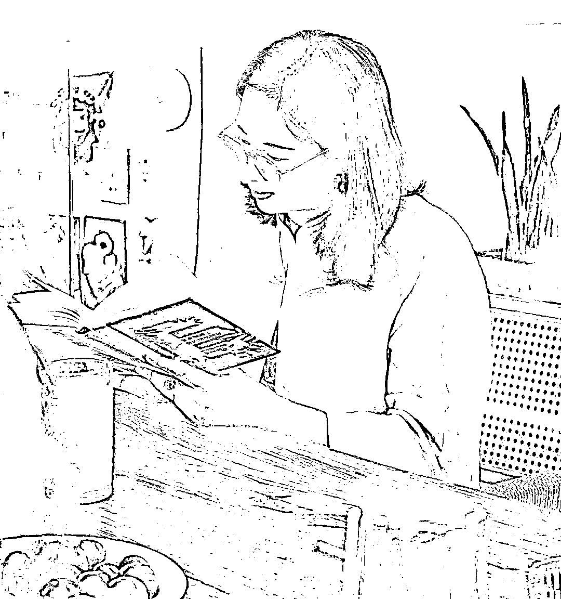

如果不是一直向内探索，我可能永远不会遇见那个声音。它总在岔路口给我方向，让我一步步靠近期待的自己。你可以把内在向导理解为更完整、更清晰的你，是精神和灵魂的声音。只有不断尝试与行动，美好才会与你相遇。

我很相信“窄门思维”：走少有人走的路，再暗的地方也能等到光。这个时代做难而正确的事，确实很难。要抵抗诱惑、面对质疑、吞下不确定性，还要承受“可能白费”的恐惧。因为难而正确的事，往往需要漫长的时间验证，多数人等不起，于是转身选了捷径。

五年前我辞职写作，就是主动走进一扇窄门。那之前，我已经在一家世界五百强企业做到财务主管，公司离家两公里，不用加班，工作清闲，看起来非常理想。但开始公开写作后，我生命里的热情被彻底点燃，我知道这才是自己真正要去的方向。既然遇到了热爱的事，又怎能停在原地？

从财务转到专业写作，付出的代价并不小。我的第一个孩子，就在我最拼命写稿的阶段停育了。那三年，我写了200多篇十万加，名字频繁出现在各大平台，也登上了官媒。后来我遇到瓶颈，不想再给平台当写手，想真正为自己写。于是我又选了一条难路——停止投稿，在自媒体上继续写，直到第一本书出版。

做写作导师这四年，我手把手带着1000多位写作者走上变现之路，也陪跑过一年写作IP私教，帮很多人弯道超车。她们中有人拿到公费出书机会，圆了出书梦；有人成为IP故事导师，为创始人梳理人生故事；有人加入作协，作品登上樊登读书，约稿不断；有人开发爆款文案课，开启知识变现；有人成为读书营领读人，一篇书评横扫各大平台；有人接下了全年文案项目；有人三个月把📕做到近万粉；也有人靠📕图文接广告，月入稳定在四位数以上。

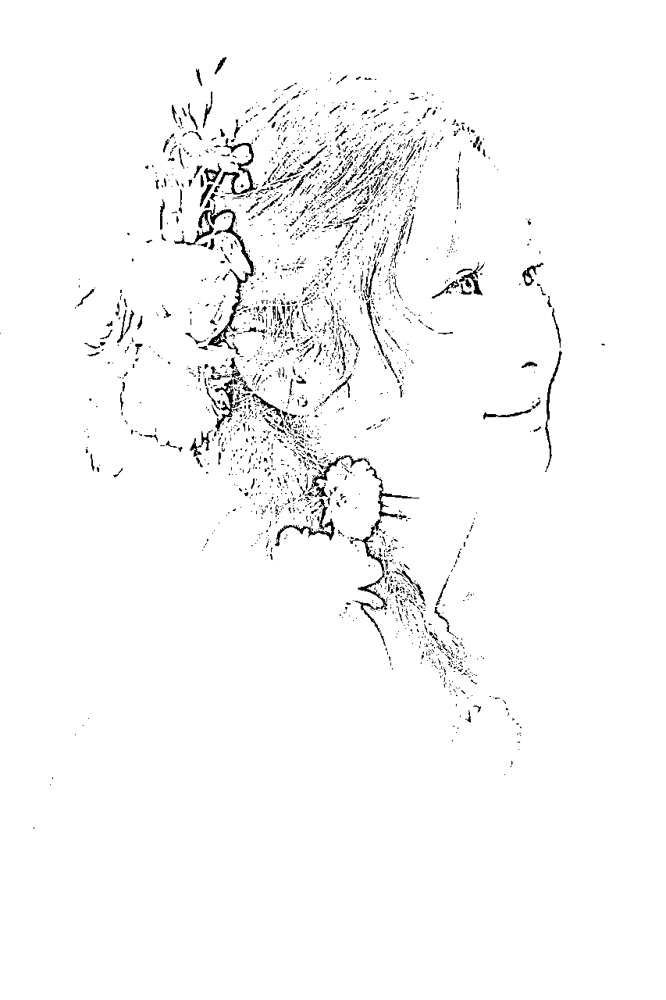

尽管已有这些成绩，今年我仍然选择转身做心理赛道，继续做一件难而正确的事。不是叛逆，而是听见了使命的召唤。这条路并不容易，但每一步都让我更接近心里期待的样子。泥泞尽头必有光，敢选更难的路，才可能看到更辽阔的风景。

很多学员问我：为什么你总是能量满满？我的回答是：人之所以迷茫，往往不是没有能力，而是没有想清楚自己要什么，缺少对目标的笃定，也缺少“非做不可”的愿力。我只要确定方向，哪怕一无所有，也敢拼尽全力往前冲。进入新行业没那么难，保持学习力和行动力，很快就能走上正轨。人生本来就是一场体验，放松心态，笃定往前走就好了。

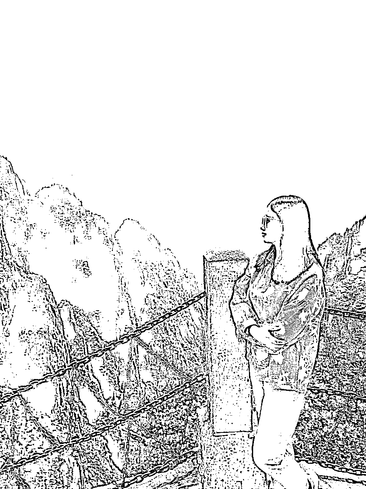

每一次转型，都是从0到1的过程，都会有蛰伏期，也必须面对未知。但我做决定只为自己负责，不因别人的声音左右摇摆。因为外面从来没有别人，只有自己。开不开心、有没有热情、是不是真心想要，只有自己知道；最后承担结果的人，也只有自己。旁人不过是看客，父母也一样。

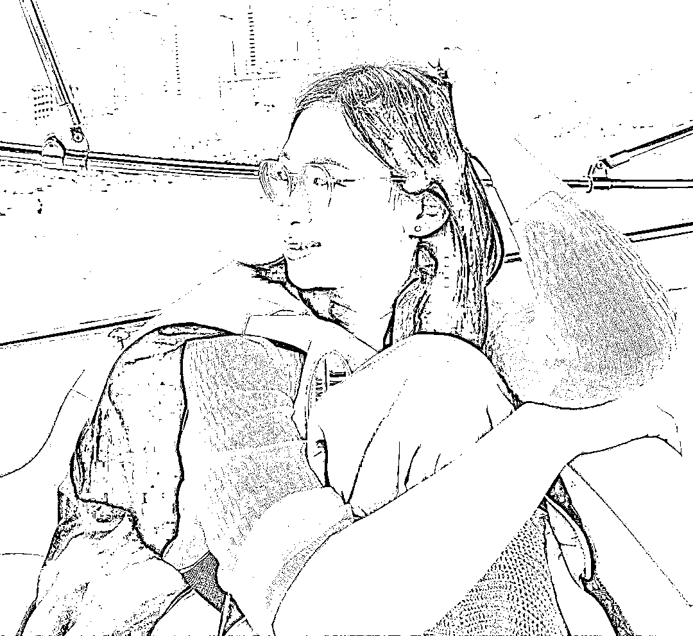

别让别人的声音替你活。你才是自己人生的主角，学会课题分离，分清自己的事和别人的事，才能掌控自己的命运。做热爱的事，生命才会绽放。我的能量场很强，人类图中也显示出丰沛的创造力和感染力；这样的配置注定我不会安分，总想不断折腾，去探索人生的更多可能。

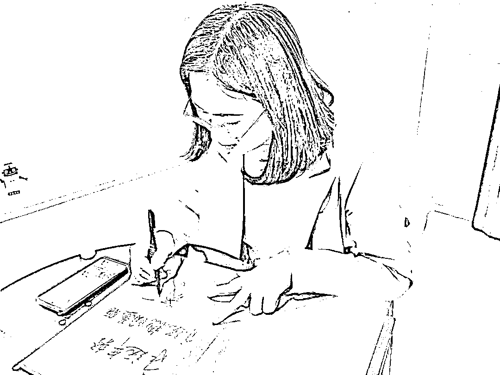

进入心理赛道第六个月，营收突破90万，一百多位学员加入“丽行者”，和我一起逆流而上。我相信财富是认知与能量的显化，内在足够丰盈时，财富自然会靠近。

白岩松说：“阅读带你面对内心，面对人性，面对生命。在你行走艰难之时，为无门之处开门，让无光之处有光。”我常在某些作者的书里认出自己，那不是偶然，而是必然——书里藏着我期待成为的模样。阅读能提升认知、拓宽眼界，也让我不轻易随波逐流；无论外界多喧闹，我都能保持判断，守住自己的节奏。我每天都会读书，再忙也至少读半小时。好书是与高人对话，能带来高维智慧。

除了读好书，付费向高手学习也非常重要。2022年以来，我花10万进入菁凌私董会、不晚轻创、玩赚等知识IP圈子；今年又花10万学习疗愈技术和教练技术，另花19800学习心理咨询式成交之道。不少朋友知道，我还付了12万，成为《1000个铁粉》作者伍越歌老师的一对一学员。

伍老师在课堂上讲，个人IP的真谛是活出真我，真实就是最好的人设。这和我的价值观完全一致。当我说出想从写作IP转做心理IP时，他认为我非常适合。我的文字能打动人，不是因为我写作技巧多厉害，而是心理学功底带来的洞察力和共情力。写作不该只用来变现，更应当作表达工具，服务于更大的事业。

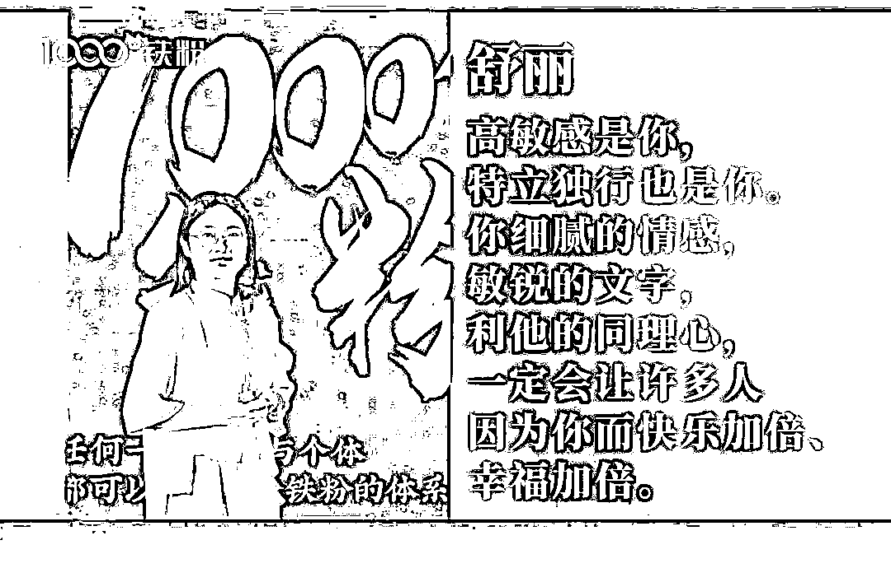

他点醒了我：心理学是根，写作是枝。写作不是目标，而是心理IP的放大器。他还强调增量思维——不是基于你现在拥有什么，而是基于你未来想成为谁，去活出天命。

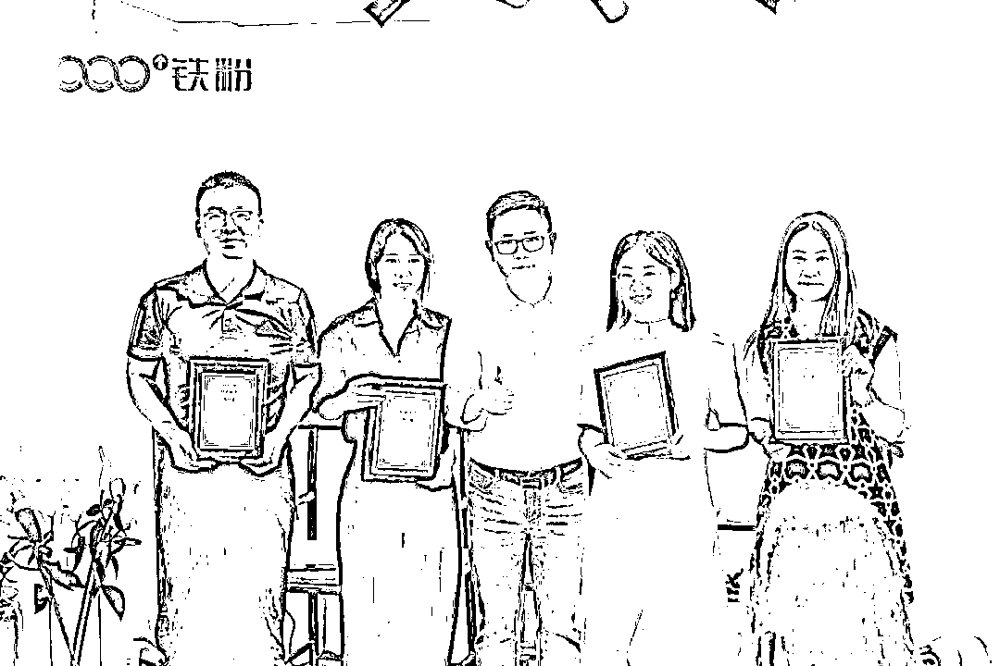

遇到对的人，真的会唤醒生命潜能，点燃灵魂，让你看见自己的无限可能。如果有一位老师与你价值观同频，又能看见你、激发你、给你能量，一定要深度链接他。他很可能就是来成就你的贵人。你想成为谁，就去靠近谁。每个人都有自己的能量场，选老师本质上是在选场域；同频的人才会互相吸引。和谁在一起，真的不一样。好的老师会点燃你对生命的热情，帮你找到使命，陪你一直向前。

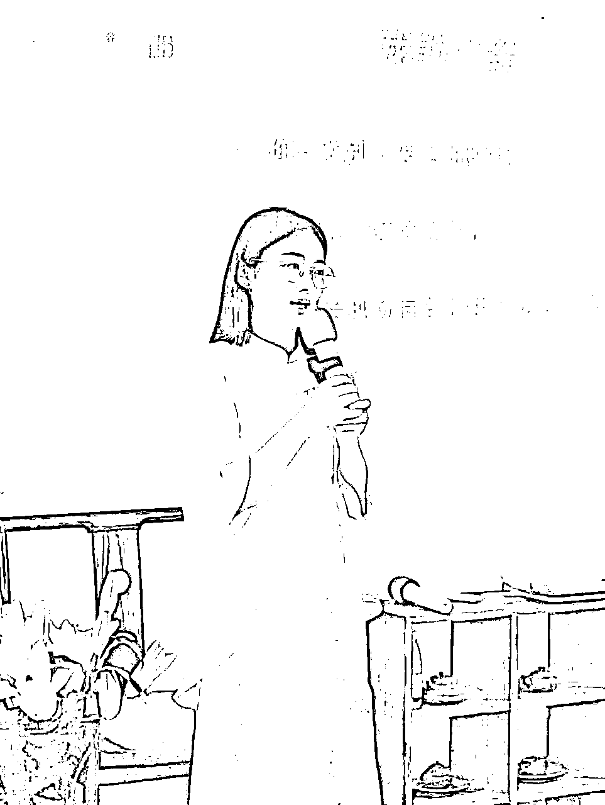

很多人选择加入丽行者，正是看中这里的正心正念正能量。选老师不必选最贵的，要选最合适的。看起来再厉害的老师，如果与你不同频，也未必能真正帮到你。相信自己的直觉，遇到适合的老师，就紧紧跟住，不要松手。

我始终相信，人生的意义在于以行动作示范，彻底投入当下，用真实而坦荡的状态去影响身边的人，进而召来与我同频的伙伴。而我的转折点，正始于我开始坦然地把自己摊开来表达。

在对外发声之前，我像个与世界隔着一层玻璃的人。内心世界丰盈得像座图书馆，却找不到可以安心倾诉的对象。那段日子，我把大部分时间都留给了自己，独处对我而言既是放松也是滋养。正是这段安静的沉淀期，让我一点点攒下了底气与素材。

表达的冲动一直都在，我的内在非常活跃。早在🛰️刚起步的2014年，我就养成了每天朋友圈记录的习惯。外界眼里我是个爱读书爱分享的文艺女生，但其实很多人并不理解，甚至会贴上装腔作势、脱离现实的标签。世俗的那套“接地气”标准，从来没有让我动摇。我从未解释，从未妥协，依旧按照自己的节奏走。情绪来了就写，能一口气写出几千字的长文。因为长期的日复一日积累，等到我真正开始公开写作时，文章自然而然就能成形，素材也源源不断。当我把过往的经历、内在的领悟和真实想法放到台面上，才惊讶地发现原来有那么多相似的灵魂。读者的留言一次次把我感动到落泪。公开的表达像点燃了生命的开关，让我的能量一次次被推向顶点。

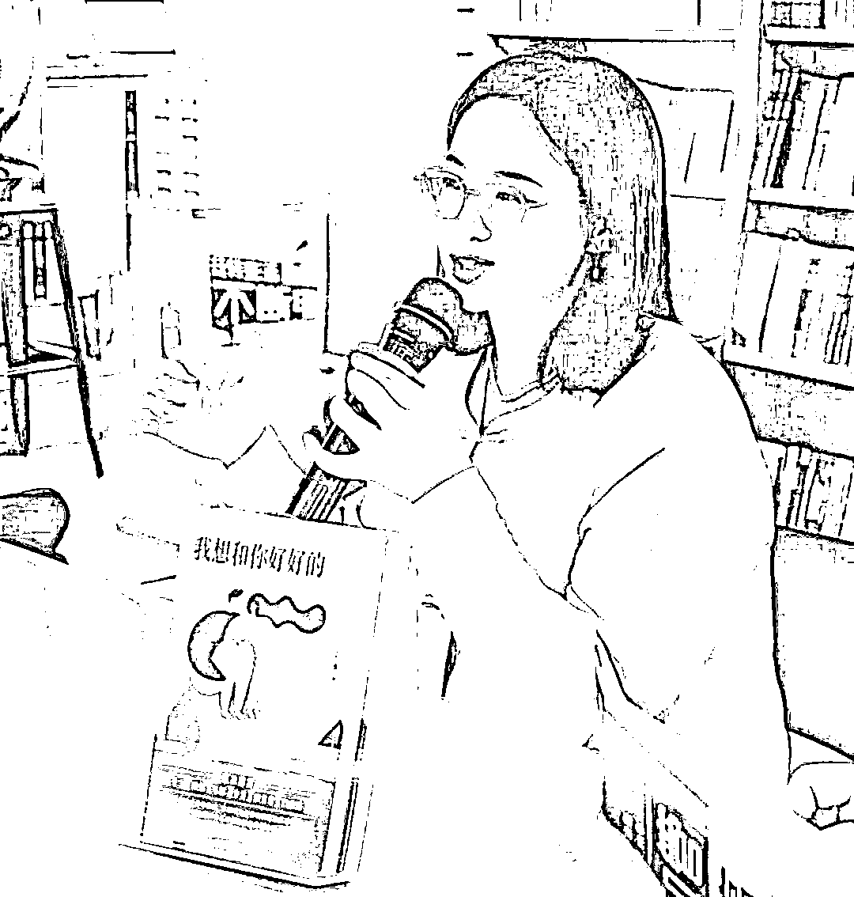

我沉迷于创作，沉迷于把自己说出来。我要为女性的觉醒发声，要为内向高敏感的人群发声，这就是我表达的初心。

也正因此，《为什么越内向的人越厉害》《高敏感，是一种天赋》这些文章在👸号、知乎、📕以及短视频平台上引发了广泛共鸣，并在很多内向高敏感的人心里种下了被看见的种子。

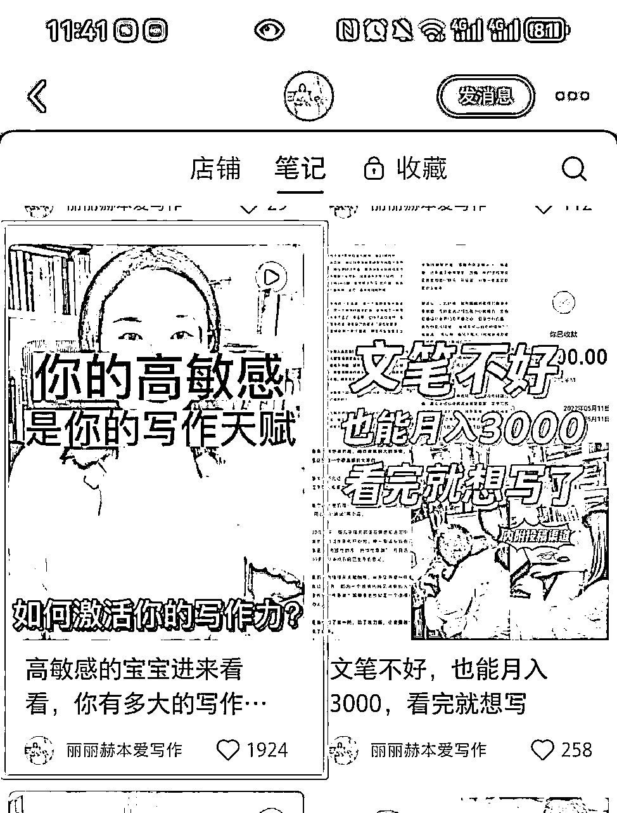

当我真正给到这些群体清晰的价值与陪伴，他们自然会向我靠近，并选择付费学习。不是因为我手法高明，而是因为表达足够真诚，直指人性共通的痛点，文字里有共情。活出本真，持续表达，同频的人会靠近，机会自然也会来。

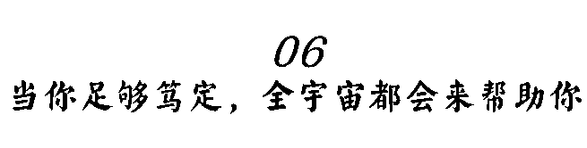

内心一旦坚定要去做的事，好像整个宇宙都会配合。直觉一直是我重要的导航。当我发愿把这件事做成终身事业时，资源便接连出现。我实实在在地体验到了心想事成的状态。

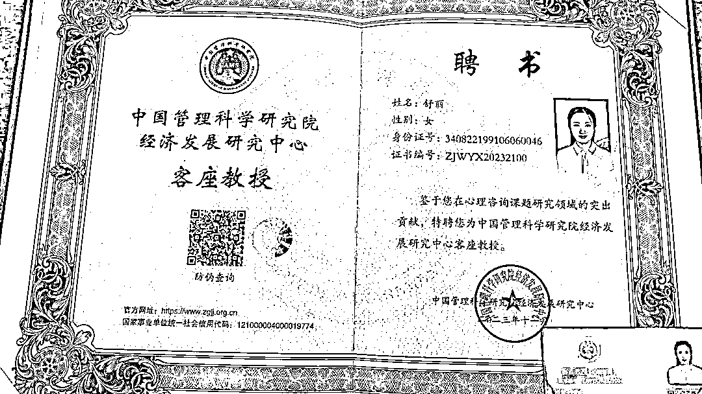

在合伙人招募期间，我在新华书店的一场分享中结识了一位朋友，后来促成了证书项目的合作。我也相继获得了中央新影中学生频道【原CCTV中学生频道】童心向未来栏目组特邀心理专家证书、中国管理科学研究院客座教授证书，以及教育部电教办颁发的高级心理咨询导师专业证书。

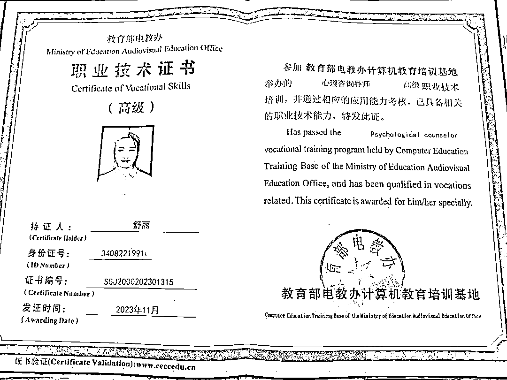

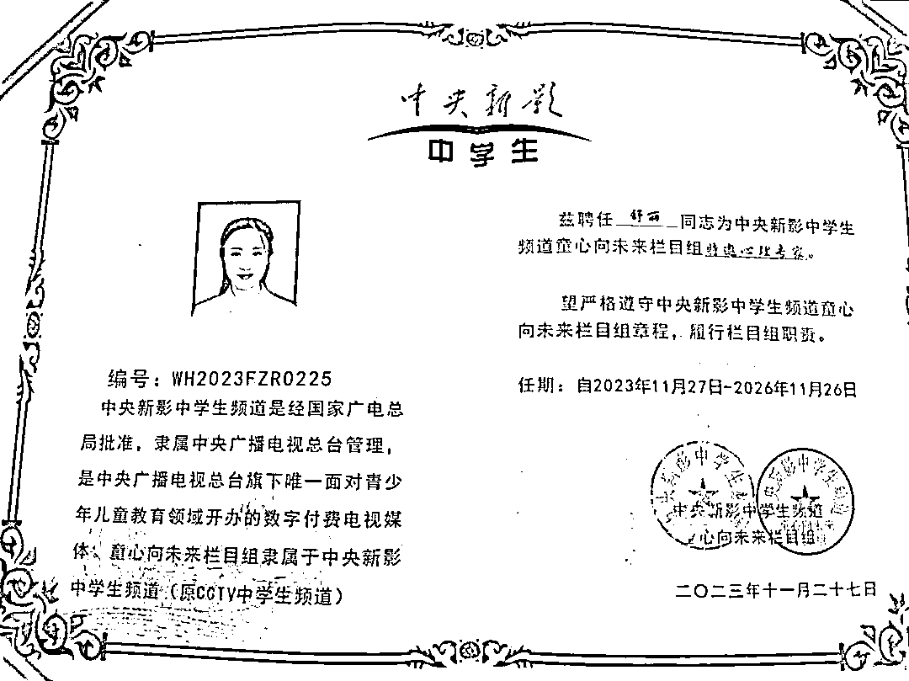

所有加入合伙人项目的学员，都能获得由教育部电教办颁发的“高级心理疗愈师”证书。不少合伙人感慨，如果早点认识我，就能早点活回自己。从我踏入心理领域的那一刻起，我从未如此笃定、如此充盈，仿佛十几年的自我探索，都是为了此刻的展开。

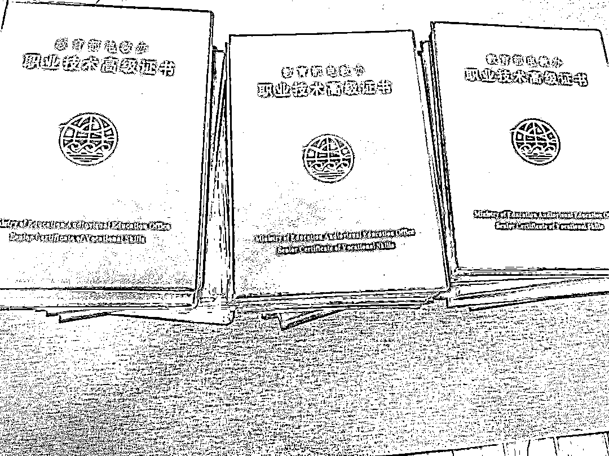

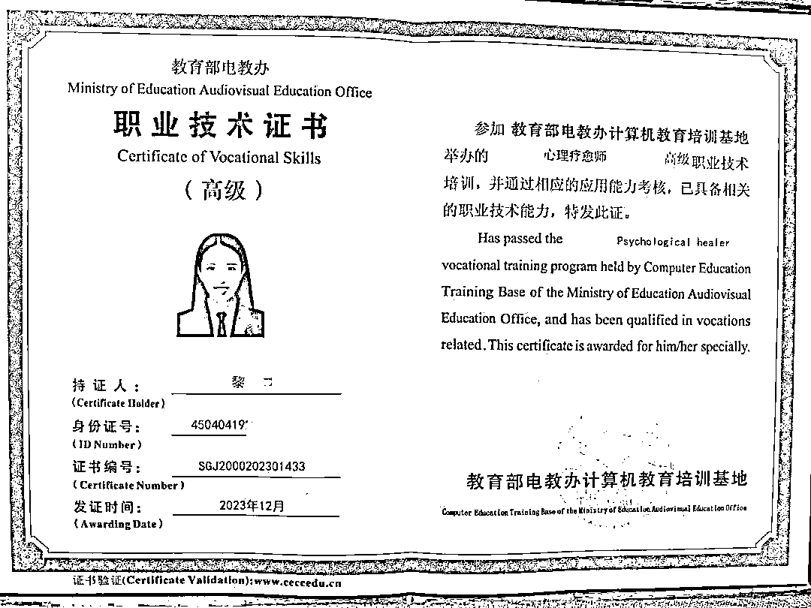

那种活出天命的踏实感，每天都在召唤我。我坚信，觉醒后的我们，有能力带领更多女性一起觉醒。这是一件有意义、也有福报的事。觉醒之后拥有属于自己的处世哲学，内心便更容易安稳笃定。2021年10月3日，我写下人生最遗憾的一件事：没能出一本书。

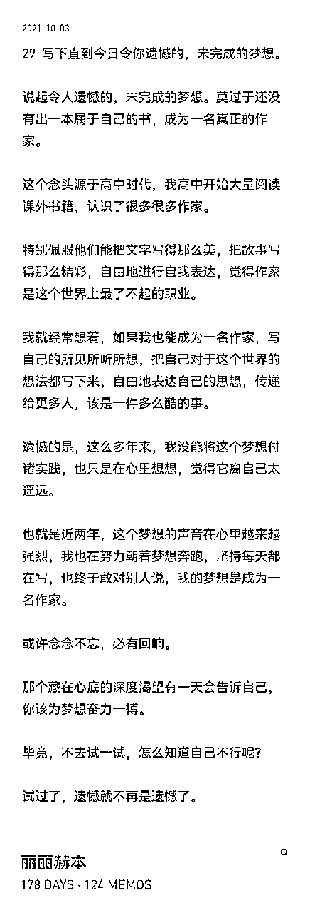

10月9日，出版社的编辑就通过知乎找到了我，抛来了写书的邀请。

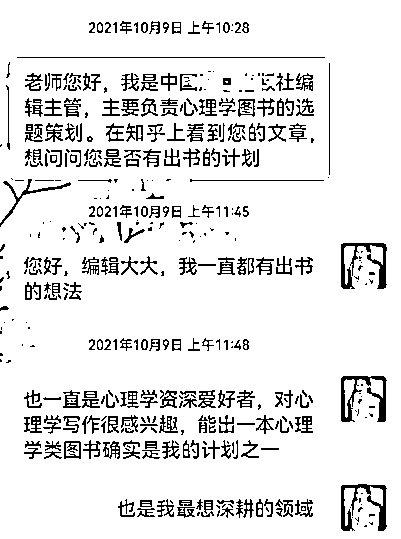

一切都像冥冥之中早已安排好，念念不忘终有回响。正如张德芬在《遇见未知的自己》里说的：当你真心渴望一件事情时，你会散发出相应的频率，全宇宙便会联合起来助你实现。心理学帮我厘清了自我、自我与他人、自我与社会的关系，也为我天马行空的思考提供了方向。我常问自己：人生的意义是什么？要成为怎样的人？一生的目标和使命是什么？一次次向内聆听，让我很少被外界左右。

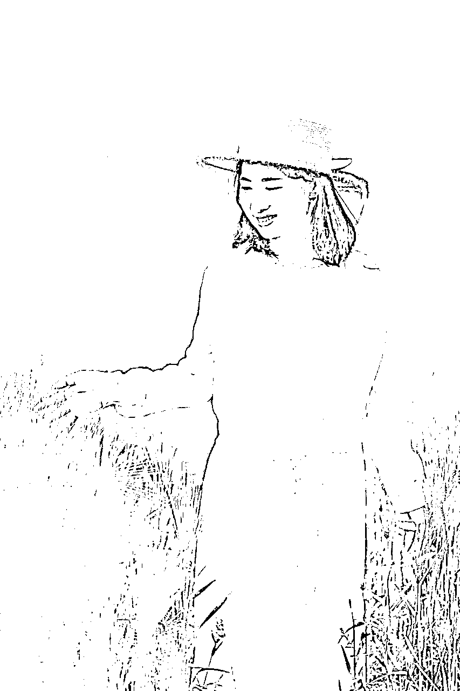

朋友说，我似乎一直清楚自己要什么，活得有底气，困难挡不住，心态很沉稳。学员也说，我年纪虽轻，却比许多年长的人更通透、更有智慧。阅读心理学培养了我深度思考的习惯，我对人和事有了自己的判断，形成了独立的价值体系和思维框架，很难有人撼动我的内心稳定。我更容易专注在目标上，分得清可控与不可控。

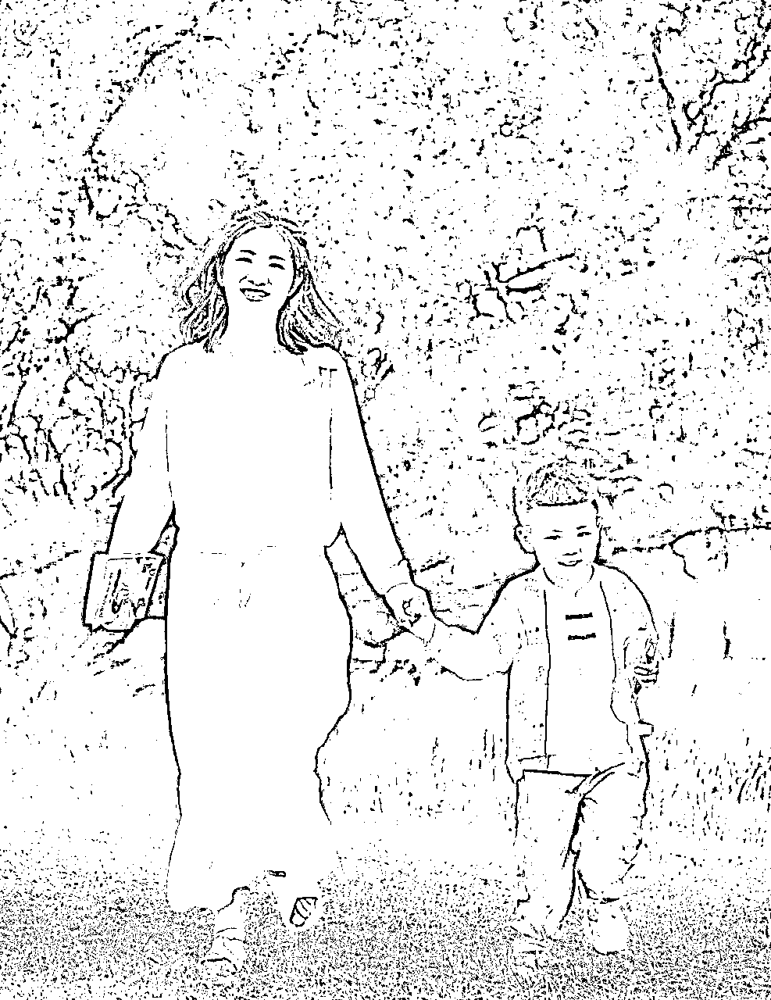

不会为不可控的事焦虑，把精力放在自己能行动的地方。去年九月，我父亲被查出肝癌，消息像晴天霹雳。但我很快调整心态，知道天灾人祸不可控，发生了就要去解决。我查阅了大量资料，买书研读，线上请教了十几位专家，奔走于北京多家医院，还加入了多个病友群。在充分了解前沿信息、弄清病情后，我清楚了接下来的治疗路径。虽然仍有恐惧，但不再迷茫，有了应对方案。最终父亲的治疗很顺利，恢复良好，如今定期复查，情况稳定。

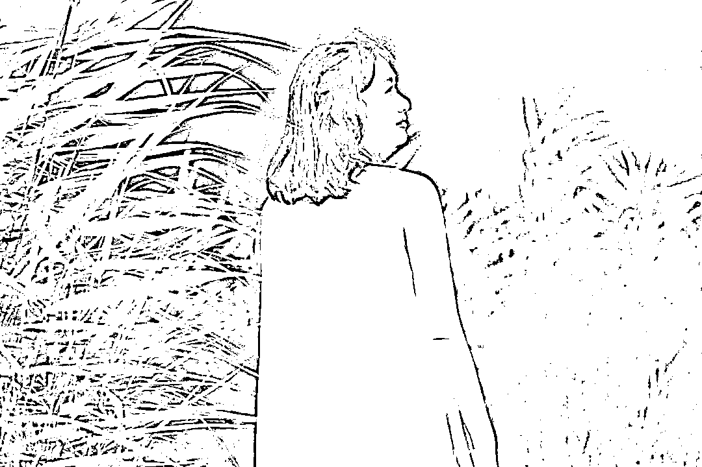

把注意力放在能掌控的事上，就不会乱撞，也不会做无谓的情绪消耗，能更快解决问题。身边的朋友常被我的镇定惊到，这已经成了我的习惯。心理学就是给我这样的力量。要相信，内心的安宁与笃定比什么都重要，它能让你在任何境遇里守住自己，安顿自己。

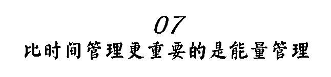

《反脆弱》里提到：“任何死守计划、不懂变通的事必然失败。鼓吹规划能助企业发展是错的：世界太随机、不可预测，根本无法基于未来波动制定政策。生存取决于适应力与环境的作用。表面稳定的往往脆弱，给人脆弱假象的往往更强大，具有反脆弱性。”在这个快节奏的时代，很多人总觉得时间不够，于是羡慕那些时间管理极强的人。看到密密麻麻的日程表，会觉得越细致越高效。可事实真如此吗？

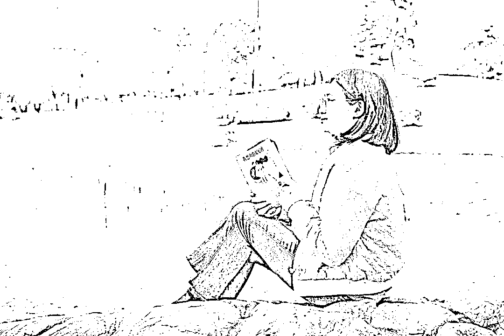

不可否认，一些大忙人确实按分钟管理时间，因为待办太多只能这样。但对大多数普通人来说，真的需要把时间精确到小时、分钟吗？很多人尝试过，最后坚持的不多。因为这种精细的时间系统很脆弱，一旦出现突发状况或不想动的日子，计划就全乱了。

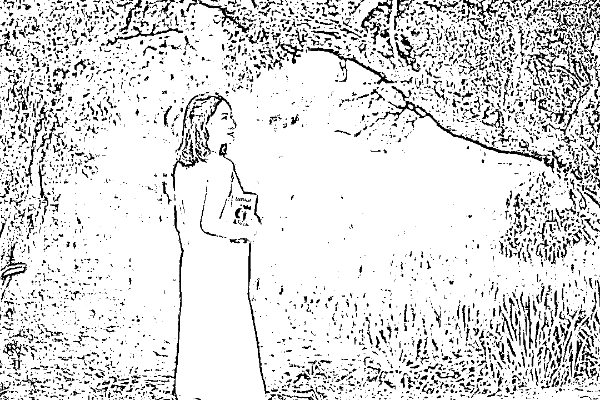

其实你管理不了时间，你能管理的只有能量。或许因为我是INFP，天生不爱做计划，更别说排满日程表。按表生活会让我觉得自己像个工具人。我更倾向于随心而动。选择自由职业，正是因为我喜欢掌控节奏。其实所有时间管理的本质，都是有效专注时间的多少。

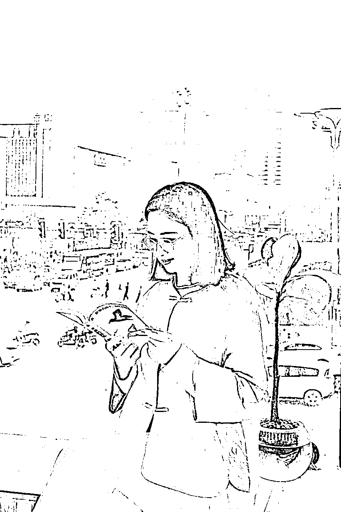

能迅速切换任务，保持高度专注，沉浸在一件事里，时间管理自然就好。所以我不做详细计划，但每天要做的事都能按节奏完成。作为创业者，我把每一天过得很饱满。一旦全情投入喜欢的事，我会忘记时间、忘记周围。工作与生活早已融合，随时进入工作状态。这不是自律，对于INFP来说，做热爱的事根本不需要自律，剩下的只有忘我。

我更依赖忘我而非自律，忘我是更高阶的投入，兴趣和激情比强制约束更有执行力。与其研究各种时间管理工具，不如先提升生命能量。内在能量不足，规划再多也完成不了。彼得·德鲁克说过：“没有比高效率地做无用功更无用的事了。”生命能量，比一切都重要。

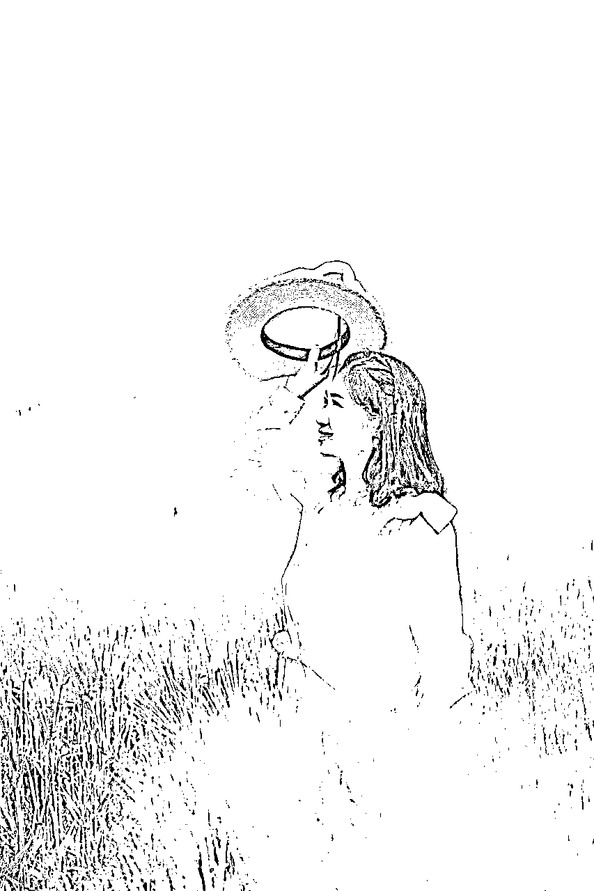

别看我上课能侃侃而谈，线下我依旧社恐，不爱社交，也很少闲聊，除了和王先生。我有200多个群，几乎不看群消息，只看自己的群。太多信息都是消耗。也许在别人眼里我有点冷漠，因为我从不主动联系人。但有人找我，我会很热烈地回应。不断做减法，聚焦重要的事，都是在保护能量。

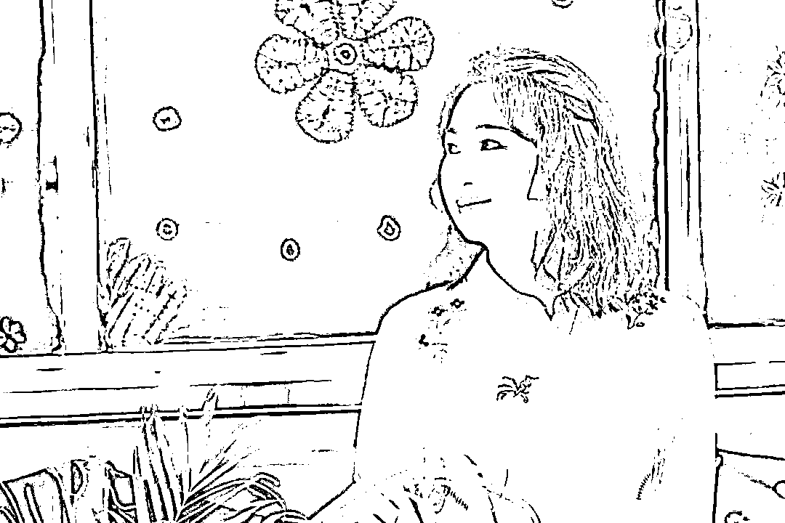

我需要在喧嚣的世俗中，为自己隔出一片不被打扰的净土，只有我和我自己，在那里恢复能量。每个人都需要找到自己的能量补给方式。要想有所成，能量大于能力，心力大于能力。能量不稳、心力不足，即便有能力也难以落地。

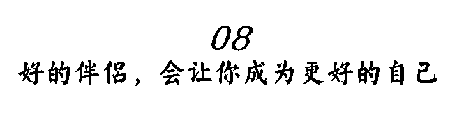

我和老公王先生相识于2010年，那时我19岁，刚上大学。相爱六年后步入婚姻，那时我25岁。如今孩子已三岁多，我们也都步入而立之年。我们既是彼此最好的朋友、家人，也是最懂彼此的爱人、最默契的婚姻合伙人。

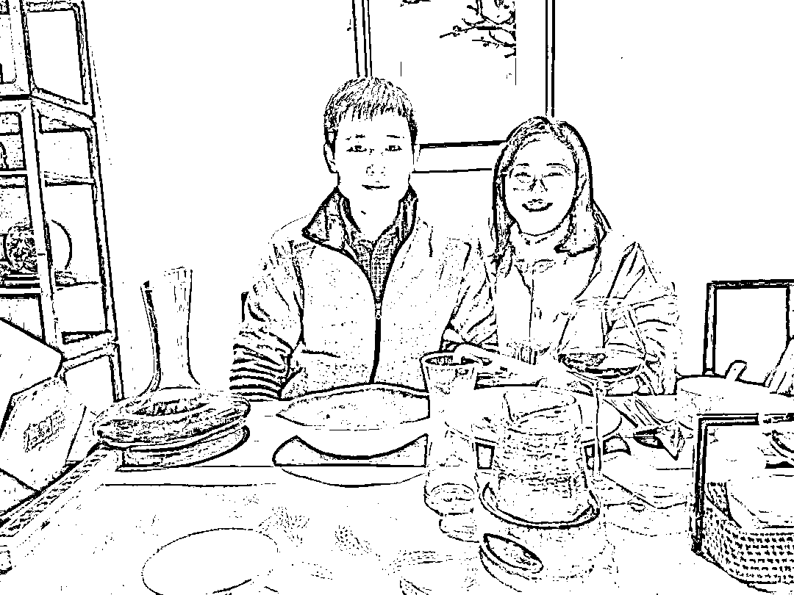

许多朋友羡慕我们，是真正的灵魂伴侣，琴瑟和鸣，彼此扶持，共同成长。王先生从大学起就不断点出我的天赋优势。他说我专注力强、反应快、记忆力好。这些肯定对我影响很大，因为我的爱的语言就是赞美。我也因此更清晰地看见自己的长处。工作后他常夸我高效、爱钻研、负责。转型写作后，他又说我很适合新媒体写作，对人性敏感、联想力强、爱思考、行动力强。

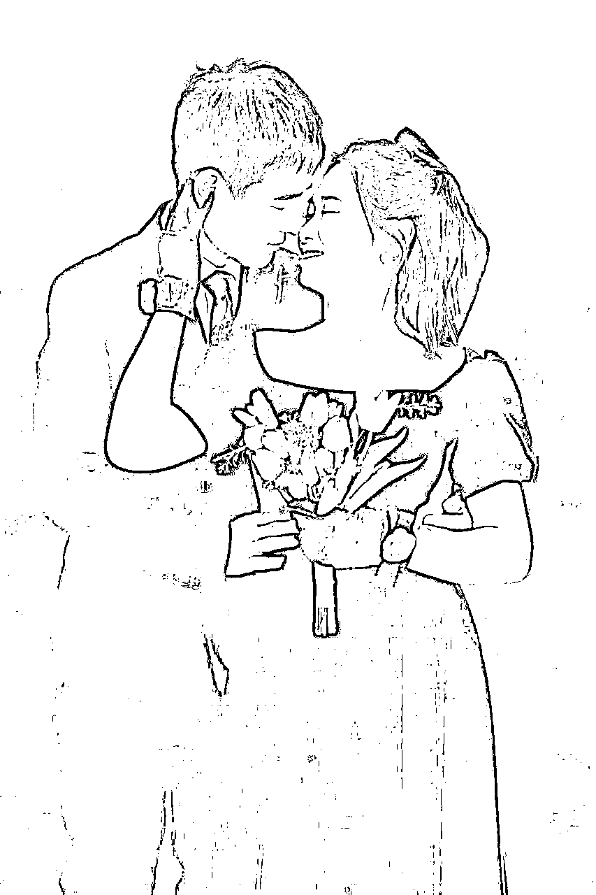

事实也如此，我越来越坚定自己适合写作，且很有天赋。身边重要他人的肯定太重要了，它会成为前行的动力。我很幸运遇见如此懂我、肯定我的伴侣，让我时刻感受到被珍视、被看见。在一段健康的关系里，你会不断从对方那里获得能量，变得更好。相反，持续被否定、被打击的关系只会消耗你。女性想要理想的生活，既要把热爱做到极致，也要经营好亲密关系，获得另一半的全力支持。

我能毫无后顾之忧地做自己喜欢的事，全靠王先生的支持。今年我提出旅行办公的想法，他立刻达成共识，我们说走就走，在云南旅居了一个月。旅途中他负责规划、带娃、操心细节，我只需要放松享受并做喜欢的事。我常沉浸在自己的世界里，他就帮我处理现实的琐碎。没有他的支持，我很难如此洒脱地绽放。

经营好亲密关系，能给女人巨大的滋养，你会时时感受到被全心全意爱着、呵护着、无条件支持着。这种陪伴带来深厚的能量。时常有人告诉我，《我想和你好好的》写得很好，很落地，充满经营亲密关系的智慧。哪怕是结婚多年的70后读者，看完也深受触动，感叹原来亲密关系有这么大的学问。经营得好的关系，减少了内耗，一切都会更顺。

每一个真挚的灵魂都值得被世界看见！每个人都可以活出天性，按自己的意愿度过一生。只要坚持向内探索，找到天赋使命，就不必再“工作”，每天都能活在热爱里。

你不必成为任何人，只需成为你自己。

你是独一无二的存在，你的存在本身就是最大的价值。让自己发光，而不是等待被照亮。当你找到自己，全世界才会找到你。请无条件地爱你自己，给自己无坚不摧的爱。爱自己，是活出自我的唯一路径。愿新的一年，你能成为你自己！

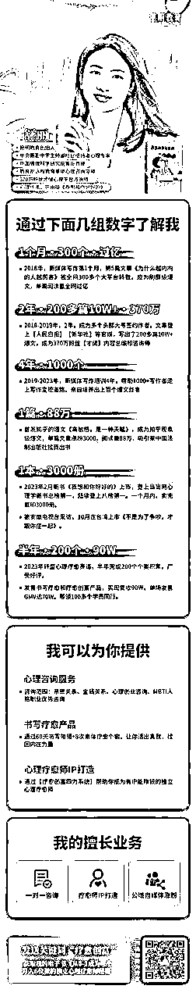