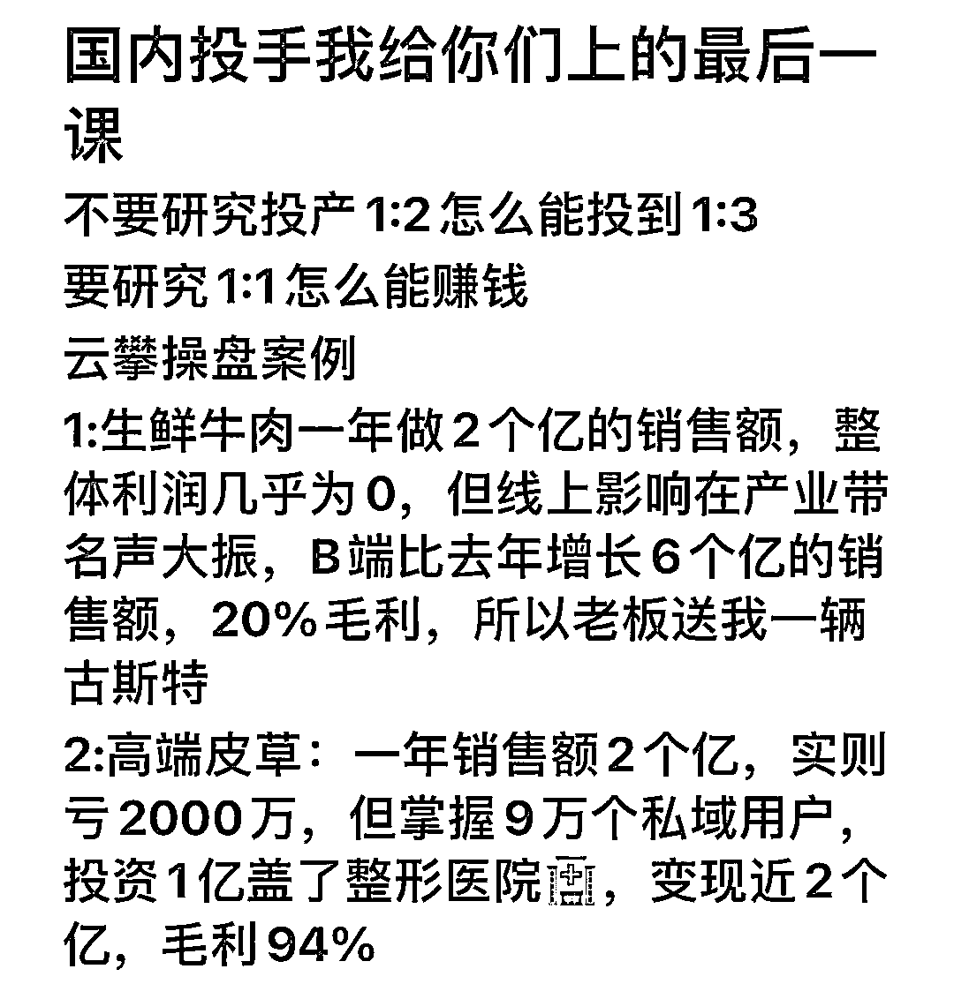
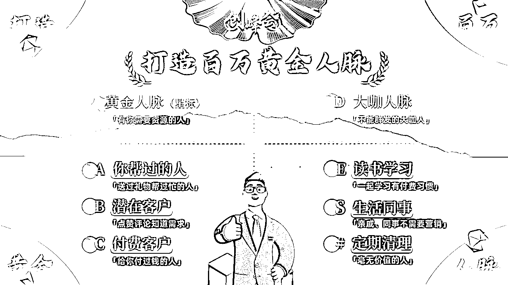
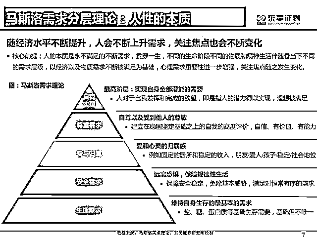
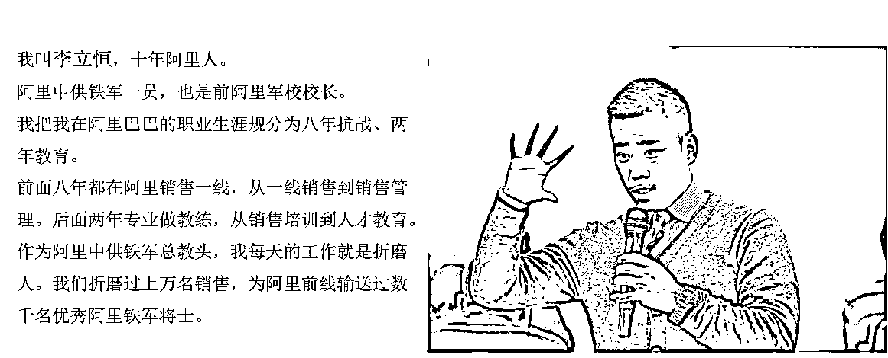

# 【私域流量营销天书】私域年利润千万的方法论分享
作者：龙哥

私域年利润千万的方法论，今天全部摊开讲

你发现没有？真正靠私域年入千万的人，很少满世界吆喝。他们只是在暗处搭好了一整套体系，让流量、信任、成交自己滚动起来。

我做私域这些年，最拿得出手的不是什么理论头衔，而是两次实战：2022年和2023年，分别用3天时间收款两百多万。这当中没有花哨套路，全是顺着人性做战略设计。什么叫战略？就是把千头万绪的要素按轻重缓急排好，站在全局看每一步对最终结果有多少贡献。别急着学技巧，顺序一旦错了，后面全白干。

先记住一个最重要的排序：流量永远比留量优先。私域是加分项，不是救火队。所以你要先拼了命搞流量，再想办法做留量。但比流量更硬核的，是产品力。你能为别人新增多少收益，自己才能收获多少。真正的赚钱逻辑，不是从对方口袋掏钱，而是帮他多挣一千，你从中分一百。可惜很多人，把因果搞反了。

下面我把心法一条条剥开讲。

第一大板块：浪潮式发售。核心结构是“一个前提 + 四个基本点 + 神之一手”。

一个前提，是让用户提前感知到产品价值。否则你的东西再厉害，冷不丁砸出来，也只是自我感动，毫无艺术感。当价值被用户感知到之后，要顺势引导他做动作：比如点赞、回复“666”或“888”。具体怎么引导？没有标准答案，要看场景、看人群、看他跟你信任到什么程度。标签不同，引导方式就不同。前面的价值预知做到位，后面的动作引导接得住，这场仗已经赢了一半。

接下来是四个基本点。

第一，造势。势能就是你的能量场。你精神饱满，用户才愿意靠近；你蔫头耷脑，别人也会感受到。别人怎么看我们，往往是我们怎么看自己的反射。所以发售之前，先把自己的能量拉满，再谈产品造势。造势的目的是抢夺注意力。注意力在哪，钱就在哪。产品还没发布，就要把它的厉害之处、差异化价值、能解决什么问题、有哪些背书和成绩，一点点铺出去，占住用户心智。过程中可以借势，可以请KOL、KOC来帮忙站台。想进一步理解借势，可以看金枪大叔的《借势》。我两次大发售，用的都是倒计时打法：层层递减、抽丝剥茧，每天蓄一点势能，到发售日集中引爆。

第二，预售。这一步甚至比发售更关键。平庸的人盯结果，优秀的人改原因，顶级高手重新设计模型。真正的高手，早在预售阶段就把单收得差不多了。预售拼的是用户标签管理，以及对用户心智的把控。如果一个人在造势期不断跟你互动，基本可以判断他对你的产品感兴趣。这类人别等发售，直接一对一私聊，给点优惠，或者送个小产品，提前转化。一对一精细化销转，每一步都要贴着他的需求、疑虑、顾虑来。这种人就是你的“轻铁杆”，转化率高得吓人。所以倒计时那几天，其实你已经收得差不多了。当然，预售收得好，发售内容也不能敷衍。我每次发售文章都会打磨超过一周，每句话、每层逻辑都反复推，牵一发动全身。

第三，发售。这是整场电影的高潮。常见呈现形式是直播、👸号文章、海报。条件允许，一定要直播。直播能瞬间拉近你跟用户的信任感。做生意的本质，就是一直在跟信息不对称、信用不传递作斗争。谁能打破信息差，谁能建立信任，谁就是赢家。如果写文章，就照前面说的，往死里打磨文案、产品力和情绪价值。发售现场还可以设计一些基于人性的小技巧：比如“今天不下单，明天就调价”“人数满多少就涨多少”“买这个送那个”“组团优惠”。但别照搬，不同产品、场景、人群，策略完全不同。多读心理学，多读历史，你会更懂人性。

第四，升华。有始有终，才算一场成功的发售。前三步攒下来的用户标签，这时候要大扫一遍：有人咨询了八次还没成交，有人付了定金还没补尾款，有人说要介绍朋友却没了下文……逐类跟单、追单。公域里还没动静的用户，后面继续触达，但要小心：已经付费的人别打扰，能屏蔽就屏蔽。对还没转化的好友，持续释放产品力、成功案例，做更长周期的转化。同时，别一根筋。产品再牛，对大多数人也可能无感。我们能服务的始终是一小部分人。放低预期，扔掉玻璃心，才能沉下心做交付。

最后是“神之一手”。对每一位付费用户，都必须认认真真交付。我自己单独设了一个VIP🛰️号，所有付费用户都加到这里，优先级高于个人生活🛰️。为什么？第一，客户就是上帝，服务是根本；第二，维护好一个老客户，比拉十个新客户更有价值。你成就客户，就是成就自己。所有基于利他的模型，最后都是多方共赢。所谓神之一手，其实就是客户终身价值的经营。

我举个例子。我的基本盘是大学生，手里接近10万私域流量。这些学生第一次付费后，只要我把产品和服务做好，他信任你，就会持续买：创赛资料、数学建模辅导、保研服务、付费内推、考研陪学、留学、论文指导、毕业后的赚钱实战营，甚至终极合伙人。一路筛选，一路陪伴。只要基数够大，服务够好，价值够足，整条链路上的高端客户就会源源不断。我们甚至有用户5年单人产值超过50万。这也是为什么别人疯狂抢创业粉，我却安安静静培养大学生。周期虽然长，但回报极大。很多人看不懂我的业务盘，看不透我凭什么做到私域千万——就是因为“神之一手”这只看不见的手，把客单价和终身价值挖到了极致。

第二大板块：私域流量用户心智管理模型。想在私域做到高转化，必须先做心智管理。用孙子兵法的话说：要么不出手，出手就要赢。我把它总结成“1+7”打法。

“1”是打标签。这是基本功。请按照加星和ABCDES#这套体系，去分层管理你的私域好友。

但光会打标签远远不够。先记住一句话：强大自己，是解决所有问题的根源。你要走正道、有真成绩，别人才会信服。靠P图和吹牛就让用户买单的时代早过去了。今天用户只认实实在在的价值和实力。有了实力，还得利他，真正替用户解决问题、创造超预期价值。这才是高粘性、高转化的根本。

“7”是哪七个？昵称、个人简介、朋友圈、👸号、视频号、话术、活动。

用一个餐馆比喻，你记一辈子。🛰️就像一间餐厅：昵称是招牌，个人简介是门口介绍，朋友圈是端上来的菜，👸号是散出去的传单，视频号是店里放的节目，话术是服务员的嘴上功夫，活动是店庆、促销、噱头。

招牌要好记又有深意。门口介绍要有特色，不能千篇一律。菜就更讲究：要有硬菜、有甜品、有招牌菜，时不时还得来点麻辣的、酸爽的。一天别上太多菜，而且厨艺要不断升级。传单要精简，每一条都直击人心。节目偶尔要更新，让顾客多留一份注意力。服务员既要让顾客情绪价值被满足，也要会引导人下单、办卡。活动就是把新客引来、把老客激活的钩子。

这套东西真没什么高大上的理论。你把自己当成餐馆老板，认真琢磨每个摆设、每道菜、每个动作，心智管理就通了。越简单，越强大。

第三大板块：没有流量，何谈留量？搞流量的底层方法论。

先泼一盆冷水：市面上90%的引流课程，买了也是白买，学了也是白学。真正会搞流量的人，要么用钱砸出付费流量模型，要么在苦哈哈的实干里磨出来。有用的道理，几句话就能讲完：

留好诱饵，东西露一半，另一半勾着对方加🛰️来领；
共情，拿到认同，这样的流量最精准；
量变产生质变，持续苦干，绝对相信时间的力量和长尾效应；
持续打磨自己，人牛了、作品有了，流量问题自然解决；
做好后端服务，让用户复购、裂变；
勇敢打付费流，不断优化流量模型；
拆解、研究、模仿50个同行的流量模型，别人能成，你也能成。

可这么直白，没人信。小白就是偏爱复杂。市面上的引流课动不动三五十节，连注册个账号都能拆成两节，为了让你觉得钱花得值。我以前也当过小白，几千块的课买回来一听，全是自己知道的，几句话的事硬是注水三十节。他们还喜欢制造细节焦虑，出了问题就让你觉得是自己没做好。实际上，很多答案都在平台官方手册里。放着光明正大的路不走，非要走歪门邪道，你不栽跟头谁栽？

做流量，本质上就是给内容加三个渠道：音频、视频、文章。音频去喜马拉雅；视频去抖音、快手、视频号、B站、📕；文章去知乎、👸号。平台就是这些，没别的。

但你要明白：排版、字号、头像这些，根本不是核心。内容不行，再花哨的排版也没人看。做内容别自我感动，要用用户思维去思考。怎么做？先拆解50个优秀同行，借鉴、创新，千万别照抄。

流量靠价值换。谁输出的价值多，谁搞流量就简单。所以平时要习惯性搜集素材。卖点锁定了，就跟卖点相关的一切素材都收起来。素材多了，赚钱就像捡钱。所有流量都来自优质内容，而优质内容就是能帮粉丝实实在在解决问题的内容。写软文的本质也无非两件事：帮人解决问题，或者帮人造梦。离开这两点，软文变不了现。每次发东西前问自己：这有没有价值？有价值，流量会自己循环；没价值，就回去充电，继续释放。

搞流量还要打持久战。一年搞不到，就搞两年。锁定一个点，打深打透，而不是东一榔头西一棒子。牛人喜欢简单，新手偏爱复杂。养成执行的习惯，很多事自然成了；养成光学习的习惯，很难立起来。

你网盘里存几百G资料，不牛。牛的是你能把它消化掉，变成一本自己的小笔记。东西放在云盘里不是你的，知识存在文档里也不是你的。只有消化了、执行了、悟出来了，才是你的。就像骑自行车，光背理论没用，多摔几次，你才会一辈子忘不掉。

还有，少做一锤子买卖。产品和服务做好了，二次裂变和内容自传播带来的复利非常惊人。拉新是所有运营环节里最苦、最难的一环。总停留在拉新阶段，迟早崩溃。不会做后端服务，就找一个靠谱的人帮你做。公域是入口，私域是归宿；流量是开始，存量是答案；遇见是起点，相伴是终点；才华是引力，品格是信任。

第四大板块：产品设计方法论——把产品卖出去的底层逻辑。

设计和产品，一定要建立在人性基础上。否则你的产品只是自我感动，用户根本不会买单。研究产品时，多想想马斯洛需求层次理论。

比如社群、圈子、知识星球、私董会这类产品，满足的是什么需求？社交，以及“爱与归属”。很多老板现实中没有真朋友，人情冷暖见多了，骨子里是孤独的。他进私董会，就是想找个归属。也有人是为了“安全需求”：想找到赚钱项目、靠谱的人、优质资源，用钱来对冲未来的不确定性，消除恐惧。再看那些“男性恐穷，女性恐丑，孩子恐笨，长者恐死”，背后全是恐惧。围绕这些恐惧，世界上诞生了多少产品？你品，你细品。

第五大板块：做私域，不懂销售，一切为0。

销售这门手艺，从人类诞生就有了。我公司培养新人的必读书单是：《所谓情商高，就是会说话》《销售就是要会聊天》《拥抱你的客户》《绝对成交话术内训手册》。必看课程是：老梁在蜻蜓FM上的《四大名著情商课》，以及前阿里军校校长的《阿里铁军销售圣经》。后者偏to B，但触类旁通，值得参考。

除了上面这些，我还有几个压箱底的方向：朋友圈塑造心法——四高万物通用法则；私域销售路径的八大流程逻辑；私域销售爆单话术SOP。后面有机会再慢慢展开。

说到底，再好的方法论，都要靠你自己去悟、去实践。先搞流量，再搞留量；先帮用户赚钱，自己才能赚钱。顺序对了，万事可成；顺序反了，一切扯淡。