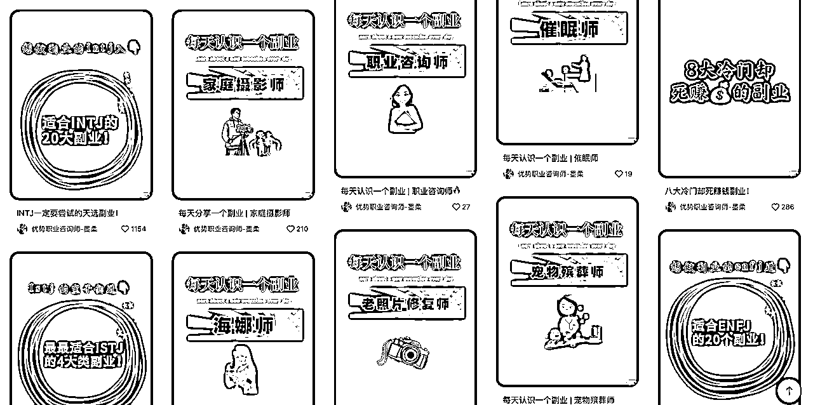
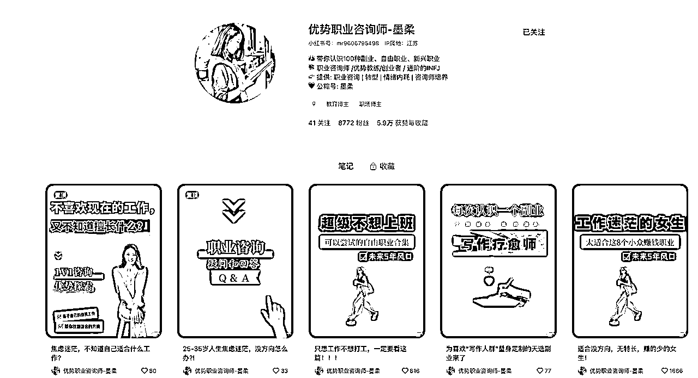
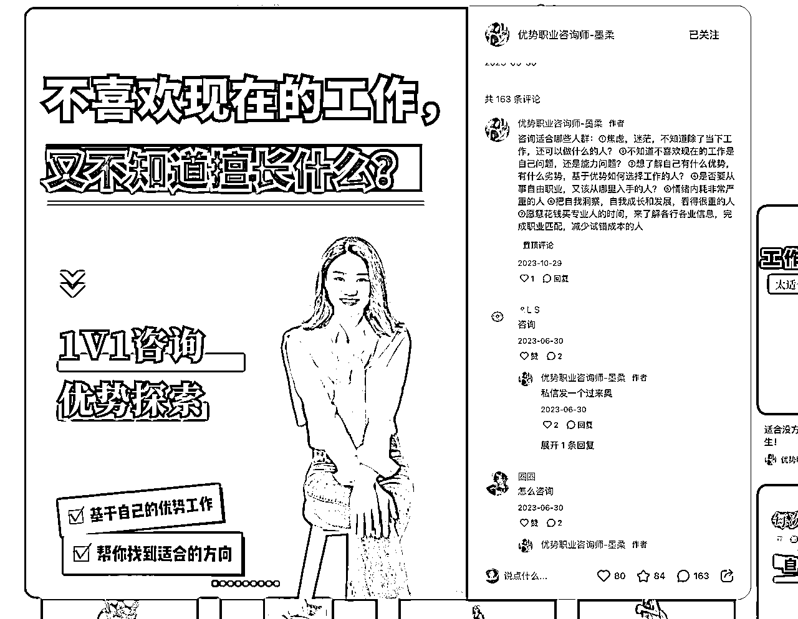
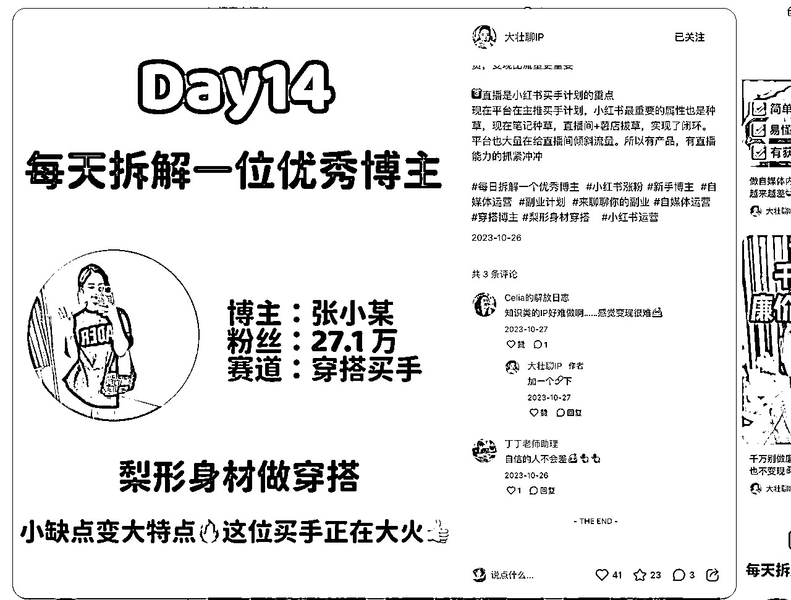
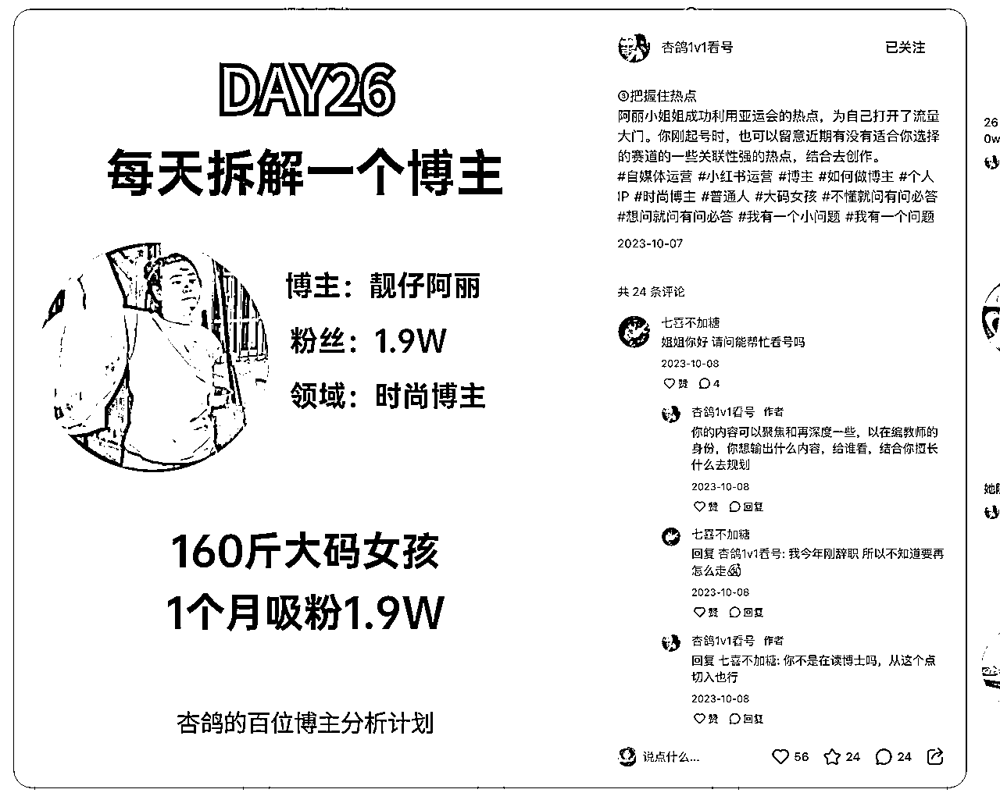

# 风向标拆解第 2 期--小红书教人赚钱的博主在玩些什么--抹茶君酱

这一期，我们继续深挖种草社区里的“搞钱生意”。观察对象不是普通种草博主，而是一群靠教别人赚钱来养活自己的人。

他们对外挂着各种标签：有人自称职业规划顾问，有人擅长打造个人IP，有人专门帮网友“看号”。乍看是在分享知识，实际上每一步都是设计好的商业动作。

流量怎么来？核心不是做爆款，而是靠持续更新的图文内容 ＋ 私域承接。

内容模式主要有两类。

第一类是职业科普型，每天介绍一种冷门或新兴的赚钱方式。

为了营造专业感，创作者会把一些咨询成功的截图或聊天记录固定在顶部，让每个点进来的人都先看到成果。

观众一旦被触动，就会在评论区留言，这时作者便会私信联系，完成第一轮筛选。

第二类是账号解剖型，每天挑一位博主来拆解分析。

这类内容天然容易引发共鸣，因为不少读者同样困惑：我的号为何一直没起色？于是评论区经常出现“求帮我看号”的请求。作者不急着给长建议，而是简单点评两句，再引导对方私聊。

私聊之后，就顺理成章地沉淀到个人通信工具上，完成引流闭环。

产品端也很直接：单次付费，提供一次完整的看号和路线答疑。比如帮用户梳理定位、找出问题、规划路线。

这背后是一套典型的低价转高价链路：用公开内容吸引泛粉，用单次咨询筛选意向客户，再用长期社群锁定高价值用户。

算账很简单：主要成本是作者的工时和心力，收入来自高额咨询费和年度社群费用。因为是“卖时间”，所以收入有上限，扩张只能靠团队或杠杆。

具体落地的步骤可以概括成四步：

第一步，做人设。起步阶段需要有一定学历、从业经历或实战成绩，否则用户凭什么都信你？

第二步，做内容。持续解剖其他创作者的路径或不同行业，让目标读者在你的主页里看到熟悉的身影，进而产生信任。

第三步，做筛选。从评论和私信中发现真正有付费意愿的人，转到私人号，用一次深度诊断建立关系。并不是每个留言的人都会成交，真正成交的是那些问题最迫切的人。

第四步，做沉淀。把已经掏钱的人邀请进长期社群，持续提供服务，持续获得收入。

这个模式的瓶颈也很明显：本质上是卖作者的个人劳动。多接一个单，就多消耗一段精力，所以可复制性一般。

要想放大，必须从“单干”走向“团队干”。当咨询量变大，创始人需要把标准化的执行环节交给下属，自己集中精力做产品规划和长期战略；或者提前用收徒的方式，把个人经验复制给更多人。

说到底，这套打法的内核是：内容换信任，咨询换付费，服务换复购。真正的门槛不在流量运营，而在于你有没有实力站在别人面前说一句：这条路，我能带你走下去。