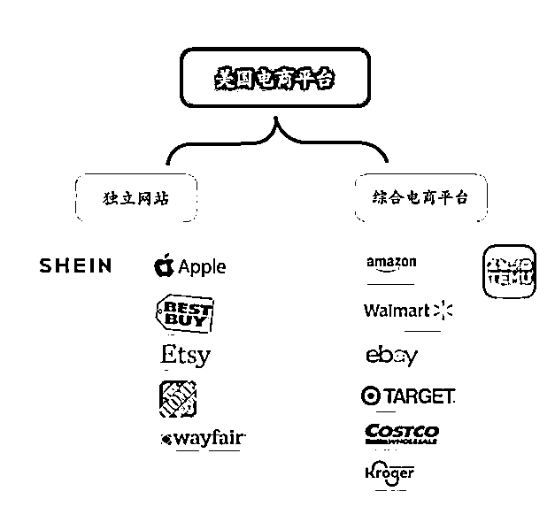
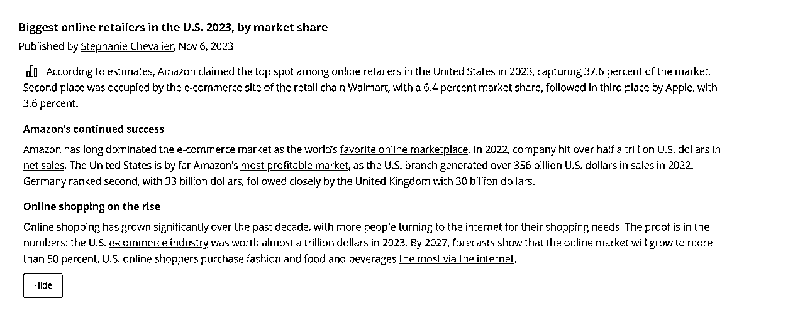
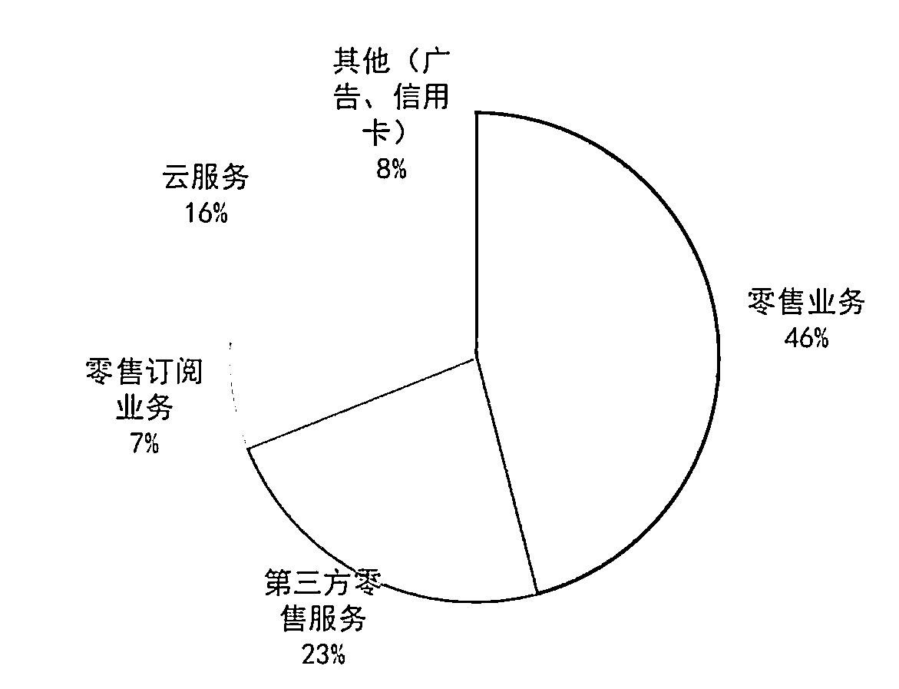
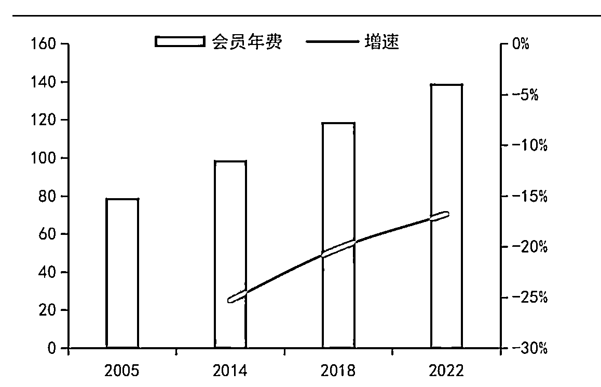
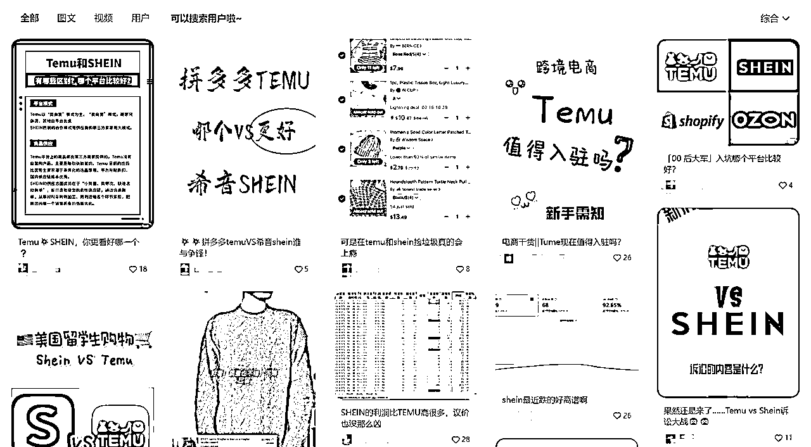
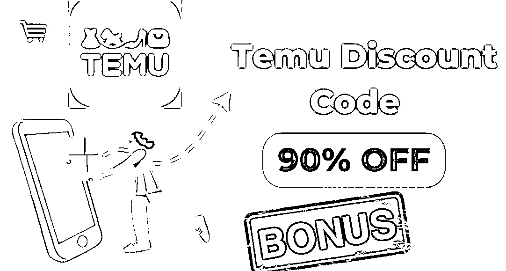
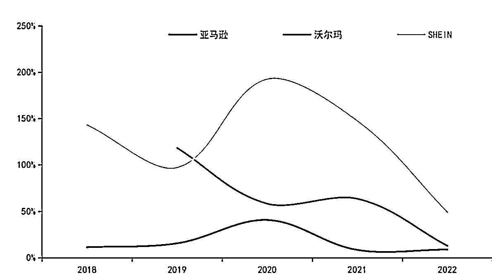

# 2024，跨境人到底该押注亚马逊还是豪赌Temu？

最近翻开朋友圈，几乎被同一类信息刷屏：Temu卖家晒订单、服务商晒战报、各种“爆单神话”满天飞。旺季一收尾，我也终于腾出时间，静下心来做了一番功课。

这段时间，不断有卖家朋友跑来问我：是不是该换赛道了？新平台到底能不能做？你是什么看法？

我的回答始终如一：不建议。

为什么这么笃定？这篇文章，我就从整个跨境电商大盘切入，顺着“宏观→微观 →全球→个体”这条线索，陪你一起把局势理清楚。

其实不论你是刚入行的新手，还是手里握着过亿体量的老卖家，做任何战略选型，首要前提都是：先看大局，再想自己。

# 1、全球电商风向：真能富贵险中求？

这几年的跨境电商圈，新平台一个接一个冒出来：势头凶猛的Temu、声量巨大的Shein、稳坐头把交椅的亚马逊、老牌零售巨头沃尔玛……说实话，今年无论你押注哪个平台，市场都还有空间给你施展。

北美电商市场，大致可划分为两大阵营：品牌独立站与综合交易平台。Statista的统计显示，2023年亚马逊在美国在线零售领域继续蝉联榜首，份额达到37.6%；排在第二位的是零售连锁品牌沃尔玛的电商网站，占比6.4%；苹果以3.6%紧随其后，位列第三。

亚马逊作为老牌平台，沉淀了最久的时间，市场份额也做到了行业天花板——2023年已经稳稳占据37.6%，在电商大盘里属于一骑绝尘的角色。回看2022年，它的净销售额高达1424亿美元，其中有61%来自北美市场。

2022年亚马逊收入结构（数据来源：statista）

亚马逊的市场占比眼下依然无人撼动，但它的费用体系日益复杂，热门类目内卷程度也相当激烈。对中小卖家来说，门槛并不友好。

再看后起之秀Shein和Temu。前者靠极致的供应链效率，后者靠“性价比”三字诀，都把全托管模式玩到了极致，也迅速抢占了大量市场份额，给不少亚马逊卖家带来了前所未有的竞争压力。

今年，Temu被冠上“跨境黑马”之名，在海外一路狂飙——拉新返利、社交裂变、“钞能力”引流的套路，一股“拼多多式砍一刀”的味儿扑鼻而来，熟悉到不能再熟悉。

我身边确实有不少卖家跃跃欲试，想冲进Temu淘金。但从平台规则、生命周期、利润空间等多维角度综合考虑，我并不建议新手入局。

有人觉得：“风浪越大鱼越贵，富贵险中求。”

我想泼盆冷水：电视剧看多了吧。这个行业发展到现在已经相当成熟了，哪来那么多大鱼？放眼望去，全是韭菜。

# 2、四大平台横向拆解：低价从来不是唯一王牌

## Ⅰ. 亚马逊 Amazon

年底招商季一到，我这边收到不少老板咨询——个个拿着资金，打算跨行杀进跨境电商。

可聊上几句就会发现，他们对亚马逊的真实认知非常有限。那我借这个机会，多说几句。

亚马逊最早是从线上书店起家的。它之所以能一步步走到电商领域的巅峰，有几个关键历史节点不容忽视：

**1994–2000年：早期品类扩充与国际化扩张。**  
从在线书店起步，亚马逊迅速把版图扩展到全球，同时上线音乐、其他商品类目，一跃成为全球最大在线书店。这波产品拓展叠加国际市场布局，为它后来的电商霸主地位打下了深厚地基。

**2001–2009年：供应链与物流革命。**  
期间，亚马逊推出了很多人熟悉的“泡面神器”——Kindle。这款产品帮助亚马逊迅速抢占电子书市场，数字阅读在那个年代迎来高峰。当时我身边几乎人手一台Kindle，电子书阅读的风潮就是被它点燃的。

而真正改写格局的，是第三方卖家平台的上线。亚马逊首次开放第三方卖家入驻，最早吃到红利的那批人，很多成了日后的“深圳湾业主”。

**2010年至今：重仓技术与新零售。**  
FBA物流服务体系上线，让亚马逊拥有了碾压级的履约网络；Prime会员制度进一步锁死了用户黏性；云计算业务持续发力，新零售布局不断加码。2018年，亚马逊与Shopify达成合作，允许Shopify商家使用Amazon Pay和“Buy with Prime”，Prime生态的影响力再次被放大。

到2018年，亚马逊市值突破1万亿美元，稳居全球市值最高的公司行列。

亚马逊会员费变动趋势（数据来源：statista）

亚马逊的崛起，是必然。它从未停止过：在不同阶段持续创新、开拓新业务、押注新领域，才最终夯实了它在电商和科技圈的统治席位。

## Ⅱ. 沃尔玛 Walmart

沃尔玛大家都不陌生。

从大盘来看，亚马逊不可能不被沃尔玛这类老牌零售商以及新兴平台冲击。

沃尔玛始终坚持“天天低价”的理念，在本土消费者心中有极高的接受度。全球范围内，它已在19个国家开设了10500家门店。截至2022年底，沃尔玛仍是美国零售超市市占率最高的企业——旗下沃尔玛超市和山姆会员店加起来，占比达到29.9%。

从2010年起，沃尔玛也开始全力拓展线上业务。2022年它的净销售额高达5677亿美元，其中电商净销售额为732亿美元，同比增长12.79%，占总零售额的13%。

虽然沃尔玛电商入局较晚，市场占比较亚马逊逊色不少，但它的核心竞争力在于线下实体网络极其稠密，配货方式更为灵活，相对亚马逊的仓储布局有明显密度优势，这让它在“当日达”服务上能覆盖到更多用户，也对亚马逊构成了实实在在的威胁。

再看用户画像：沃尔玛的核心客群是对价格敏感的中低收入人群，平均年龄46岁，女性占比约60%；反观亚马逊，用户更年轻，更在意商品品质，性别比例更加均衡，用户圈层也更宽泛。

总体来看，沃尔玛锚定的是“中低收入人群的实惠之选”，亚马逊瞄准的则是“年轻重品质的广泛受众”。两者定位分化清晰，最终也体现在购买力和客单价的差异上。

## Ⅲ. 新兴平台：Shein 与 Temu

这几年，Temu和Shein把招商攻势做得风生水起，入局者个个看着都赚得盆满钵满。身旁的亚马逊卖家，也越来越多地把“转战Temu”挂在了嘴边。

可是，新兴平台的繁荣，真的代表趋势一片向好？

Temu，拼多多的海外版，主打“极致低价”，用极其凶悍的方式切开了美国中低端市场。同一款浴室地垫，亚马逊卖9.99美元，Temu上可能只要3美元——相当夸张。它依靠全托管模式吸引供应商，再通过竞价机制，把卖家的利润空间压到最低，转头把最高90%的折扣让给消费者。对卖家来说，这操作堪称“天降正义”……

Shein更有优势的，是供应链。它“品类多、上新快、时尚度高、价格低”的标签，全靠强大的柔性供应链和精细化管理能力做底盘。目前它的供应商已经突破3000家，每天上新超过2000款产品。可以说，正是供应链的厚度，撑起了Shein的上新速度和高性价比优势。

Shein还在2023年计划完成100家供应商工厂的实体扩建与技术改造。

Temu和Shein在众多新兴平台里，已经算极其成功的存在。其他平台想完全复刻它们的商业模式，难度极大。

不过，电商平台的长期成功能否只押注价格？答案显然是否定的——还需要在用户体验、品牌形象、社交裂变等多个维度上建立平衡。

更值得警惕的是，低价和快时尚单品这两个标签，后续极有可能在环保合规、产品品质层面引发争议。这些潜在问题，极可能反噬品牌形象，动摇消费者的长期忠诚。

亚马逊、沃尔玛、Shein 近五年电商GMV增速（数据来源：statista）

# 3、亚马逊未来趋势：五年后，谁是主流？

新兴平台会不会冲击亚马逊？答案是：必然会。

但我敢断言，未来五年，亚马逊依旧是跨境电商的主流主战场。

预测显示，沃尔玛、Shein、Temu未来几年会保持高速增长：

- 亚马逊的市场份额，预计将从2023年的37%小幅回落至2027年的35.1%；
- 沃尔玛则稳定爬坡，预计2027年市场份额上升至12.4%；
- Shein的份额也将稳步增长，预计到2027年达到0.89%；
- Temu的增幅相对更猛，预计2027年市场份额可攀升至2.3%。

（上述预测的基础逻辑是：公司市场份额 = 公司电商总额 ÷ 美国电商零售总额。想要获取具体的测算细节，欢迎私下找我聊。）

（数据来源：statista）

说白了，未来五年，亚马逊确实处在一个缓慢下降的通道里——份额预估会缩水2.5个百分点左右。但你知道这意味着什么吗？

意思是：至少五年内，亚马逊依然是绝对的龙头。

而在平台选择这个问题上，最关键的一条判断标准是什么？

核心在于：这个平台能否实现“品牌化沉淀”。

对电商而言，只有持续提升品牌影响力、稳固用户忠诚度、保持高速增长，才是长久发展的底牌。而这两件事，亚马逊从十年前持续做到了今天。

# 4、写在最后

往后看五年，我的结论依旧是：归来仍做亚马逊。

那些跑去新兴平台的卖家，实际上也没有彻底抛弃亚马逊另起炉灶——原因很简单：亚马逊拥有庞大的用户基础，以及全球化的资源布局，这两点对卖家来说都是实打实的利好。

所以2024年，我依然建议：踏踏实实做亚马逊。

在电商行业狂奔的这些年，每个平台都有自己的闪光点，也各有各的局限。

他强任他强，清风拂山岗。

富贵也不必去险中求。

这行里，多少人为了那条“大鱼”争名逐利，信奉“马无夜草不肥，人无横财不富”，不惜一切代价往上游爬，却弄丢了最开始那颗初心。

而我想说的是：

守住初心，保持对行业本质的深刻理解，灵活调整打法，不被表面的浮华迷惑，用实实在在的积累和努力去靠近梦想——这才是通往成功的正道。

---

全文完。

下面几篇经典文章，99%关注我的人都会读，强烈建议你也认真看看：

精细化运营系列  
干货型内容  
职场经验分享

如果你觉得这篇文章聊得有点意思，欢迎来和我交个朋友。