# 普通人要想靠自由职业活下去，先把生态位想明白

> 原文：[`www.yuque.com/for_lazy/thfiu8/cqko9giysylrzso8`](https://www.yuque.com/for_lazy/thfiu8/cqko9giysylrzso8)

## 普通人如何通过生态位选择，实现长期自由职业？

作者：张柯 Ker

日期：2023-12-29

各位好，我是张柯 Ker。

这篇稿子是我过去一年对**商业逻辑**的梳理总结，也是去年年底那篇《普通人如何通过项目实战，成为自由职业》的递进。

去年那篇偏向微观，从**个人**这个单位出发，讲的是 0-1 的打法。

今年我换了个视角，拉到宏观，从**模式**这个层面聊，讲的是 1-10、10-100 怎么走。

**模式决定碾压，定位决定生死。**

这个话题我酝酿很久了，发现身边很多人缺的不是执行力，而是**生态位思维**和**商业模式搭建能力**。

不少已经把 0-1 跑通的人来找我咨询，结果发现他们还在 0-1 的循环里打转，怎么也跨不过去，困在原地。

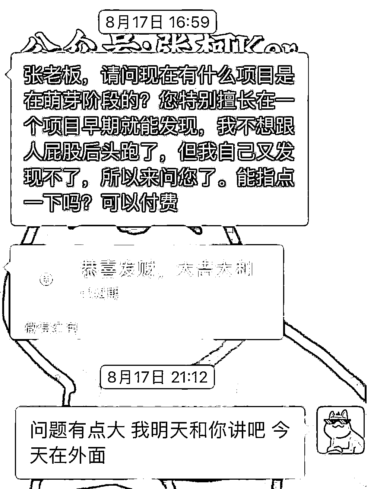

大部分人认识我，源头都是副业项目。

1、去年的小说推文，我应该是全网最早一批做起来的人，现在去搜当年文章里的原句，能看到被抄到处都是，除了我先发制人之外，可能也是因为我把项目做爆了。

2、后来的短剧 CPS，我也是最早一批入场的，带人半个月内 GMV 几十万，还因此成了赚钱的航海教练。

3、公众号爆文写作拆解，我是赚钱里最早把底层原理拿出来讲的，也顺手拿了颗龙珠。

4、小红书商单也是第一波。

5、最近一些杂七杂八的新赛道，也都算我先探路。

我对趋势的不少判断，后来都应验了，就是有点遗憾，知道却没及时加注，错过了很多钱。

**好了，这些战绩不重要。**

重要的是，我这份对商机的嗅觉到底是怎么长出来的？你们能不能学会？

我甚至觉得，很多好机会是主动找上门的，你信吗？

往下看。

我把生态位拆成五级：**困局者、入局者、借势者、成势者、布局者。**

为了让大家更好理解，我会用**布局者的双重视角**来对照讲述每个阶段。

**一、困局者**

先说结论：

**我们都是心甘情愿待在某个局里。**

有时候是清醒的，有时候是糊涂的，但都是自愿的。

一旦你真的想破局，就已经不在局里了。

再强调一遍：

**无论你多讨厌现在的状态，你都是自愿待在里面的。**

要么在攒劲，要么在自我否定。

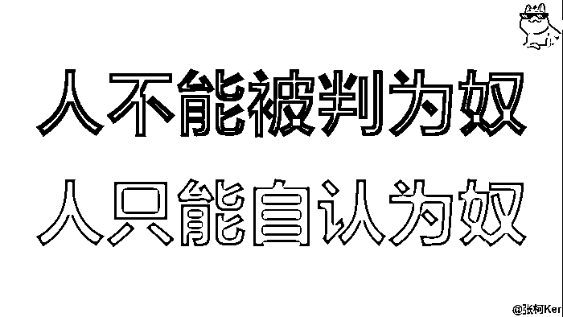

没有觉察的人，就是典型的困局者，这是最大的一群人。

1、总觉得哪里不对劲，却说不清具体是什么，心里没开过光，**分不清什么是真正的舒服，什么是真正的糟糕。**

2、每天拼命干，像头老黄牛，却对未来没有一点画面感，**想象不出更好的出口。**

3、只想把今天混过去，用工作麻痹自己，完了就安慰自己今天也挺累的，赶紧躺平。

**知识付费也成了缓解焦虑的止痛药，买了等于学了，其实根本没内化，只是在自我暗示“我很努力”。**

是不是说到你了？

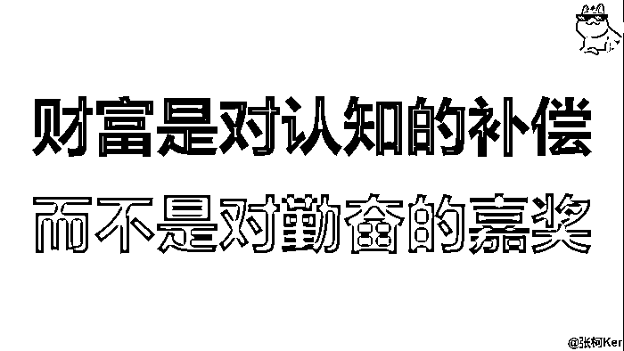

##苦其心志，劳其筋骨，饿其体肤，空乏其身，行拂乱其所为，
**无为使我有为，无知使我有秩，**
**绝对正确的，不一定是正确的，**
你，懂了吗，##

**二、入局者**

人必然身处各种局里，**不成局就不成活。**

想破局，就得先从舒适的局里走出来，主动跳进一个更不舒服的新局。

**商业的本质是价值交换。**

很多人没搞懂这一点，只会怨天尤人，觉得市场不公平。

其实问题很简单，你能提供什么价值？别人凭什么给你价值？

搞懂这点，你就从无意识变成了**有意识的入局者**。

**要么把自己卖出去，要么把知识买进来。**

一堆人带着打工思维，觉得老板给这么点钱还想我卖命？觉得买了课老师还不把东西硬塞给我？

从不主动钻研提问，能混就混，拿摸鱼开玩笑。

殊不知自己最大的资本——年轻——正在被白白浪费。

我毕业后只在公司待过半年，销售干了俩月，社群运营干了俩月。彻底自由后，家里人一直说我不稳定不体面，我差点动摇，又回去上了半个月班。

那次我彻底明白了，这条路是单行道，没有退路。

一个月赚六位数的时候，再让我回去拿几千块工资，不如一刀。

别跟我提稳定，我一年赚你十年，我出去玩九年，这叫不稳定？

被我文章吸引来的、被我本人吸引来的、主动进这个圈子的，我们大概率是一路人。

见过互联网上机会是怎么涌现的，就回不去了。

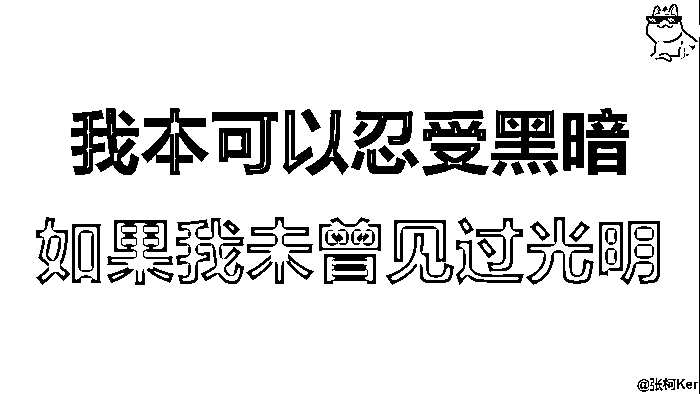

我当初进公司只有一个目的：**学东西。**

社恐想锻炼就去做销售，想做个人 IP 就去做社群运营。

东西学完了，看不到更大的成长空间，老板也不认可，那就走。

把**“我为老板用命换点钱”**改成**“老板花钱请我来学技能”**，心态就通了。

1、什么都不会的时候，能交换的只有时间和精力。认清现实，忍辱负重，用不喜欢的工作换未来喜欢的能力。

2、有点本事后，能交换的就多了“能力”这一项。你可以卖更高价，抓更多机会，看见更多可能性，从没得选到有得选。

先相信自己总会有点东西，再主动入局把自己变成有点东西的人。

**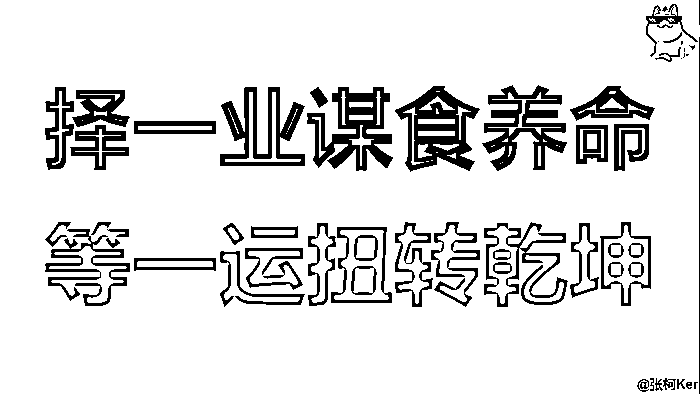**

##**破局钥匙不会存在于局中，**
其中一把钥匙，在布局者心中，
另外一把钥匙，在你的态度中。##

**三、借势者**

恭喜，你的价值提升了。

可能是技能被大腿看上了，可能是你主动把自己卖给了大腿，总之你跳出来了，**被看见了。**

别急，你只是飘在半空，还没落地。

给机会和抓住机会是两回事，第三轮筛选来了。

到这一步，已经和内容、职场没关系了。

**你要主动靠近你的理想人，**谁活成了你想要的样子，就去靠近谁。

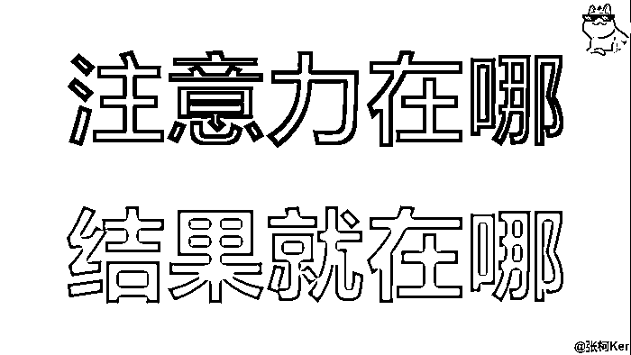

##你的价值我看到了，
现在，我要看到你的**执行与忠诚，**
**有能力的人很多，**
**有机会的人很少，**
如果你的**能力**不能为我所用，
那我绝对会倾向于让你泯于众人，
不然我帮你磨刀干什么，让你找机会捅我吗？##

能力分即时变现和延迟变现。

即时变现：要么你直接给我钱，要么我们信息、资源互换。

延迟变现：我觉得你人品还行，态度不错，提点你两句，让你少走弯路，赌你未来成事后记得我。

交流市场是劣币驱逐良币。

我以前也是老好人，有问必答，后来发现有人连谢谢都不会说，还把我拉黑。既不给我钱，也不给我情绪价值，那就别怪我划清界限。

现在不熟的、没付过费的人问我，心情好敷衍一下，心情一般已读不回，心情差直接删。

小红包我少说两句，大红包多说两句，直接砸钱的，我才把家底掏出来过一遍。

**我就是出来卖的，价高者得。**

借势者要明白一个道理：**不忠，便不用。**

什么叫忠？用心、诚意，自己问自己。

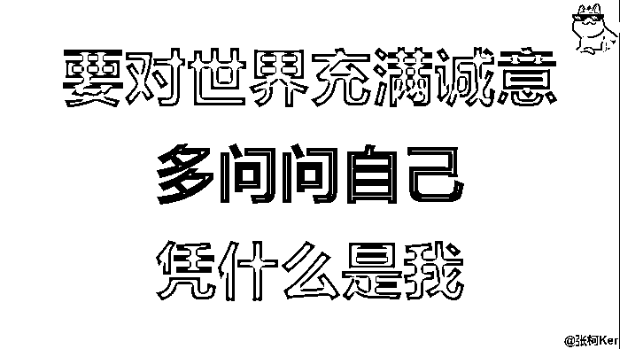

##我什么都知道，也什么都能看到，但我不会说，
我只会用破局的后半截钥匙投资你，
至于前半截钥匙，要么你自己长出来，要么我投资下一个。##

**四、成势者**

你已经天才到跳出怪圈了。

这是人生关键转折点。

以前是你主动问：**哥，我能不能……**

现在是别人主动来问：**好兄弟，你要不要……**

听上去有点怪，但就是这个意思。

你的能力已经过线，被很多人看见了，有代表作了，有势能了，你成了别人心目中的理想人。

为什么这是转折点？

因为一旦你成了成势者，除非自己作死，否则很难再掉下来。

**机会不再是你找的，是机会来找你。**

优质的一手信息差只在小圈子里流转，而你已经在里面了。

很多项目的一手风声，都是圈里人主动或被动透露给我的，他们会问我做不做。

拆解能力是迁移的，我看一眼就知道能不能做，所以我一直走在前头。

身边高能量的同行会把你往前推，有时亢奋，有时 emo，但方向都是向上。

##我的左膀右臂，少了你我可就亏大了，我可得好好带带你。##

**五、布局者**

到了这个阶段，你和以前的大腿基本就是合作关系了，你甚至可以拥有多条大腿，或干脆自己就是大腿。

**有了基本盘，**风吹雨打都不怕。

这里重点说一个分支。

过了入局者后，会分两条路：

有人选择继续**一线厮杀**，有人选择**隐居幕后做局**。

前者多见于工作室，缺少借势和成势的过渡期，容易长期卡在 0-1。

后者多见于个人 IP、超级个体，必须经历完整周期才能体悟。

两者都能赚钱，但前者很容易陷入项目一结束就迷茫的死循环，项目凉了没 Plan B，又开始从 0-1 找新项目。

**很多困境，本质都是商业模式没搭好。**

回到开头的问题，请看图，

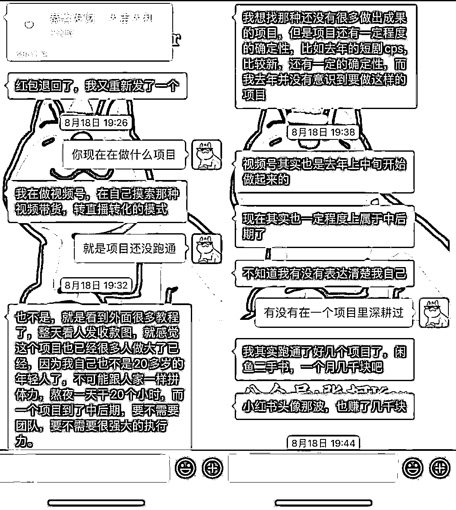

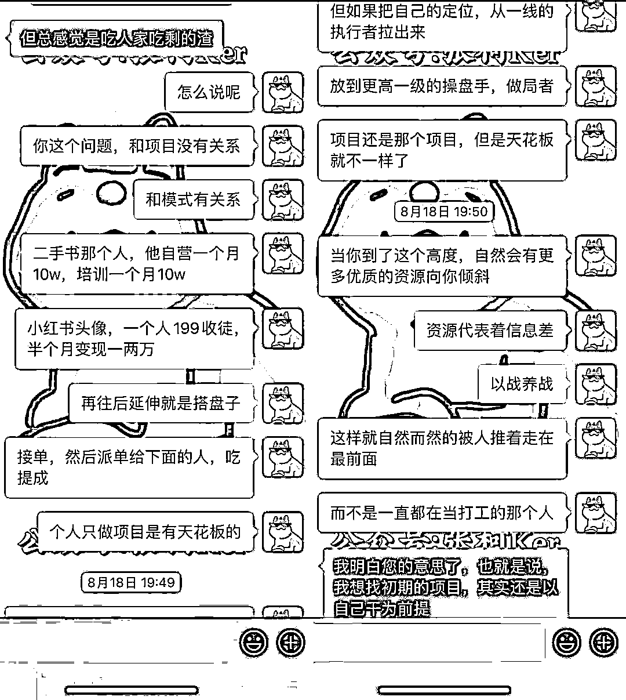

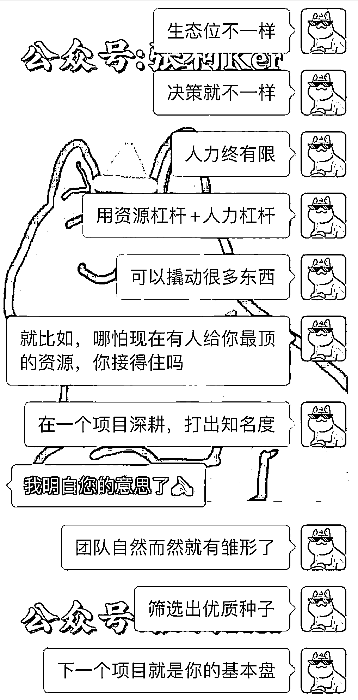

跳出当下，用更高维度的视角看问题，解法和天花板都不一样。

自己单打独斗，天花板肉眼可见。

想赚更多，要么加量，要么招人放大，要么换玩法。

如果根子上没解决，没搭建长期商业基本盘，问题依旧。

**项目会死，能力会留。**

你在这个项目里积累的能力能不能复利？能不能用在下一个？如果不能，你是不是又要从零开始？

很多人做事没主线，今天学一点明天学一点，却没想清楚自己想成为什么样的人、做成什么事。

要么是试错不够多，没找到正反馈；要么就是还是困局者，眼界太窄。

走过的路都不算白走，但**步子对齐一点，就能更快到拐点。**

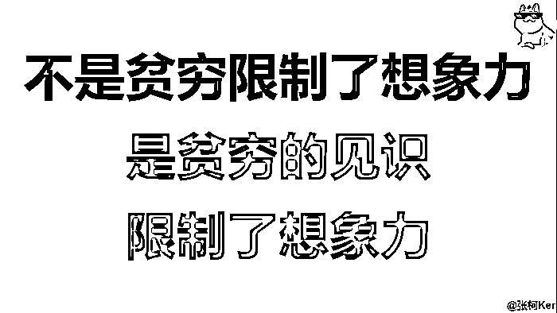

再深一点聊：

**生态位选择和商业模式搭建，都是为了穿越周期。**

0-1 跑通后只做项目，很难质变，大多是量变。

短期赚多赚少的区别罢了。

要明白：**能赚钱**和**随时能有钱**是两回事。

赚到钱后怎么复用、怎么守住？

财富不止是钱，还有人脉、能力、认知、信息源。

想达到“随时能有钱”的状态，就得质变，而不是在项目上线性增长。

**为学日益，为道日损。**

做项目是加法，在一条直线上延长。

搭建商业模式是减法，把直线归零成点，再延展、环绕、炸成星光，聚成“体”。

做项目问的是**“我要什么”**，搭模式问的是**“我不要什么”**。

拿我自己举例，我物欲极低，正好有参考价值。

入行后最大的焦虑不是哪个项目能赚钱，而是我赚钱到底为了什么？

这个问题困了我两年。

以前我只能逃避，赚到就花光，饿了自然会继续赚。

现在我的答案是反过来的：我不为了什么。

我为什么选择自由职业？

我不喜欢被无意义的工作捆绑 → 我要创作
我不喜欢三点一线被锁死 → 我要自由
我不喜欢工资限制未来 → 我要创业
我不喜欢忙到没时间发呆 → 我要思考

……

所以我的商业模式，都是围绕“自由”建的，为了摆脱“束缚”。

所有选择底层都是因为我不喜欢某件事，才去做对应的另一件事。

我们很难清晰说出**“我要什么”**，但一定能坚定说出**“我不要什么”**。

回想你之前的大决策，基本都是先排除了“不要什么”，才选了方向。

只要不违背自己喜欢的东西，结果都不会差太多，这就是“道”，也就是减法。

**确定性砍掉不喜欢的东西，归零后再从无到有思考“我不要什么”，排掉绝对错误的路，剩下的多半能走通，走着走着就对了。**

从内心长出来的路，才会成为你的商业模式、你的生态位，形成基本盘，从而穿越周期、拥有随时有钱的底气，实现长期自由职业。

有了赚钱能力后，多想想怎么做到随时能有钱，什么是变、什么是不变。

天天盯着销售、转化、团队管理、SOP 反而着相了。

这些我不懂？学不就行了？

能把 0-1 跑通的人，学习能力都差不到哪去。

尤其是我这种有点艺术细胞的人，更应回归本质，别强迫自己做不喜欢的事、赚不喜欢的钱。

看到同行那种极致的流量转化逻辑，确实赚钱，但我不喜欢，那是他们的道。

我眼中的商业要有“味”。

**来之则喜，去之则安。**

选我，你不会亏；不选我，你也一定找到了更好的。

我从不主动成交任何人，要买自己来。

过一阵子我可能就把这篇删了。

对，我承认我说话直。

**当「过程」沦为只为商业变现的「结果」服务，**
我就觉得一切都索然无味。

我想追求的，是在创造商业价值的「过程」里，完成内心对答案的抵达。
**事后能留下点什么，**
**比事后能赚到多少钱，重要得多。**
等证道的那一天到来，

**钱，不过是水到渠成的附属品而已。**

再加上前段时间龙哥老板在航海家线下分享的，
**「十倍增长」与「终局思维」，**
对我触动很大。
下面是我当时现场的速记整理，仅代表我个人理解。

**「十倍增长」：**
一句话说透，其实三点。

**做成十倍规模，和做成两倍规模，**
**花的时间、精力，区别不大。**
关键在于生态位和选择的路径不一样，解决的问题不一样。

**1、十倍思维，本质是勇气**
舒适区里没人愿意多花成本，多担风险。
没人带路时，大多数人会退一步。
有人点拨后，同样的事，就敢往前迈一步。

**2、要顺势**
趋势向上时，平台给5倍，你自己做2倍，合起来就是10倍。
趋势向下时，平台只剩0.5倍，你自己做2倍，加起来也只有1倍。

**3、需要团队**
团队能帮你拆问题、解问题，给你一种理性的笃定，允许试错。
这样你才有空把精力放在核心优势和战略思考上。
思维要打破线性，多回到原点去找这件事的底层规律。

**4、心态要开**
**真正的突破，多藏在弱关系里。**
跟熟人、同行聊，灵感通常有限。
跟跨界的人聊，反而容易开窍。

**十倍增长业务的选择标准：**
1、别跟平台对着干，越往上越容易爆。
2、业务要搭上大趋势，而不是单打独斗。
3、底层问题有没有解，能不能真的解决。
大多数业务都能做到年入千万级别，边界是在过程中不断扩张的。
要往后看，第一性在哪，能不能打开。
点线面体，你现在站在哪一层？

**「终局思维」：**
先问自己，

**你的业务的终局画面是什么？**
**在千万级体量的终局里，你想要占什么位置？**

**有了画面感，你就不会焦虑。**
因为路径是清晰的，只剩快慢之分。
**没画面感，说明路径没想清，**
平台和趋势的空间有限，押注感不足，于是就容易急。

**一着急，动作就变形。**

**增长是趋势带来的增长。**
要有信自己，能突破的勇气，别纠结短期得失。
把个人优势用到极致，和业务深度绑定。
人无我有，人有我精的点，往往就是天赋所在。
别人抄不走，这就是壁垒，也是定价权。

注意，注意，

**上面关于布局者的内容，**
**我个人觉得，**
**只适合已经把业务从0到1跑通的人看。**

起步期，首要任务是多赚一分钱，现金流就是子弹。
存款不够时，试错空间和心态都很奢侈。

**长期主义是能力，不是选项。**

当然，
**并非所有人都想当布局者，**
**也不是所有人都必须当布局者。**
你要守成还是要开疆，自己心里最清楚。

我见过很多人卡在困局者、入局者的阶段，却活得很开心。
**我已经没有退路了，**
但不是所有人都要像我一样卷。
赚钱不就是为了开心，为了更好的生活吗？
已经过上满足的生活了，又何必硬割肉喂鹰。
我有时候真挺羡慕他们的。
**不过我相信自己的终局，不会差。**
各自努力，好好过好每一天就够了。

**不是让你知足常乐，**
**而是像搭商业模式一样，搭好你的人生模式。**
**赚钱是为了生活，**
**不是为了换一种方式继续受苦。**

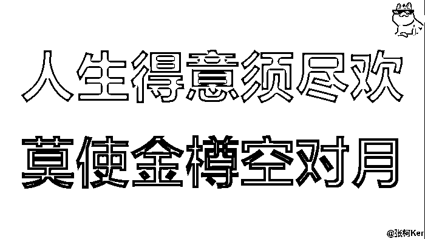

变强总需要一个理由。
如果单纯为了变强而变强，
**最后只会沦为力量的囚徒。**
别扯什么顶峰相见了，
这个世界哪有什么顶。

**能把每一天都过得踏实充实的人，**
**才是真正的赢家，**
**只会想着赚钱，却不会生活的人，**
**才是真正的小丑。**
而且前者，往往还能顺手赚到不少钱。
你说气不气人。

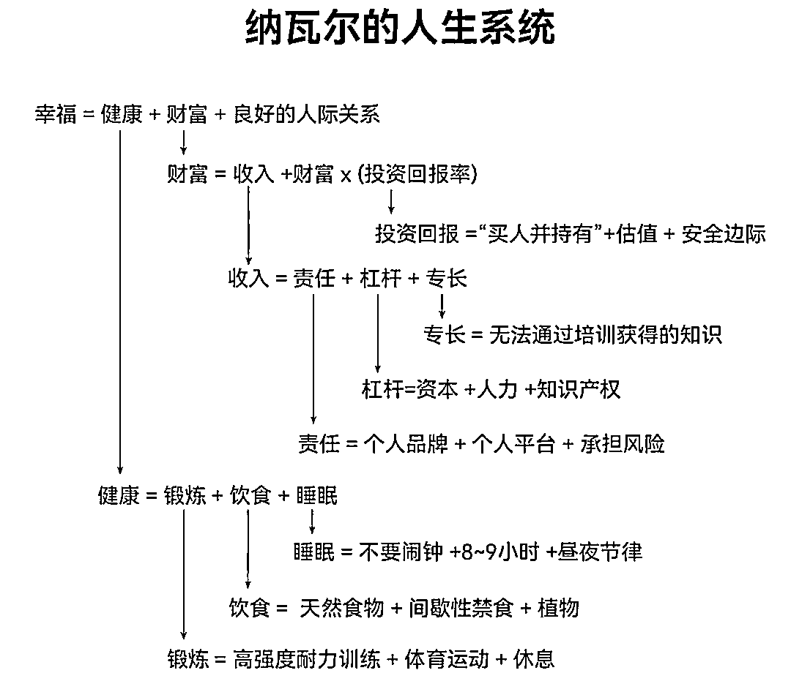

（图源网络）

**如果你总指望明天会更好，**
**那是不是等于承认今天一塌糊涂，**
而且你还不想改变，
只是想逃离当下，什么都不做，
**只对「永远到不来的明天」许愿。**

最后，这种格局的东西，
知道的人本就不多。
**知道的也不一定愿意写，**
**愿意写的也不一定写得好。**
回到开头那句，

**无为使我有为，无知使我有秩。**
我自己也是受益者。
但我觉得，我不能装没看见。
我清楚自己不喜欢什么。
我不愿，也不屑。

**一将功成万骨枯，**
我更想的是，
**相逢意气为君饮，系马高楼垂柳边。**

以上，祝好。
有收获的话请点赞。
提前祝大家新年快乐。
微信：ker600
欢迎交流。

* * *

评论区：

周梦行 : 注意力在哪，结果就在哪，财富就在哪，说得真好。

清欢 : 先赞后看[强][强]

阿仧 biu : 柯总牛逼

星尘丶 : 太牛了

鲸鱼 ken : 深度好文，已赞赏[偷笑]

不明 : 字字诛心，别骂了别骂了 [捂脸]

浅笑 : 先赞后看！养成习惯！

523 : 先赞后看[强][强]

* * *