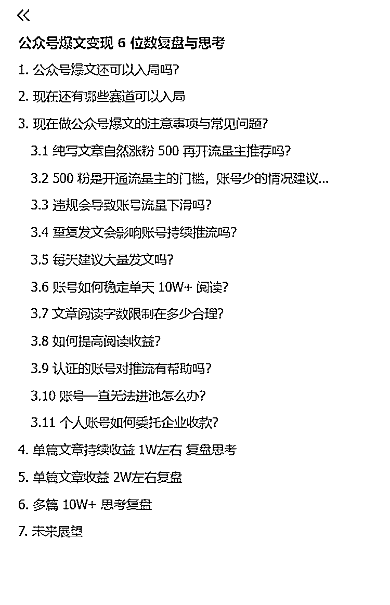

# ('公众号爆文变现 6 位数复盘与经验分享', (2, 21))

最近龙哥盟里有一篇公众号爆文变现6位数的复盘帖特别火，作者是西安的Feng，自称“赚钱小透明”。他在帖子里先感谢了平台，说自己挖到了不少有用的赚钱信息，也靠这些信息赚到了钱。

Feng坦言，自己入圈其实挺久了，但一直潜水，有段时间甚至被信息焦虑困扰，干脆不打开App——因为看多了反而怀疑自己。今年2月龙哥哥就预测过公众号爆文的机会，8月他也注意到相关帖子，却始终没有下场。直到9月底，被收入不稳定的压力逼了一把，他才决定真正动手实操。

让人没想到的是，仅仅一个月左右，他就做出了6位数的成绩，顺利拿下公众号领域的第一桶金，而且现在收益依然稳定。他把整个实操过程都整理成了详细笔记，为了让大家有更好的阅读体验，特意放在飞书文档里，想上手的可以直接点击：[`kvsqxrpcce.feishu.cn/docx/FuyAd4FHcoIgKtxBA2xcfr0anFb?from=from_copylink`](https://kvsqxrpcce.feishu.cn/docx/FuyAd4FHcoIgKtxBA2xcfr0anFb?from=from_copylink) 

评论区也很热闹，有的说细节超丰富，有的说新手照着做就行，还有人评价内容不含糊。更有人提炼出“数量对抗算法”的心法，以及“真人粉成本并没有想象中高”的洞察，都是很实在的反馈。 