# 小红书达人接单变现全套思路拆解：单人月入2W，团队10W+可复制打法

> 原文：[`www.yuque.com/for_lazy/thfiu8/xgochcla81s0v4v5`](https://www.yuque.com/for_lazy/thfiu8/xgochcla81s0v4v5)

在龙哥盟里经常能看到不同圈友的实战复盘，项目灵感和管理上的思路常常就是这么被打开的。我把自己在小红书做达人接单的完整方法整理出来，希望对正在跑这个方向的人有一点参考价值。

先把逻辑说清楚。很多新手觉得达人变现是头部博主的专利，其实门槛没那么高。核心就是养一个普通的素人账号，通过持续发笔记把粉丝做上去，达到一千粉后就能去对接品牌商单。广告主一般会提供成品文案和素材，你在约定的时间点发布，费用就结算了。整个闭环可以概括为：建号-定赛道-养号-更新-破千粉-实名认证-入驻蒲公英-承接推广。

我们长期采用矩阵化运营的方式同时推多组账号，覆盖的垂类包含娱乐资讯、网络小说、情感共鸣、美妆护肤、萌宠日常、AI创作等。内容来源基本依赖全网搬运与二次创作，图片做适度改造，视频做混剪去重即可，基本不做从零原创。整体操作门槛偏低，上手几天就能跑通，适合当副业或全职项目来做。

聊聊当下的环境。小红书上市一直没落地，平台这两年把商业化做得很重，普通人也能分一杯羹，最近热的小红书店铺就是例证。过去大家觉得商单只有大号能接，小号没戏，但今年平台放宽了准入，博主只要千粉并开通蒲公英就能开始接单。

用户画像也很香。高浓度在一二线城市，女性占比过半，学历和付费意愿都偏高，属于广告主眼中的优质流量。大量品牌涌入投放，达人接单需求持续放大。早一批嗅觉灵敏的人已经通过这个赛道完成多轮变现，接下来的窗口期仍然很大。

接下来是最关键的选题问题。方向选对，涨粉效率会指数级提升，也能更快进入变现阶段。我们团队从今年五月起开始验证，到现在收益稳定上升，五人小队月产十万左右，至少证明模式可行。

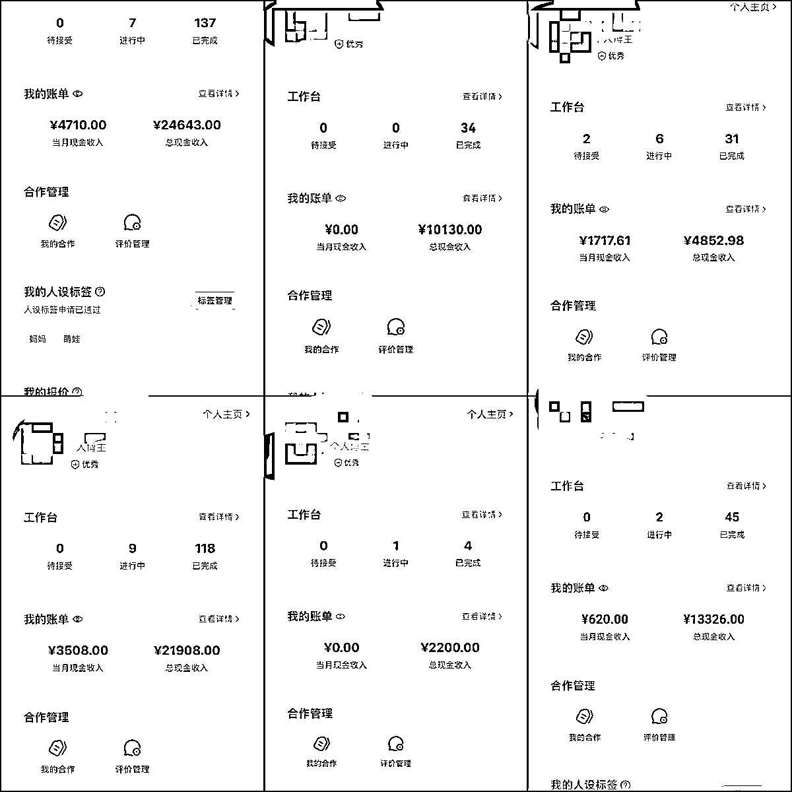

综合实操和测试来看，现在涨得相对快的赛道有：明星娱乐、影视剪辑、动漫解说、各类盘点、星座运势、公考基础常识、本地服务、AI绘画、抖音快手美食搬运、章鱼哥语录、正能量内容、情感语录、文案金句等。因为是多号矩阵，前期基本全铺，留存下来的就是这几类。需要强调的是，赛道只是前提，能不能爆才是核心。方向再好，笔记发出去没互动，粉丝照样上不去，后面会专门讲爆款的打法。

下面用三个案例拆开说。

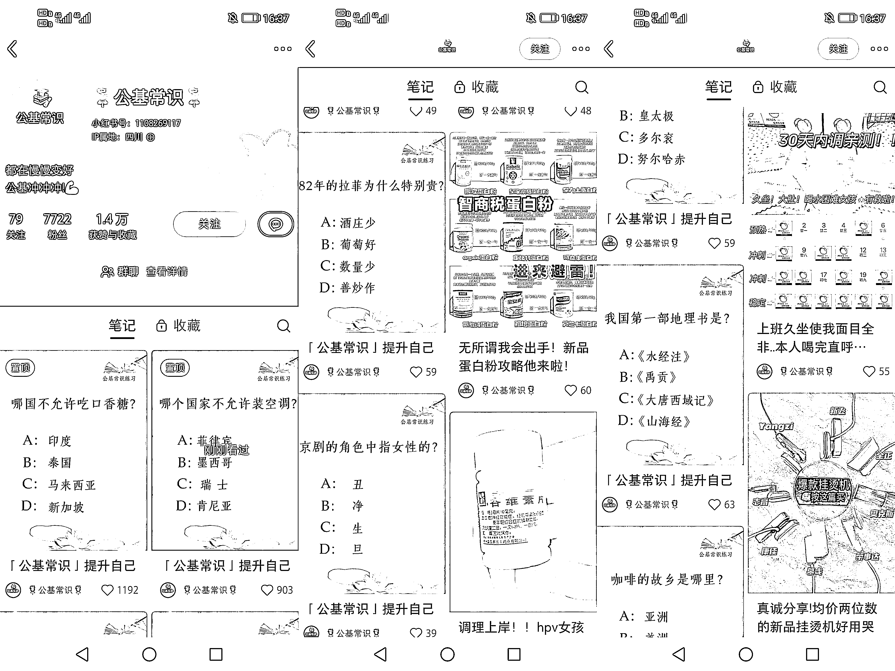

先看公考基础常识赛道。我们跟踪过一个账号，目前粉丝七千多，九月中下旬起号，十一月就破千入驻蒲公英，之后累计接了二十条商单。按单条一百五十到两百的市价算，总收入三千到四千，基本等于普通人一个月工资。均摊下来月入一千五到两千。虽然单号看着不高，但矩阵化后体量会完全不同。制作上极简：每条笔记放三道题，题库从同行的爆款笔记里搬；配图用纯色底+题目文字，模板固定后只换题目和文字，一天能产出大量素材，对新手非常友好。

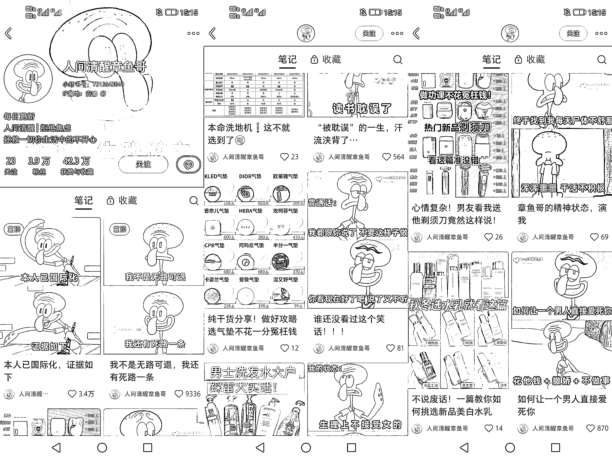

再看章鱼哥图文赛道，以“人间清醒章鱼哥”为例。这号今年八月起号，目前粉丝三万九千左右。起号速度快，数据一直在线，累计接广七十五条以上。按单条两百到五百算，总变现一万五到三万，且这类账号有长尾效应，粉丝会持续累积，后续接单能力更强。制作流程：先从影视平台、B站、微博、百度等地方搜集章鱼哥、海绵宝宝、蟹老板、派大星的图片；再用小红书或灰豚找近期爆火的章鱼哥语录，把文案抄下来；最后用美图秀秀把两张图拼接，配上语录文字即可发布。

美食搬运赛道逻辑更直白：从抖音、快手搬美食视频，二次处理后发到小红书。

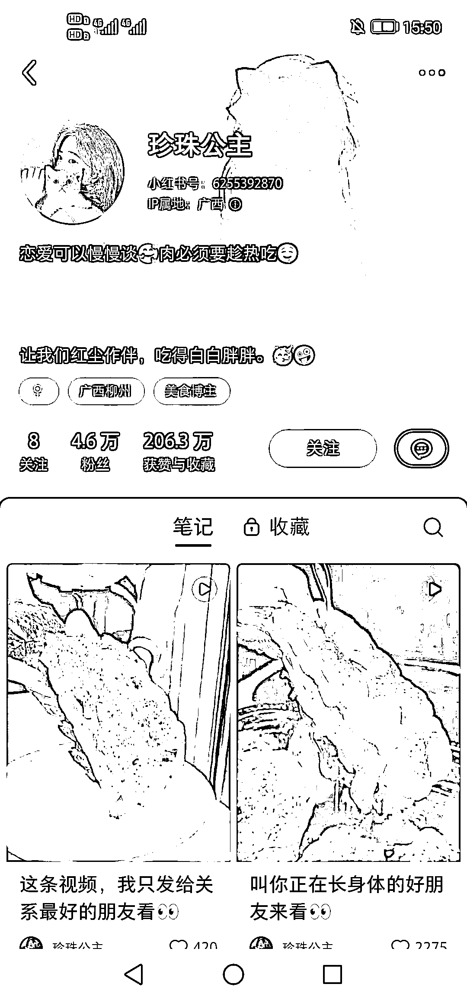

以“珍珠公主”账号为例，其不少作品素材都是从抖音导来的，先用抖音识图找到源视频，再用剪映做伪原创处理后发布。目前粉丝四万六，累计接广六十五条以上，按单条两百到五百估算，已变现一万三到三万五。实操细节：先准备一个抖音号和快手号，前三天专门刷美食类内容，把推荐池喂饱，后续找素材会更快。找到视频后复制链接，通过微信小程序去水印保存，再导入剪映进行混剪处理。常用的去重手法有：裁剪头尾、调整播放速度、更换背景音乐、画面镜像、画中画叠加、片段顺序重排、抠图、加文字贴纸、加滤镜特效、转场、变声等。

提醒一点：视频千万别单条搬运改一点就发，违规风险极高。正确做法是多条混剪，提升原创度。很多朋友收到笔记违规或优化提示，就是去重不彻底、单视频处理太粗糙造成的，一定要重视。

养号阶段也有固定节奏。赛道确定后开始注册，一个手机号对应一个账号，注册建议使用正规实体卡，全程走移动网络。注册后按下面节奏养：

第一天：用流量完成注册，注册后不要修改头像昵称简介，也不要刷任何笔记。

第二天：开始养号。按拟定赛道刷同类笔记，点赞收藏关注评论都要做，每个动作停留二三十秒，模拟真人。每天累计半小时到一小时，分时段进行。

第三天：上午继续刷养，下午检查发现页，目标是七成以上内容属于目标赛道。达标后可改包装，着急的话当天就能试发一条赛道笔记。

建议先用一条生活、风景或干货类泛内容测试流量，第二天看小眼睛大于一百再开始垂直更新。养号不能省，跳过直接发基本起不来，浪费时间。

关于内容伪原创，新手建议先从图文起步，视频对剪辑要求更高。适合的图文赛道有星座、章鱼哥、情感、本地服务、公考常识、正能量、语录类等。

养号后账号已有垂直标签，首页刷新就能看到同行。若看不到，可用灰豚等工具找爆款。热门赛道点赞五百以上可参考，普通赛道两百以上即可。优先选低粉爆文，近七天素材不足可放宽到三十天、六十天甚至九十天，样本量会大很多。

**图文去重要点**
- 更改尺寸比例，拉伸或压缩
- 调整色彩、饱和度、明暗
- 添加滤镜、光晕、阴影
- 更换背景
- 多图拼合
- 使用专业工具如Photoshop、GIMP等深度改造

总结就是：模板固定内容更新，结合滤镜调色、翻转加字、贴纸拼图抠图等手法。工具推荐美图秀秀、图怪兽、稿定设计，能快速处理。

**视频去重要点**
核心手法是掐头去尾、变速、换BGM、镜像、画中画、打乱顺序、抠图、文字贴纸、特效滤镜、转场、变声等，具体操作可参考剪映官方新手教程。

剪映专业版入门手册：
[`www.capcut.cn/learning/topic_detail/7128272592783428894/1page_enter_from=videocut_pc`](https://www.capcut.cn/learning/topic_detail/7128272592783428894/1page_enter_from=videocut_pc)

再说说灰豚的使用。进入达人榜，切换到涨粉榜，按兴趣领域筛选，就能看到该垂类涨粉最快的账号，找到对标。

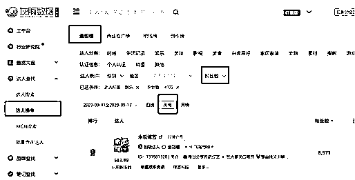

在灰豚里还能直接搜笔记，输入关键词配合筛选条件，快速锁定近期上升的爆款，拿来做参考。

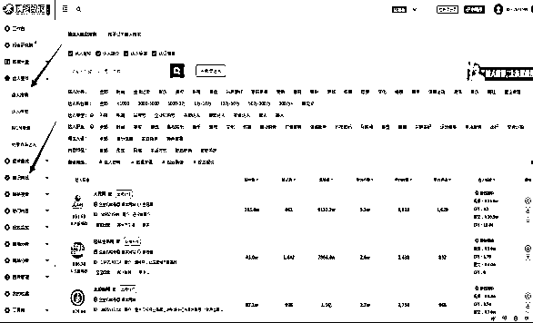

如果已有专业号，也可登录蒲公英后台，进入博主广场按领域筛选，重点关注粉丝五千以内、近三十天涨粉快的账号，这批通常是正在爆发的同行，参考价值高。

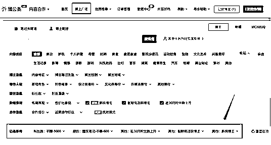

其他找素材的渠道：
- 小红书：频道页或发现页刷种草广告；或从蒲公英商家后台、灰豚后台翻找热门投放，一个月内点赞百加或两月内破千粉的账号都能参考。
- 抖音：定好方向后搜半年内点赞百加的视频。
- 快手：按播放量点赞量排序，一个月内点赞百加即可。
- 知乎：搜关键词按赞同排序，半年内百赞以上可参考。

用灰豚找低粉爆文时，越近越好，但不要直接搬。应循着关键词去抖音等平台找同话题不同素材，再做二次创作。

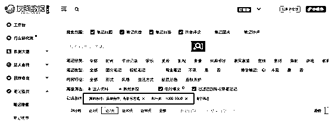

**视频爆款思路**
以美食搬运为例，先在抖音找三条以上近期点赞千加的不同视频混剪，一次至少三条，原创度才够。单条处理极易被判定违规或优化，影响权重和专业号资质。把视频导入剪映按前述手法处理，配文案和话题后发布。

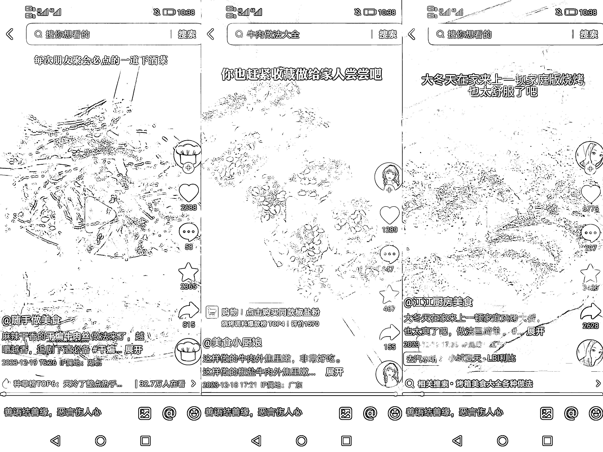

**图文爆款思路**
以文案语录为例，先找到同行近期点赞百以上的爆款笔记。假设同行用纯黑底白字模板，排版简洁，我们就把文案提取出来，用QQ文字识别或微信文字提取功能获取，再到稿定设计挑选相似模板填充，调好字距和对齐，导出无水印。标题正文字体保持统一，后续做同类图会更高效。参考模板和重排效果如下：

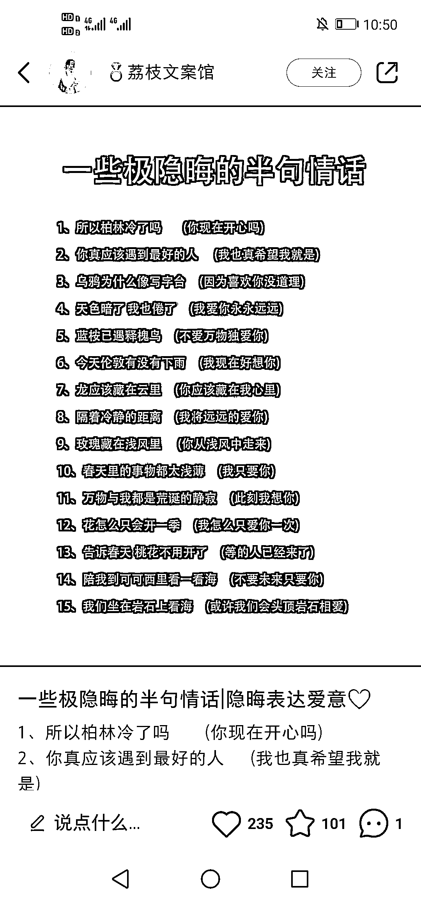

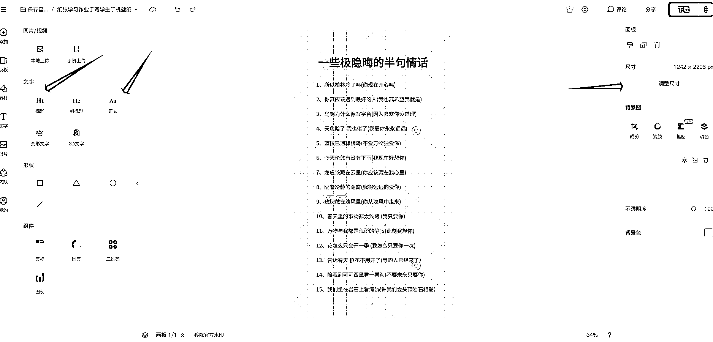

最后说变现入口。千粉后入驻蒲公英，先把账号升级为专业号。路径为“我-账号与安全-升级专业号-成为专业号”，完成后按后台指引完成后续入驻、接单、结算流程即可。

整体来说，这个项目的核心是选品、养号、做内容，再用矩阵放大。希望这份拆解能给正在尝试的朋友提供一些实操参考。

千粉之后想靠小红书接广赚钱？那蒲公英平台你一定绕不开。今天就手把手把从入驻到接单、再到避坑的完整经验捋一遍，全程干货，建议先收藏。

**先说说怎么入驻蒲公英**
操作路径很简单：点开“创作中心”，在“更多服务”里找到“内容合作”，顺着页面指引一步步往下走，就能搞定入驻。  
重点来了——图文的报价，前期别贪高，哪怕系统给的同行均价是170到180，也建议你定在150。为啥？低于均价，品牌方更愿意找新号试水，你才有机会快速接到第一波广告。一上来就标高价，很可能长期零邀约。视频报价就随缘了，因为现在大多数合作都是图文单，视频邀约很少。等粉丝量涨上去之后，再慢慢涨价也不迟，蒲公英每个月能改一次报价，通常次月生效。

**入驻之后多久有广告？**
设好报价就等于万事俱备，人设标签什么的先不用管。新锐博主快的话1到3天就能收到品牌邀约，慢的也就一周左右。但这期间千万别掉链子，每天至少更新一篇，内容质量要靠谱，阅读量平均最好能破千，这样品牌方才会源源不断找上门。

**接单和提现要注意什么？**
和品牌对接的时候，砍价很常见。比如你挂了150，对方可能还到120、130甚至140。如果对方产品是日用百货这类的，给点优惠完全OK；但如果涉及医疗健康类，就要多留个心眼了。这类商品敏感词多，发出去容易给账号惹麻烦，能拒就拒，别为了接单硬扛。

**怎么快速接广、长期维护账号？**
两个关键动作必须做到：一是账号持续日更，每天1到2篇，保持数据活跃度；二是多跟粉丝互动，看到评论赶紧回，别摆高冷架子。互动一多，品牌方会觉得你账号更有活力，更愿意投放。

接到广告后，日常更新也别忘了，数据稳定了才有持续邀约。如果同一天收到好几个合作，比如一天来了3个，别急着连着发。新号最好发完一条商业笔记后，隔一天再发下一条。可以在微信跟商家协商好排期，千万别广告刷屏，这样会伤账号权重。最好的方式是商业内容和日常笔记穿插着来，把负面影响降到最低。

**账号违规怎么处理？**
最常见的是视频笔记违规，多半是伪原创去重不彻底，系统提示整改后继续推流。偶尔一两次没事，但总违规会导致专业号掉灰，那样就接不了广告了。图文笔记因为用模板套图，相对安全，但情感、正能量、星座这类赛道容易踩雷，比如负能量、偏激情绪、封建迷信等敏感词。收到违规提示，按系统要求改就行，改完基本没影响。  
万一专业号真掉灰了，赶紧申诉。如果是原创性低的原因，就截图你剪辑素材的过程当证据，说明是辛辛苦苦原创的，再配上一点诚恳话术——比如跟薯大大说自己每天都认真做内容，突然被限流很受打击，附上剪辑记录，恳请恢复。总之，附图加卖惨，成功率更高。

**高频问题集中答疑**
- 必须开通企业专业号吗？不是必须，用灰豚看对标账号也完全OK。
- 企业专业号也要千粉才能进蒲公英吗？不用，蓝V号本身就有蒲公英权限，只有普通号才需要千粉。
- 安卓机能用多开软件吗？建议一机一号，多开容易异常，影响流量。
- 视频已经上万播放了却违规，怎么办？先自查伪原创程度，如果确实做了深度处理，就可以申诉，把剪辑记录截图传上去，说明是原创。
- 删笔记有没有影响？删多了会掉权重，能隐藏就别删，审核不过的再删。
- 没浏览量可以换类目吗？刚发不久不用急着换，先观察第二天流量。真要换，就重新养号，先刷出该领域的内容偏好再发。
- 每天发多少条合适？个人操作3-5个号的话，每个号一天至少1条，有空可以2条。也可以参考同领域头部账号前期的发布频率，有的号一天发5-6条也正常。
- 蓝V认证需要账号和执照法人一致吗？个体执照认证专业号不用实名，一张执照就行，交600元官方认证费用，账号本身也不用实名。
- 营业执照经营范围有限制吗？如果只是入驻蒲公英看数据，基本不限；但以后想申请MCN，经营范围里得带上网络技术、信息咨询、文化传媒之类，尤其建议加上“文化传媒”这四个字。

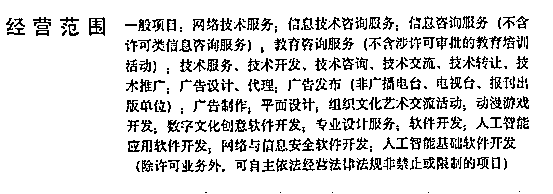

- 有点赞和评论，就是不涨粉？那就在评论区、视频结尾和简介里引导关注。新号笔记少，粉丝不了解你，不关注很正常。可以尝试发上中下集的系列内容，吸引人追更，关注自然就来了。
- 能用电脑定时发吗？不建议定时或存草稿箱再发，会影响流量。做好就立刻发。
- 蒲公英的普通、标准、优秀等级怎么理解？优秀代表内容和流量都健康，有更多平台主动推荐合作；普通代表状态不稳定，可能有一些平台不鼓励的动作，比如违规推广、数据作假；异常就严重了，说明账号近期存在大量不实信息或违规内容。

以上就是小红书运营接广的全部核心经验，从入驻报价、日常维护、违规申诉到各种疑难杂症，都给你拆解清楚了。最后分享一句话：心有所期，全力以赴，定有所成。愿你的努力，终被温柔以待！