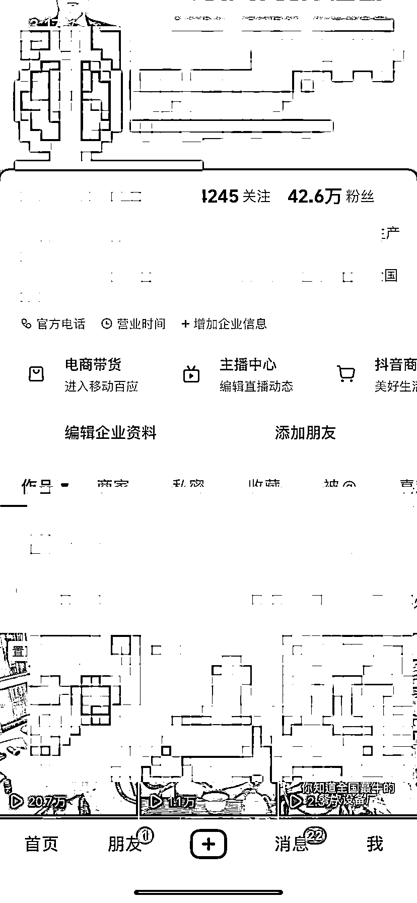
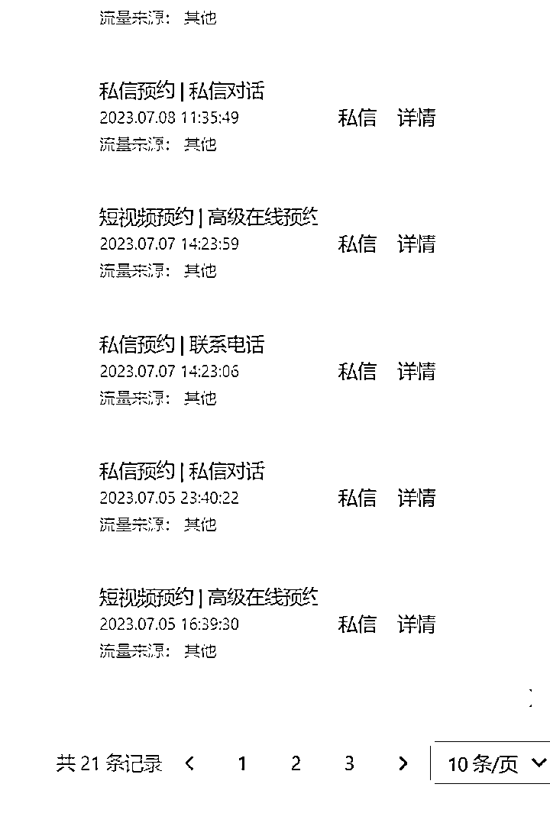
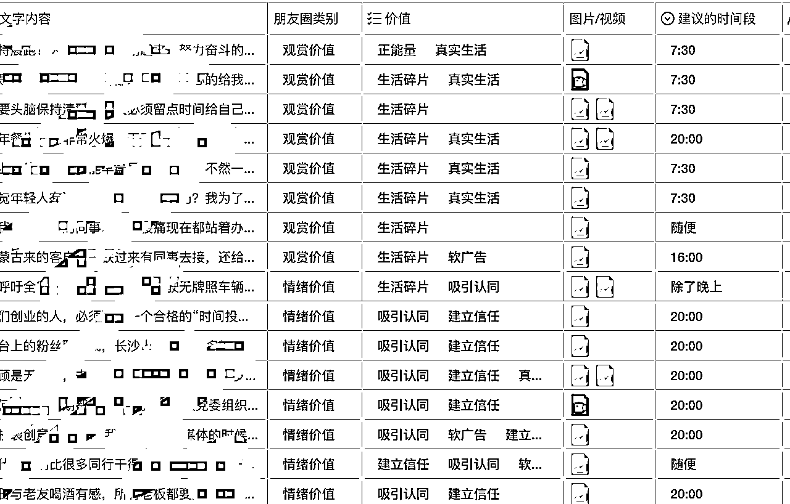

# 传统生意如何被线上流量盘活？从线下起家到年入 3000 万的抖音实战

> 原文：[`www.yuque.com/for_lazy/thfiu8/ua4rxgdrqzec9o54`](https://www.yuque.com/for_lazy/thfiu8/ua4rxgdrqzec9o54)

## 航海助推传统企业线上突围，100% 互联网客流撬动 3000 万营收

作者： Jason wey
日期：2024-01-10

“每个赛道都可以在抖音里重新做一遍。”

2022 年 7 月，我开启第三次创业，带着一支小团队在抖音上做传统餐饮设备生意。第一年完全吃线上流量，年销售额就突破了 3000 万。

在那之前，我从剧本杀实体起家，运气不错尝到一点甜头；后来又把正赚钱的门店全卖了，all in 一个剧本杀 App，结果团队散了，项目死了。

这次选品，几乎是破釜沉舟的重来。

为做抖音，我报了大量课程，花两个月把账号快速起盘，做成了高转化号，日均线索一度稳定在 150 以上。

后来加入赚钱，参与抖音 SEO 航海，意外给主营业务带来增量。现在每天都有 SEO 精准线索进账，信任感极强，成交率能做到 20% 左右，是常规流量的五倍。

开篇先强调两点：模仿大于创新，选择大于努力。老话一句，但确实改写了我的创业轨迹。下面这些经历，都是我对这两句话的注脚。

# 一、关于我

**1、我是谁**

大家好，我是小魏，山东人，97 年的创业者。

我一直是个做梦的人，对未来有太多想象，却常年困在县城里。信息差和圈子局限，让我的视野受限。我深信，见得多听得多，选择才多。赚钱的机制正好补足了这块短板，加进来不到一年，吸收的信息量超过之前四年创业的总和。

赚钱让我开眼界、换思维，从别人身上找方法。但只看不干等于零，必须执行。想到、看到，就要做到。

**2、做过什么**

2019 年大学毕业后首战剧本杀，从 200 平米的小店做到 4 家店，最大一家超 3000 平米，运营到 2022 年。
2022 年切入抖音，操盘餐饮机械设备项目，一年营收超 3000 万。

# 二、创业往事

**1、第一次创业，靠模仿起步**

2019 年毕业，我独自跑到江苏一个陌生的城市想扎根，就是想开一家能聚人的店。我几乎没爱好，也习惯热闹，听说年轻人爱玩剧本杀，就直接开了。

完全不懂门道，我跑南京、杭州、上海考察半个月，盯上一家理想店，直接蹲门口数客流、算流水。觉得能做，就开干。

选址、装修、玩法、营销全靠抄。那家门店的创意园区模式，我照搬；店面调性、服装、道具、员工配置、剧本、会员办理、复购激励、朋友圈话术、微信群维护、大众点评口碑处理，全部像素级复刻。

正巧赶上《明星大侦探》带火行业，很快回本。

**2、想做整合，被市场验证**

看到 2020 年文旅概念大火，我觉得剧本杀可以和文旅结合，用历史故事做剧本，让年轻人边玩边学，于是写了商业计划书想找投资。

年底时，本地一家文旅国企正有此意。虽然没拿到投资，但换来一座免租金的古宅授权做剧本杀。模式跑通后赚到启动资金，在他们的支持下同年又开了第三、第四家店。

**3、第二次创业，创新翻车**

2021 年，市场火、自己膨胀。我拒绝加盟和复制，干脆把还在盈利的店全转让，自断后路，去做行业 App。

设想是把大众点评的板块剥离，做一个年轻人的社交交易 App。我砸光积蓄，拉来合伙人，组建开发、运营、商务团队，全是半路出家。

没有成熟体系、没有清晰运营方案，只靠一个想法硬撑。第四个月账上见底，App 变成四不像，挂在上面的门店寥寥无几，用户更没几个。团队依然热血，我却被迫叫停。

没有市场验证的创新，往往是自找麻烦。

**4、第三次创业，重头来过**

2021 年底，项目失败，团队只剩两人。我没店没项目，不知道下一步往哪走。下载抖音后发现各行各业都在做短视频，看到“所有行业都能在抖音重来一遍”，线下生意线上无限放大的焦虑感把我推了进去。

我带着仅剩的兄弟报名各种课程，成了老师眼里的韭菜。学完发现没项目落地也没用。后来问伙伴，我在山东有餐饮设备资源，回去做这个行不行。

2022 年 7 月正式转型，All in 抖音 + 传统机械设备。老家正是国内餐饮机械的集中产地，供应链拿到手最快。

我常说：没项目时，先用手上技能盘活身边的资源。哪怕再小再不起眼的项目，在中国市场一年赚百万的并不少。先活下来再谈发展。

目前全网矩阵粉丝超 100 万，第一年营收超 3000 万。客单价平均过万，部分订单 10-20 万，所以结果可观。下面说下具体打法。

# 三、如何打造高变现号

**1、先别急着创新，坑踩过就懂**

前期我们学到最多的是创始人 IP。行业里几乎都是产品硬广，我就想做差异化，模仿广东家具 IP 的结构、文案、镜头和引流方式，一个多月没流量，也没询单。

反思后发现：
产品几乎无复购，不适合做 IP；
把 100% 精力押注在低确定性打法上不划算；
用户更在意价格；
起步期别创新。

第一个月只拿到 30 来个线索，还不如电销快。若第一个项目就死，团队会直接散架。于是我们决定先深度模仿，等有结果再微调。

**2、两个月起盘，像素级抄作业**

每天盯 10 个优质对标，只要比我好的就是老师。他们改 BGM、换标题、调发布时间，我们第二天就跟。

爆款视频逐秒拆解：为什么能爆？点在哪里？音乐、画面、形式、素材能否复用、能否做得更新、如何抢流量。

如何判断对标是否优质：
数据是否健康，不能只有赞没评；
更新是否规律，隔三差五的别看；
评论区是否大量问价，问价无关的很多就 pass；
私信问价，加微信看朋友圈判断真实性。

跟随对标做 BGM、文案、标题、字体、配色、话题、发布时间、评论区前几条、回复话术、引流方式。初期哪怕对标的错误动作，我们也照做。起五组账号，全发产品视频和新闻体短视频。想法很简单：我抄一模一样，别人一千单，我十单就够。

加上 dou+ 助推，五组账号很快做到日均 50+ 线索，1-2 个销售就能承接。

**3、微创新：从送资料到送服务**

同行抄完后做小迭代。知识博主爱玩“送资料，链接我”，我们实体产品没资料可送，于是改成“送服务，链接我”。只要客户发来平面图，我们免费出设计方案，市场价每平 50-100 元，我们招了两个设计师免费做。

对抗流量波动：矩阵+固定更新能保证基础播放，但播放不稳定。产品同质化、剪辑雷同导致经常收到“减少推荐”提示。解决方案是投信息流广告，等盈利后这是必须交的“过路费”。

“送服务”+信息流后，日均线索破百。信息流带来的线索里白嫖党多，成交率不升反降，但为了稳定业务，这个成本必须花。

**4、故事软广：做养成记视频**

有一次甘肃客户线上下单后自驾来山东提货。我们担心这是不信任导致跑线下，于是强化私域信任。

销售反馈客户发了一个 00 后开火锅店的记录视频，从选址到装修、买设备、开业全记录，播放不高，却一周带来二十多个咨询。

我们立刻安排亲友用个人号发系列内容：00 后开餐厅、90 后创业、80 后辞职开店、大学生奶茶店、宝妈创业等，并@主号。这一波来的客户极精准，信任度更高。配合 dou+ 微撬动，投产比正就加大投入。

最终日均客资稳定在 150-200，峰值破 200。

**5、两大核心能力**

节奏感。调研期就只调研，测试期就只测试。没有数据支撑就拍视频，大概率没流量；没流量就乱投代运营，越做越迷。不同阶段要把力用到刀刃上，否则节奏乱、执行松、最后放弃。

复盘能力。我们从 0 到 1 的关键是每天复盘。流程：定目标→做计划执行→看结果→高于预期就复盘成功点并放大矩阵；低于预期就找问题改进重启。复盘做透，离成功就不远。

# 四、抖音 SEO 航海带来的增量

**1、SEO 就是被动赚钱的精准流量**

抖音已成很多人的“百度”，60% 用户会用搜索。搜索流量目的性强，排名靠前就等于持续收钱。

**2、航海期间的打法**

抽出三人做 SEO，小号几千粉，每天保三条口播+素材剪辑。14 天内被动获客 16 个，按成交周期估算价值约 7 万。效果惊喜。

**团队拆分，避免内耗**
部分同学航海时手忙脚乱，一天一件事，最后才发第一条视频。我们拆分工序：

A 负责关键词筛选、选题、初稿文案。
B 负责文案润色、必拍镜头规划、出镜口播、配音。
C 负责拍摄、剪辑、发布、建合集、投流分析。

SOP 示例：
9-11 点 A 做选题和 ChatGPT 初稿；
11-12 点 B 微调文案，确定必拍镜头；
13-14 点 B 出镜 C 拍摄；
14-14:30 B 配音；
14:30-17 点 B+C 剪辑；
17 点后 C 发布建合集；
次日 9-11 点 B+C 看数据、投抖加、跟进客户。
一人操盘就按此拆任务做流水线。

**精准找客户**
蓝海词和下拉词是基础，手册和大神都反复强调。我们把全赛道关键词做成选题库，活用 5 踩法。
真人出镜+场景背书。竞争对手普遍不露脸，真人出镜在抖音更易推，记忆点和信任感都更高。IP 在工厂内出镜，背后是产品和设备，源头工厂的背书感拉满。
痛点挖掘。看竞品评论区和 SEO 榜单的对标视频，收集用户最关心的品类和问题，反向生成选题。

**提升质量，常规化运营**
账号必须常更、常分析和调整。判断是否值得投抖+：
用 5 个新手机搜关键词，3-4 个结果一致，且视频排名在前 15 名以内，具备投流价值；
发布后在关联词搜索中能直接发现视频，也具备价值。

通过航海，我们把 SEO 流量变成稳定增量，也验证了传统企业线上化的可行路径。

这次我们没有选择铺预算换流量，而是用小额投放不断做实验，先把有效信号筛出来，再决定要不要加码。

两个信号值得跟进：一是搜索结果位次变化。对一条视频投完抖+后，换另一台设备查看关键词排名，如果明显前移，比如从第14名升到第5名，说明它还有继续推的空间。二是内容自带咨询场景。比如一条讲小吃店如何购置设备的短视频，有人在留言区直接问“你们都有哪些机型”，这就是天然的需求信号，值得继续投放。

整个项目没有重金砸流，而是花小钱多试，目标是找出能复制的打法。我们看对标账号时发现，图文内容也能在搜索榜上拿到位置，小范围试验有成效；想更明显，需要再配合抖+。但当时坚持主理人内容路线，搜索获客的本质又是用小预算撬动长尾需求，所以没有做深度投放。

新号测试的经验

这批经验来自新认证的企业号。刚起步的账号优先投点赞加评论，时长选24小时；一些品类不适合两段式投放，别一开始就同时跑2小时和24小时。

投放人群要同时圈两类：同类达人和客户画像。

同类达人怎么选：不买粉，点赞数对粉丝数比例在3到10之间；有真实成交迹象，留言区能看到问价格、问货源的评论，而不是清一色点赞；数量上选5个核心行业账号加5个周边行业账号，卖珠宝的可以找婚庆、婚礼司仪、婚纱摄影等。

客户画像要锁年龄区间、性别，有些行业还要选城市，把香港、澳门、台湾排除。拿不准就借第三方工具看同行后台，比如蝉妈妈与灰豚。

进阶追投

当视频质量极高，不靠搜索排名也能直接拿客资时，要果断追投。前提是首轮投的是点赞加评论，其他设置保持原样；行业成交金额至少要比下面三个成本线高一个量级。

同时满足三条：100元换来300个粉丝，也就是单个粉丝不超过3毛；100元能引来20个有效询单，平均一次咨询不超过5元；100元能买到2000个点赞，单赞不超过2毛。

追投分两步。先加500元跑24小时，其他不变，看数据是否衰减。如果没衰减，可以每天500元甚至加到1000元；如果衰减，就换成500元跑48小时，或者200元跑24小时。慢慢把合适的节奏试出来。试错的意义就在这：把错的方向排除完，余下的路就是可行的方向。

线索追踪反哺选题

团队按前后端分工：前端负责流量，后端负责成交。线索进CRM后分配给销售，销售跟进时会把需求、意向、关注产品、添加时间、位置、来源、微信号、电话、姓名等全部更新。任何一条信息都能倒查完整轨迹。

来自搜索的线索往往有共性。比如10个客户要的产品不完全一样，但都会问到同一类配件、电压或质保条款，这些关键词就是下一轮内容选题的方向。

阶段成绩

严格执行手册里的动作后，搜索获客的威力很快显现。上一期结束到现在，每周能稳定拿到55条上下线索，数量不算多，但质量很准。产品成交有周期，活动期间只完成了7万多销售额；不过搜索视频是长期资产，做一次就能持续获客，像收租金一样。现在每天仍有精准线索进来，信任感比一般渠道强很多，成交率大约20%，相当于日常渠道的5倍。

看到3000万这个成绩，有人可能觉得夸张。服饰、食品这类大众消费品在抖音上出量不稀奇，抖音看起来就是个娱乐平台，凭什么工业品也能卖出成绩？别急着划走，后面会拆开讲。

私域动态的认知升级

我们最初对私域的理解很浅，只知道要维护个人账号的日常动态，却没有章法。加入这个社群后，我先翻完了活动指南里的“个人号动态经营”章节。虽没有做到专业私域团队那种精细度，但各个账号和客户之间的互动频率提升了好几倍，这是最直接的改变。互动多了，成交概率自然被拉高；因为同时做了很多调整，暂时没法单独拆分涨幅。

下面是我们沉淀下来的私域内容素材整理：

最后

头一回系统复盘自己的从业轨迹，我把能讲的都拿出来了，没有藏太多。若没讲透，欢迎随时找我聊。

如果你也在工业制造领域，照这套流程一步步试，大概率也能复刻出类似的结果。

回头看，我更像一个参照式学习者：先寻找范例让自己存活，接着根据实际情况做调整，最后把产品做成优势。这也是公司里常提的观点：先站稳，再做微调，再把产品做强。

我也进过不少知识付费圈子，很多只是表面交付，能拿到的就是基础资源对接。但这里不一样，高质量长文多到几个月读不完，既能触达别的行业信息，也能让我自己挑方向落地实操。

文字分享能让我静下来。刷视频不挑场合，想理解一个人的真实经历，还是得安静读字。这个社区里每天有人在各自领域分享，我不可能不被这种氛围推动。

环境很重要。有些圈子热衷讨论黑灰玩法、收割用户，这里则是持续向上的创业氛围，每一次打开都能感受到被有价值的信息和实干的人包围。

留言区里有人问私域素材整理用的工具，我答是飞书下面的在线表格；有人夸行动力强；还有做餐饮供给的同行想要个联系方式，我们后来也对上了。另有一位朋友聊到角色扮演推理App的创业想法，我看到昵称后觉得可能认识，回了句“世界不大”。

* * *