做跨境电商这些年，我最大的一个感受就是：选品这件事，本质上拼的不是眼光，而是你对某一类人有多懂。

与其什么火做什么，我更倾向于把目光收窄，盯住一个小众但真实存在的圈子，深挖他们愿意为什么掏钱。

打个比方，如果你是做二次元方向的，就别光盯着“动漫”这个泛词。真正值得琢磨的，是那些愿意为角色买单的coser——他们要的不只是衣服，还有道具、假发、配饰、以及各种能彰显“我懂这个角色”的周边产物。

这类人群看似不大，但需求极度精准，而且一旦你戳中他们的点，转化率往往高得惊人。

还有一个很现实的情况是：海外市场里，这类二次元相关的产品供给其实相当稀缺。亚马逊对于这种小众又蓝海的类目，反而会给予不小的流量倾斜。

我当时正是看中了这个空档，一头扎进了亚马逊动漫品类。没有急着砸广告，也没有囤货压库存，而是老老实实走自发货的路子，把所有精力都砸在选品和打磨listing上。

结果反而跑出了一条曲线：店铺不花一分推广费，靠着自然搜索和SEO优化，流量自己源源不断地流进来。

目前我们单店在亚马逊全站点的年销售额大概在5万美金上下，而这样的店铺，我手里差不多有三十来个。

今天这篇文章，我想把自己从0到1跑通这套“自发货+蓝海选品”玩法的完整过程，毫无保留地拆给你看。

包括怎么做人群洞察、怎么用工具验证需求、怎么在小众赛道上做出增量、以及新人最容易踩的坑。我都会一次性聊透。

但先把丑话说在前面：亚马逊这条路，绝不是躺赚。任何一个环节操作不规范，都可能让你满盘皆输。如果你想靠它一夜暴富，那我劝你还是别碰了。

先交代下背景吧。

我叫青川，2021年从国内直播电商出来，转做亚马逊跨境电商。之前一直在跑自发货项目，从最开始的纯铺货，慢慢转型到“精铺”模式，中途也试过好几条不同的赛道。今天正好借几个实际案例，聊一聊怎么通过类目细分，在庞大的亚马逊生态里找到属于自己的那片蓝海。

我当初决定出海，理由和大家差不多——在国内市场卷不动了，想出去找找增量。

说实话，刚起步时我根本没想那么多。成本没细算、利润没跑过、风险也没太当回事。2021年3月注册好店铺，随便找了一款铺货软件，就开始无脑传产品。

结果毫无悬念——订单少得可怜。

和大多数新手一样，我一开始也觉得“多传就有机会”，但现实狠狠打脸。直到后来我沉下心来，认真研究数据、琢磨用户，才慢慢摸索到几个利润还不错、而且不怎么拥挤的蓝海类目。

先给你们看几张后台截图：

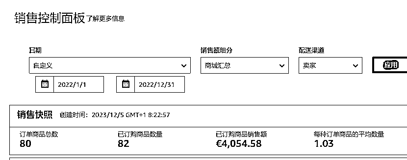

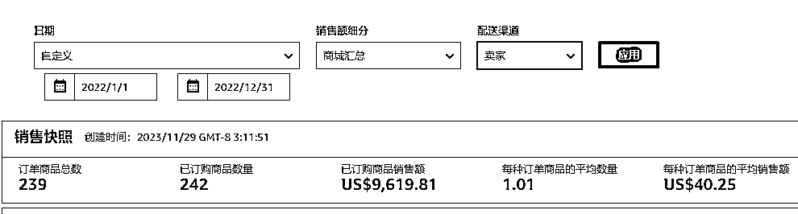

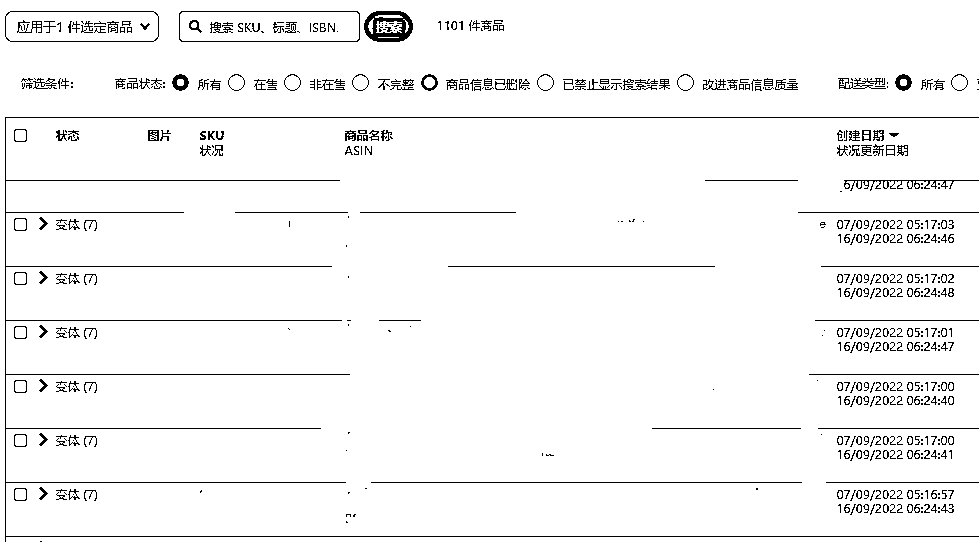

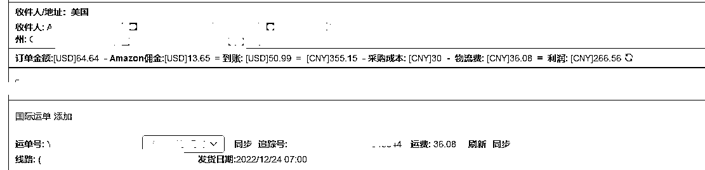

这几张图并不是为了晒数据，主要是给大家一个直观参考。我们所有店铺都是清一色的FBM模式（自发货）。截图里是同一家店铺下两个不同站点的销售表现，产品数量基本持平。

和传统铺货那种动辄上千SKU的玩法比，我们的产品线要克制得多。也正因如此，无论是日常管理还是备货，都不至于手忙脚乱。更关键的是——直到现在，这些店都没花过一分钱推广费。

不开广告、不做站外投放，偶尔补几条QA，流量全靠自然搜索进来。平时花得最多的，其实是选品调研的时间成本。

整体算下来，单店全站点一年的销售额大概在5万美金上下（不同站点之间有差异）。这样的店铺现在有三十来个。至于利润，大家可以根据单个订单的情况自己推算一下。

我在亚马逊圈子里算不上什么大卖，这点成绩和大神比也不值一提。但如果我的选品思路和思维方式，能给你带来一点点启发，那这篇文章就没白写。

关于FBA和FBM哪个更好，这个话题争论了好多年，我的看法很简单：存在即合理，赚到钱才是硬道理。没有谁高谁低，只是每个人对平台、对用户、对产品的理解不同罢了。

新手的话，FBM的资金门槛确实友好很多，试错成本也低。但核心还要看你自己有没有“用户思维”——你能不能真正从买家的角度出发，打磨产品和店铺，形成自己的壁垒。

另外有一点想提醒大家：盲目铺货这种玩法，早年平台产品库不够丰富的时候还有红利，但放到现在，平台规则逐步完善、类目越来越细分，这种又累又不赚钱的模式早就该淘汰了。

接下来，我从以下几个层面，把这套玩法完整拆解给你：

1、FBM新手入坑，先搞定哪些基础问题

2、怎么用“圈层思维”做选品

3、怎么挖到用户真正的深度需求

4、蓝海产品的运营核心思路

5、广告到底该怎么开

6、退款和售后怎么处理

7、这个赛道潜在的风险和挑战

8、给新人的几句掏心窝子建议

## 一、FBM新手入坑，先搞定哪些基础问题

**（1）店铺注册**

店铺注册是整个链条里最底层的事。个人卖家的话，我还是建议老老实实自己注册。流程并不复杂，圈内不少大佬分享过，各大论坛也有非常细的图文教程，只是要花点耐心去填资料、等审核。

对亚马逊卖家来说，店铺的合规性是第一生命线。不管你账面上有多少钱，真正落到自己口袋里的才算数。

如果你在这个行业里摸爬滚打多年，经验非常老道，时间又特别宝贵，那去找靠谱的号商买现成店铺也不是不行，主要省心省力。

另外补充一句：不管美洲站还是欧洲站，都可以做。但前提是你得对当地不同国家人群的消费偏好有足够的洞察。这一块后面讲选品的时候会重点展开。

**（2）产品上架问题**

我现在基本都是用ERP配合表格来上架。新手如果不知道从哪入手，直接去亚马逊后台找“卖家大学”，里面从产品编辑到上架流程，每一步都写得极其细致。耐心跟上，多练几次，上架这一步其实就是最基础的活儿。

**（3）产品采购**

我的渠道主要是1688、拼多多和淘宝。大部分1688厂家都支持一件代发，你把后端对接好国际物流的收货地址，剩下的事就能转起来。

**（4）物流对接**

国际物流现在已经非常成熟了，国内有太多渠道可选，直接找客户经理要报价表就能对接。比如云途、燕文这两家，时效相当稳定，很适合小包裹运输。偏远地区两周内基本也能送达。

但大件包裹我建议前期千万别碰，物流成本高不说，风险也大。等手里有足够资金和经验了，再考虑去做也不迟。

## 二、用“圈层思维”来选品

“到底卖什么”，永远是电商人入行最关心的话题。

只要是做电商，就没有人不想做出爆款。赛道选择也一样。哪怕你选的是蓝海产品，里面也得有爆款基因，不然很难快速拿到结果。

那……爆款基因去哪找？我的做法是：从一个特定圈子里，挖掘小众需求来反推选品。

先说圈子。举个例子，赚钱的圈友聚在一起，共同目标就是找赚钱路子。但生活里还有很多类似的圈子——骑行、烘焙、写作、剧本杀、摄影……每个圈子里，又可以往下拆分出更细分组。

比如摄影这个圈子，拍人像和拍星空的，装备能一样吗？公路自行车和野外山地车，配件需求也天差地别。

所以，选品的核心不在于“找到表面需求”，而在于“找到用户真正愿意付费的深层需求”。

我举个例子：国外的骑行爱好者，表面需求是“买一台适合自己的车”，然后再找队伍、找线路去体验。

但往深了挖，你会发现：他们会根据不同的线路难度和里程，去配置一整套不同的装备，用来“赋能”自己的骑行之旅。而这层细分出来的装备需求，才是真正藏着金矿的地方。

## 三、如何找到用户真正的深层需求

要聊“怎么找到真正的用户需求”，我用自己一路踩过来的选品经历，给大家拆一个可复用的方法。

**（1）职场经历带给我的选品启示**

当时在盲目铺货这步摔了一跤之后，我开始认真琢磨：不同平台的用户，到底需要什么样的产品？

创业之前，我一直在头部直播间做组货运营，日常接触的，大都是各个类目的知名品牌标品。

但标品意味着什么呢？意味着内卷，意味着同质化竞争惨烈。

做跨境出海更是如此。你在1688上能看到的产品，用不了多久就能在亚马逊上被卷成红海。有些人会说：“那我自己开模做行不行？”

但说实话，很多开模的卖家最后也没逃过被抄袭的命运。今天你开模，明天对手就照着你的款改一版，然后又是一波价格战。所以，光开模是不够的，你得有别人抄不走的核心竞争力。

**（2）从自己的兴趣出发，站在买家角度选品**

我个人平时是个动漫爱好者，大学时也追过不少电竞赛事。后来看到国内很多大厂游戏、动漫出海的消息越来越多，我就在想：国内二次元圈子已经这么庞大，那国外是不是也有同样规模的受众？

于是我就觉得，用这个赛道作为切入口，是可以认真试一下的。

当然，肯定不能凭感觉乱选。我习惯先用数据分析来验证方向。咱们就用一个“书包”的案例，来具体看看这套打法是怎么跑的。这个产品只做参考，不构成具体建议哈。

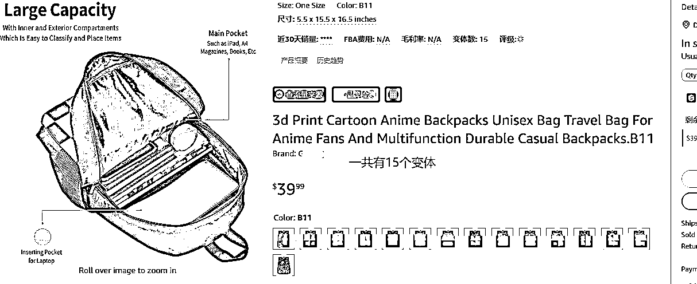

你可以从截图里看到，那是一款印了不同动漫元素图案的书包。本质上还是一个书包，只是找了厂家在版面上印了不同的图案而已。

它的目标受众，就是喜欢这部动漫作品的粉丝群。你只要找到足够多的图案素材，用PS做好主图，就能创建出很多不同的变体链接。每个链接，对应的就是一部动漫的粉丝群体。

但注意，这里我们要回到刚才说的“深层需求”上。

如果我只是把这个书包直接拿到1688上去搜、去采集、去照搬，或者再找同一个IP的其他图案书包，那就又回到拼价格的死胡同了——因为这个链接你能看到，别的卖家也能看到，人家还能卖得比你便宜。

所以，不是说这个书包本身有多特别，而是通过这个产品，我们看到了一个“可行”的赛道。

那二次元群体真正深层需要的是什么呢？

说白了，是对某部动漫的喜爱——但这还是表层。真正深层的，是“角色代入感”，是身份认同和精神共鸣。

就像每个人看金庸都会有一个武侠梦，看动漫也是一样——有人看到热血，有人看到温暖。这背后本质上是一种精神需求。

那这种精神需求，能不能用数据来验证呢？能。

新手做数据分析，我推荐用卖家精灵。把动漫名、人物名这些关键词组合起来反查，就能直观看到搜索量有多大，用户到底在搜什么。如果你会ABA数据反查，那辅助效果更佳。

但最关键的一点是：你得对这个赛道有自己的理解，清楚产品定位在哪个群体画像上。

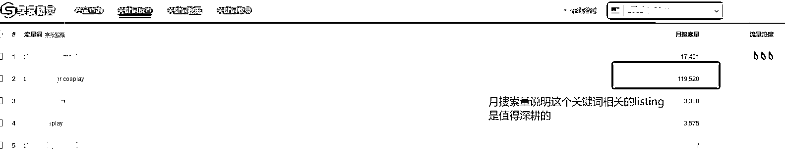

通过“动漫名称+角色名称”等关键词组合反查，你会发现“cosplay用品”这个方向的搜索量相当可观。这说明什么？说明“现实中扮演成自己喜欢的二次元角色”，确实是一个非常真实且庞大的深层次精神需求。

顺着这个需求往下拆：有人想通过穿特定服装来扮演，有人想靠道具来还原，还有人对手办、配饰、假发这类“衍生周边”感兴趣。

这样一来，需求就自然分成几条路：服装、道具、发饰、衍生周边。

但知道了赛道，还得知道从哪个子类目切入。这时候可以参考BSR排名——它是基于销量的实时排名，能直接告诉你什么产品在市场上走得好。自然排名则反映关键词的权重。两者搭配着看，就能把用户搜索意图和实际销售情况结合起来，筛选出值得进选品库的候选品。

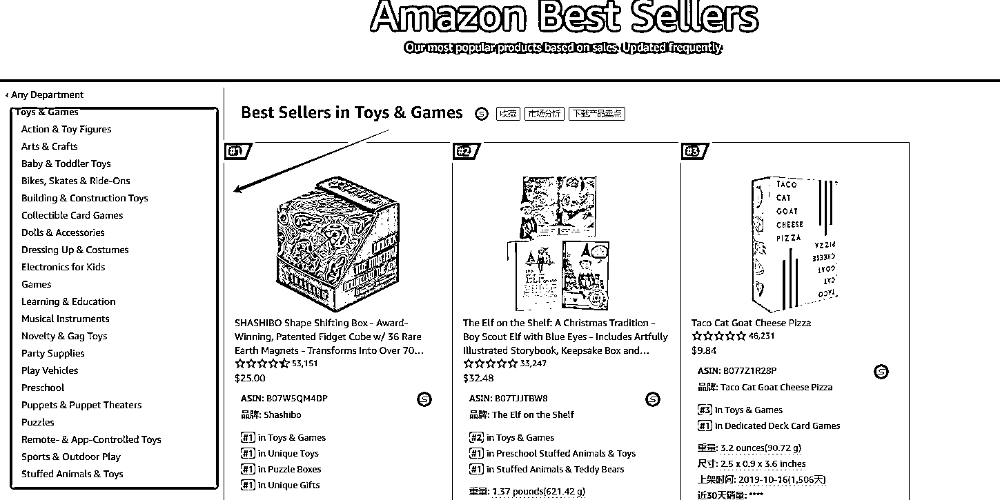

找到基础产品之后，下一步是找“爆款元素”给它赋能。这里还是用圈子思维来筛。

我一般会去国外的动漫排行网站，比如MAL（MyAnimeList），看本月、本周的实时热播排名，把排名靠前的动漫抓出来筛一遍。这个网站有点像国内的豆瓣，有评分、有投票数，能快速帮你定位粉丝基数还不小的动漫群体。

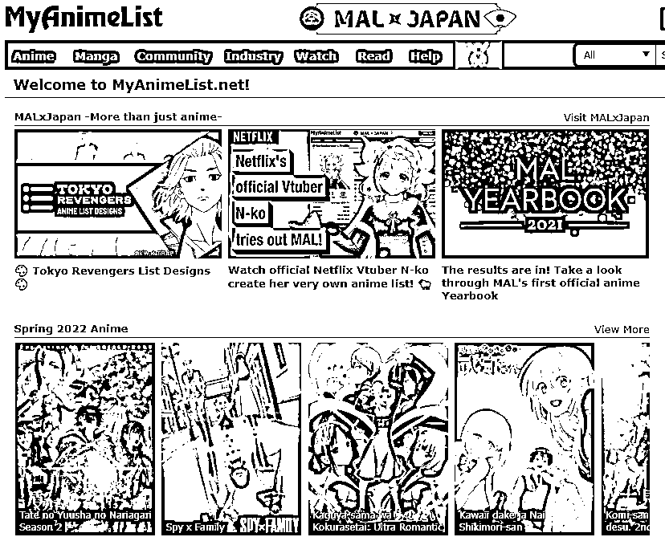

但这里必须十万分小心：动漫是知识产权侵权的重灾区。选爆款元素时，一定要提前排查版权风险，千万别踩雷。

## 四、产品的一些运营思路

有人说自发货卖家不需要运营，尤其是铺货型的，靠“量”就能躺赢。初期确实如此，但长期看，没有竞争壁垒就是死路一条。

尤其是蓝海产品：要想在小众市场里站得住脚，你就得在细分领域里把产品做到极致，让圈子里的人一眼就认定“这个东西只有你家最懂我”。只有做到这一步，结果才是可持续的。

还是拿动漫赛道举例。运营这块，我拆成几个阶段：

**（1）产品筛选**

蓝海赛道有一个绕不开的问题：数量天花板低，受众群体本身不大。那怎么做出增量？

答案是：做产品筛选，把“爆款元素”和“刚需产品”结合，最大限度覆盖不同用户的需求。

具体执行上：初步出了单以后，我把所有出单产品按类目、周期订单量、利润、发货时效这几个维度拉一张表，统一筛一遍。这一步的目的，是找“潜在的爆款元素”。

为什么？因为这个阶段基本不开广告，能自然出单、能吸引自发货买家下单的产品，背后一定有某种爆款因子在起作用。

接着，再把发货时效相对稳定、利润空间可观、且带爆款元素的产品拎出来，建一个初步的产品池。

那“爆款元素”到底是什么？说白了还是需求——比如书包上的图案、角色标志性配饰、专属道具……这些本质上都是小众群体在日常生活中投射出来的精神需求。

**（2）把爆款元素和需求产品做组合**

有了爆款元素和产品池，接下来就要做“组合”。

怎么做？可以用产品相关的类目关键词去卖家精灵或ABA数据库反查，看看哪些产品适合附加这些爆款元素。

再拿书包举例。你在出单产品池里发现：带某个图案书包特别好卖，那说明这个元素粉丝买账。这时候你再去反查类似“anime bag”这样的关键词：

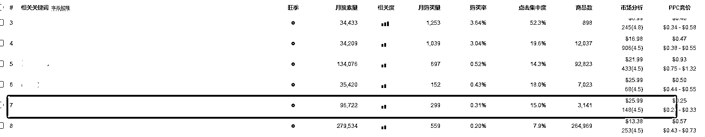

反查结果会告诉你：这个关键词下商品数量并不多，但搜索量却很可观，客单价也远超平均。说明市场供不应求。

然后再去搜一下，这个产品有没有其他卖家已经配了动漫元素？如果搜出来发现首页大多都是不相关产品，那恭喜你——这就是可以操作的机会。

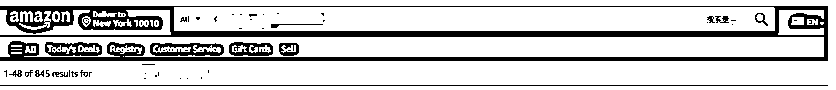

这时候就可以把这套“爆款元素×需求产品”的组合打法跑起来，做出新品上架。更聪明的是，把以上步骤做成标准SOP，交给员工去执行。他们自己就能顺着这套流程：每天看榜单找元素、用工具反查需求、筛赛道上新品。

这样做的好处是双重的：一方面避开了同质化竞争，另一方面在整个上新过程中，持续沉淀下来的是真正匹配粉丝群体需求的蓝海产品。

下面是我们当时初始MVP测试跑出来的数据，能看到某款动漫相关产品的自发货成本利润，以及定制化产品的采购数量。

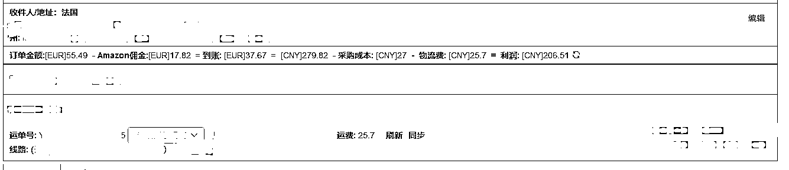

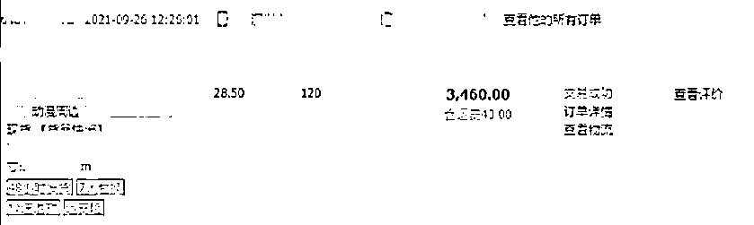

**（3）产品运营进阶**

等测款和出单稳定之后，就要开始用更精细的运营手段去撬动更多流量了。亚马逊产品运营的常规版块就是：产品编辑优化、广告投放、QA问答、站外推广。产品优化和广告后面会单独说。

对动漫这个赛道来说，我认为QA反而是更重要的那个。

为什么单独把它拎出来讲？因为这群买家在付费前，格外想确认产品细节和定制服务。比如道具的还原度、材质工艺、细节尺寸、会不会有掉色问题……这些都是忠实粉丝最在意的点。

在稳定出单的阶段，我一般会通过业务报告，盯每个变体的浏览量，挑表现不错的款式，有节奏地埋几条QA，内容永远围绕：材质、细节工艺、制作周期、发货时效这几个关键维度来做。

**（4）产品编辑优化**

亚马逊的转化逻辑很简单：主图一眼抓人、卖点一眼看懂。这两步能做到，转化就成功了一大半。所以产品编辑非常重要，尤其是动漫赛道——材质细节、不同国家的尺码表述、使用场景……都必须在上架前打磨到位。

**1、标题、五点描述与详情**

这里有个红线：有些动漫名称本身就是版权保护的，能不能用，一定要提前查。一方面是看你所在的赛道有没有其他卖家，另一方面也是确认元素是否已经有版权在手。

千万别稀里糊涂上架了，然后收到一封绩效警告邮件。另外就是核心关键词布局：一方面用工具反查关键词组合，另一方面也看同行里跑得好的卖家主要在哪些词上出单。

更聪明的做法，是从粉丝视角出发，把那些有情绪、有场景的长尾词埋进去。

**2、图片**

不管你切哪个赛道，主图都一定要能让你的受众在第一眼就产生兴趣。比如书包上的图案足够有代表性。

但这里我要特别建议：别直接从1688拿图，尽量做原创图。所有卖家都能拿到的图，没有竞争力。

我的做法是找国内一些二次元插画师合作，把他们的原画“赋能”到产品上。这样出来的产品原创度极高，还能有效规避很多知识产权问题。在这个细分领域里，你的产品就是独一无二的定制款。等出单稳定之后，再找厂家按件定制。

## 五、关于广告

这个赛道有个好处：早期产品数量多，关键词也非常精准，基本靠自然流量就能出单。等你有稳定爆款了，再考虑用关键词组合给主力产品开一些广告活动。

目的是什么？为了冲排名，让更多粉丝能看到你。

广告逻辑上，我几乎都是手动开。因为SKU数量多，必须优中选优，筛出主推款来集中投放。投放关键词的设计，就是用“爆款元素词+产品词”组合，效果不错之后切精准匹配，一口一口把流量吃下来。

但预算一定要死死控住。自发货的回款周期长，前期资金压力大，利润和现金流之间必须找到平衡。

当通过精准匹配把几个链接的自然排名推上去之后，就可以把广告竞价慢慢调低。因为这类小众群体的产品本身就很精准，有一定的搜索排名在那撑着，自然流量就已经很可观了。这时候把广告费省下来，利润自然就变厚了。

## 六、退款和售后问题

如果有海外仓，退货可以直接退到那边中转。没有的话，自发货的短板就浮现出来了：国际退运的运费非常肉疼。

我的应对策略是：能沟通就沟通。多跟买家协商，给到一定折扣，尽量避免走退货流程。

另一方面，每过一个周期都要根据最新的物流报价表重新核算利润。确保在全年运费最贵的时间段，利润还有富余空间，并且还能有余力给客户免费补发一次货。

## 七、这个赛道潜在的风险和挑战

（1）发货时效

动漫周边产品有一个明显特性：节日属性强。很多人买来是为了当礼物或者过节用的，对时效要求非常高。而定制化产品往往国内发货+国际运输时间拉得太长，导致店铺绩效飙升。

如果优化方案不到位，前期很容易大面积流失订单。所以，在listing上把时效、定制周期写得清清楚楚，同时做好客户与厂家的双向沟通，非常考验耐心和效率。

（2）知识产权

这个赛道的知识产权问题，是重灾区中的重灾区。

很多人只看到了高利润的表象，比如盗版手办——却完全忽略了背后巨大的合规风险。有人可能说：“动漫游戏本身就有IP，做了就肯定侵权。”

但我更想强调的是：合规风险是可以主动规避的。到现在为止，我的店铺还没有一个因为知识产权问题而挂掉。核心做法就一句话：严格按平台规则上架，提前排查版权雷区。

（3）平台规则与自身成长

跟卖问题、品牌注册、绩效审核、发货时效……这些都是自发货卖家时刻要面对的事。

尤其是绩效管理和店铺合规性——产品一多，哪个环节掉链子都可能被平台盯上。所以“铺货转精铺”，是所有自发货卖家长远走下去的必经之路。

（4）回款周期

前期回款周期长，这是做自发货必须接受的事实。每天都要先垫钱给供应商、给物流商，再去等客户确认收款慢慢回血。这就要求你得科学规划现金流，千万不要盲目大批量订货，更不要轻易陷入价格战——否则，很容易把自己玩崩。

## 八、给新人的几句掏心窝子建议

（1）行业门槛

亚马逊的门槛，真的没大家想象的那么低。它需要一定的选品能力，也需要扎实的电商思维。好在国内很多产品运营的打法，放到这个平台上一样通用。前提是你愿意投入足够的时间和精力，去认真经营这件事。

还有一点，入行久了你会发现：每一步不规范的小操作，都可能酿成不可挽回的结果。所以，如果你是冲着“一夜暴富”来的，或者想用极少的精力换取极高的回报——我真诚建议：先冷静一下。

（2）我的建议

每个赛道都有值得深耕的价值，关键在于你怎么分配自己的时间和精力。盲目铺货，在这个时代已经没有红利可言了。

真正重要的，是找一个适合你的细分方向，把它吃透，让利润和现金流形成正向循环。

希望我的分享对你有启发。

别再纠结这个赛道能不能做了——能，但千万别空着手就冲进去。真正的重点就两个：选品要用心，侵权要避开。要是你们团队只有两个人，我的建议是别一上来就铺开，先小规模跑点数据，用测试结果说话，再决定下一步怎么走。

* * *