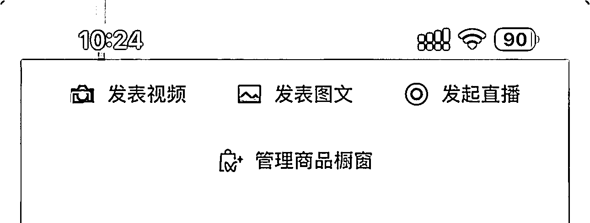
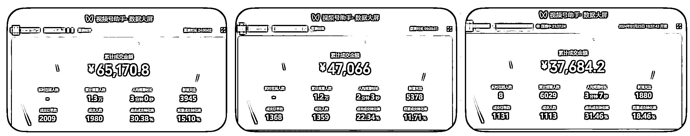
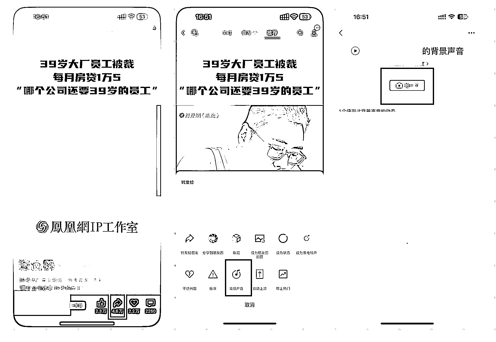

你有没有发现，互联网每隔一阵子就会冒出一个“只要上车就能赚”的机会？

回看过去几年，视频号带货、抖音图文带货、小红书无货源、美团无货源店铺、抖+流量红利……一波接一波。每一次都有不少人吃到了肉，但也有更多人只能眼睁睁看着机会溜走，然后拍大腿。

为什么总抓不住？说到底，还是没看透红利的底层规律。

## 红利到底是什么？

把过去几轮红利摊开看，你会发现它们的出生方式惊人地一致：

- 视频号带货火，是因为平台刚开始布局电商，供给极少，需求却很旺；
- 抖音图文带货火，是因为抖音第一次把大流量倾斜给图文内容，做的人还不多；
- 小红书无货源火，是因为小红书电商刚起步，商家和内容都严重短缺；
- 抖+流量便宜，是因为豆荚刚上线，流量充足，但采买的商家少。

这些故事都指向同一个结论：**红利藏在变化的初期。** 一个市场如果长期不变，早就挤满了人。而红利从出现到消失，也通常是同一个剧本：先供不应求，然后众人涌入，供需平衡，最后内卷到谁都不赚钱。

所以，想抓住红利，速度比什么都重要。而且，现在的很多红利往往在以天为单位快速衰减，你的能力成长根本赶不上。**抢先发现变化、抢先下场实操、抢先放大规模，才是赢家打法。**

那么问题来了：现在还有没有新的变化值得关注？

有，视频号图文，正在悄悄崛起。

## 我看到了两个信号

信号一：最近很多人都在说，安卓版微信的最新版本里，创作者发布作品时多了一个“发布图文”的按钮。

平台不会无缘无故改版。这个按钮的出现，基本等于官方在喊话：大家多发图文。

信号二：我自己的团队就在做视频号带货。前段时间，我参考赚钱有术的风向标机制，建了一个垂直类目的风向标群。前阵子群里晒出的爆单案例，十有八九都是视频。但从1月初开始，图文形式的爆单案例开始频频出现，隔三差五就有人晒出图文的销售成绩。

看到这个趋势，我们自己也立刻下场试了试。真实体感是：图文现在的竞争比视频小太多，拿流量和出单都容易不少。于是我们开始鼓励新手直接做图文，团队也小规模跑出了一些成绩。当然，说实话，现在还没到那种闭眼赚钱的夸张程度，但已经是一个值得投入的窗口期。

有人会问：既然你说有红利，那怎么还没爆发？

我的判断是：变化已经来了，只是还没完全展开。视频号目前是在悄悄给图文放量，试探市场反应。接下来大概率会出台官方的图文扶持计划，运气好的话，过年前后就能等到。那时候，才是真正的大红利。但别干等——现在就下场，图文的流量红利已经够你吃一阵了。

## 具体怎么落地？

聊完了趋势，说说实操。视频号图文，主要看三件事：选品、制作、发布。

### 选品：先定变现路径

视频号图文的红利，本质是流量红利。流量既能走电商，也能走非电商。

- 非电商玩法：把流量引到私域做转化，或者在公域靠流量本身变现；
- 电商玩法：图文挂小黄车直接卖货，或者用图文把流量导到直播间，在直播间成交。

选品上，大家可以参考我之前分享的《选品思路&答疑》，同时也可以看看赚钱有术整理的抖音图文玩法合集。虽然平台不同，但底层逻辑是相通的，具体执行时需要结合图文的特点做调整。

### 制作与发布：语音是隐藏变量

做图文带货，语音在很大程度上决定了能不能上热门。但现在视频号发布图文，有一个限制：不能自己上传背景音乐，只能用系统里的音乐。

想用指定BGM，可以走一个“曲线救国”的流程，原理其实就是借道发布同款BGM的视频，让系统把这首音乐收录进来：

1. 先在外部平台把你想要的图文素材背景音下载下来；
2. 去视频号搜一下，看有没有同款BGM的视频，有的话直接下载视频提取音频；
3. 没有就录屏，再用剪辑软件把音频提出来；
4. 用剪映做一条风景视频，配上这段音频，然后发布到视频号；
5. 最后用你准备发图文的账号，点进这条视频的背景音界面，选择“拍同款”。

搞定这一步，你就能在图文里用上想要的音乐了。操作截图我放在下面，真正上手时参考着来就行。

## 一些心里话

我刚开始靠红利赚钱的时候，真以为自己能力很强。后来完整经历了几波红利周期，才越来越清醒：个人那点本事，在趋势面前根本不值一提。红利就像一股向上的浪，每一波都会把冲在前面的人托起来。

这篇文章只是抛砖引玉，期待后面看到更多圈友的实战分享。也祝大家都能接住这波视频号图文的红利，一起变富。

最后，配合下面两篇内容阅读，体验更佳：
- 【新手必看】分阶段的搞钱攻略
- 抖音图文玩法合集

