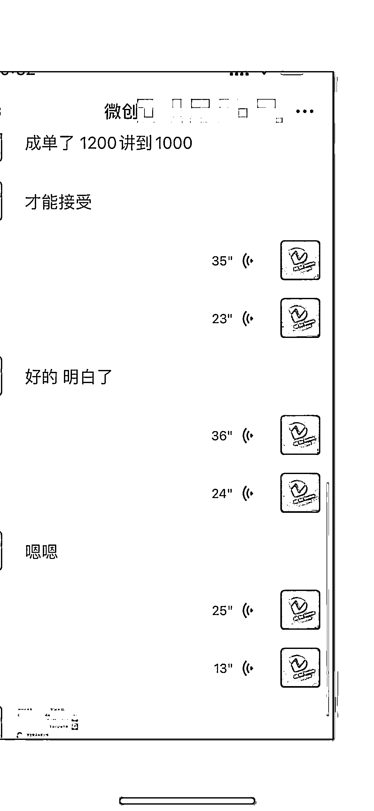
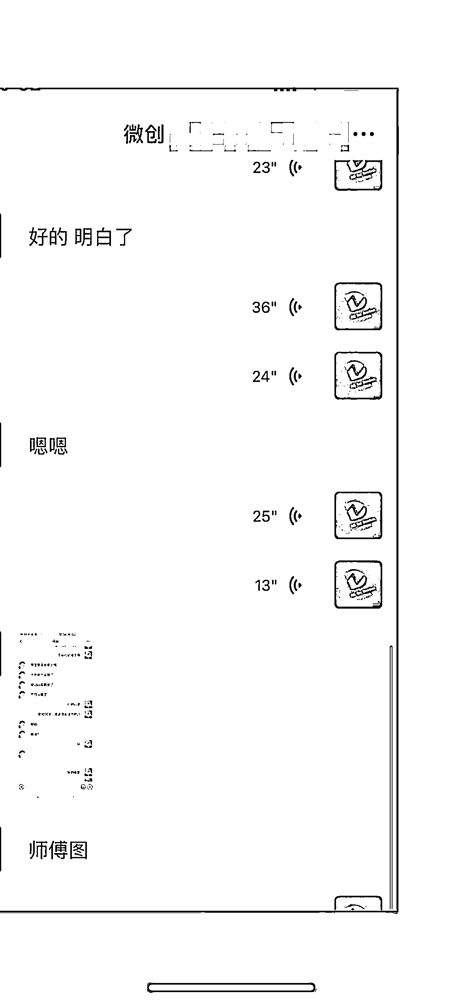
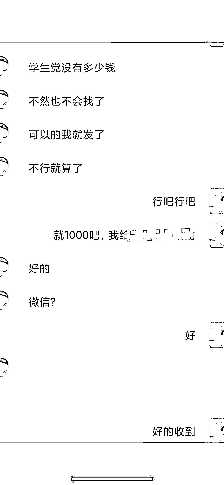
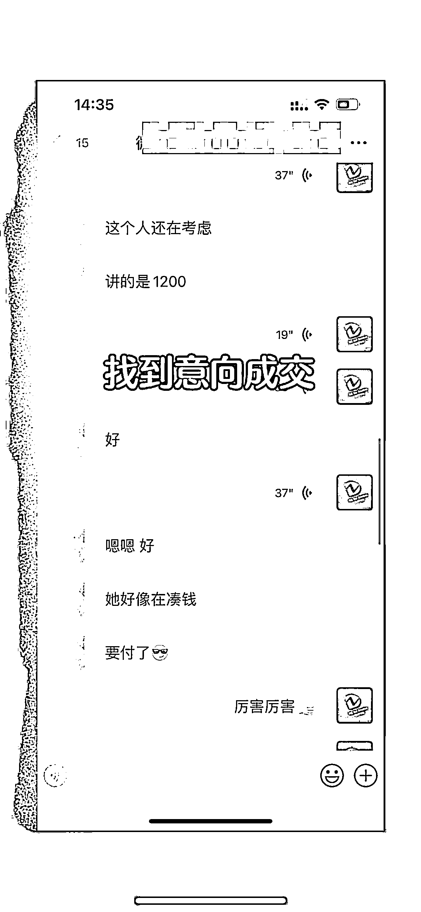
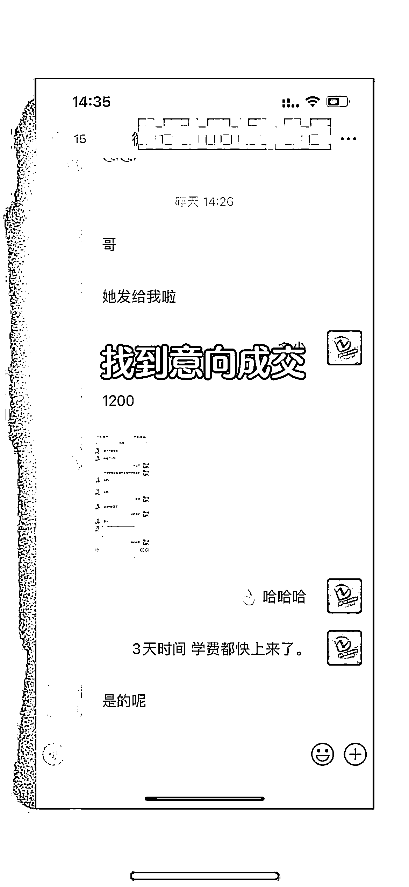
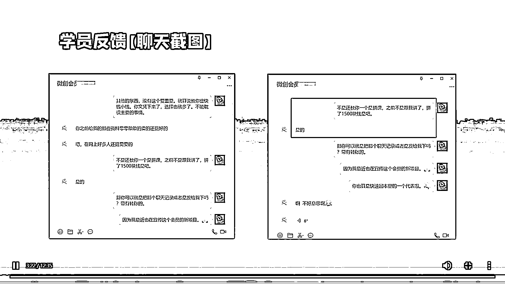
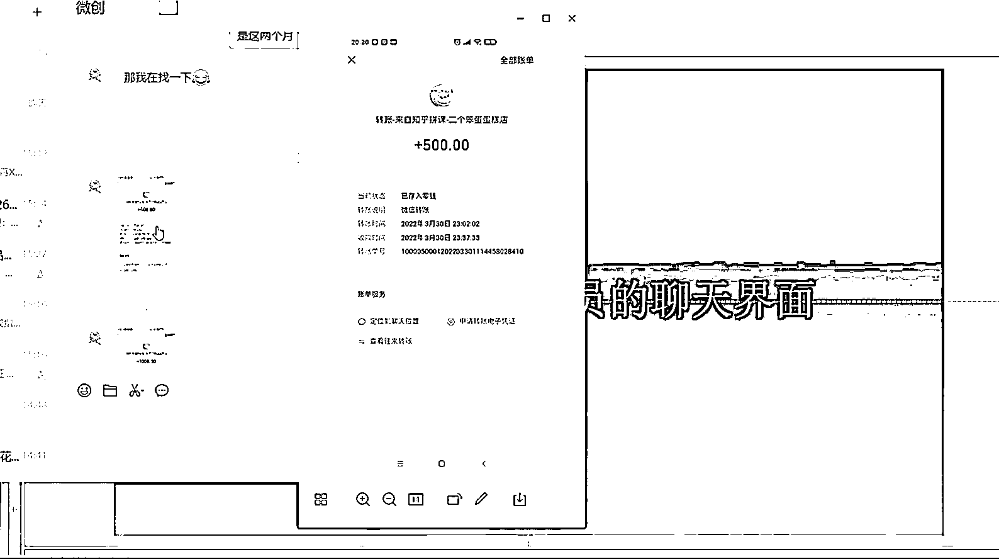
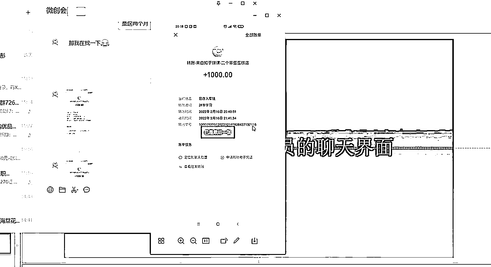

# 买来几千块的课程账号怎么在两周内把学费赚回来？有账号的可以直接照做

> 原文：[`www.yuque.com/for_lazy/thfiu8/amreendezekfg5fw`](https://www.yuque.com/for_lazy/thfiu8/amreendezekfg5fw)

很多人报课的初衷都一样：花钱学技术，顺手把学费赚回来。

我大学时报了一套设计课，贵得离谱，大几千块。报名前为了省钱反复算计，看到机构宣传可以分期首付，后续学费由兼职单子抵扣时，瞬间觉得稳了。几百块一月的分期，摊到半年一年，配上能学技术的噱头，心里一下就松了。

结果入坑之后才发现，现实和宣传差太多。交了钱拿到的只有账号权限和每月必还的分期账单。承诺的兼职、接单、带带单子，全都没影。每个月从生活费里挤出大几百，学生一个月生活费也就一千出头，等于把大半年的开销都压在这一个账号上了。

心情能好才怪。手里握着课程账号，每天能看回放，每天都能直播，但兼职的承诺成了一张空头支票。课程一期30多节，有一年期限，分期却要半年到一年。越学越憋屈，越还越心累。

那能怎么办呢？退课还是硬啃？其实还有第三条路：既把课学完，又把学费快点收回来，后续还能继续用这份资源赚钱。能不能长期赚钱要看技术，但先把学费赚回来是可操作的。

关键就在于你手里已经有了一个付费账号。这个账号价值几千块，放着不用就是闲置。

有人会问，是想倒卖吗？只猜对了一半。真正的玩法是共享、分摊，让账号发挥最大利用率。合理操作的话，一个账号回血比例能做到80%左右。真有朋友靠这套方法，十几天到一个月就把1500左右的学费补回来了。

怎么具体操作，分成几步走：

1. 先认清资源本质。账号相当于你花钱买的虚拟房子。房子空着就浪费，可以卖也可以租。账号同理，可以拼课、可以共享。把几千块的课程权限做有偿共享，就是变现的核心逻辑。

2. 找到愿意分摊的人。会担心拼不出去？实际上需求一直都在。很多人报名时就是冲着低价学技术来的。你去小红书、知乎、抖音搜一下课程机构的名字，围绕机构的评价、吐槽、拼课信息，评论区里全是潜在用户。你就是从这些地方看到广告加到老师微信的，那里也同样聚集着一堆想报课的人。平台不会限制你评论、留言、私信的权利。

3. 具体的触达方式。去这些平台搜索机构关键词，找相关笔记和帖子，直接在评论区留言：我这门课快学完了，包含哪些内容，有没有小伙伴一起拼？把你能提供的价值先亮出来。留言后立刻转私信，把联系方式引到微信。没有微信就很难成交。

4. 微信里的沟通和成交。了解对方需求后，提出分摊方案。课程卖2900，你收1000到1200，对方省了贷款、省了全款，还能立刻学习，大多数人都会考虑。重点是建立信任：把账号信息介绍清楚，聊聊自己的报名经历和学习感受，沟通顺畅成交就顺畅。

5. 意向多留几个。把加来的朋友都认真对待，确认转账后把账号密码和登录方式发过去，后续使用问题保持沟通即可。

总结成三点：

第一点，回血的前提是什么？前提就是你手里有一个有效期长的账号。期限越长，价值越高。

第二点，怎么操作？拼课，不以赚钱为目的，以学习交流、学费分摊为主。2900的课你只花1500，后面再拼一次，学费基本就回来了。

第三点，找谁拼？互联网找人最快。广告出现的地方就是目标用户聚集的地方，在那里留言、私信、引流到微信即可。一般坚持10天左右能有意向，一个月内回本很常见。

这套打法保证你能学到内容的同时把学费快速收回。至于学完之后能不能长期变现，就看你技术到没到位。能熟练做图、修图、做效果图，有自己的思路时，就能走技术变现路线。

我认识的一个朋友，接了淘宝店铺的长期合作，分成做图。另一个同学学完基础后在花瓣网发作品引流到微信，卖PS插件、素材、模板也赚得不错。我自己第一桶金就是拼课，之后帮社团处理证件照、活动照片，久而久之积累了校园客户，修图做图单子不断。

所以单一的知识很难变现，得用平台或人脉做桥梁连接。变现是一个框架，之后学习别再从第一节刷到最后一节，而是学什么就用在什么单子上，有需求才学对应的模块。

方法很简单，关键要去做。最好的产品来自自身资源，最好的引流就是去需求聚集的地方，最好的成交就是性价比。希望这套思路能帮你拿到第一笔意外的入局收入。

价值共享，祝大家赚钱有术。

* * *

评论区：

希平 : 有点过于理论

* * *