# ('AI+头条号，如何月入5000+', (2, 18))

标题：AI+头条号，月入5000+的实操心得

大家好，我是一北。在赚钱有术这个圈子里待久了，之前一直盯着ChatGPT+公众号的精华帖学。由于我自己本来就在头条号写文章，自然而然就冒出一个想法：能不能把AI搬过来，批量产出头条爆文？试了一阵子，还真跑通了。今天不藏着掖着，全部分享出来。特别感谢群里研究AI的台风、一来几位老师，没有他们的无私分享，我也走不了这么快。

一、动手前，先做好两件事
第一件事，账号得备齐。今日头条、百家号、公众号、网易号，这些主流变现平台，是不是都注册好了？第二件事，认知要摆正。AI初稿大概率只有40到60分的水平，真正的分水岭在于，你能不能把它加工到80分以上。举个例子：假设你的内容爆款率是20%，以前一天只能写1篇，有AI帮忙后一天能出3篇，爆款数量不就等于翻了3倍吗？所以AI的真正价值是放大产能，而不是替代你的判断。这里头有两个维度：一方面，你要学会和AI磨合，指令怎么下、反馈怎么调，都要有点耐心；另一方面，你自己的写作能力也得跟上，写作方法论、拆解爆款、模仿高手，再加上日常的数据复盘，发现问题就改进。而所有环节里，最重要的一步是找对标账号。

二、找对标、拆爆款
做内容项目，第一步永远是找人模仿。方法很简单：在微信搜一搜里输入领域关键词，再多看几遍文末推荐，系统就会给你打上标签，开始自动推同类内容。如果你连3-5个对标账号都说不上来，写不出爆款真不冤枉，因为你根本不知道爆款长什么样。

对标账号要满足两个条件：一是近期更新勤快、爆款密集。像张晓磊，一天更新5到9条，爆款率差不多80%。二是你看完以后有感觉：“这我也能模仿一下”。找法有很多，从首页入口进，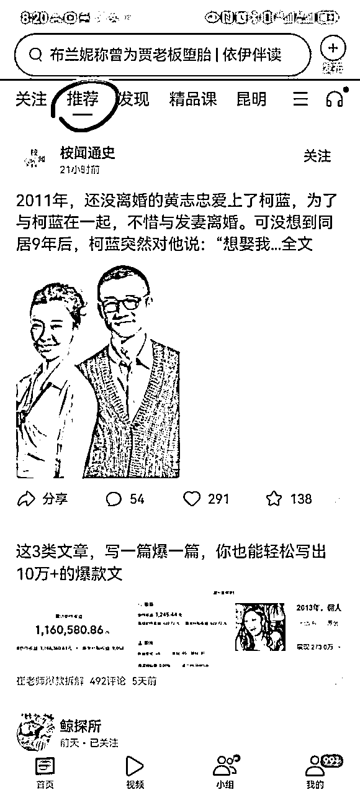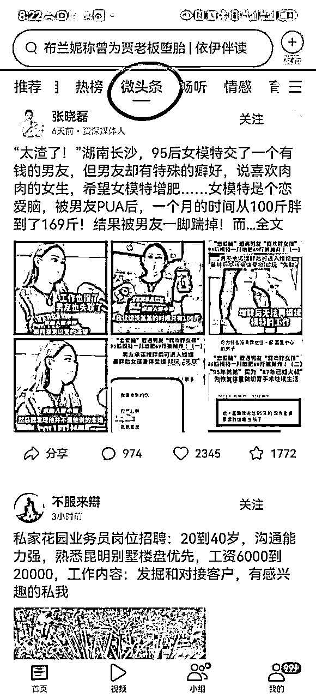 也可以依赖大数据推荐，只盯自己领域的爆款，刷着刷着系统就会把同行的爆款推到眼前；再就是搜索关键词，文史类搜武则天、朱元璋、胡适，情感类搜婆媳、离婚、儿媳；账号名可以搜“文史”“历史”“说史”“明史”这类词。

找到对标以后，从选题开始就要模仿它。拆标题、拆开头、拆正文、拆评论区。莫言有句话：写作从模仿开始。但模仿不是抄，而是摸清里面的门道。我在早期会把爆款的全文长度、开头长度、结尾长度、配图数量全部统计一遍，连开头都要细看：人家用的是故事梗概冲突法，还是细节提炼法？然后用同样的路子写一篇，写完了再和对方对比，看看标题到底有没有模仿到位，结构有没有模仿到位。现在这个环节也能交给AI，让它辅助拆解，把对方的风格提炼成指令，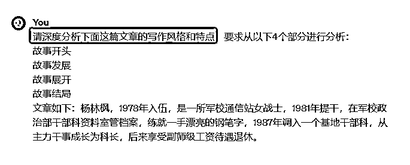 以后再写同类文章，直接拿指令去生成就行。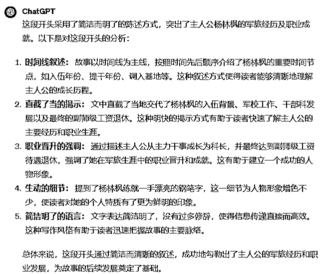

三、爆款的两个命门
一是标题，二是开头。标题决定了一篇内容七成的命运。好标题里，反常、夸张、悬疑、转折、冲突这些手法很常见，权、钱、性更是常客。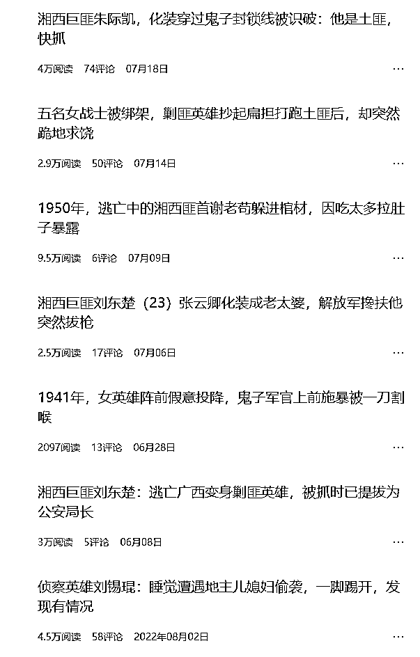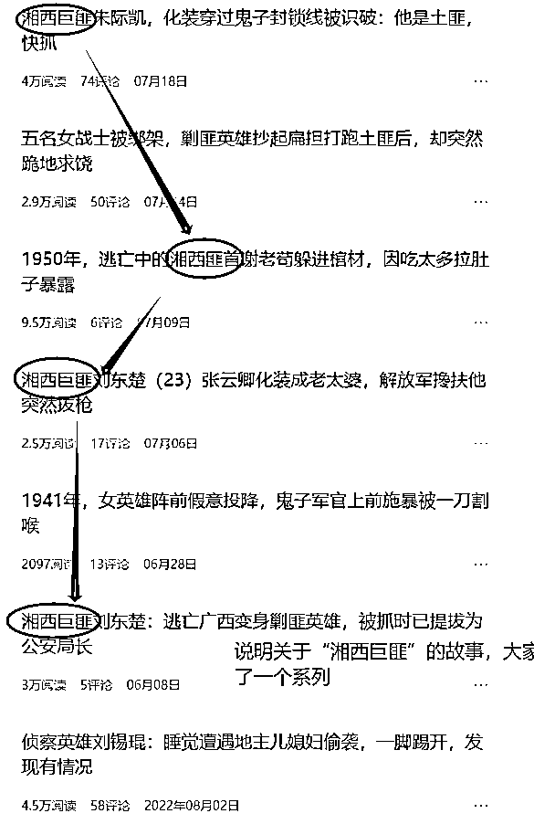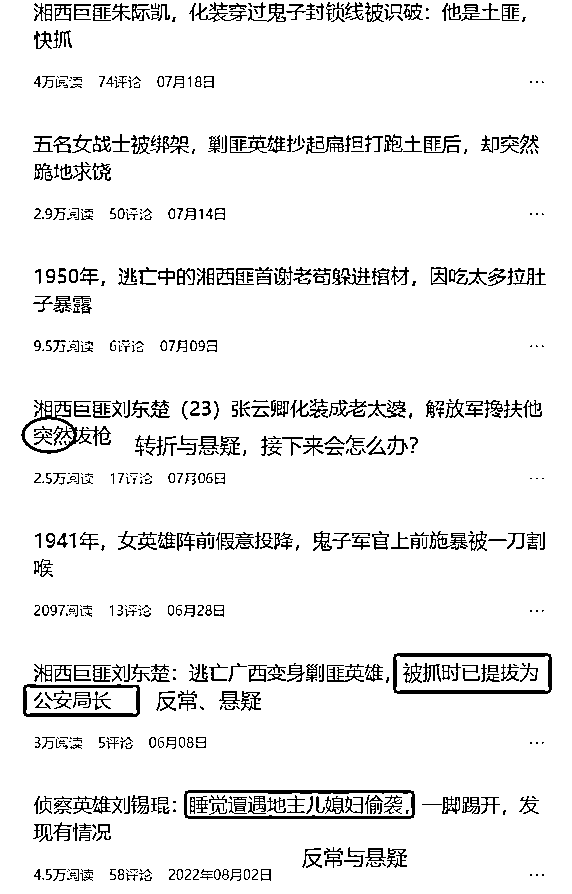 你去看那些高段位账号，标题往往在极致重复同一个规律。比如某账号做了个“湘西巨匪”系列，几十篇都有不错的阅读量。这么一想，换成“胶东巨匪”“贵西巨匪”，是不是也能做成系列？开头同样重要，在微头条里，开头占了七成功劳。开头一旦啰嗦，读者马上划走，碎片化时代争的就是注意力。几乎所有爆款账号，标题和开头都藏着极强的规律。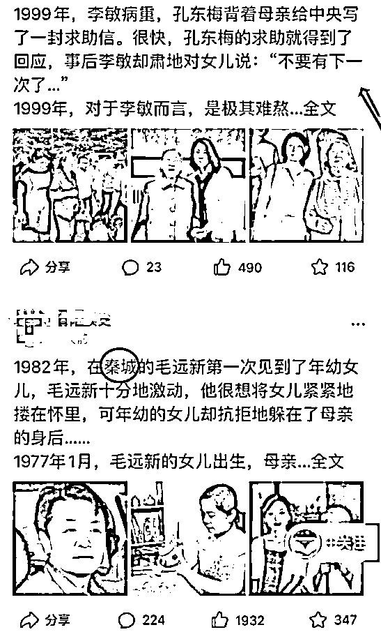 比如拆某账号的开头，基本可以总结为：时间+人物+事情+细节+转折。再往深一层看，它专门写那些正史不载的大人物野闻，满足大众的窥私欲；而这个固定公式，就是我们可以直接套用的开头模板。

四、AI在不同领域的用法不同
有些领域，AI完全可以挑大梁。比如第一人称故事、养老金这类大范围评述、心理学分析、虚拟情感故事。这类内容可以让AI先搭框架、再输出正文。我常用的指令模板叫“人物故事模仿大师”，里面设定了角色背景、技能、限制条件和工作流程，目标受众是爱看八卦的中老年人群。操作流程大致是：先把模板发给AI，让它进入角色，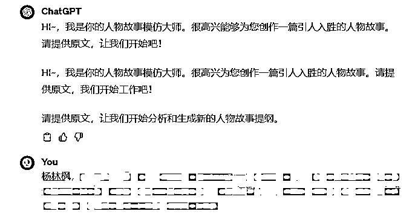 然后让它读原文、提炼核心要点，并把内容拆成3到6个部分，重新生成一份提纲。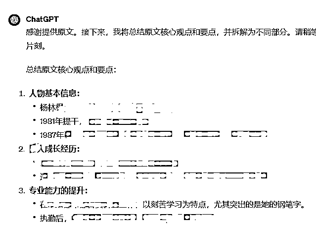 如果提纲不满意，就让它改。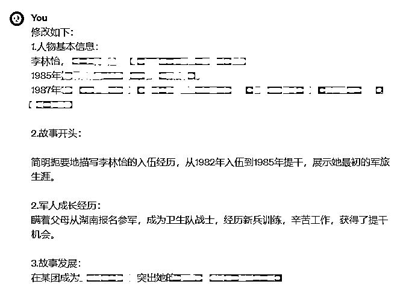 等提纲敲定，再让AI按部分逐段写作，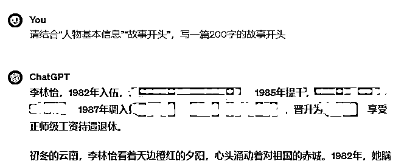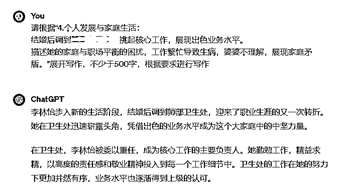 最后把所有段落拼起来，人工通读一遍、润色一遍。我写李林怡那位女兵的故事，就是走的这个流程，发布后阅读量10W+。

另一类领域，AI不能自由发挥。像文史、人物这类有史实底子的内容，AI写出来容易跟原文重复，甚至被头条的大数据识别成洗稿。所以AI交稿后，你务必做加减法：有没有加入新的素材？有没有删掉一些原情节？有没有调整论述顺序？有没有写出全新的评论？四步都做到，才算真原创。这里我用的模板叫“写作模仿大师”，要求它在不改变大意的前提下，用自己的话重写。如果觉得模板太复杂、反馈不给力，可以退一步用简单指令：先让AI提取中心思想和行文大纲，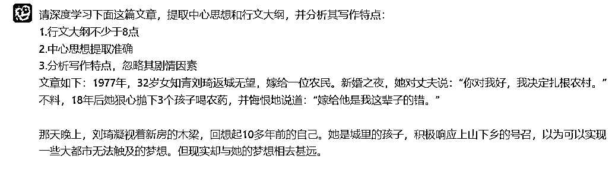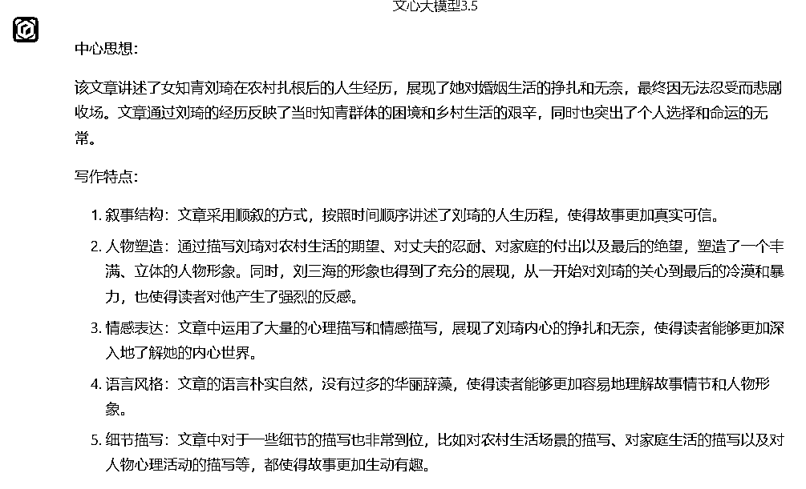 要是它没按命令执行，就再追问、强调要求。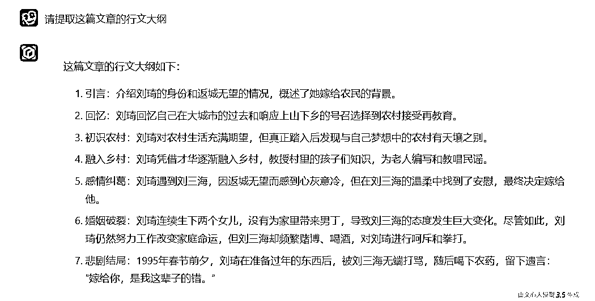 然后让它按大纲写一篇1000字左右的新文章，每个要点至少150字，语言朴实，让六年级学生都能看懂，细节处还要有对话。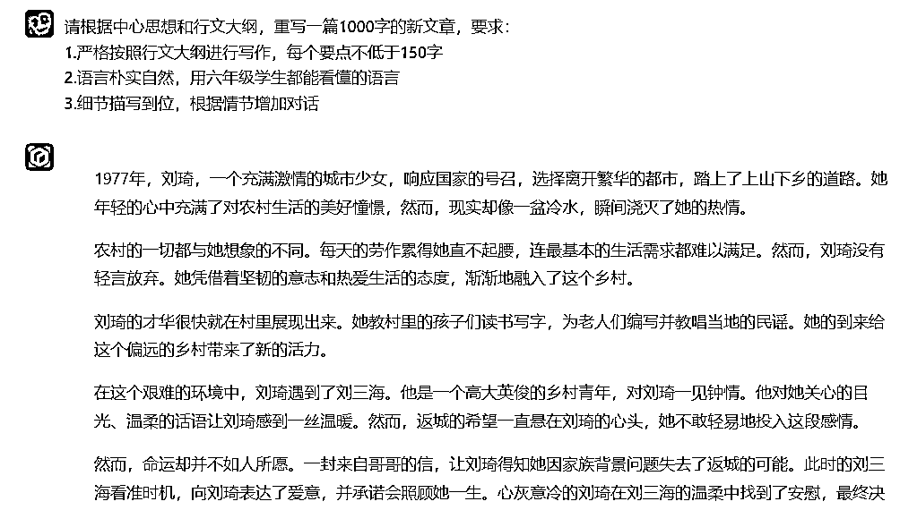 写完再让它补一条评论。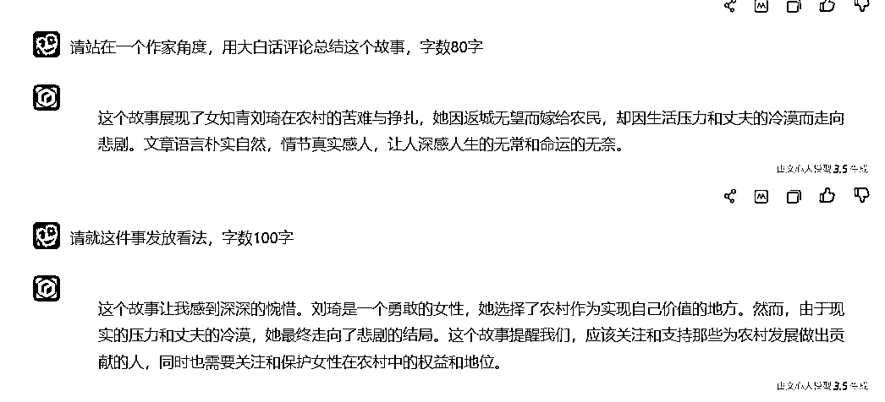 接下来，把所有内容整合到同一篇文档里。我习惯用飞书，开启分栏功能，左边原文、右边AI稿，改起来清清楚楚。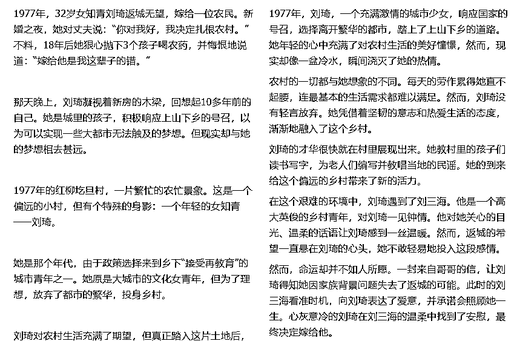 修改前后的对比图也可以参考。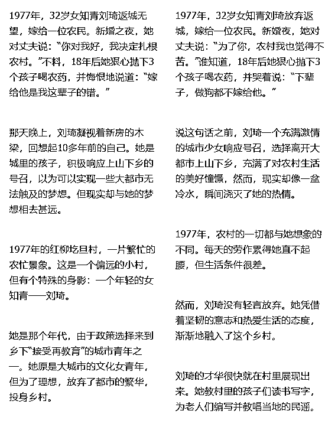 改完发到易撰去检测，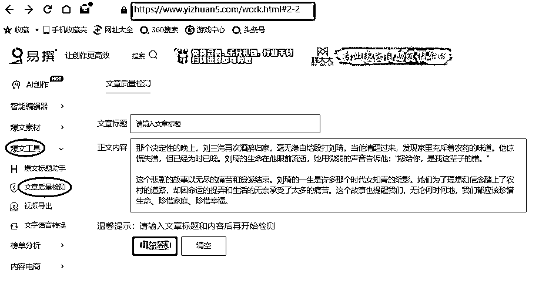 原创度超过70%、同时有新增素材，才算及格。那篇稿子最终带来了1100块收益。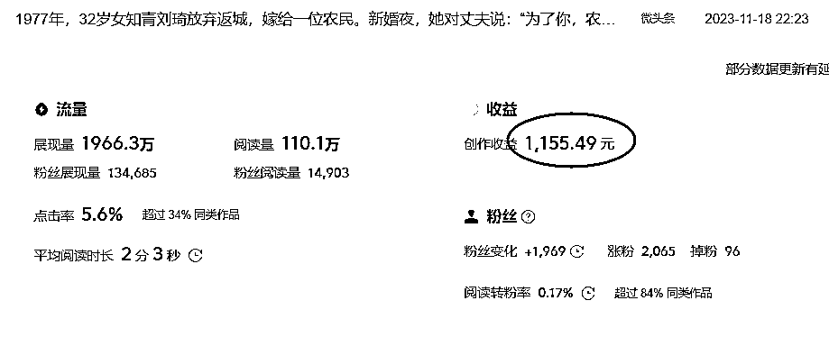

五、写在最后
AI+头条号不是躺赚的游戏，它的逻辑是：用AI把产量提上去，靠人工把质量顶上来。值钱的从来不是AI本身，而是你对爆款的理解、对内容的打磨。方法都放在这儿了，有问题欢迎来星球交流。我是一北，下次见。