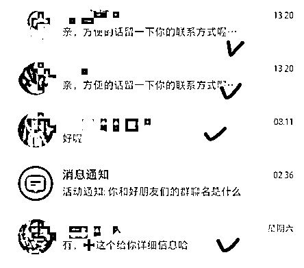
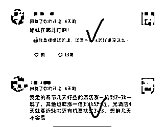

# 十天内拿到首个正反馈：一个纯小白的跨境游小红书实操复盘

> 来源：[https://fxx6d3i9bl.feishu.cn/docx/MhEfdzV4GobIUWx5RvOce2fCnyb](https://fxx6d3i9bl.feishu.cn/docx/MhEfdzV4GobIUWx5RvOce2fCnyb)

# 前言

大家好，我是沐一，一个喜欢亲手试错的实践者。

跟跨境游这条赛道说实话，我之前完全不沾边。没有对接过任何旅行社，没操作过旅游产品，连出境游需要的资料清单都说不全。它跟我的本职工作更是两码事。更关键的是，我此前从未碰过小红书运营。

简单说，2024年1月3号之前，跨境游+小红书，对我而言就是双零，一点经验都没有。

那这十多天下来，到底能做到什么程度？我把真实数据摊出来。

# 1、成果实录

第一篇笔记发布时间：2024年1月6日

筹备阶段：2024年1月3日-1月4日

实操阶段：2024年1月5日-1月16日，统计截止日为1月16日

笔记平均曝光：700-800+

评论与私信情况

十天左右拿到这个体量，跟头部玩家比起来不算出圈，但对我的目标来说已经是快速达标。能这么快跑出反馈，我归结为以下几件事。

# 2、我做对了哪几步

## ①先开干，再迭代

1月3-4号，我照着航海打卡节奏，主要做了两件事：备好两个账号、定下来目的地、初步对接供应链。选地完全照抄教练给的参考思路，没做过多纠结，毕竟小白时期选哪个都差不多。

1月5-6号，时间紧就先上线。笔记是拼凑出来的，封面粗糙，内容潦草，就是那种刷到会划走的类型，但也先发了。

1月7-10号开始收敛。重点放在笔记打磨、搭建素材库、学会用爬虫工具。特别感谢梨云大大提供的爬取工具，帮我迅速锁定目标目的地下的爆款长什么样，可以直接对标学习。

1月10-16号，进入稳定节奏。每天养号、持续补充素材库，笔记保持2-3天一篇，同时做引流。引流方式都用教练提过的相对稳妥做法：表情包留微信、粉丝群用小号引导、私信里引导意向客户留联系方式。

这段时间我坚持的就是：持续执行、持续打卡、持续优化、持续补库。遇到问题就去群里提问，或者去手册里找答案，也会回看高手领航里教练直播提到的要点。

## ②信息按需取用：航海手册 + 高手领航

刚开始我把手册翻了两遍，还是偏理论，脑子里留存不多。后来我改了策略：用到哪一步，看哪一部分。

养号期只看养号相关的内容，笔记优化期只看笔记优化，引流期只看引流。其他阶段暂时放一边。

高手领航也是同理，有疑问就直接直播间问，没疑问就回放快进挑重点。边做边查，查到立刻用。没轮到的问题先不提前预习。

## ③素材库快速搭建靠工具

我主要用了飞书来做库，再配合爬虫插件来抓取。爬虫代码是梨云老师给的，效率提升非常明显。我每天大概花1小时左右，就能更新10-15篇对标素材。

## ④时间盘控

我习惯记录时间并复盘，看清楚自己时间都花在哪。主业不丢的情况下，保证两边都能持续打卡。

## ⑤心态稳住

跨境游对新人并不友好，尤其是看完教练说的行业壁垒后，更容易想放弃。但我告诉自己先扛住，先把能做的都做完，该学的都学完，对自己预期别拉太高。正反馈来的时候，才发现其实就是踏踏实实跟着计划做了一遍。

# 3、踩过的坑

## ①笔记发不明白

起步时完全不知道笔记该怎么写，东搜西凑出一篇特别糊的笔记，封面不吸引人，内容也不成型。先发出来才开始慢慢改进。持续补库、迭代内容后，笔记一点点变顺。后来跟着高手领航复盘账号缺口，把关键点记下来再融入下一篇。久而久之，发之前心里就有个大概预期：曝光、点赞收藏、评论私信会是什么量级。

## ②怕引流被封

一开始太谨慎，一个引流动作都不敢用。到了第四五天，我开了第三个号做备胎，结果还是真封了一个。后来才敢把教练教的相对安全的引流方式轮换着用。

## ③引流没反应不及时换

我先是用粉丝群+S小号维护，结果引导进群动作太弱，评论和私信里很多意向客户后面就没下文了。大概拖了一天后才换招：做表情包微信图+私信直接让客户留联系方式，引流才又起来。

## ④账号不垂直，数据拉胯

目的地虽定下来了，但前期发的笔记话题很散，不够集中，看的人有，但不精准。后来发了几篇高度垂直的内容，咨询才明显增多。尤其是加上“特定出发地”“特定航班时段”“特定行程”“特定人群”等限定词，笔记的长尾效应就出来了，有的内容发了很久还在持续带来私信。

## ⑤因敏感词被封

自己评论时用了“关注我”等敏感词，自己都没意识到，结果账号直接被封。提醒新人，平台规则熟悉度不够时，动作一定要谨慎，别急。

# 4、工具清单

## ①爬虫工具

凌云采集器：小红书笔记批量导出神器https://t.zsxq.com/16cGfTV3X

## ②素材库

·飞书+善用搜索

·小红书如何搜集笔记素材，解锁变现赛道选择自由度https://t.zsxq.com/168bLAuq7

## ③违规词检测

https://duozhongcao.com/

# 5、收尾总结

1. 持续行动+每日迭代很关键。我能从零到能引流，核心是每天抽1小时左右泡在赛道爆款里，拆解标题、封面、内容、评论，给自己扫盲。
2. 保持好奇心和学习力。养了多个号后，我会用小号去看其他赛道别人怎么留钩子、怎么引流、怎么控评，直接搬运到自己的赛道上用。
3. 关键词式学习。在哪个阶段就找该阶段的经验，不追求做成百科全书，只追求目标精准，有问题立刻解决，没遇到的问题先了解即可。
4. 心态与精力管理。报了多个项目，时间分配是难题，效率和时间的安排比蛮干更重要。
5. 打造自己的武器库。航海里讲的核心是素材库。学会了建库方法，以后换项目也能迁移。清楚自己的武器库是什么，什么时候用，怎么迭代、怎么扩充，最后就能形成自己的护城河。

最后我还是个新手，这些经验还需要时间检验和修正。如果有不同看法，欢迎开放讨论。感谢龙哥盟、船上教练和志愿者的机会，也希望这份复盘能帮到更多刚起步的人。