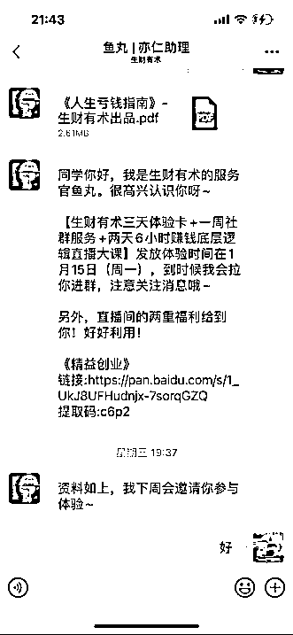
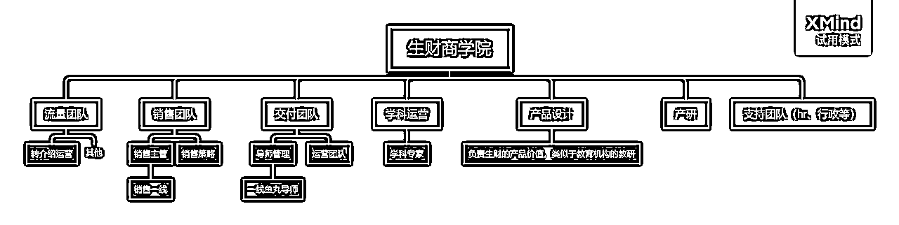

# 把在线教育的扩张打法搬到赚钱商学院，能不能做到十倍体量？

> 来源：[https://wi1v74w740.feishu.cn/docx/O8QKdiDjLodJ6cxhFe2cBxqFnbf](https://wi1v74w740.feishu.cn/docx/O8QKdiDjLodJ6cxhFe2cBxqFnbf)

前阵子去了北京航海家路演，龙哥现场拆解了赚钱的战略思路。他提到赚钱现在最核心的能力，是以社群为轴心做运营，用内容加实战加链接来完成交付。接下来的十倍增长规划，也是基于这套组织优势来落地的。放在知识付费赛道，能把交付、口碑和续费做到这个程度的很少，甚至不少靠重人力养团队的在线教育公司也比不上。过去几年在线教育里冒出来的公司，增长动不动就是几十上百倍，年收入过亿的比比皆是，虽然烧钱买量是主因，但其扩张路径里仍有很多可借鉴的点。

会后我一直在复盘，如果赚钱在守住自身优点的前提下，把在线教育的扩张逻辑和组织形态拿来融合，有没有可能实现体量的十倍跃迁。我过去七年亲历了少儿编程从冷门到爆发的全过程，也参与过两家头部机构从0到数十亿的0-1爬坡。基于这些实操经验，我针对“赚钱商学院”这个命题做了一次脑暴，重点推演了销转体系搭建、转介绍获客、交付体系设计以及配套组织，并把账算清楚了。本文约一万字。

# 一、先把知识付费和在线教育分清楚

先厘清两者的本质差异。没做过的可以补个背景，有经验的可以直接跳到下文。

共同点只有内容是核心壁垒，分歧在交付本质。

知识付费更像出版：把内容交给你就算履约了，你看不看与我无关。在线教育是服务业，课程研发只是环节之一，交付后的服务才是重头戏。因此在线教育的核心竞争力，是能否搭建一套前后端都能规模化交付的体系。

体量上，知识付费因服务少、客单低、对自驱要求高，天花板比较明显。在线教育重服务、客单更高，因具备规模化交付能力，对用户要求更低，覆盖面更广。打个比方：知识付费像卖健身卡，卖完不管到不到场，甚至希望你别来；在线教育像卖私教课，有人盯着你来上课，服务做好出效果了才有续费。赚钱目前的后端交付已很接近在线教育，所以客单能到2500左右，但前端的转化打法仍偏知识付费的轻模式。

流量-转化-交付链路也不同。知识付费交付轻、客单低、毛利高，大量靠分销裂变，老学员或KOL推产品。转化相对佛系，在私域里反复洗认知、筛选匹配的人，被动成交，周期长，极度依赖大节点引爆，比如赚钱的418。交付也很轻，内容给完即完成，后续最多开个社群答疑。公域几乎不投放，主要靠内容引流到私域。整体是“内容引流-私域沉淀-朋友圈洗认知-节点爆发成交”。

在线教育则是细水长流。流量端多渠道稳定采买，按固定节奏做转化，学员增长可预期。交付端很重，有专属老师陪伴、答疑，按节点续费。整条链环环相扣，不依赖大爆发。下面重点讲三个环节里赚钱商学院可借鉴的地方。

# 二、做一套以转化为主导的销转体系

在三环节里，销转是最关键的一环。流量成本终会趋同，交付做到及格线不难，但想差异化很难。真正考验组织的是结合产品特性打磨出的销转体系，转化率差1个点就可能决定模型死活。

在线教育的主流打法是体验营。用1-5节的短期课程包装出来，配合精细服务，让用户提前感受正价产品的价值，促成交。赚钱之前也做过不少体验营迭代，积累了不少经验。

体验营设计分三块看。

第一块产品设计，要给到获得感，制造aha时刻。忌讳把课程做成干货堆砌、枯燥无反馈。赚钱的认知和技能需要较长时间沉淀，一周很难见效。体验营的目标不是让你这几天真学会多少、真赚到钱，而是让你快速得正反馈，在某个瞬间感受到“原来我也能”“原来赚钱没想象难”“机会很多”“能跟高手交流”。表面收获不多，但感受很强。细品两者区别。

听起来像割韭菜？换个角度：如果是目标用户，就让他先认可你，转成正价学员，再在交付中持续成长。如果不是目标用户，就快速筛掉，别想着几天改变他。产品设计的核心是提升获得感、让用户爽、产生期待，从而提高成交，这才是影响更多人的方式。

线下培训同理。家长带孩子去体验机器人或钢琴，老师会先让孩子快速搭出小车或弹一首曲子，看到效果才买单。一节课真学会不可能，但用强正反馈先点燃兴趣、看见未来，家长才会续报。

第二块流程设计，要同时做到筛意向和强认知。在线教育体验营常见环节：等待期-开营讲座-第一课-第二课-...-闭营讲座-转化期-结束。课时长短取决于市场成熟度。

流程第一目标是不断筛选意向。通过参与度判断，用户会越筛越少，需要做好数据埋点。

第二目标是在流程中持续强化认知，俗称洗脑，让用户更认同赚钱的重要性、品牌信任度、产品匹配度。这是过去在线教育被诟病的地方，通过激发焦虑让家长觉得必须买。当然营销强度可控。

数据上呈现两个漏斗。数量向正漏斗：开营讲座到闭营讲座，每步参与率递减。认可度反漏斗：留下的人认可度持续升高。刚来时模模糊糊、试试看，认可度约5%；听专家讲座认可到20%；上课感受到aha moment认可到50%以上；闭营讲座认同长期学习体系，认可到60-80%，等待销售临门一脚。

第三块助教角色要以强销售为导向。助教本质是销售，不是老师或客服。标准动作是挖需、解异议、做规划，促成交。要想投放模型跑通，除了产品有爽点、流程有双漏斗，还需要销售强力干预。这是在线教育和知识付费组织上的最大分歧。知识付费基本被动成交，不好就放池子继续洗；在线教育90%是销售主动成交，在体验营留专门转化期，用优惠福利等抓手不断迭代策略，高强度关单，目标在营期内成交。

具体动作：加微信后先挖需聊报名目的；上课前通知听专家讲座洗认知；第一节课后回访反馈再挖需；后续课程前铺垫规划；转化期把产品价值、优惠、后续规划一对一讲清，有异议就解决，必要时用默认成交、施压、逼单等技巧。

整个过程和产品流程是统一的：不断梳理需求，筛掉无效、加深有效客户粘性。助教的工作以销售为主，通知、上课答疑、群运营、朋友圈营销都是配角。按工作量大致是服务2、教学答疑2、销售6。

可见要获得稳定转化，体验营的人工投入很重，先营销再销售，先服务再转化。我最近体验赚钱的营，鱼丸目前更多是通知客服，做得比较轻。

从在线教育看，服务好销售弱的助教，转化率低于服务弱销售强的。所以体验营助教的能力画像应按顶级销售来招，再补产品和服务认知。

一个体验营做这么重，需要匹配的组织。通常有一支销售业务团队，金字塔结构，对转化率负责；一支销售策略小团队，持续优化流程和策略，做ABtest、数据复盘，产出转化增量；再配一个跨部门学科运营团队，类似在线教育的学科运营，负责专业物料、专家讲座、产品培训，提升对价值的认知。放到赚钱商学院，这个角色必须是真正做过赚钱实战、商业认知高的人，能持续向学员和内部输出认知。三支团队配合，研究不同渠道用户画像，提升转化。

知识付费的转化链路很轻，在线教育的销转则很重。为什么要重投入？因为只有稳定销转才能支撑前端持续买量，把整条链ROI算清楚。ROI达标就能持续放量，支撑扩张，飞轮转动。销售成本对客单千元以上的产品是能覆盖的，具体账在下文会展开。

# 三、用转介绍稳定拿到十倍流量

销转是为了把各渠道买来的流量稳定转化，所以和流量获取是联动的。赚钱的流量不用担心，圈子里有大量操盘手和大KOL。我没有直接的流量增长经验，不展开投放。但有一个渠道特别值得先攻：转介绍。

原因三点。

其一，初期打磨销转体系时变量多，搭建成本不低，转化率不确定。外部投放不一定有量，质量也不可控。转介绍自带朋友背书，降低销转难度，利于由易到难打磨。

其二，转介绍成本是所有渠道里最低的。把转介绍占比拉到一定水平有战略意义，能提升整体获客容错。前几年在线教育广告战里，转介绍起关键作用。除了拿巨额融资的公司，其他公司投放都要卡安全线。当外部成本上涨时，转介绍占比越高，平均成本越低，外部投放预算就能抬高。简单算：整体获客成本卡2500，转介绍成本1000，占比20%时，外部渠道安全线可抬到2875。

其三，赚钱现在的口碑和势能，做转介绍像从高处推石头，小力也能撬动。四两拨千斤，重点投入足以拿到十倍流量。

现阶段大力获取低成本、高质量、可控的转介绍，对早期体系打磨和后期的投放竞争都有意义。

怎么把转介绍放大十倍？三个思路。

第一，把邀请有礼改为分享有礼。

现在赚钱的转介绍以邀请入圈为主，如知识星球默认邀请入会，辅以少量邀体验营。两种形式效率差至少十倍。以我为例：邀请一个人直接入圈，我得找朋友圈里对赚钱有动力、认知高、有付费习惯且信任我的人，心理门槛高，我两年来只成功一位。而分享有礼，我只要把体验营信息发到朋友圈或社群，动作就完成，价值介绍、认知清洗、销转都由赚钱完成。我分享本质是信息差，分享压力小，还能触达弱关系。弱关系看到2000多的圈友价会退，但几块钱的体验营转化概率大。

把邀请入圈改为分享体验营，可触达范围和转化率都会提升，效果至少十倍。直接邀请入圈可保留给流量大转化强的赚钱大V，普通圈友更适合分享体验营。

第二，提高分享频次，中台供物料。

知识付费过往的营销集中在418等节点，其他时间无由头。改为分享后，频次可大幅提升。教育公司按周分享，孩子上完课家长看到学习报告就能发。赚钱商学院可把分享频率提到按月甚至按周，形成习惯。

只要赚钱路上有点进步就能分享。比如每次航海实战，鼓励大家把打卡、好事发朋友圈带二维码，扫码参加体验营。以万人航海体量，一次带来几万leads不难。逻辑不是靠大事件营销，而是靠每个圈友的小进步去营销：认知提升了、迈出实践第一步了、小红书有流量了、赚到第一笔钱了、积累客户了……每个小确幸都是引子。

对进步不明显的圈友，可靠中台小团队定期产出突出价值、实战成绩、赚钱认知的物料，并测试引流效率，给圈友可直接分享的素材。

第三，建立成体系的激励。

让没成绩、认可度不高的圈友也能参与，需要体系化激励，赚钱在418战队PK、龙珠激励、航海里程上很擅长。核心像设计游戏一样不断给正反馈。假设带来一个leads得50积分，那50分要有可兑换物。分档设置实物激励和精神激励。龙珠门槛高，需要更低门槛的积分做日常兑换。

在线教育的扩张路径和组织形态，确实有值得赚钱借鉴之处。如果能把销转做重、转介绍打通，叠加现有社群和交付优势，十倍增长不是空想。关键是在保持口碑和商业模式的前提下，把转化每一环打磨到极致，这才是支撑赚钱商学院的底层能力。

最近读到一份很有意思的拆解，来自一位在线教育老兵对赚钱商学院10倍增长的构想。这人操盘过年营收8亿的业务，他给出的路径很清晰：用转介绍做流量池，用“赚钱私教”做重服务，最后跑通一条可持续放量的增长链路。

先说转介绍这块。赚钱的产品力和口碑摆在那里，只要官方把激励规则公开，再在星球或产品里加一些适当的提醒，一定能带动一批圈友主动分享。但要吃透全部流量，最好还是有人工强提醒，比如每周/每月定期私聊圈友，推动大家参与转介绍。作者举了核桃编程的例子：早期编程教育难以外化，家长看不出孩子学了什么，转介绍根本推不动。后来他们给一线老师很高的激励，让老师一对一致电家长，保证活动100%触达。就算有些家长只是冲着核桃币和实物礼品来，因为孩子没坏体验，又有利可得，大约20%的家长养成了每周分享的习惯。赚钱比核桃的起点高得多——3万圈友本身就是优质传播节点，里面还有大量流量操盘手。规则合理、动员到位，每月保守也有万级leads，这条链路完全能转起来。

再谈交付端。作者的核心观点是：想做到10倍规模，必须给长期会员配上专属“鱼丸导师”。这位导师不只是发通知，还要建成长档案、带航海实战、推精准信息、当第一答疑官，更重要的是帮会员外化成果、做续费。有人觉得“赚钱还要人盯，活该赚不到”，但作者认为，赚钱早期用户确实自驱力强，可这类人在人群里占比很低；随着盘子变大，一定会涌进大量“想赚钱但行动力一般”的人，就像俞敏洪书里写的留学培训：大学生能上大班，中学生得靠小班老师盯。赚钱商学院要服务的正是后者——他们规模可能是前者的几十倍，哪怕有些人不值得挖掘，也总有一部分能在高陪伴下拿到结果。

有了鱼丸导师，很多环节效率会大幅提升。通知不再怕错过；转介绍物料有人定期发；会员一年至少参加一次实战，续费率在现有基础上再提5%-10%完全可能。而且，鱼丸长期跟踪你的赚钱路径，知道你卡在哪、该补什么，这时候推荐细分产品，成交率会很高。相当于在赚钱学完“通识课”，再进“专业院系”进修。本质上，这就是在线教育公司后端老师的活儿：服务、续费、转介绍、扩科。带来的收益远远覆盖成本。

再来算账。转介绍流量端：假设圈友带来一个体验营leads拿30元，按在线教育10%转化率算，投放成本300元。销售端一个人一个月能带600人，10%转化就是60单，15万GMV，销售成本加管理摊薄约197元/单。总获客成本497元，而现在邀请一个正式会员赏金493元，成本基本打平。

交付端：一个鱼丸服务500-800人，年成本10万，人均摊125-200元。只要续费率提升10%，一个客户就能多贡献250元GMV，直接回本。组织上，如果月leads是12000，按人效600算，需要20个销售；如果做到5万会员，500人一个导师，就需要100个鱼丸导师，再加不到10个中台。公司会从几十人支撑几万会员的轻模式，变成组织规模随会员数增长的重模式。

增长模型也很简单：月leads=分享人数×分享转化×每人每月分享次数。3万会员，20%参与，每次带来1人，每月2次，正好12000条leads，10%转化，月新增1200人。如果流量端做到10万，每个月就能新增几千到上万人——这就是10倍增长。在线教育当年就是靠这套“流量采购+销转”体系快速扩张的，系统、可控、稳定。

作者说，他完整经历过在线教育起落，很幸运两家公司都活着：一家从0做到20亿，一家从0破亿。他听完龙哥讲10X战略后，花了10天写下这份思考。他更希望赚钱能成为“中国的斯坦福”，让没有赚钱认知的人建立框架，让想赚钱没动起来的人开始行动，让行动的人有更大舞台，让舞台上的人获得资源，最终成为大佬，再扶持更多后来者。

作者背景：核桃编程18号员工、前教研负责人，火花编程前学科运营总监，现在在赚钱孵化器做教育培训/IP/知识付费领域的10X赋能。