# 风向标拆解第 2 期 -- 机会7：一款月入10万美元的AI工具是怎么炼成的 -- 叉叉敌

> 来源：[https://y3my0b87ql.feishu.cn/docx/Sr6Mdqw04obvifx0b5McFv8UnSf](https://y3my0b87ql.feishu.cn/docx/Sr6Mdqw04obvifx0b5McFv8UnSf)

# 前言

第一期的风向标拆解让我明白了一个道理：光看不练没有体感，只有亲自下场拆解，才能真正搞懂项目流程和可行性。

第二次拆解我又赶上趟了，而且这次正好报了出海第一站·海航实战，等于提前把实战项目预习了一遍。这篇文章就写写我拆解过程中看到和学到的东西。

希望能帮到赚钱的圈友，一起出海赚刀乐。

先上两个观察数据。一个国产团队的订阅制智能产品，月营收已经摸到10万美金以上；另一个是出海第一课教练哥飞的站，月流量有513k。

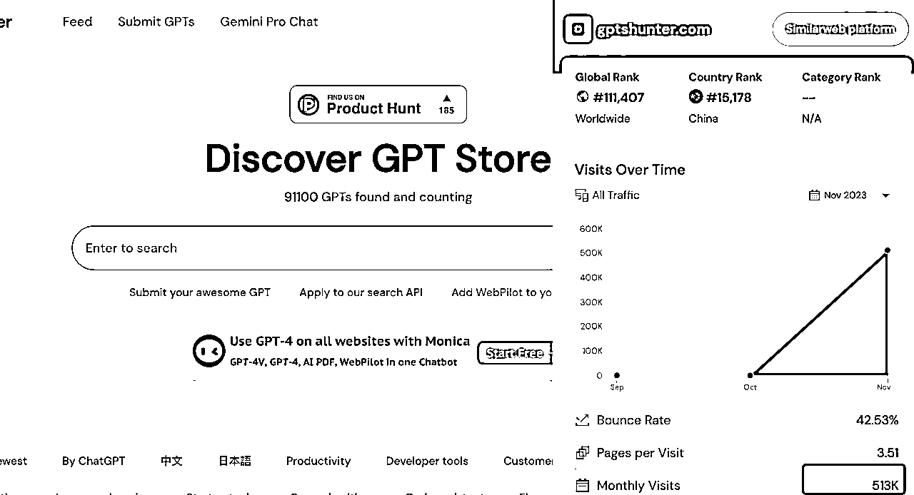

桌上摆着的只是少数，桌下没被注意到的包装型产品更多，不管是收订阅费还是赚广告费，收入都相当能打。

从2023年底开始，国内外冒出不少有代表性的智能产品，ChatGPT、Midjourney、通义、文心一言只是其中的几个熟悉面孔。

这些产品不只是给用户带来强力功能，还通过开放API给开发者，长出了一个庞大的生态，像是沉浸式翻译、信息聚合、内容解析这些细分方向，多到数不过来。举两个我自己在用的例子：

## 例子1：批量产出文章

今年我把重心放在公众号上，每天用量很大的方式靠大模型生成文章。最近切换到百度的千帆大模型API，0.12元/千token，一篇成本也就几毛钱。如果把这个接口包装成产品服务更多人，那就是一笔生意了。

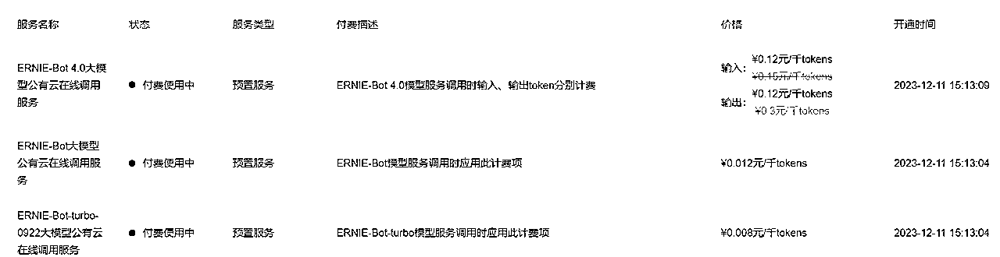

## 例子2：翻译体验更顺滑

用ChatGPT API或者其他大模型接口，开发者可以做沉浸式翻译，让阅读外文内容的体验像母语一样顺畅。

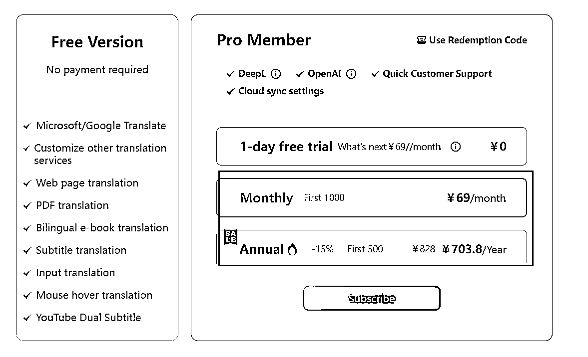

这类产品市面上还有很多……

AI闯入之后，传统行业原有的玩法被搅动出大量新可能。这篇文章就拿两款月利润在10w$之上的智能产品，做一个产品向的拆解。

# 拆解对象分别是谁？

两个产品，收入都很猛。一个面向C端个人用户，一个面向B端企业客户，月收入都在10万美金以上。

## 1.1 案例拆解 1(2C) - flot.ai

#### 基础信息

账号：flot.ai

所属类目: 桌面端应用

盈利模式：会员订阅制，最低月费9.9美金

为什么选它来拆：

*   对应的场景是打工人日常办公效率👉盘子够大
*   做的是桌面应用👉有技术壁垒，对手没那么挤
*   根据已有情报，订阅人群庞大👉30 cash流可观

Flot AI 的用法，是把ChatGPT揉进你的工作流里，当你在任何应用或网页里选中文字或输入内容时，它会对应弹出ChatGPT。

一键帮你改写、润色、总结、翻译，或者直接回复文本。

从官网和其他渠道到手的数据估算：

2w付费用户： 9.9$ * 2w = 20w$/每月

要是做到10w用户： 那画面太美不敢看……

下面这个年付价格表，月付比年付贵25%。

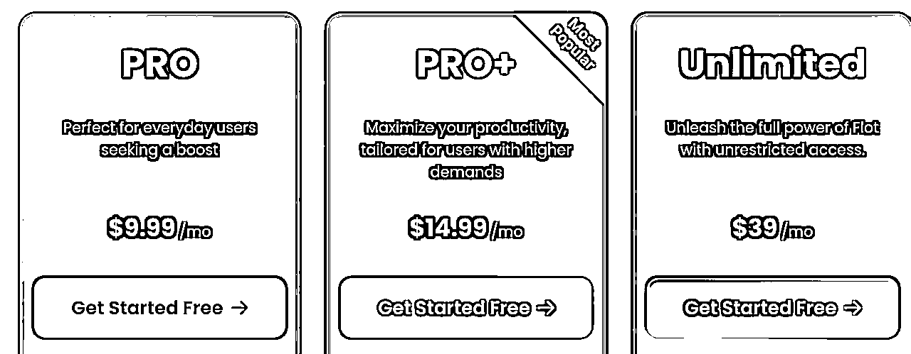

## 案例拆解 2(2B)：formwise.ai

#### 基础信息

账号：formwise.ai

所属类目: Web应用

盈利模式：会员订阅制，最低月费29美金

为什么选它来拆：

*   切的是办公提效场景👉需求明确
*   本质是大模型套壳👉上手门槛低，但赛道拥挤
*   从可知信息来看，付费用户不少👉营收确定性高

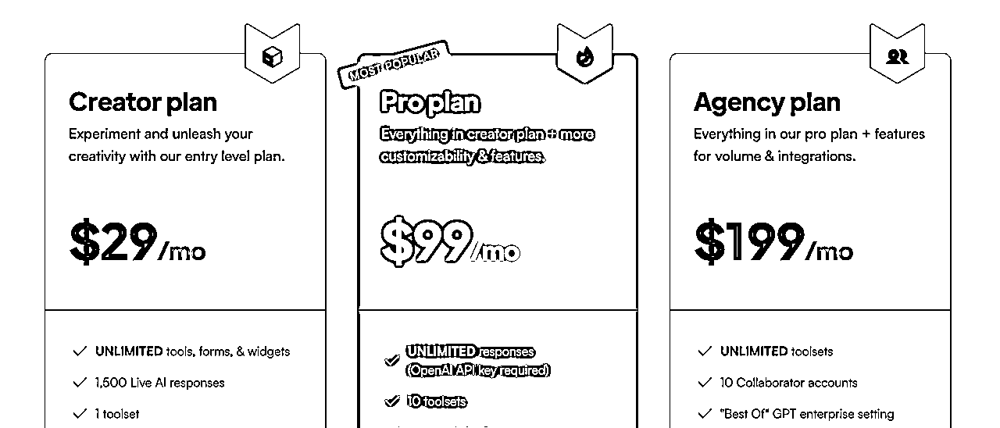

在builtwith上查它的营收，利润$105k+，每月稳稳的10w+俱乐部成员。

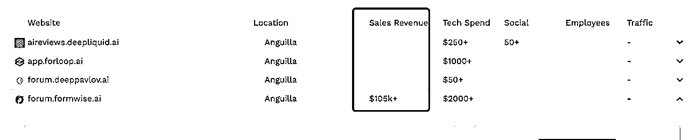

Formwise 的产品覆盖营销文案、线上研讨会、获客辅导等。它每天上新模板，帮客户把写提示词的时间省下来，把精力放回到销售上。

底层逻辑就是套一层壳，卖提示词优化之类的能力。

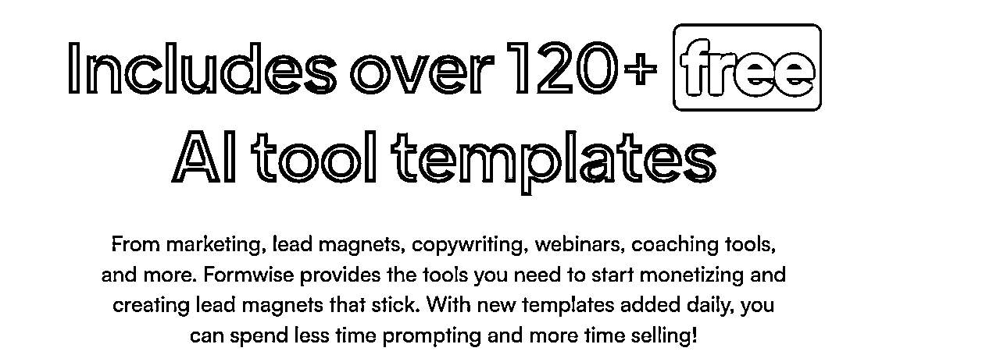

Formwise.AI 的差异点，是把GPT提示词转成面对特定人群的现成AI工具，这就让它在众多同行里有了身份辨识度。它盯住的是一块独特的市场需求。

对不懂技术的人友好：让AI不再是程序员的专属玩具，非技术背景也能直接上手。这直接把潜在客户池撑大了，因为技术门槛被拿掉了。说白了，赚的是信息差。

# 产品靠什么解决问题？

上面这两款产品，都给用户提供了一套辅助生成文案、脚本、邮件的AI能力。它们的共同思路，是把GPT提示词做成面向终端用户的成品工具，营销客户拿来即用，也支持搭建内部工具，让非技术人员也能用上AI。

用最低成本跑MVP，不要憋大招等完美了再上线，先做验证。

专注用最简单的路径解决一个足够具体的痛点，而不是一上来就做大而全的平台。可以只解决一个让人头疼的问题，然后从这个点开始滚。

这样一来，页面不必堆那么多，代码也不用写那么多。

实在不行，拿Excel手动登记客户需求，再让ChatGPT给结果、手动回复对方，也能撑起早期的小批量业务，虽然不是实时响应，至少可以走通流程。

懂技术的，找个顺手的开源框架，先跑起来，再慢慢打磨。

不懂技术的，淘宝上找外包，一抓一大把，要求就两条：快、便宜。能跑就行。几千块钱就能落地。

要搭一个AI内容生成类的最小可行产品，有几条路可走：

## 自己动手

先把目标用户想清楚，他们的真实痛点是什么？

做技术的最忌讳自我感觉良好，拿自己的想象当用户需求，翻车概率很高。

确认需求之后，写一个具备核心功能的最小原型，或者上GitHub找个开源项目，比如chatbot这类，用Python和对应框架直接改。

网页类产品可以参考这个站，给它一张线框草图，它直接帮你把前端代码生成了：

https://v0.dev/

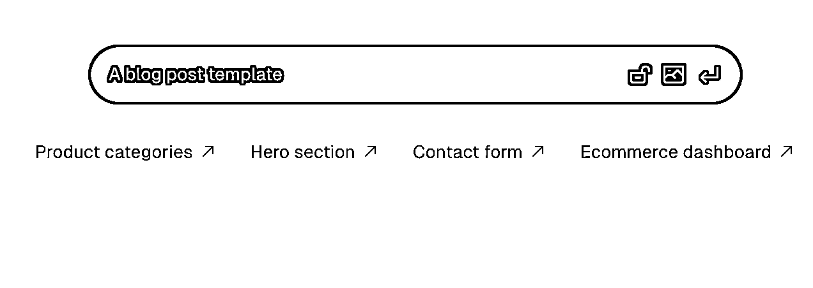

后端代码更是可以直接丢给ChatGPT处理。

客户端的话，可以看这个自带多端的开源仓库：

https://github.com/ChatGPTNextWeb/ChatGPT-Next-Web

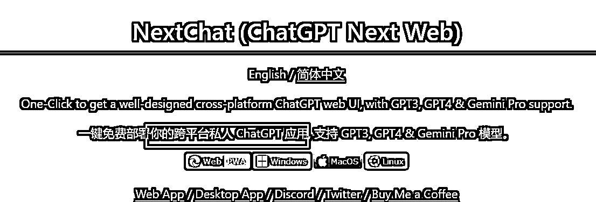

测试和打磨放到后面做，先把MVP的效果跑出来。

自己做的优势是对产品有绝对控制权，想怎么改都行。

前提是你得懂编程和AI，或者愿意砸时间砸钱去补这些能力。

进了赚钱之后才懂得，可以用钱买别人的时间，这就是价值交换嘛，赚钱里码农一抓一大把，发个帖做资源交换，愿意接单的人不少。

## 丢给外包团队

找专业的外包公司从头到尾接过去也可以。外包团队一般由资深工程师+项目经理构成，设计、开发、测试能一条龙包圆。

疫情期间我在淘宝上做过几个站，价格在5～8k上下。建议找天猫店，现在有只退款服务了，服务不满意直接退。

网页类的项目便宜，桌面应用门槛高，价格会跳到2～5w。

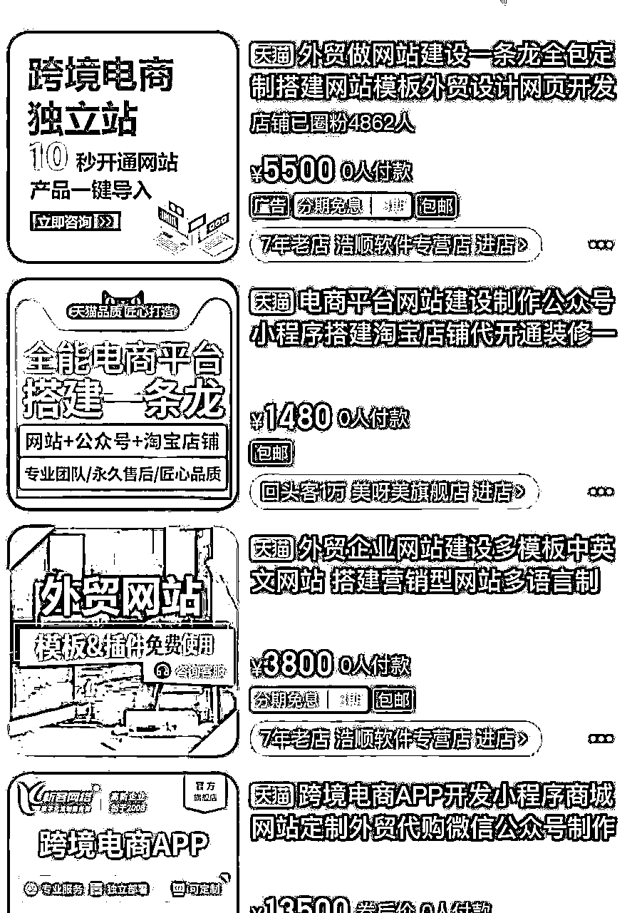

英文过关的，也可以去国外自由职业平台freelancer上找人。原则还是一样：快，先跑通MVP。

外包的好处就是能借力他们的专业技能，不用自己啃复杂问题，速度上跑赢自己干。

要付出的代价是真金白银，成本更高，而且得确保对方真的get到你想要什么，交付的东西不掉链子。

不管走哪条路，最终目的都只有一个——用最短时间把MVP验证掉。

另外，动工之前把计划落到纸面：预算多少、时间排期、业务需求和技术要求，白纸黑字写清楚，后面少扯皮。

# 流量打法是什么？

换我来操盘的话。

## 看域名的流量结构

flot.ai 的访问量以及访客的国别分布：

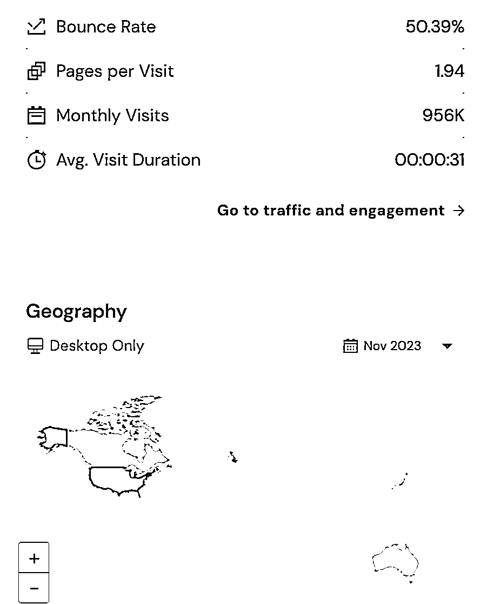

再拉 formwise.ai 的数据，流量大头是直接输入网址访问和自然搜索带来。

直接访问： 66%

自然搜索：17%

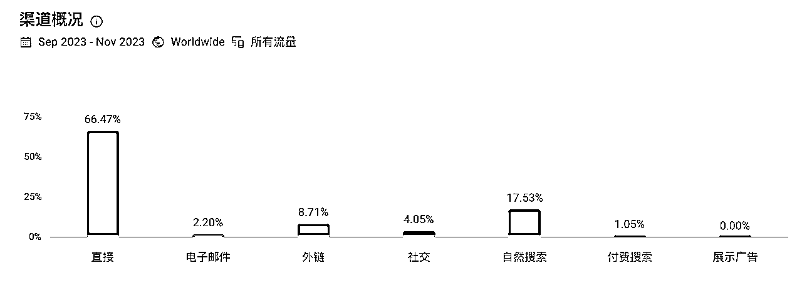

搜索曝光：

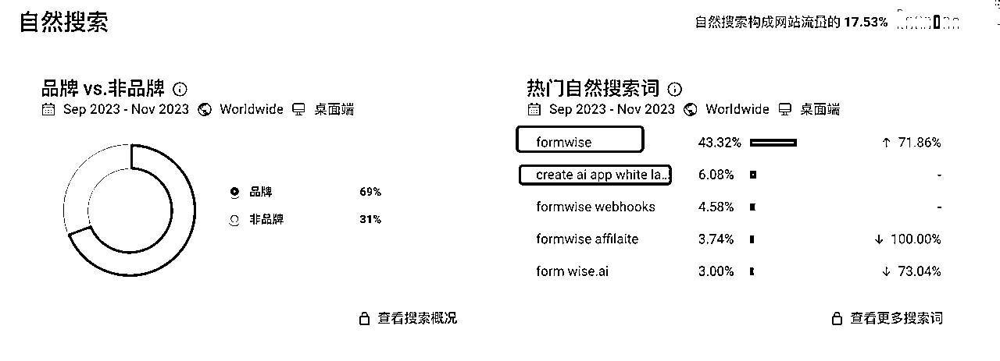

社交流量：

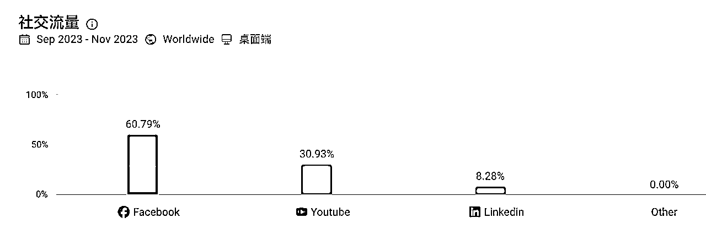

## 第一波用户怎么搞

看 flot.ai 作者的X时间线，他们是按PMF（产品市场契合）的节奏，上线渠道是Product Hunt发布。

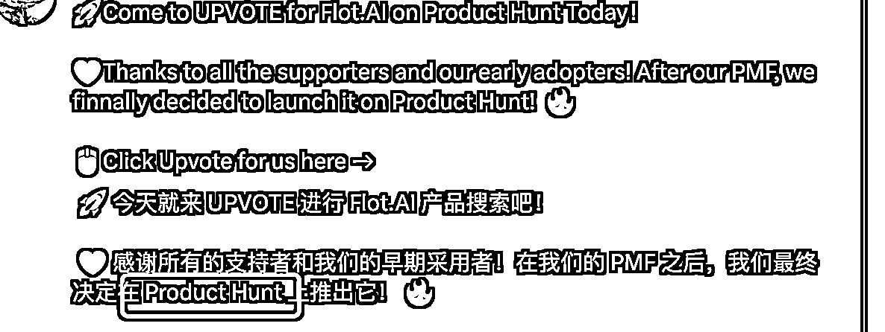

新产品上线之后要推出去，可以参考这些路子：

免费试用是最常见的手法：让用户白嫖一阵子，用爽了他自然会掏钱。

推特和V2EX上就经常看到有人用这招收割第一波用户。

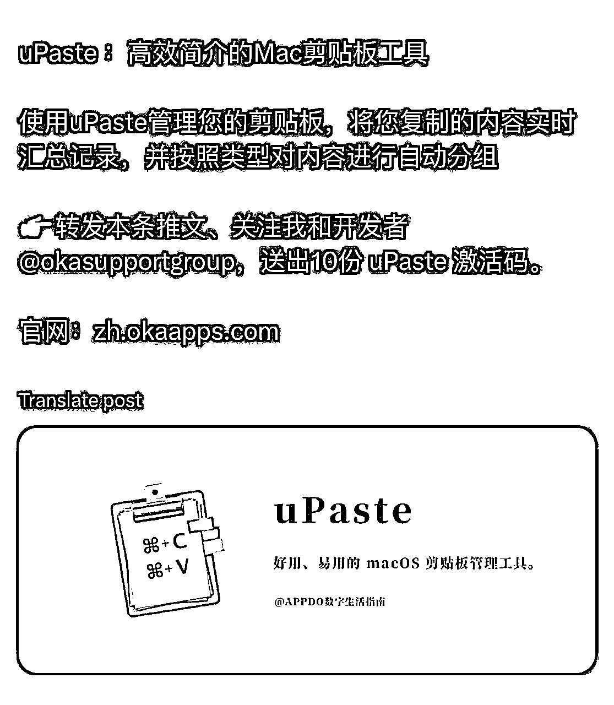

V2EX用户以程序员为主，产品真的好用，他们会自发帮你传播。

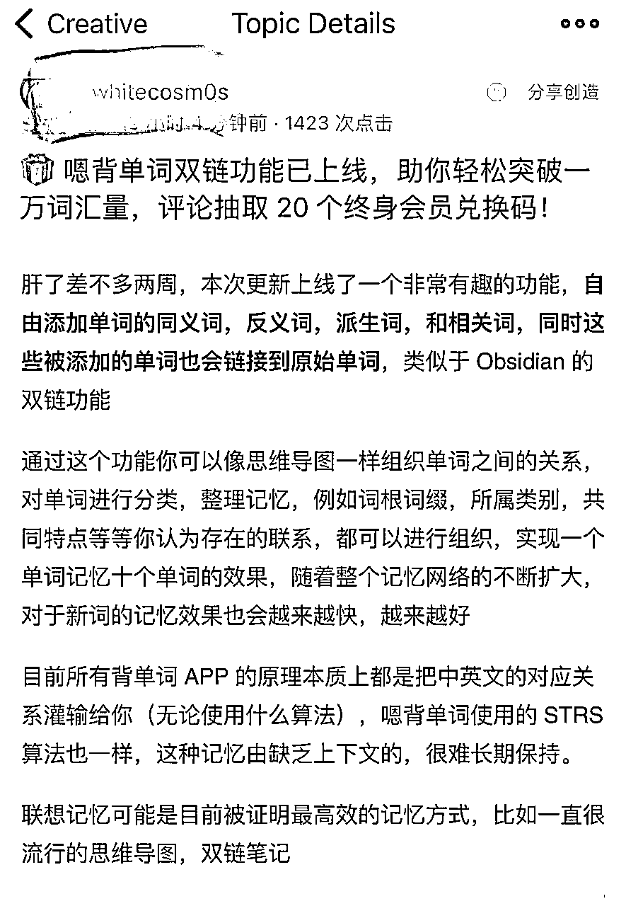

做产品相关的博客或Newsletter页面，往里填充内容，让搜索引擎更愿意把你的网站往前排，自然流量就来了。

简单点直接上静态页面跑，用vercel.com的免费域名部署就行。

社媒矩阵也要布置：Facebook、LinkedIn、Twitter、Medium、Reddit、Hacker News这些都能用，把产品信息铺出去，把人导回网站。

写自家产品别不好意思，但底线是真诚、不吹牛。

拆着拆着发现Reddit也是个不错的流量池。

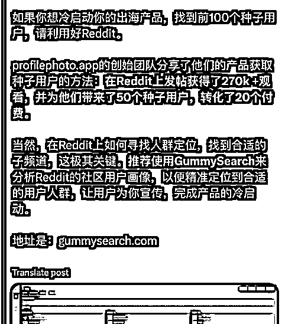

整理拆解的过程中，看到有人靠免费社交博客给自家网站导流，效果还可以。

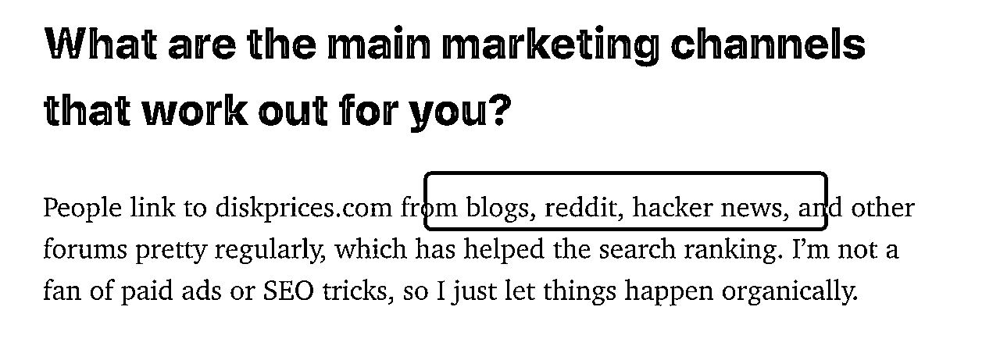

国内的朋友也可以去知乎、小红书、公众号这些社区同步做分发。

## 3.3 继续把盘子做大

联合营销：找同行公司或博主联手推，他们有现成的受众，能帮你起量。

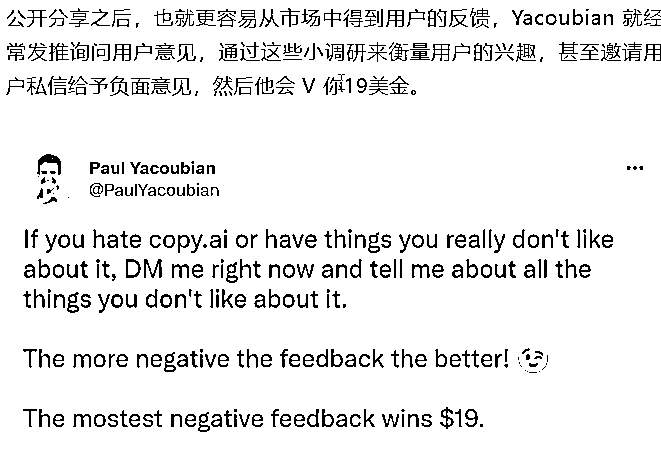

SEO排名：在搜索引擎结果页里把名次打上去，等于躺着接免费流量。关键词布局和SEO策略是基本功。

投广告：付费买量也能帮你圈出更准的人群，让每一分广告费都花在刀刃上。

客服体验：把用户的问题回应好、解决好，信任是慢慢攒出来的，攒够了用户会主动帮你安利。

推广的本质就是三件事：把牌子打出去、把新用户拉进来、把老用户变成回头客。打法不是一成不变的，得不断试、不断调。

## 3.4 build in public

前提是你手里已经有一票粉丝或私域资源。

什么叫build in public？

简单说，就是创业者做产品的时候不关起门来憋大招，而是开着门带着观众一起围观全过程。跟咱们航海实战的玩法有点像。

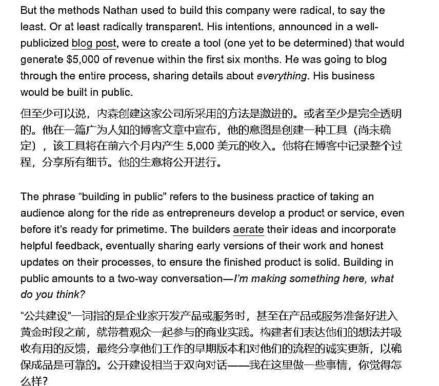

做的人拿着早期版本对外分享，讲清楚自己正在做什么，把有用的反馈吸收进来，流程保持透明更新，最后成品自然更靠谱。本质上是一边做一边跟围观群众聊天——我正在搞这么个东西出来。

下面这个是行业里最有名的样板，copy.ai（目前月入600w+美刀）就是靠这招起家的。

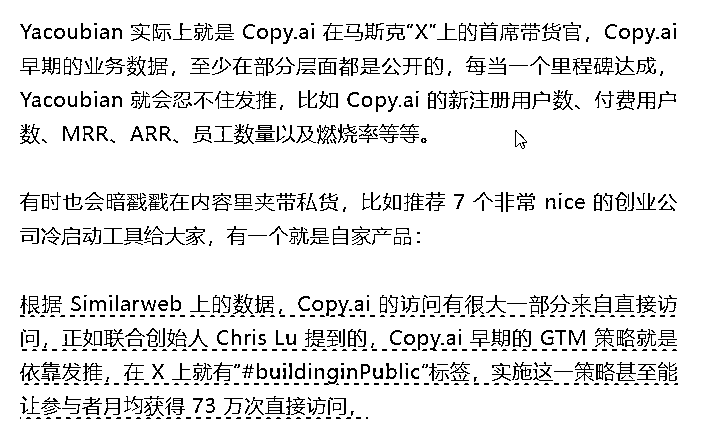

# 利润怎么算？

## 4.1 花出去的钱

网站开发费用：大约5k~5w人民币；

AI域名：买.ai后缀的域名大概500元，其他普通根域名一百块上下；

服务器：阿里云2C4U的配置，一年1000出头；

总盘子：6k~5w元。

## 4.2 赚到的钱

互联网产品的边际成本趋近于零，规模越大利润越厚，复利会自己滚起来。

通过builtwith查到该站月利润为$105k。

变现全靠订阅，分了三个档位：

创作者： 29$

专业：99$

代理：199$

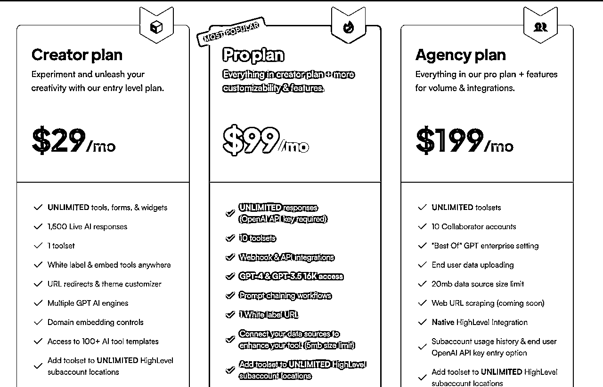

creator档29刀/月，普通用户基本够用了。

反过来算算：105k ÷ 29 ＝ 3620个付费用户就够达标。

或者定价99刀，那只需要1000个用户，月入10w+就达成了。

# 项目的落地与放大

起步：瞄一个小切口需求，抄已经跑通的产品模型

生存：在领跑者的先发优势之下撑住，不断微调

非标产品：去没有共识的地方，选择难而正确的事

壁垒：主动去挑有难度、有门槛的业务和技术方向

## 5.1 项目怎么落地

如果让我来操盘这个项目，关键环节拆开就是：

一句话总结：别管走哪条路线，核心都是先把MVP以最快速度验证了。

项目主逻辑：锁定那些人气旺、进账猛的智能应用，照着打，把量冲上去。

1.  找对标应用（海外已经积累了用户量、流量、收入，三个里面至少占一个）

1.  准备域名和服务器

1.  域名购买渠道：godaddy、cloudflare、腾讯云国际版、阿里云国际版均可

1.  服务器购买渠道：同理

1.  开发环节

1.  先去GitHub翻开源项目

1.  不熟技术就去赚钱发帖做资源对接求助（哪怕只是先做个页面）

1.  部署上线

1.  开始推广

1.  准备好文案去V2EX、推特上发一波

1.  送出激活码做免费试用

1.  找海外的newsletter、垂直领域KOL聊商务合作

1.  后续优化

1.  把种子用户反馈收集起来

1.  持续迭代，比如做分销、裂变等

## 5.2 怎么把盘子放大

1.  增长黑客

1.  老带新，推推荐奖励机制

1.  开放分销权限

1.  按用户反馈补功能

1.  上浏览分析、热力图工具，看用户行为做优化

1.  付费流量

1.  FB、Twitter、Instagram

1.  ROI低于3基本是打不正，就是亏钱。

# 结论

拆完之后我的判断是：智能产品出海这扇门是开着的，单个应用的天花板暂时看不到。

方向对了，月入10w是够得着的数字，利润率非常性感。

这些产品数据确实馋人，海外市场用户已经被教育过了，付费意愿是有的，出海做AI这局能玩，问题是你的东西能不能让老外心甘情愿掏腰包。

多渠道推广+不同形式的内容营销，种子用户是可以攒出来的。

反过来，开发成本不低、要过英语关，这是门坎，但换个角度也是护城河。

# 写在最后

最近的体感大家都懂——国内越来越卷，钱越来越难挣，不如一起出海赚美元。

出海的路径很多，只要你愿意搞钱，做工具、做导航、做咨询、卖铲子，哪一条都能趟出钱来。

最后祝各位龙哥盟，2024继续狠狠搞钱。