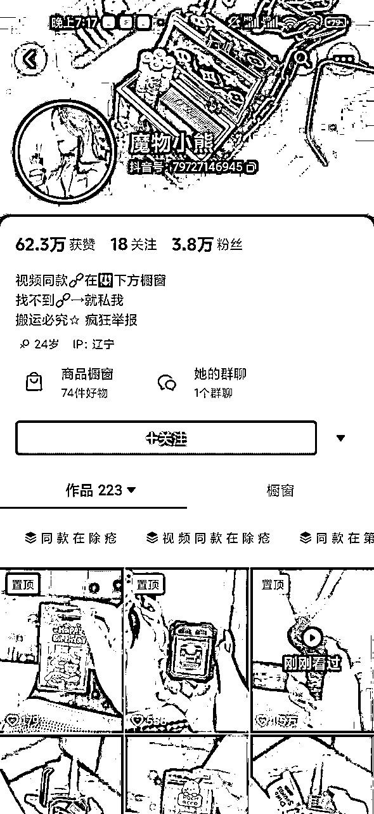
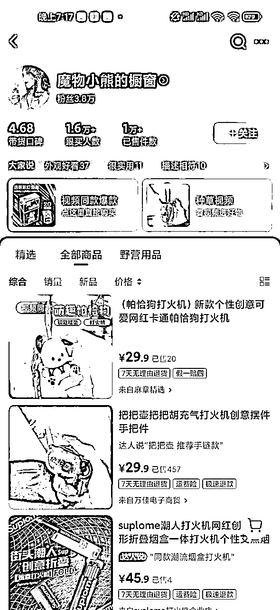

# 抖音蓝海选品的实操打法

> 来源：[https://kib0lcw2xe.feishu.cn/docx/T744dgW9yoT00VxzZIXccdUlnCd](https://kib0lcw2xe.feishu.cn/docx/T744dgW9yoT00VxzZIXccdUlnCd)

赚钱的伙伴们大家好，我是古辛，目前在负责选品航海的教练工作，今天聊聊团队现在正在跑的抖音选品思路。

我之前深耕淘宝蓝海，后来逐步转战抖音、小红书，目前抖音已经做了快两年，也有了一些可复制的成绩。刚上手时，我也以为抖音和淘宝的选品逻辑是通的，干的时间长了才发现，两者差别其实很大。

# 抖音选品和淘宝选品到底差在哪

## 1. 竞争的赛道不一样
淘宝、拼多多这类搜索电商，流量拼的是排名。谁的链接能排到第一，谁就能吃到最多的自然搜索量。所以做竞争分析，本质上就是判断把一个链接顶到首页有多难，所有人都盯着同一个名次打。

抖音是典型的内容电商，流量靠系统推荐。只要内容足够有差异化，能让观众点赞、收藏、评论、转发、看完，就能拿到分发。哪怕同行已经很多，只要你的表达方式不一样、更抓人，就依然有机会。

简单说，淘宝拼排名，抖音拼整活。谁的短视频做得更出圈，谁就能获得流量。

## 2. 对品类体量的敏感度不同
搜索电商里，一个月净赚五六千的单品，也完全可以单独开一条链接去做。抖音就没那么宽容，它对品类天花板有要求。品类太小、盘子太窄，做起来费劲，而且不值得投入精力。

所以在抖音选品，必须先看品类能不能养活。只有体量足够大的赛道，才值得去布局。

## 3. 选的不是SKU，而是对标账号
做淘宝的时候，表面上是在选产品，实际上好的玩家都在找对标店铺去模仿、超越，只是当时找不到系统的方法。抖音更直接，我们选的根本不是具体商品，而是能赚钱的“对标账号”。

找到合适的对标账号后，把它的内容打法、玩法拆解清楚，再做差异化复刻，盈利路径就清晰了。产品反而是后置的——对标账号卖什么，我们就跟什么。

# 我们现在在用的几种选品方式

## 1. 直接刷短视频选品
因为抖音选品的核心是找对标账号，所以最有效、最快的方式就是刷短视频，没有之一，前提是你能管住自己。

人赚不到认知之外的钱，选品同理。传统搜索选品最大的问题是，你得知道关键词是什么，没有词根就无从下手。抖音的推荐机制不一样，不需要你有方向，持续刷就能不断拓宽认知边界，撞见你从未想过的品类和玩法。

比如有一个账号，全部内容都围绕打火机做，223条视频涨粉3.8万。

橱窗成交一万多单。打火机谁都认识，但能把打火机做成这样的人不多。

看上去很简单，实操起来却很难。你表面上是在对抗推荐算法，实际上是在对抗自己的欲望。刚开始我刷半小时，往往一个品也选不出来，因为很快就掉进兴趣推荐的漩涡，关掉App才发现时间没了。

后来通过刻意训练，强迫自己带着选品目的去刷，才慢慢稳定产出。现在我们产品库里认知外的品，绝大多数都来自这条路径。

到现在我也不敢说完全掌控了这套方法，一放松就容易被算法和人性带跑。如果你是新手，建议先从其他方法入门，等有了一定盈利能力，再回来练这套“刷视频找认知”。

## 2. 刷抖音直播间选品
这套方法的效率仅次于刷短视频，也能找到不少可复制的对标账号。局限在于，并非所有账号都在直播，有些只做橱窗，有些导流到私域，所以覆盖面会打折。

抖音顶部就有直播入口，点进去可以一直刷。

对起步阶段的朋友很友好，可以先从这里入手。

## 3. 用第三方数据工具
我们刚做抖音时也用过考古加这类工具，现在基本不用了。用来找对标账号，效率远不如直接刷视频来得直观。

不过对于新手来说，数据软件仍有价值。效率虽低，但只要肯花时间，还是能筛出机会。尤其是自控力不足的人，直接刷短视频很容易只收获情绪价值，刷得很爽但啥也没干。

## 4. 跨平台找灵感
偶尔我们也会去其他平台找方向。比如贴吧，我们在做小众爱好类目时，贴吧是宝库。国内几乎所有的小众圈子，在贴吧都能找到聚集地，如果连贴吧都搜不到人，这个品类大概率不值得做。

再比如美篇，主要用户是体制内退休的老年人。如果你的目标人群是中老年人，美篇里的内容和需求，能给你很多选品灵感。

以上就是我们团队当前在抖音上实际使用的选品打法，希望对你在短视频赛道的选品能有帮助。

我是古辛，专注选品，欢迎大家在选品问题上和我交流。